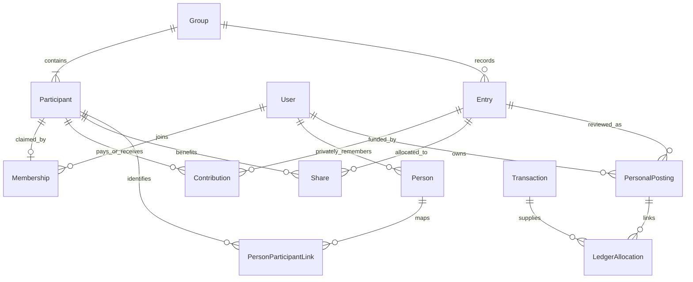

# Shared expenses and settlements

Current delivery boundary: `docs/specs/shared-expenses-ui-polish.md` section 0
supersedes the private-finance creation and Transactions handoff behavior below.
New booking is deferred; existing private records remain readable/unlinkable.
The accounting definitions below are retained for those accepted records.


Status: **implementation authorized by the requesting user on 2026-10-25**.
This records local authorization, not upstream maintainer approval. On 2026-10-27
the requester asked to publish a Draft PR and Discussion to seek that approval
while verification continues; no approved-to-build label is claimed.
Date: 2026-10-25. Based on Monize `b9ee599b2`.

This specification defines the product, financial meaning, screens, data and
acceptance criteria. It does not implement the feature or constitute the later
implementation plan. The user confirmed both modes: manage expenses for named
people without accounts, then optionally invite those people to collaborate.

The [research companion](shared-expenses-research.md) records existing Monize
capabilities, official Tricount sources and pinned Spliit/SplitPro code references.
The [UX and document contract](shared-expenses-ux.md) is part of this draft:
it specifies split editing, files independent of expenses, private publication,
screen states and usability acceptance scenarios. Arithmetic remains defined here.
The proposed English feature name is **Shared expenses**; Polish navigation is
**Rozliczenia**. English is used here for repository review; Polish labels below
illustrate the intended UX, not literal strings to hardcode.

## 1. Product outcome

Record a trip, shared home, dinner or expense with one friend. Answer three
questions immediately: **what was my share, who should repay whom, and what has
already reached my accounts?** Starting a group requires names, not invitations,
bank accounts or accounting configuration.

Example: I pay PLN 300 for dinner for three people. The group shows my cost as
PLN 100 and my receivable as PLN 200. If I include this in Monize finances, my
bank account decreases by PLN 300, spending increases by PLN 100 and a settlement
receivable increases by PLN 200. A later PLN 100 repayment increases bank cash
and decreases that receivable; it does not create income.

The product combines Spliit's simple group entry, SplitPro's people-oriented
overview and Monize's existing financial ledger. It is a native Monize feature,
not an embedded upstream application.

## 2. Proposed release boundary

“Required” describes the first useful release of this proposal, not a claim
about code already present. One concern is shared expenses; the eventual plan
may divide its delivery into reviewable PRs with an agreed dependency order.

| Capability | Proposed scope | Reference or distinction |
| --- | --- | --- |
| Named groups, named non-user participants, optional invitations | Required | Both user-requested modes in one group/history. |
| Equal, exact-amount, percentage and weighted-share splits | Required | Tricount's common cases; explicit percentage/weight modes as in the OSS references. |
| Several payers for one expense; payer need not be a beneficiary | Required | Native contribution records; the inspected OSS schemas each use one payer per expense. |
| Expenses, refunds, group income, repayments | Required | Separate meanings and totals; a refund is not a repayment. |
| Original currencies and one fixed settlement currency per group | Required | Tricount-like balance reading; rates frozen when accepted. |
| Suggested repayments, partial payments and payment history | Required | Suggestions reduce transfers; payment records affect balances. |
| People view across groups; private optional payee links | Required | No implicit merging or settlement across groups. |
| Existing transaction picker and optional personal-finance posting | Required | The key Monize integration, with preview and duplicate protection. |
| Receipt photos/PDFs, group files independent of expenses, activity, search/filter, CSV export, archived groups | Required | Reuse Monize upload, scan and preview patterns; publication has explicit scope. |
| In-app notifications and existing optional push delivery | Required for collaboration | Per-group mute and no bank details in shared notifications. |
| Offline financial edits with later synchronization | Later | Tricount supports this; an installable Monize PWA is not equivalent. |
| Recurring shared expenses, line-item receipt allocation/OCR | Later | Reuse existing recurrence/document infrastructure only after a separate behavior specification. |
| Tricount/Spliit/SplitPro/Splitwise import | Later | Requires real exported fixtures and an explicit fidelity contract; no assumption of compatible APIs. |
| Anonymous public group access, cross-instance federation | Outside first release | Invitees authenticate on the same Monize instance; unregistered friends can remain named participants. |
| Payment initiation, BLIK/bank links, card/eSIM services | Outside this feature | “Record repayment” means record a fact, not send money. |
| Automatic netting between groups, pooled household wallets | Later | Group consent and ownership are materially different from individual expenses. |

Accounting integration, membership authorization and receipt sharing are material
changes to shared areas. The approving Discussion must include those boundaries
under [CONTRIBUTING](../../CONTRIBUTING.md). This document does not grant that
approval or change a guard, dependency, deployment file or schema.

## 3. Vocabulary and identity

| Concept | Meaning | Relationship |
| --- | --- | --- |
| Monize user | An authenticated account on this instance | May claim one participant per group through an accepted invitation. |
| Person | A private, reusable contact in my settlement address book | May map to several group participants and optionally to one of my payees. |
| Group participant | A stable identity in one group, with a display name | Exists without a login; financial history references its ID, not its name. |
| Membership | Permission for an authenticated user to access a group | Separate from being named in an expense and from account delegation. |
| Payer/recipient | Person who actually paid/received external money | Can differ from the author of the record and from its beneficiaries. |
| Beneficiary | Person assigned a cost or income share | May have paid nothing and may be excluded from another expense. |
| Bank/cash account | An existing Monize account containing actual movements | Private; an account ID is not a participant ID. |
| Settlement account | Optional managed private account for receivables/payables | Holds the user's accepted group position, not available cash. |

Adding “Anna” creates a group participant and, optionally, a private Person.
It does not create a login, payee or bank account. An invitation later binds
Anna's authenticated membership to the same participant ID; prior shares stay
attached. Matching names or email strings alone never claims or merges history.

A private Person may be reused across groups after explicit selection. Two Annas
remain distinct. A contact/payee merge changes private mappings, not historical
group allocations. “I am this person” is an identity claim validated through the
invitation, not a freely editable browser preference for a claimed participant.

## 4. Navigation and screen contracts

Add Rozliczenia through the existing navigation registry and mobile drawer.
Keep the current six desktop primary links usable; expose the feature through
the Tools menu and a dashboard shortcut rather than overflowing the header.
Entry points also exist on a transaction, account register and linked payee.

The following routes are proposed UI contracts, not existing source paths.

| Screen | Main content | Primary action and states |
| --- | --- | --- |
| `/shared-expenses` | Tabs Groups / People; receivable and payable summaries shown separately; active/recent group cards with my position | New group; empty state offers a trip or two-person group. Archived filter does not remove debts from totals. |
| `/shared-expenses/new` | Group name, participants with “You” included, currency, optional description | Create group; invitations and finance setup are optional subsequent actions. |
| `/shared-expenses/:groupId` | Summary, expenses/income/repayment timeline, search and person/type/date filters | Add expense; clear loading, failed, empty, archived and incomplete-rate states. |
| Group Balances tab | Each person's paid amount, own cost and net position; proposed debtor-to-creditor payments | Record repayment; explanation of simplification; no action based on stale/incomplete balances. |
| Expense create/detail | Amount, description, payer, beneficiaries, split; optional receipt/category/date/FX; private finance section | Save or Review changes; visible allocation remainder and preview of my cost/position. |
| Repayment editor | From, to, discharged group amount, date, actual payment currency/amount, optional private account match | Record repayment; partial amount supported; no “Pay now” wording. |
| Group People/settings | Participants, membership state, roles, defaults, currency and archive controls | Add person / Invite; distinguish removing access from removing an unused participant. |
| Group Activity tab | Who recorded/changed what, date and financial before/after | Open affected item; private account details absent. |
| Group Files tab | Group documents and entry receipts, with parent/title/uploader and thumbnails | Add photo/PDF without an expense; open linked expense; filter group-only files or receipts. |
| `/shared-expenses/people/:personId` | Related groups and entries, with payable/receivable positions by group and currency | Add expense with this person; settle within a selected group. |
| Invitation landing | Inviter/group identification after authentication, proposed participant and access role | Accept or decline; expired, consumed, revoked and wrong-recipient states. |
| Private finance review | Group revision versus last accepted personal posting; affected rows and account effects | Apply reviewed changes, resolve mapping, or leave pending. |

Proposed mobile group composition:

```text
Weekend in Krakow                    People / Settings
You are owed 200.00 PLN               [Why?]
Your cost 100.00 PLN    Group expenses 300.00 PLN
Your finances: up to date

Expenses     Balances     Files     Activity

Dinner                               300.00 PLN
You paid · 3 people · your share 100.00 PLN
Today · Receipt available

                         [ Add expense ]
```

The main balance uses a sentence, not an unexplained signed number. “You paid”,
“Your cost” and “You are owed” are distinct labels. Settlement suggestions say
“Anna pays you PLN 100”, while a person's group position says “Anna owes the
group PLN 100”; the latter does not assert a direct bilateral debt to the reader.

## 5. Fast expense entry and interaction quality

The default editor presents four decisions: amount, description, who paid, and
who participated. Today, the current member as payer, group currency and equal
split across active participants are defaults. A person recording on behalf of
someone else changes the payer explicitly; author and payer remain distinct.

“Split equally” opens a focused editor with four modes. Amounts stay visible
beside names; deselecting a participant removes that share before preview.
“Several people paid” reveals contribution amounts whose sum must match the
expense. Weighted shares explain the unit, e.g. nights: 2, 2, 1.
Exact amounts offer explicit remainder distribution and an extras-plus-equal
helper. Both produce visible exact shares; neither silently normalizes typed
amounts. Mode, total and participant changes follow the UX companion's table.

Use a desktop `Modal` and the existing responsive modal behavior on phones.
The save action remains reachable above the software keyboard. Advanced options
are collapsed until needed; an edited field with an error is expanded and focused.
Back/close uses the existing unsaved-changes pattern. Saving does not silently
apply a newly fetched exchange rate or reset a typed date.

Reuse `Card`, `Badge`, `EmptyState`, `DateInput`, `CurrencyInput`, `NumericInput`,
`InfoTooltip`, `useFormModal` and `useNumberFormat`. Extend the shared money input
for currency precision where required; do not add a competing parser. Existing
date/money controls already provide keyboard and calculator behavior. All labels,
errors, notifications and accessibility names follow the English-first i18n flow.

UX acceptance targets, to be measured with the implemented feature:

- A prepared user can create a group and its first equal expense within 60 seconds;
  adding the next ordinary expense takes at most 20 seconds, excluding receipt upload.
- At 360 px width there is no page-level horizontal scrolling; controls have at
  least a 44 px touch target, amounts wrap deliberately and a keyboard can reach
  every action. Focus returns to the initiating control when a dialog closes.
- Color is supplementary: owed/owing, pending and failed states also have text.
  Dark mode, reduced motion and long translated names remain usable.
- Validation names the correction: “PLN 10 remains to allocate”, not “Invalid split”.
  Missing data, failed requests, pending synchronization and known zero look different.
- Saving has one pending state; a lost response offers retry/status recovery for
  the same operation key, not a second uncorrelated submission.

## 6. Primary flows

### A. Start alone, then invite

Create “Weekend”, add Anna and Bartek by name, enter expenses immediately. Later,
invite Anna to her existing participant. Anna signs in/registers where instance
policy allows, accepts, sees the group's prior history and can add entries.
Bartek continues without a login. Nothing is reallocated by the join.

The invitation states that joining reveals the group's history to the invitee
and makes their group entries visible to its members. It shares no accounts.
When registration is disabled, the owner can keep recording for that person;
group invitations do not bypass the instance's registration policy.

### B. Start from an imported bank transaction

On the PLN -300 restaurant row choose “Split with people”, choose a group and
beneficiaries. Date, amount, currency and description are prefilled. Review the
shared description and choose which receipt, if any, to publish to the group.

The private preview says: bank movement unchanged, your cost PLN 100, receivable
PLN 200. Confirming saves the group record and the caller's bridge in one
`withScopedDb` transaction. It keeps the original bank row ID and external import
identity. If an earlier manually entered group expense matches, the user links
to that expense instead of creating another one. Date/amount/payee matches are
suggestions, not automatic identity.

### C. Someone else paid

Anna pays PLN 120 for Anna and me. Group shares are PLN 60 each; my position is
PLN -60. I may include my PLN 60 cost and payable in my finances without a bank
movement. When I actually repay Anna, selecting my bank row or recording cash
settles the payable. Anna's account is neither requested nor modified.

### D. Settle partially or in full

Choose a suggestion, edit PLN 100 to PLN 40, and record the observed repayment.
The remaining position is PLN 60. Optionally match/create my own bank/cash row;
the other participant independently matches their side. If two members record
the same suggested payment concurrently, its revision guard accepts one and
returns the recorded result/conflict for the other without a second effect.

A repayment is a group assertion that money moved, not proof of bank settlement.
No recipient-approval step is required for the balance to change; the UI shows
who recorded it. A mistaken payment can be reversed with an auditable reason.
An unrelated editor cannot record a payment between two other claimed members;
the owner may record it on their behalf.

### E. Refund, income and later corrections

“Refund this expense” preselects its beneficiaries and shares, capped by each
person's remaining refundable allocation. A refund received by the original
payer reduces that person's receivable and everyone's affected cost. A distinct
group income is distributed to its beneficiaries and shown separately from
expense refunds. Editing a settled expense changes current balances; it does not
erase already recorded repayments. A formerly settled group can become owing again.

A linked refund reverses the source's accepted original/group allocations and
rate, up to the unrefunded remainder. Several partial refunds together cannot
reverse more than the source allocated; the last refund takes the stored residual.
An actual bank refund at another rate exposes a private FX difference. Revising
the original below an already refunded share is refused until the related refunds
are corrected in an explicit combined preview.

### F. Correct a linked entry

Compare the proposed group edit with the stored revision. Group editors can
change the shared facts within their permissions, but cannot submit private
account IDs. A changed financial revision marks each affected personal bridge
as needing review, based on that participant's input fingerprint. An unrelated
participant's expense or a membership change does not create private review work.
The owner of each ledger accepts its delta separately;
ordinary metadata edits with unchanged amounts/shares/rates do not reprice it.

## 7. Two layers of financial truth

The **group journal** answers the agreed allocation and repayments. The
**personal ledger** answers the money in my accounts and the costs/claims I have
chosen to book. They have explicit links and revision states, not two independently
editable copies pretending to be synchronized.

Recommended bridge: one managed settlement account per `(user, group)`, in the
group's fixed currency, using existing `OTHER` account semantics plus a proposed
explicit managed-purpose marker. Its sign may be positive (receivable), negative
(payable) or zero. It has zero opening balance and derives its balance from its
ledger rows through existing account mechanisms. Do not write a group balance
directly into `accounts.current_balance`.

The managed-purpose marker must control pickers, reports and mutation policy;
neither the account name nor `OTHER` alone identifies it. It is shown in a
separate “Settlements” section, included in net worth by the user's usual choice,
and excluded from available-cash, banking-sync and saving/loan-target choices.
It is not an investment, a loan schedule or a jointly shared bank account.

### Posting truth table, all figures in PLN

`C` is my private settlement account. Each transfer has two ordinary linked legs.
The cost/income row is separate and carries my own category/payee mapping.

| Accepted fact | Bank/cash effect | Rows in C | Personal spending/income | Group position for me |
| --- | --- | --- | --- | --- |
| I pay 300; my share is 100 | -300, transferred to C | +300 funding; -100 expense | Expense 100 | +200 |
| Anna pays 120; my share is 60 | None | -60 expense | Expense 60 | -60 |
| Anna repays me 100 | +100, transferred from C | -100 transfer | Neither | Decreases by 100 |
| I repay Anna 60 | -60, transferred to C | +60 transfer | Neither | Increases by 60 |
| I receive a 60 refund; my refund share is 20 | +60, transferred from C | -60 transfer; +20 expense reversal | Expense reduced by 20 | Decreases by 40 |
| I receive group income 90; my share is 30 | +90, transferred from C | -90 transfer; +30 income | Income 30 | Decreases by 60 |
| Group-only entry, no finance integration | None | None | No new ledger entry | Group journal only |

This intentionally books consumption when the expense occurred, including an
expense paid by someone else. It does not wait for repayment to recognize the
cost. When an expense and its bank booking have different dates, both dates are
preserved; the reconciliation view explains timing differences.

### Personal consent and completeness

Default at group creation is “Group only”. “Include in my finances” creates the
managed account only after a preview. For my own new entry, Save may also accept
its personal posting. Entries or financial changes authored by others enter my
review inbox; no background job writes my bank ledger from their edit.

All contributions/receipts/repayments attributed to me in an integrated revision
need explicit bank/cash mappings or newly recorded real movements. No fabricated
bank account or “cash paid” assumption fills a missing mapping. A pure beneficiary
can book their cost without one because they made no payment.

The bridge states are `GROUP_ONLY`, `READY`, `POSTED`, `NEEDS_REVIEW` and
`NEEDS_MAPPING`. The accepted rows stay at their accepted revision until reviewed.
The group screen shows the live agreement; personal reports show booked figures
with a named pending-review count and an action to resolve it. A field claiming
the current group position has `null` while required mappings/revisions are
pending, with the booked position in its own field. Do not label the booked
position as synchronized or silently add the live group balance to net worth.

Disconnecting integration stops future posting, not erases existing financial
history. Closing a nonzero settlement account or deleting a linked account needs
an explicit reviewed resolution. The user can settle, retain the historical
account, or reverse a mistaken posting; an archive action never forgives debt.

### Bank-row linking rules

- Match only the caller's owned, writable bank/cash rows in this release. An
  owner's joint account is usable as their owned account; a foreign joint-account
  grant alone does not authorize this bridge. Group recording still works.
- One bank row may fund one shared entry, with multiple contributions within that
  entry if needed. A partial shared portion leaves the private remainder in
  category splits. Multiple groups sharing one bank row are deferred.
- Lock the bank row and validate its financial fingerprint, status, ownership and
  unclaimed allocation. Preserve its amount, date, reconciliation and import ID.
  Imported rows are transformed/reclassified in place, not copied as another debit.
- A plain whole-row conversion can reuse `convertRowToTransfer` for its existing
  same-currency domain. Cross-currency and partial conversions need a reviewed
  domain operation; its current same-currency check is not removed casually.
- Existing category-only splits can allocate selected portions after preview.
  Investment/loan-generated rows, transfer splits and unrelated existing transfer
  pairs are refused with a reason in the first release. Reconciled rows respect
  the existing strict reconciliation lock.
- A manual cash movement created by the bridge is distinguishable from a linked
  imported row. Later matching an import replaces the manual movement only in a
  reviewed merge preserving one net effect; it does not book a second payment.
- Generic update, split replacement, delete, VOID, bulk, rule, undo, AI and MCP
  paths must refuse structural changes to linked/managed rows unless they use the
  bridge command. Private non-financial notes may change without a group edit.

### Reports and other consumers

Global spending, budgets and category reports read the posted category rows in C;
repayments remain transfers. Receivables/payables reach net worth through C once,
not by adding group totals again. Category filters and budget exclusions continue
to honor the user's configured account scope.

An account-only register or cash-flow view still shows the actual bank outflow,
with a “Shared expense; your share” link. Its caption does not call PLN 300 my
consumption. A report restricted to that bank account does not secretly include
other accounts; it offers a link to the personal shared-cost view. A managed
settlement transfer is classified as “Shared settlements”, not savings/investments
merely because C uses `OTHER`. The Sankey identity must still close.

The implementation must enumerate dashboard, budget actuals/alerts, built-in and
custom reports, exports, account forecasts, net worth, AI and MCP consumers of
these rows. They read the same projection state and completeness reasons. New
shared-expense AI/MCP mutation tools are deferred together; existing generic
tools must respect the linked-row refusal and explain it.

## 8. Group arithmetic, precision and currencies

Store money at `NUMERIC(20,4)` and rates at `NUMERIC(20,10)`. Calculation uses
exact scaled integer arithmetic; decimal strings cross the proposed API boundary
without a lossy JavaScript float accumulation. Validate representable range and
currency precision before converting values for existing helpers.

For a committed entry of original amount `A > 0`, contributions sum to `A` and
beneficiary shares sum to `A`. Explicit type determines whether it is expense,
refund or income; negative UI input offers the appropriate type instead of
creating an ambiguous negative expense.

Repayments instead have the two distinct endpoints and discharged amount; they
do not create a beneficiary split. A two-person group is also the representation
of a one-off expense with a friend, keeping one arithmetic and permission model.

### Allocation

- Equal and weight modes use largest-remainder allocation in that currency's
  minor units. Percent mode first validates a total of 100%; exact mode validates
  the amount sum. Neither mode rescales an invalid user-supplied total.
- Break equal remainders by sorted stable participant IDs with an entry-specific
  rotation. Persist the allocation version/rounding seed and the resulting shares;
  preview and commit use the same server resolver and seed. Renaming/reordering
  participants or reopening a form must not redistribute a cent.
- Currency precision comes from `currencies.decimal_places` (0 through 4 supported
  here). Preserve a bank row's extra stored decimals. A difference from the shared
  portion stays a disclosed private remainder, not an invisible rounding write.
- Percentages/weights express allocation instructions; persisted final shares
  express the accepted obligation. Removing a person later does not recompute them.

### One settlement currency, three possible money amounts

The group selects its settlement currency at creation; it is locked after the
first committed financial entry. Changing it would change debts, so create a new
group rather than relabel history. The receipt currency, group currency and
private account currency can all differ.

For each expense, store the original amount, original shares/contributions,
accepted rate to group currency, rate date/source and resulting group amounts.
Convert the total once, then apportion the converted total among contributors
and beneficiaries separately using their original amounts as weights. Each side
sums to the same converted total. Do not independently round every person's FX
conversion and accept a nonzero group residue.

Use `resolveFxRate`/`ExchangeRateService` for the entry's date, `roundFxRate` for
rates and the existing FX validation/conversion abstractions at ledger boundaries.
A stored explicit rate wins on later reads. Fetching a current rate, renaming an
entry or editing its note does not change an accepted obligation. An explicit
financial repricing is a new revision with an impact preview.

A bank conversion can differ from the group's agreed conversion. The preview
separates the agreed share from my actual settlement and private fee/FX difference.
For example, a EUR 100 bill agreed at PLN 430 but charged as PLN 440 becomes a
PLN 430 transfer to C plus a PLN 10 private FX/fee category line, with consent.
The bank total remains PLN 440. Sharing that extra PLN 10 requires a separate
group expense or an explicit change to the agreement. Same-currency transfer legs
still have equal amounts; the difference is not hidden in a false exchange rate.

Repayment stores both the group-currency debt discharged and the actual amount
sent/received. Settlement suggestions use the group currency; an agreed foreign
repayment requires an explicit conversion preview. A later bank fee does not
silently alter everyone else's debt.

### Balance equations

All terms below are in the group's currency and use accepted, non-reversed entries:

```text
balance(person) = expense contributions - expense shares
                - refund receipts + refund shares
                - income receipts + income shares
                + repayments sent - repayments received

positive balance = the person should receive money
negative balance = the person should repay money
sum(balance(person)) = 0

group net expense = expenses - expense refunds
my net cost       = my expense shares - my refund shares
group income      = income entries, shown separately
repayments        = excluded from expense, cost and income totals
```

Group positions are derived from the journal. Persisted projections are caches
tagged with the group financial revision and calculation version, not separately
editable totals. In a fresh empty group, every total and position is known zero.

### Repayment suggestions

Derive debtor and creditor lists from net balances, match them deterministically
and settle the smaller remaining position at each step. Use stable participant
ordering to avoid reshuffling the list unnecessarily. For `n` nonzero positions
this construction needs at most `n - 1` suggestions; it is not a proof of the
globally smallest possible number of transfers.

The suggested edges are a read model, not historical IOUs or payments. Recording
one changes the journal; merely regenerating suggestions changes nothing. “Why
this person?” explains group netting and links to the person's entries. Direct
expense attribution remains readable. A person overview across several groups
keeps each group's payments separate; a net overview is not an instruction to
transfer money across those groups.

People rows show suggestions involving the reader, labeled as suggestions, plus
their group context. They do not reinterpret another person's whole group debt
as a debt to me. Across-group summary cards sum my positive and negative positions
separately; any reporting-currency conversion is an as-of valuation through
`FxAggregate`, with named rate gaps, and does not change the settlement currency.

## 9. Missing data and failure truth table

| Condition | Store/read behavior | User action |
| --- | --- | --- |
| Empty group or zero remaining debt | Numeric zero; empty suggestion list | Add expense or archive. |
| Same currency | Rate 1 without provider lookup | No FX configuration. |
| Foreign entry with no usable dated rate | Save a clearly labeled unresolved draft; original amount remains visible | Retry fetch or enter an agreed rate/date. |
| An unresolved shared draft describes an expense already incurred | Group settlement readiness is false; full group totals/positions are null, committed subtotals named separately | Resolve or discard the draft before suggested settlement. |
| A future/planned expense draft exists | Excluded from current positions and totals; listed as planned, with no automatic posting | Confirm the expense after it occurs. |
| Provider request failed | Preserve entered values; show provider failure, not “no rate exists” | Retry or supply rate. |
| Read request pending/failed | Loading/error; retain last successful data with stale label where useful | Retry; do not render a false empty group. |
| User has no linked bank row or category mapping | Group arithmetic works; personal projection needs mapping | Select/create actual movement or keep group-only. |
| Group revision changed after private posting | Group balance current; private booked position labeled with pending changes | Review before claiming personal integration is current. |
| Receipt unavailable | Financial record remains readable; receipt has its own error | Retry attachment read/upload. |
| Inaccessible or revoked group | Uniform unauthorized-resource response; clear cached protected payload | Return to own group list. |

Before declaring an FX gap, use the existing bounded provider-fill behavior and
re-read stored rates. Failed calls do not become successful no-data observations.
Draft resolution uses a write/preview against its revision; a background market
fetch cannot silently commit previously unaccepted debt.

## 10. Numerical acceptance examples

The IDs A, B, C in the rounding examples describe the deterministic tie order.
These are expected results for independent regression fixtures.

| Case | Expected allocation/position |
| --- | --- |
| A pays PLN 300, equal A/B/C | Shares 100/100/100; positions +200/-100/-100; group expenses 300. |
| Above, B repays A 40 | Positions +160/-60/-100; expense total still 300; suggestions B to A 60 and C to A 100. |
| PLN 100 split equally three ways | Shares 33.34/33.33/33.33 for the stated tie order; exact sum 100, no disappearing cent. |
| PLN 0.01 among three people | Shares 0.01/0/0; zero-share people need no repayment for that entry. |
| JPY 100 among three; KWD 1 among three | 34/33/33 JPY; 0.334/0.333/0.333 KWD. |
| PLN 100, weights 2/1/1 | 50/25/25. |
| PLN 250, percentages 50/30/20 | 125/75/50. Percent sum 99 is rejected. |
| PLN 100, exact amounts 50/30/19 | Reject with 1 left to allocate; no committed entry or bank change. |
| PLN 90, A pays 60 and B 30; only B/C benefit equally | Positions A +60, B -15, C -45; beneficiary shares B45/C45. |
| EUR 60 at 4.30 PLN/EUR, A pays, A/B/C equal | Group 258 PLN, shares 86 each, positions +172/-86/-86. A later rate 4.50 leaves this unchanged. |
| EUR 0.01 at 4.30, split equally three ways | Group total 0.04 PLN; apportion original shares first, then group amounts from those shares; do not invent equal 0.0133 PLN debts after one participant received the original cent. |
| A paid PLN 300 equally; A receives refund 60 | Net expense 240; net costs 80 each; positions +160/-80/-80 before repayments. |
| A receives group income PLN 90 equally | Income shares 30 each; positions -60/+30/+30; expense total zero. |
| Above dinner fully repaid, then refund 60 to A | Positions -40/+20/+20; earlier payments remain; A now owes the others. |
| A pays PLN 300; own ledger opening bank 1000 | After integration bank 700, C +200, expense100, net worth900. After B repays100: bank800, C100, net worth900. |
| Bank debit PLN 100.0001; shared portion 100.00 | Preserve debit100.0001; group100.00; private remainder0.0001 explicitly previewed. |
| One PLN 100 entry plus unresolved EUR 10 entry | Group total null, known subtotal100 PLN and named EUR/PLN/date gap; no full settlement suggestion. |

Test caps/overflow with the actual DTO range, including rejection of values above
it; accepting `NUMERIC(20,4)` does not authorize unsafe Number arithmetic.

## 11. Proposed data contracts

Names below describe proposed entities, not files or tables already implemented.
Physical schema and endpoint naming are settled by the subsequent plan.



| Record | Required content and constraints |
| --- | --- |
| Group | UUID, owner user, name, description, fixed currency, lifecycle, financial revision and default allocation template. Owner membership created in the same transaction. |
| Participant | UUID, group ID, display name, stable ordering/rounding identity, active/inactive state. Referenced participants are inactivated, not cascade-deleted. |
| Membership | Group/participant/user, role, active/revoked state, joined date. Unique active user per group and active claim per participant. No automatic self-issued membership. |
| Person and private mapping | Owner user, private name, optional own payee and verified user association; participant mappings checked against groups the caller can read. |
| Invitation | Group, intended participant/role, optional intended verified address, hashed high-entropy token, expiry, consumed/revoked metadata. No plaintext token persisted or logged. |
| Entry | Group, type EXPENSE/REFUND/INCOME/REPAYMENT, date, title, bounded note, original/group amounts, currencies, frozen FX provenance, allocation mode/version, revision, actor and reversal metadata. REFUND references its source expense. |
| Contribution / Share | Entry and same-group participant, original and group amounts; allocation instructions retained. Unique participant allocation per entry; exact sum checks under the entry/group write protocol. |
| Repayment details | Distinct from/to participant IDs, group amount discharged, actual currency/amount/rate, actor/date; references for suggestion revision or reversed payment. |
| PersonalPosting | Owner user, group/participant/entry, accepted financial revision, managed account, private category/payee mapping, state and input fingerprint. Unique projection per user and source entry. |
| LedgerAllocation | Personal posting, original transaction/split, allocated signed amount, contribution/payment identity, created-versus-linked provenance and before-shape for reviewed reversal. One entry claim per source row; allocation capacity checked under row lock. |
| Activity | Append-only group action/revision, real actor, timestamp, public before/after summary. Private bank snapshots are held separately. |
| Shared document | Exactly one authorized group or group-entry parent plus existing attachment metadata/lifecycle; uploader, display name and document revision. Publishing a private document creates a new shared copy with independent bytes/access/retention; private origin references stay private. |
| Command receipt | Actor/group/operation key, normalized payload hash, resulting resource/revision. Unique key commits with its financial effect. |

Every child reference must be checked against the same group; composite foreign
keys should enforce `(group_id, participant_id)` membership where possible.
Non-negative amounts, distinct repayment endpoints, supported types, bounded
fields and enum parity belong in constraints as well as DTO validation. Aggregate
sum validation runs under the group lock before commit; a plain row CHECK is not
claimed to enforce a sum across child rows.

An entry may carry an optional shared category label, explicitly published with
the entry. It is not another user's private category ID. The private posting maps
it to the reader's own category; choosing Uncategorized is a valid explicit
mapping, not missing data. A private payee mapping follows the same ownership rule.

Proposed bounds: 50 participants per group, 120 characters for a group/entry title,
80 for a participant name, 60 for a shared category label, and the existing
`TRANSACTION_NOTE_MAX_LENGTH` for entry notes. Lists default to 50 rows and cap at
200; contribution/share arrays cap at the group participant limit. Ordinary dates
follow Monize's existing calendar-date validation; future expenses remain drafts
and do not change today's debt. Invitation lifetime is seven days, with explicit
revoke/reissue. Money input/bridge limits must honor the existing transaction DTO
limit and reject unsafe numerical conversions; storage precision alone is not a
promise to accept every database-representable number through existing helpers.

Proposed read models contain `currencyCode`, `financialRevision`, `calculationVersion`,
`settlementReady`, nullable totals, explicitly named known subtotals and structured
`missingReasons`. Personal responses add accepted revision, projection state,
booked position and actionable pending-change items. Decimal amounts have one
wire representation. Group responses omit private account, transaction, payee,
institution and category IDs even when their fields would otherwise be null.

The API needs group/member/invitation operations, entry preview/create/revise/reverse,
balance/suggestion reads, repayment record/reverse, private posting preview/apply,
transaction candidates, activity/document access and export. Mutations carry an
operation UUID and the relevant revision: group/entry for financial changes,
document for file edits. Preview and
commit invoke the same resolver; ownership IDs come from the authenticated context.

## 12. Roles, sharing and RLS

| Operation | Owner | Editor member | Viewer member | Named person without membership |
| --- | --- | --- | --- | --- |
| Read shared entries, balances, receipts, activity | Yes | Yes | Yes | No |
| Add an expense/income/refund | Yes | Yes | No | Owner/editor records on their behalf |
| Revise/reverse an entry | Any, with history | Own authored entry | No | No |
| Add group/entry documents | Yes | Yes, including another author's readable entry | No | No |
| Rename/remove group documents | Any, with activity record | Own uploads, with activity record | No | No |
| Record repayment | Any participants | Payment involving their claimed participant | No | Owner records it |
| Invite/revoke/change roles/archive | Yes | No | No | No |
| Link/post private accounts | Only their own | Only their own | Only their own accepted shares | No |
| Read another member's private financial data | No | No | No | No |

Regular group data uses authenticated JWT routes and `withScopedDb`. A request
operates under the real user in their own context; acting-as delegation is not
group membership and is refused for these first-release routes.

New policies classify shared parents/memberships explicitly and children through
their group. Membership read and write permissions are separate; a read policy
is not copied into `WITH CHECK`. RLS must not recurse through group/membership
policies. A narrowly scoped, registered database membership predicate may be
needed, as existing delegation already requires one; the plan must document its
privilege boundary and exercise it under `RLS_MODE=enforce`. Ordinary group access
does not run through a blanket system bypass. No exemption-list expansion is
assumed by this proposal.

Invitation acceptance requires authentication and a valid unexpired token bound
to that participant; a targeted invitation also verifies its intended address.
A conditional consume and uniqueness constraints arbitrate concurrent claims.
A general invitation can request membership but cannot steal a claimed identity.
An unauthenticated link reveals no financial rows. The invite flow preserves the
destination through login without persisting a financial payload in localStorage.

Revocation is checked in the same locked transaction as each group write and on
each subsequent read/download. It removes future access, not financial history
or copies already legitimately exported. Clear client group caches on revoke,
logout and identity changes; event notifications carry identifiers, not private
financial payloads. A group receipt URL is not an authorization credential.

## 13. Editing, lifecycle and concurrency

Group lifecycle is `ACTIVE` or `ARCHIVED`; “Settled” is derived from known zero
balances and no unresolved drafts. Archiving is read-only and may preserve an
outstanding debt, visibly labeled. Reopen to record another payment. Hard deletion
is available only for an empty group with no financial history or private postings.
An inactive participant retains history and repayment eligibility, but is not a
default beneficiary of new expenses.

An owner must transfer ownership to an accepting active member before leaving a
collaborative group. Account/user deletion cannot cascade away other members'
shared history: ownership transfer or explicit retained/archive disposition is
a precondition. Revoking a member and deleting a participant are different actions.

Financial commands serialize on a group-scoped transaction advisory lock, followed
by required account locks in ID order, transaction locks, then split locks. Group
revocation, invitation claims and financial commands follow that group protocol.
Normal unrelated bank operations retain their existing lock protocol; structural
writes discovering an active shared link refuse rather than taking a group lock
after account locks. This lock-order rule needs two-connection evidence.

After locks, re-read permissions, entry revision, bank fingerprints, mapping
capacity, group lifecycle and all sum/FX preconditions before writing. Group rows,
the caller's requested personal bridge, command receipt and activity commit in
one transaction; rejection rolls them all back. Notifications and cache
invalidation dispatch after commit. A failed notification does not turn a
committed expense into a failed save.

An identical operation key/payload returns the prior committed result after
authorization is rechecked. Reusing the key with another payload returns a conflict.
After a lost response, query/retry the same durable command; do not generate a new
key. Two different keys attempting the same suggested repayment are arbitrated by
the expected group revision under the group lock. A manual payment beyond the
current debt needs an explicit overpayment preview; it must not be clamped silently.

Personal postings keep their accepted snapshots. Group edits create review work,
not cross-owner bank writes. Reversal/correction of a posting observes reconciled
locks and rechecks current rows before restoring an imported row's before-shape.
No generic undo replays an old snapshot over another user's newer group revision.

## 14. Receipts, notifications, export and recovery

Extend the attachment parent abstraction and exactly-one-parent constraint for
a group or group entry. A group file needs no financial entry and changes no
balance. Reuse the upload/document-scan/preview pipeline, provider registry and
sharded storage. Both metadata and bytes require current membership; uploader
identity alone is not the group's read policy. Private originals are copied only
after per-file publication preview; scan originals require separate opt-in.
Use the UX companion's visibility, copy/retry and deletion contract. Entry uploads
retain the existing 10-document/10 MiB-per-object limits; propose a separate
50-document cap for files parented directly by a group, enforced under its lock.
Upload failure leaves the saved entry with a named file failure and retry action.
Bytes precede metadata commit; physical deletes follow it under the existing
intent/tombstone lifecycle. File-only changes create activity, not financial review.

Notifications are in-app by default, with existing opted-in push delivery and a
per-group mute. Notify affected participants on creation, a financial change,
repayment or access change. Do not include private bank names/balances. A “Remind”
action previews its text; automatic debtor-chasing is outside the release.

CSV exports distinguish expenses, refunds, income and repayments and include
currency, accepted rate provenance, contributions/shares and revision. Personal
ledger exports and shared group exports are separate scopes. Use existing CSV
escaping/formula-injection protection. An export over unresolved entries carries
their status and blank unknown totals, not zeros.

Backups must classify every new table and receipt parent; support backups mask
names and drop personal free text/invitation secrets. A user's archive includes
their private postings and a labeled snapshot of group history they could read,
not other users' bank links. A per-user restore must not overwrite a live shared
group or resurrect memberships. Restore shared snapshots as detached, owner-managed
copies with remapped IDs and no active invitations; relink only the restoring
user's restored ledger rows. Collaborative reconnect is an explicit later action.
Full-instance backup/restore must preserve canonical group relationships instead.

Existing generic account erasure/restore paths need tests for this boundary before
the release; silently excluding shared data is not a backup policy. New migration
and schema definitions land together, following the current migration contract.

## 15. Invariants and test matrix

The `SE-*` names below are proposed local specification identifiers, not claims of
enforcement or entries already added to the invariant catalog.

| ID | Required invariant | Mechanism / evidence required |
| --- | --- | --- |
| SE-001 | Shares and contributions preserve the accepted total; group positions sum to zero | One exact allocation resolver, persisted allocations, locked sum validation; adversarial unit/property tests. |
| SE-002 | An invite claim changes access, not past allocations | Stable participant IDs, conditional claim, uniqueness constraints; PostgreSQL and two-connection tests. |
| SE-003 | Joining a group grants no account access | Separate membership/private RLS, response allowlists; enforced-role negative integration and receipt tests. |
| SE-004 | A bank fact has one ledger effect | Original row preservation, allocation claim uniqueness, capacity check under row lock and durable command receipt; concurrent link/retry tests. |
| SE-005 | Own consumption is an expense; repayment is a transfer | Managed posting resolver, existing transfer/category filters; table-driven real-ledger/report tests. |
| SE-006 | A peer edit does not write my private ledger | Owner-only bridge command and accepted-revision fingerprint; cross-user and review-state tests. |
| SE-007 | Missing rates or pending inputs cannot produce a full settlement total | Structured missing reasons, null totals, separate known subtotals and settlement-ready predicate; UI/export tests. |
| SE-008 | A rejection has no financial effect | Validation and mutation under the same lock/transaction; failpoint and real-database reload assertions. |
| SE-009 | Financial edits and repayments remain explainable | Revisioned journal/reversals, append-only activity, frozen rate/allocation inputs; edit-after-settlement tests. |
| SE-010 | Restoring one user does not change another user's live group or ledger | Detached snapshots, ID remapping and no restored grants; multi-user backup/restore integration. |
| SE-011 | Shared documents expose only the files explicitly published | Independent shared copies, current-membership byte/metadata checks, original-photo opt-in and deletion isolation; cross-user and scan-pair tests. |
| SE-012 | Reopening or cancelling a split editor preserves accepted allocations | Persisted instructions/amounts/rounding seed, isolated editor draft and explicit redistribution; amount/mode/participant transition fixtures. |

Existing obligations include `INV-BALANCE-001`, `INV-TRANSFER-001`,
`INV-RECONCILE-001`, `INV-FX-001`, `INV-FX-002`, `INV-FX-004`,
`INV-REPORT-003`, `INV-REPORT-004`, `INV-SANKEY-001`, `INV-CACHE-001`,
`INV-ATTACHMENT-001`, `INV-BACKUP-009` and `INV-DISPLAY-001` from
[the catalog](../system-invariants.md). Register new invariants and enforcement
status only with the implementation and its actual evidence.

| Test layer | Minimum cases |
| --- | --- |
| Pure financial tests | Every numerical row in section 10; excluded payer, several payers, zero remaining balance, exact/percentage mismatch, stable ties, 0.1/0.2 arithmetic, maximum supported values, original/base FX residuals, repeated refunds and over-refund refusal. |
| API validation | Real DTO pipeline for invalid dates/UUIDs, mixed-group IDs, unsupported precision, bounds/array caps, negative/zero amounts, duplicate participants and injected owner/account IDs. |
| PostgreSQL integration | Balance = ledger after create/link/edit/reverse; original bank row preserved; split/private remainder; refund sign; budget expense100 not300; repayment income0; no net-worth double count; FK/uniqueness and RLS at enforce. |
| Two connections | Link same bank row; same operation retry; different-key payment against one revision; invitation claimed twice; revoke versus write; edit versus posting; account deletion versus link; opposite-order account mapping. Losing requests leave stored figures unchanged. |
| Failure/recovery | Throw between group and bridge writes; lost response after commit; attachment byte/metadata boundaries; post-commit notification failure; restore snapshot beside an edited live group. |
| Frontend | Own/paid/owed labels; split validation; unknown vs zero vs failed; pinned FX when editing notes; comma decimals; 4dp bank round trip; no late response from another group; pending personal revision; keyboard/mobile/dialog behavior. |
| Browser journeys | Solo group to invited membership without duplicated history; bank -300 to own cost100; nonpayer debt then repayment; partial payment; foreign receipt and rate failure repair; refund after settlement; revoke access and receipt download; archive/reopen; export and reload assertions. |
| Cross-surface guards | New read models cannot drop currency/completeness; generic write/bulk/rule/undo/AI/MCP paths reject structural bypasses; private references absent from group responses; existing UI primitives and cache invalidation patterns. |

Use [financial semantics](../financial-semantics.md),
[calculation](../financial-calculation-contract.md),
[time-series](../time-series-contract.md), [verification](../verification-contract.md),
[testing](../testing-contract.md), [concurrency](../concurrency-and-idempotency.md)
and [RLS](../row-level-security-contract.md) contracts. Database-backed suites run
serially in UTC; mocks cannot prove transaction, RLS or race properties.

## 16. Decisions to approve before the implementation plan

The recommended design is specified above; these are approval boundaries, not
requests to invent the behavior during implementation:

1. **Both modes in one group**, confirmed by the user: named people first,
   optional authenticated collaboration later.
2. **Optional managed settlement account and review-based personal posting**:
   accept the extra financial integration work so budgets and net worth reflect
   own costs and claims. A links-only alternative is smaller but leaves the bank's
   full debit as personal expense; it must not be marketed as the same capability.
3. **Authenticated invitations, same instance, no anonymous financial links**:
   borrow Spliit's ease of entry while retaining Monize's private-account boundary.
4. **Online first, with explicit parity gaps**: offline writes, recurring expenses,
   automatic receipt allocation, cross-group settlement and historical import need
   subsequent agreed scope. PWA installation is not offline editing.
5. **Owner-only bank posting in this release**: no automatic writes through foreign
   joint accounts and no household ownership inference from an account grant.

After agreement, the next deliverable is a separate implementation plan and task
list under the repository's future-plans convention, with exact files, API/schema
decisions, migration sequencing, checks and observable results. No implementation
task list, feature code, migration or external PR is created by this spec change.
