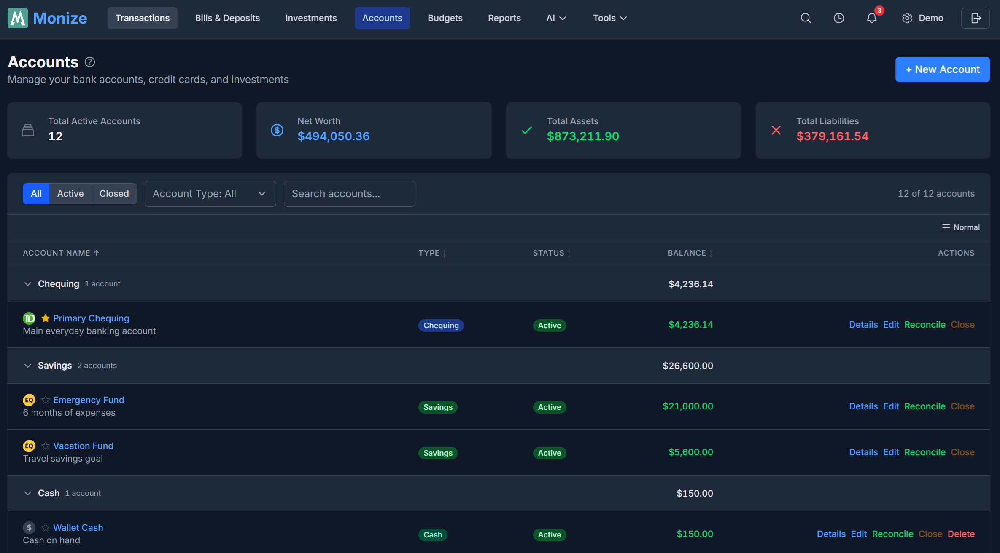
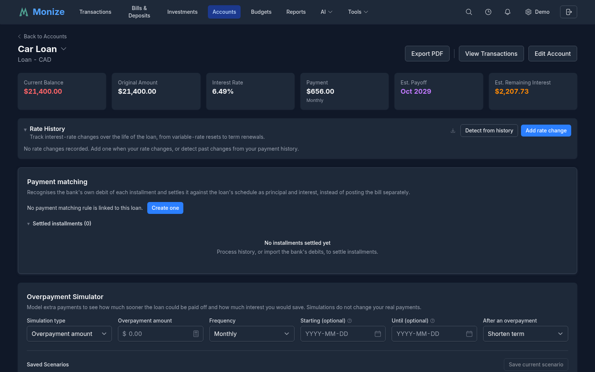
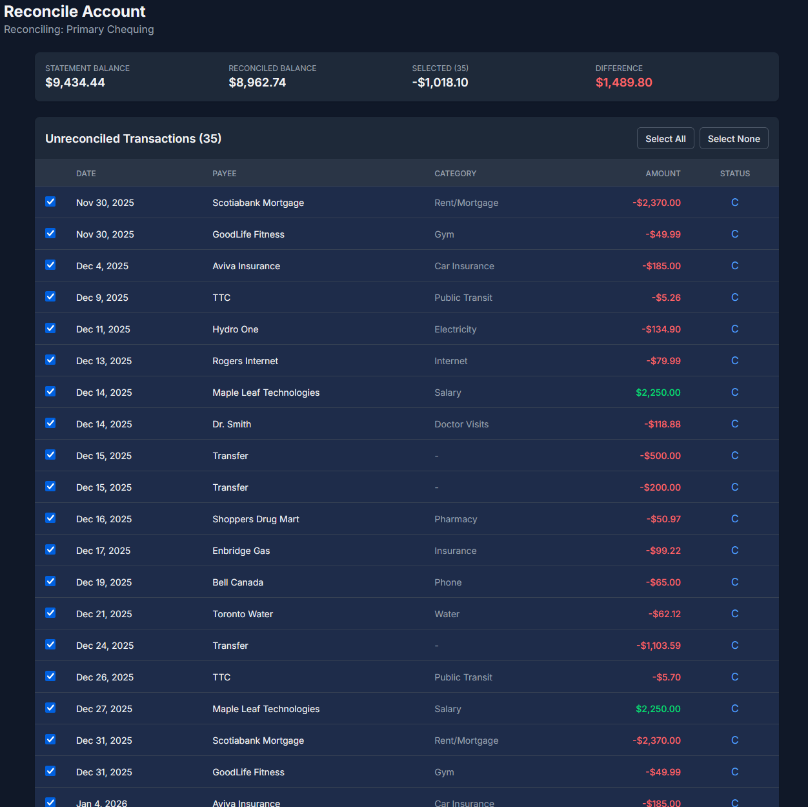

# Accounts

Monize supports a wide variety of account types to represent your complete financial picture. This page covers creating, managing, and organizing your accounts.

---

## Account Types

Monize supports 10 account types:

| Account Type | Description | Typical Use |
|-------------|-------------|-------------|
| **Chequing** | Checking or current account | Day-to-day banking |
| **Savings** | Savings account | Emergency fund, short-term savings |
| **Credit Card** | Credit card account | Credit card spending and payments |
| **Loan** | Installment loan | Personal loans, auto loans |
| **Mortgage** | Mortgage account | Home mortgage tracking |
| **Investment** | Brokerage account | Stocks, ETFs, mutual funds |
| **Cash** | Cash wallet or petty cash | Physical cash tracking |
| **Line of Credit** | Line of credit | Revolving credit facilities |
| **Asset** | Asset tracking | Property, vehicles, collectibles |
| **Other** | Miscellaneous | Any account that does not fit other types |

### Account Type Details

**Credit Card** accounts include a credit limit field. The available credit is calculated as `credit limit - current balance`.

**Loan, Mortgage, and Line of Credit** accounts are debt accounts. They support interest rate tracking and a dedicated payment setup, and clicking them opens a per-account [detail page](#loan-and-mortgage-detail-page) rather than the transaction register. Loans and mortgages show an amortization schedule and payoff projection; lines of credit show a revolving-balance view. Mortgage accounts add Canadian-specific amortization settings. See [Loan and Mortgage Setup](#loan-and-mortgage-setup).

**Investment** accounts are always created as a linked pair -- a brokerage account (for holding securities) and a cash account (for the cash balance within the brokerage). See [Investment Account Pairs](#investment-account-pairs) for details.

**Asset** accounts are used to track the value of physical assets like property or vehicles. Transactions on asset accounts represent changes in value.

---

## Creating an Account

1. Navigate to **Accounts** from the top navigation bar
2. Click the **Create Account** button
3. Fill in the account form:

<!-- Screenshot: The account creation form showing all fields -->

### Required Fields

| Field | Description |
|-------|-------------|
| **Account Name** | A descriptive name for the account |
| **Account Type** | Select from the available types |
| **Currency** | The currency this account operates in |

### Optional Fields

| Field | Description |
|-------|-------------|
| **Opening Balance** | The starting balance (defaults to 0) |
| **Opening Date** | The date of the opening balance |
| **Institution** | The financial institution that holds the account (see [Financial Institutions](#financial-institutions)). Optional for most account types, but **required** for loans and mortgages |
| **Account Number** | The institution's account number for your reference |
| **Credit Limit** | For credit cards only |
| **Interest Rate** | For savings, loans, and mortgages |
| **Notes** | Any additional notes about the account |

4. Click **Save** to create the account

> **Tip:** When importing from Microsoft Money, you do not need to create accounts manually if you plan to create them during the import process. However, creating accounts first gives you more control over the exact names, types, and opening balances.

> **Note:** When you choose a **Loan** or **Mortgage** account type, the form reveals extra payment fields. See [Loan and Mortgage Setup](#loan-and-mortgage-setup) below.

---

## Loan and Mortgage Setup

Selecting the **Loan** or **Mortgage** account type on the [account form](#creating-an-account) reveals a dedicated payment setup panel so Monize can track your amortization, split each payment into principal and interest, and project your payoff.

### Loan Payment Setup

For a **Loan** (or line of credit), the following fields become available in addition to the standard fields:

| Field | Description |
|-------|-------------|
| **Payment Amount** | The regular payment made against the loan |
| **Payment Frequency** | Weekly, bi-weekly, monthly, quarterly, or yearly |
| **First Payment Date** | The date the first scheduled payment is due |
| **Payment-From Account** | The account the payment is drawn from (e.g. your chequing account) |
| **Interest Category** | The expense category the interest portion of each payment is booked to |

As you fill in the loan amount, interest rate, payment, frequency, and first payment date, a live **amortization preview** appears showing the principal and interest portions of the first payment, the total number of payments, and the estimated payoff date.

### Mortgage Setup

**Mortgage** accounts offer everything a loan does, plus mortgage-specific settings:

| Field | Description |
|-------|-------------|
| **Canadian mortgage** | Toggle for Canadian semi-annual interest compounding |
| **Variable rate** | Toggle to mark the mortgage as variable-rate |
| **Term Length** | The mortgage term, entered as years plus months |
| **Amortization Period** | The full amortization, entered as years plus months |
| **Payment Frequency** | Monthly, semi-monthly, bi-weekly, accelerated bi-weekly, weekly, or accelerated weekly |
| **First Payment Date**, **Payment-From Account**, **Interest Category** | Same as for loans |

The mortgage amortization preview shows the calculated payment amount, the **effective annual rate**, the first payment's principal and interest split, the total number of payments, total interest, and the estimated payoff date.

### Guided Payment Setup

If you have already imported transaction history for a loan or mortgage, Monize can set up the payment for you. The **guided payment setup** analyses your existing transactions and detects:

- The **payment cadence** (frequency) and regular payment amount
- The **principal / interest split** from your most recent payment
- Any recurring **extra principal** payments
- An estimated interest rate, interest category, and source account

Each detected value is presented with a confidence indicator (High, Medium, or Low) for you to review, adjust, and confirm before the payment schedule is created. You can also opt to auto-post future payments.

If you are not sure how to record loan payments in the first place, a collapsible **"How to record loan payments"** guide is built into the form.

### Overpayment Recognition

So that extra principal payments are scored correctly in the schedule, simulator, and Past Impact analysis, the account edit form lets you tell Monize how you record them. An overpayment is recognized as **100% principal** when it matches any one of:

- A designated **category**
- A designated **payee**
- **Memo text** you specify

Any single match is enough -- you do not have to use all three. The settings live in a gear menu on the account's edit form.

### Interest Booking Mode

Banks book interest in different ways, and Monize reads all of them. An **Interest booking mode** setting (Auto / Split / Separate) tells Monize how to find the interest portion of each payment:

| Mode | Use when |
|------|----------|
| **Auto** | Let Monize detect the style automatically (the default) |
| **Split** | Each payment is a split transaction with a principal line and an interest line |
| **Separate** | Interest is booked as its own standalone expense transaction, apart from the principal transfer |

Interest-only grace periods appear as their own rows in the schedule. Interest is counted by its category across your full history regardless of the loan's configured start date, so a migrated loan's earlier activity is not hidden. If you refinance sequentially, give **each refinance its own interest category** so the periods stay cleanly separated. See the [loan detail page tools](reports.md#loan-detail-page-tools) for how recognized overpayments and interest flow into the simulator and rate detection.

---

## Financial Institutions

Each account can record the **financial institution** that holds it -- the bank, brokerage, credit union, or lender behind the account. This is a free-text field on the account form, so you can enter the institution's name exactly as you want it to appear (for example, the name of your bank or your loan provider).

### Why Set an Institution

- **Identify accounts at a glance** -- When you have several accounts of the same type, the institution name makes it clear which is which.
- **Group related accounts** -- Knowing the institution behind each account helps you see your overall exposure to any one bank or lender.
- **Required for debt accounts** -- The institution is **mandatory** for loan and mortgage accounts, since it identifies your lender. For all other account types it is optional.

### Setting or Changing an Institution

1. Open the account form when [creating](#creating-an-account) a new account, or click the edit button on an existing account.
2. Enter the institution name in the **Institution** field (up to 100 characters).
3. Click **Save**.

You can change an account's institution at any time by editing the account. The field is purely descriptive -- Monize does not connect to the institution, fetch logos, or detect the institution automatically; it is the name you type for your own reference.

---

## Account List

The Accounts page displays all your accounts organized by type.

<!-- Screenshot: The accounts list page showing accounts grouped by type with balances -->

Each account entry shows:

- **Account name**
- **Account type** indicator
- **Current balance** in the account's currency
- **Currency code** (if different from your home currency)
- **Actions** -- View transactions, Loan Details, Edit, Reconcile, Close (or Reopen), and Delete

The available actions depend on the account: **Loan Details** appears only for loan, mortgage, and line-of-credit accounts and opens the account's [detail page](#loan-and-mortgage-detail-page). **Delete** is only available for accounts with no transactions (see [Deleting Accounts](#deleting-accounts)), and closed accounts show **Reopen** in place of **Close**.

### Summary Card

At the top of the accounts page, a summary card shows:

- **Total assets** -- Sum of all positive-balance accounts
- **Total liabilities** -- Sum of all debt accounts
- **Net worth** -- Assets minus liabilities

### Filtering

The filter bar above the list lets you narrow down which accounts are shown:

- **Status** -- A segmented control to switch between **All**, **Active** (currently in use), and **Closed** (closed/archived) accounts.
- **Account type** -- A dropdown to show only selected account types (e.g. only chequing and savings). It lists just the types you actually have; leaving it empty shows all types.
- **Search** -- A text box that filters accounts by name as you type. Click the **X** inside the box to clear the search.

A counter beside the filters shows how many accounts match, in the form **"X of Y accounts"**. When the filters match nothing, a **Clear Filters** action resets the status, type, and search filters at once.

> **Note:** Your filter, sort, and density choices are remembered between visits.

---

## Account Detail Pages

Clicking into an account opens a **detail page** tailored to that account's type, rather than a plain transaction list. Each type surfaces the views that matter for it; a **View Transactions** button on every detail page takes you to the underlying register.

### Banking (Chequing / Savings / Cash)

- **Balance history** chart, with a **90-day balance forecast** projected from your scheduled bills and deposits
- **Recurring charges** the account detects, each with one-click conversion to a scheduled bill
- A **cash-flow mini-report** for the account
- **Top spending categories and payees**, defaulting to a "This month" timeframe

### Credit Cards

- **Statement-cycle** information and the current amount owed
- **Spending breakdown by category** for the cycle, including **late-posting, unreconciled charges carried over from the previous cycle**, so the amount owed is right
- **Interest and fees** tracking
- A **payoff calculator** and a 90-day projection
- A payment dialog for recording a card payment

### Assets

- **Current value** and **purchase value**, with appreciation metrics
- A quick **value-update dialog** to record a new valuation
- An **equity panel** when the asset is linked to its financing loan (for example, a house linked to its mortgage), showing value minus outstanding debt

### Investments (Brokerage)

Brokerage accounts open the [Investments](investments.md) view for that account -- portfolio summary, asset allocation, value chart, holdings, and income tracking.

---

## Loan and Mortgage Detail Page

Loan, mortgage, and line-of-credit accounts open a per-account **detail page** at `/accounts/[id]` instead of the transaction register. You reach it by clicking a debt account in the list, or via the **Loan Details** [row action](#account-list). A **View Transactions** button on the page takes you to the underlying register.

<!-- Screenshot: The loan detail page showing summary cards and the amortization schedule -->

### Summary Cards

For loans and mortgages, the top of the page shows a row of summary cards:

| Card | Meaning |
|------|---------|
| **Current Balance** | The amount still owed |
| **Original Amount** | The opening balance (or the amount derived from history) |
| **Interest Rate** | The annual rate; Canadian fixed mortgages also show the effective rate |
| **Payment** | The regular payment amount and its frequency |
| **Estimated Payoff Date** | When the loan is projected to be fully repaid |
| **Estimated Remaining Interest** | The interest still to be paid over the remaining schedule |

Below the cards, the page includes a month-grouped **Loan Schedule** with real per-row interest, an interactive **Overpayment Simulator** with saved what-if scenarios, an **Impact of Overpayments Made** (Past Impact) analysis, and an editable **Rate History** timeline. The schedule, rate history, and scenario comparison **export to CSV**, and the payoff comparison chart exports to **PNG**. See [Loan Detail Page Tools](reports.md#loan-detail-page-tools) for the full breakdown of each tool.

### Line of Credit

Because a line of credit revolves rather than amortizing to a fixed payoff, its detail page shows a **revolving-balance view** instead of an amortization schedule:

- **Current Balance** -- The amount currently drawn
- **Credit Limit** and **Available Credit** -- Shown when a credit limit is set
- **Utilization %** -- The portion of the limit in use, colour-coded to flag high utilization
- **Peak Balance** -- The highest balance reached (shown when no limit is set)
- **Balance History** -- A chart of the balance over time, counting both draws and repayments

---

## Editing and Closing Accounts

### Editing

Click the edit button on any account to modify its details. All fields from account creation can be updated.

### Closing Accounts

When an account is no longer active (e.g., you closed a bank account), you can close it in Monize:

1. Click the edit button on the account
2. Toggle the **Closed** switch
3. Click **Save**

Closed accounts are hidden from the active accounts view and from transaction dropdowns, but their historical data is preserved for reporting.

### Deleting Accounts

Accounts can only be deleted if they have no transactions. If an account has transactions, you must either delete the transactions first or close the account instead.

---

## Account Reconciliation

Reconciliation helps you verify that your Monize records match your bank statement.

<!-- Screenshot: The reconciliation screen showing cleared and unreconciled transactions -->

### How to Reconcile

1. Navigate to the account you want to reconcile
2. Click **Reconcile**
3. Enter the **statement ending balance** and **statement date** from your bank
4. Review each transaction:
   - **Cleared** transactions match your bank statement
   - **Unreconciled** transactions have not yet appeared on a statement
5. Mark transactions as cleared by clicking on them
6. When the difference is zero, click **Finish Reconciling**

### Transaction Status

| Status | Meaning |
|--------|---------|
| **Unreconciled** | New transaction, not yet on a statement |
| **Cleared** | Matches a bank statement entry |
| **Reconciled** | Previously cleared and locked |
| **Void** | Cancelled transaction |

---

## Favourite Accounts

Mark accounts as favourites to have them displayed on the Dashboard:

1. In the account list, click the star icon next to an account
2. The account will appear in the Favourite Accounts widget on the Dashboard

---

## Investment Account Pairs

When you create an **Investment** type account, Monize automatically creates two linked accounts:

1. **Brokerage Account** -- Holds your securities (stocks, ETFs, mutual funds, etc.)
2. **Cash Account** -- Tracks the cash balance within the brokerage

These are linked internally. When you buy securities, the cash balance decreases. When you sell or receive dividends, the cash balance increases.

The cash account is hidden from the main account list but is accessible through the investment interface. Clicking on a brokerage account in the account list navigates to the [Investments](investments.md) page filtered to that account's holdings. For more details, see [Investments](investments.md).

> **Important for Microsoft Money users:** In Microsoft Money, investment accounts contain both securities and cash in a single account. In Monize, these are split into two linked accounts. When importing, the QIF parser handles this automatically -- the "Investment" export maps to the brokerage account and the "Regular" export maps to the cash account.

---

## Multi-Currency Accounts

Each account has a designated currency. If you have accounts in different currencies:

- Transactions in that account are recorded in the account's currency
- The Dashboard and reports convert balances to your home currency using the latest exchange rates
- Cross-currency transfers record both amounts and the effective exchange rate

For more details, see [Currency Management](currency-management.md).
