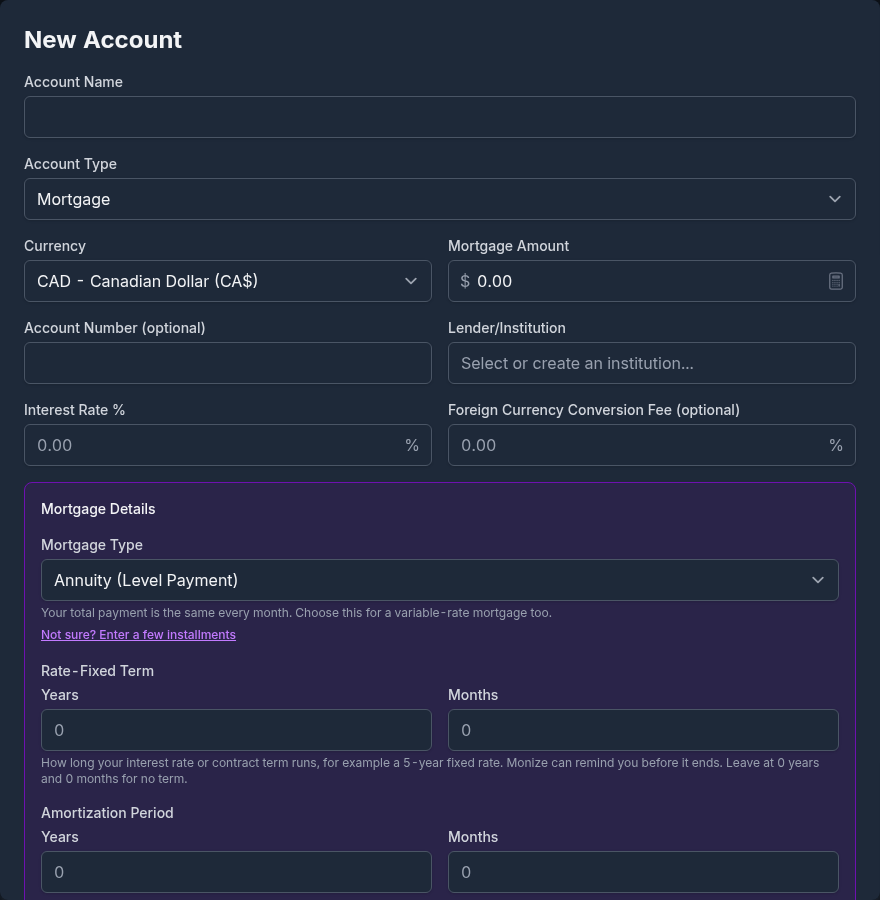
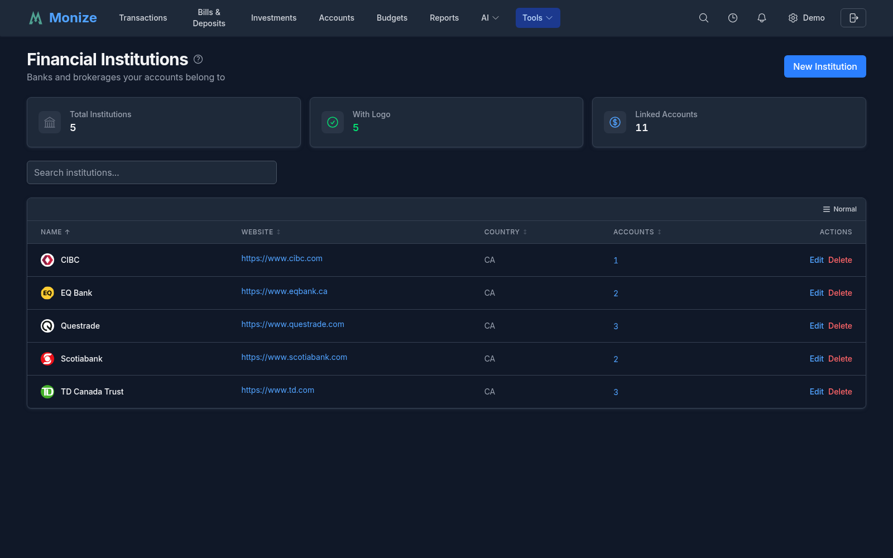
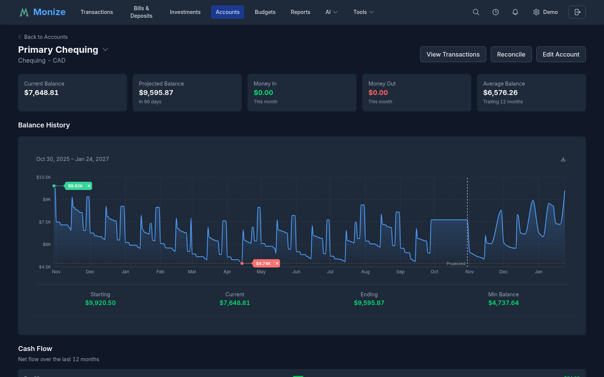
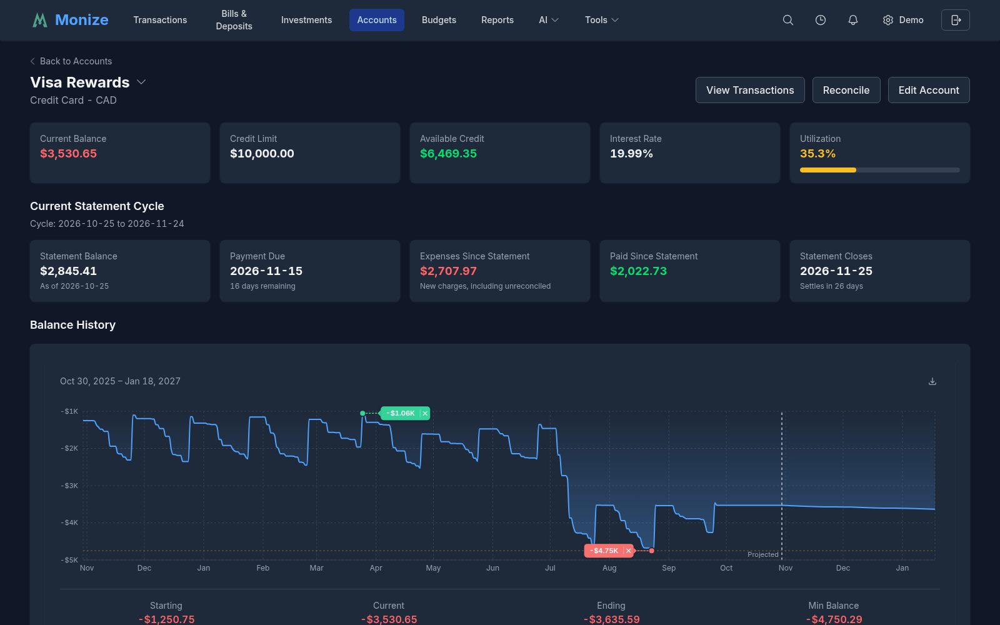
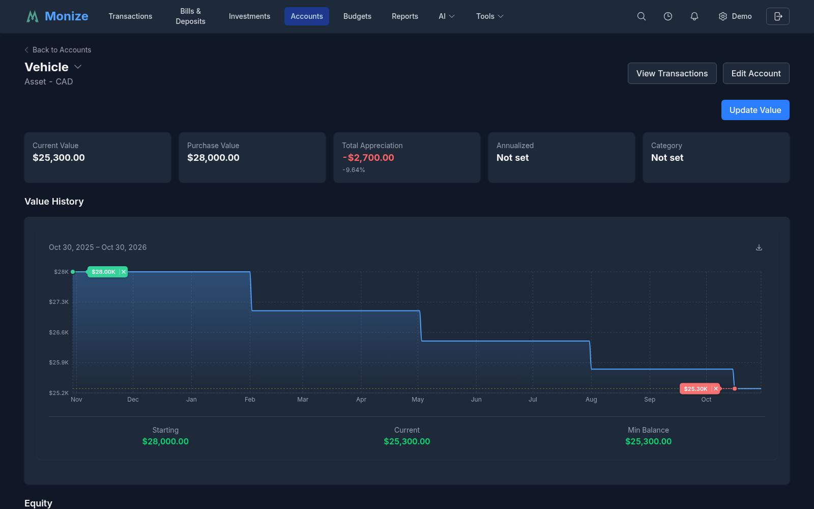
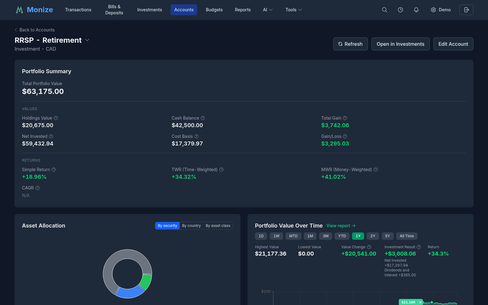
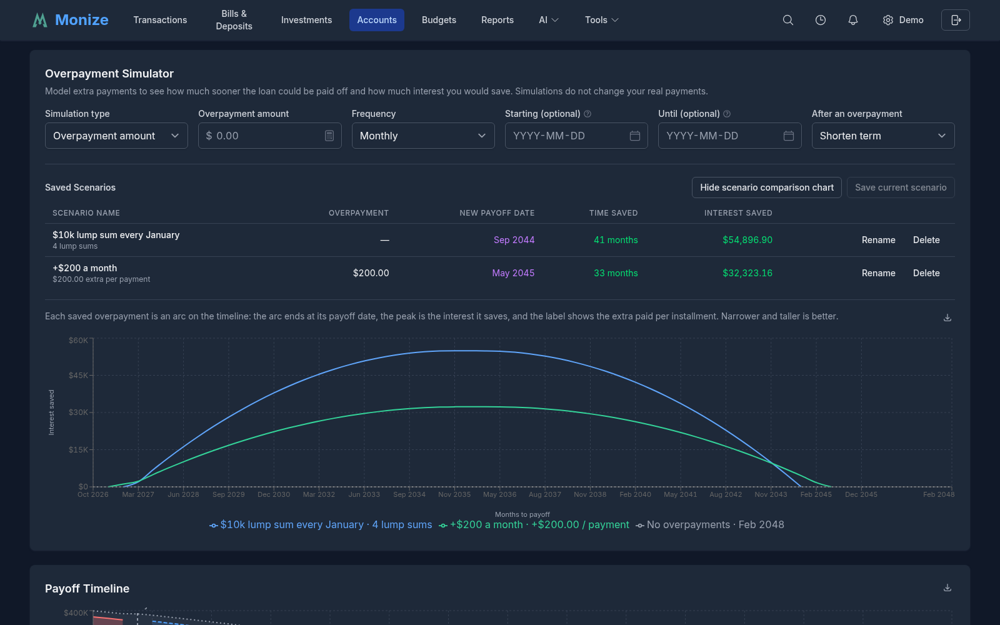
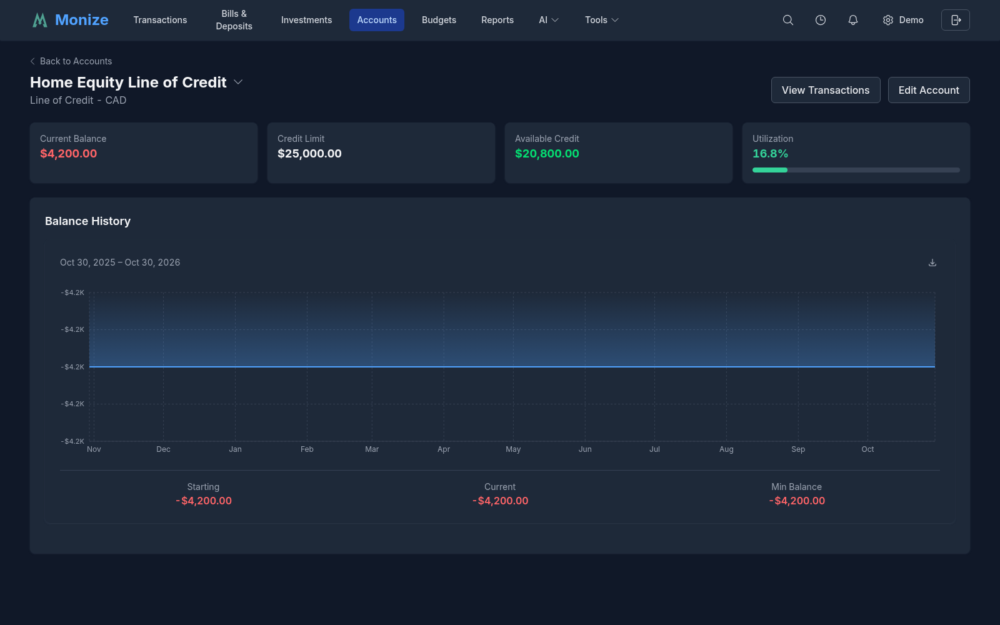

# Accounts

Monize supports a wide variety of account types to represent your complete financial picture. This page covers creating, managing, and organizing your accounts.

---

## Account Types

Monize supports 10 account types:

| Account Type | Description | Typical Use |
|-------------|-------------|-------------|
| **Chequing** | Checking or current account | Day-to-day banking |
| **Savings** | Savings account | Emergency fund, short-term savings |
| **Credit Card** | Credit card account | Credit card spending and payments |
| **Investment** | Brokerage account | Stocks, ETFs, mutual funds, bonds |
| **Loan** | Installment loan | Personal loans, auto loans |
| **Line of Credit** | Line of credit | Revolving credit facilities |
| **Mortgage** | Mortgage account | Home mortgage tracking |
| **Asset** | Asset tracking | Property, vehicles, collectibles |
| **Cash** | Cash wallet or petty cash | Physical cash tracking |
| **Other** | Miscellaneous | Any account that does not fit other types |

### Account Type Details

**Credit Card** accounts include a credit limit and optional statement dates (the payment due day and the settlement day of the billing cycle). The available credit is the credit limit minus the current balance.

**Loan and Mortgage** accounts are debt accounts with a dedicated payment setup, so Monize can split each payment into principal and interest, show an amortization schedule, and project your payoff. Mortgages add a mortgage type, a rate-fixed term, and an amortization period. See [Loan and Mortgage Setup](#loan-and-mortgage-setup).

**Line of Credit** accounts are revolving debt accounts with an optional credit limit and interest rate; their [detail page](#line-of-credit) shows a revolving-balance view.

**Investment** accounts are normally created as a linked pair -- a brokerage ledger for your securities and a cash ledger for the money -- shown as one account. See [Investment Account Pairs](#investment-account-pairs) for details.

**Asset** accounts track the value of physical assets like property or vehicles. Transactions on asset accounts represent changes in value, booked to a value-change category you choose.

---

## Creating an Account

1. Navigate to **Accounts** from the top navigation bar
2. Click **+ New Account**
3. Fill in the **New Account** form:

### Required Fields

| Field | Description |
|-------|-------------|
| **Account Name** | A descriptive name for the account |
| **Account Type** | Select from the available types |
| **Currency** | The currency this account operates in. It is locked once the account has transactions |

### Optional Fields

| Field | Description |
|-------|-------------|
| **Opening Balance** | The starting balance (defaults to 0). For loans and mortgages this is the **Loan Amount** or **Mortgage Amount** |
| **Account Number** | The institution's account number for your reference |
| **Institution** | The financial institution that holds the account (see [Financial Institutions](#financial-institutions)). **Required** for loans and mortgages, where it is labelled **Lender/Institution** |
| **Credit Limit** | For every type except assets, loans, and mortgages |
| **Interest Rate %** | For every type except assets; **required** for loans and mortgages |
| **Foreign Currency Conversion Fee** | The percentage your bank adds to purchases in another currency, so Monize can show what foreign transactions really cost you |
| **Statement Dates** | Credit cards only: the **Due Date** and **Settlement Date** (day of the month) |
| **Description** | Any additional notes about the account |
| **Favourite** | Show the account on the Dashboard (the star button) |
| **Exclude from Net Worth** | Leave the account out of net worth figures and reports |

4. Click **Create Account**

When you edit an existing account, the form also offers **Balance alerts**: **Notify below** and **Notify above** amounts that send you a notification when the balance crosses them. The edit form's **Import** and **Export** buttons import a QIF file into the account or export its transactions.

> [!TIP]
> When importing from Microsoft Money, you do not need to create accounts manually if you plan to create them during the import process. However, creating accounts first gives you more control over the exact names, types, and opening balances.

> [!NOTE]
> When you choose a **Loan** or **Mortgage** account type, the form reveals extra payment fields, and an **Asset** shows a **Value Change Category** and a **Date Acquired** (the asset is left out of net worth before that date). See [Loan and Mortgage Setup](#loan-and-mortgage-setup) below.

---

## Loan and Mortgage Setup

Selecting the **Loan** or **Mortgage** account type on the [account form](#creating-an-account) reveals a dedicated payment setup panel so Monize can track your amortization, split each payment into principal and interest, and project your payoff. Saving it creates the scheduled payment in [Bills & Deposits](bills-and-deposits.md).

### Loan Payment Setup

When you create a **Loan**, the **Loan Payment Details** panel asks for:

| Field | Description |
|-------|-------------|
| **Payment Amount** | The regular payment made against the loan |
| **Payment Frequency** | Weekly, Every 2 Weeks, Semi-Monthly, Monthly, Quarterly, or Yearly |
| **First Payment Date** | The date the first scheduled payment is due |
| **Payment From Account** | The account the payment is drawn from (e.g. your chequing account) |
| **Interest Category** | The expense category the interest portion of each payment is booked to |

As you fill in the loan amount, interest rate, payment, frequency, and first payment date, a **Payment Preview** appears showing the principal and interest portions of the first payment, the total number of payments, and the estimated payoff date.

### Mortgage Setup

**Mortgage** accounts offer everything a loan does, plus mortgage-specific settings in the **Mortgage Details** panel:

| Field | Description |
|-------|-------------|
| **Mortgage Type** | **Annuity (Level Payment)** -- the total payment is the same every period, including most variable-rate mortgages; **Canadian Fixed Rate** -- interest compounds twice a year; **Linear (Constant Principal)** -- the principal part is the same every period and the total falls; **Interest Only** -- you pay only interest and the balance is repaid at the end |
| **Rate-Fixed Term** | How long the interest rate or contract term runs, entered as years plus months; Monize can remind you before it ends |
| **Amortization Period** | The full amortization, entered as years plus months |
| **Payment Frequency** | Monthly, Semi-Monthly (15th and month end), Bi-Weekly, Accelerated Bi-Weekly, Weekly, or Accelerated Weekly. The accelerated frequencies are for annuity mortgages only |
| **First Payment Date**, **Payment From Account**, **Interest Category** | Same as for loans |
| **What an Extra Repayment Does** | Linear mortgages only: whether an extra repayment shortens the term or lowers the installment |

Not sure which type you have? Click **Not sure? Enter a few installments**, copy two or three consecutive installments from a statement, and click **Suggest a Type**; Monize explains its suggestion, and **Use This Type** applies it.

The **Amortization Preview** shows the calculated payment amount, the **effective rate**, the first payment's principal and interest split, the total number of payments, total interest, and the estimated payoff date. A linear or interest-only mortgage has no fixed payment, so each installment is worked out on its due date from the balance and the rate.

### Payment Matching

If your bank posts one undivided debit for each mortgage or loan installment, turn on **Match imported bank payments** and enter a **Payee pattern** (with a `*` wildcard, for example `*MY BANK*`) and an optional **Description pattern**. When an imported or synced bank row matches, Monize splits it into principal and interest, books it as the installment, and marks the scheduled payment as paid, instead of you ending up with a duplicate. Turning this on turns off auto-posting on the linked bill, because the bank's own row is what gets matched.

### Guided Payment Setup

If you have already imported transaction history for a loan or mortgage that has no scheduled payment, its edit form offers **Set Up Recurring Payments**. The **Set Up Loan Payments** (or **Set Up Mortgage Payments**) dialog analyses your existing transactions and detects:

- The **payment frequency** and regular payment amount
- The **principal / interest split** from your most recent payment
- Any recurring **extra principal** payments
- An estimated interest rate, interest category, and source account

Each detected value is presented with a confidence indicator for you to review and adjust before clicking **Set Up Payments**. You can also choose to **Automatically post transactions when due**.

If you are not sure how to record loan payments in the first place, a collapsible **How to record loan payments** guide is built into the form: principal is a transfer to the loan account, interest is an expense.

### Overpayment Recognition

So that extra principal payments are scored correctly in the schedule, simulator, and Past Impact analysis, the mortgage form's **Overpayment recognition** settings tell Monize how you record them. An overpayment is recognized as **100% principal** when it matches any one of:

- An **Overpayment category**
- An **Overpayment payee**
- **Overpayment memo text** (a case-insensitive match against the payment's memo)

Any single match is enough -- you do not have to use all three. A loan's detail page offers the same settings under **Payment recognition**.

### Interest Booking Mode

Banks book interest in different ways, and Monize reads all of them. The **Interest Recording** setting tells Monize how to find the interest portion of each payment:

| Mode | Use when |
|------|----------|
| **Automatic (recommended)** | Let Monize detect the style (the default) |
| **Split leg of the payment** | Each payment is a split transaction with a principal line and an interest line |
| **Separate expense (principal is a transfer)** | Interest is booked as its own standalone expense transaction, apart from the principal transfer |

Interest-only grace periods appear as their own rows in the schedule. Interest is counted by its category across your full history regardless of the loan's configured start date, so a migrated loan's earlier activity is not hidden. If you refinance sequentially, give **each refinance its own interest category** so the periods stay cleanly separated. See the [loan detail page tools](reports.md#loan-detail-page-tools) for how recognized overpayments and interest flow into the simulator and rate detection.

---

## Financial Institutions

Each account can record the **financial institution** that holds it -- the bank, brokerage, credit union, or lender behind the account. Institutions are records of their own, kept on **Tools -> Institutions**, so several accounts can share one and each institution carries its brand logo.

### Why Set an Institution

- **Identify accounts at a glance** -- The institution's logo and name appear beside the account in the account list and on the dashboard.
- **Group related accounts** -- The Institutions page counts the accounts at each institution, so you can see your exposure to any one bank or lender.
- **Required for debt accounts** -- The institution is **mandatory** for loan and mortgage accounts, since it identifies your lender. For all other account types it is optional.

### Setting or Changing an Institution

1. Open the account form when [creating](#creating-an-account) a new account, or click **Edit** on an existing account.
2. In the **Institution** field, select an existing institution, or type a new name to create one.
3. Click **Create Account** or **Update Account**.

On the **Financial Institutions** page, **New Institution** adds one with its **Name**, **Website**, and an optional two-letter **Country**. The logo is fetched automatically from the website. Each institution's **Accounts** action lists the accounts assigned to it, where you can add or remove accounts. Deleting an institution unassigns its accounts without deleting them.

---

## Account List

The Accounts page lists all your accounts grouped by type, each group with its own subtotal.

The table has these columns:

- **Account Name** -- with the institution's logo, the favourite star, and the account's description
- **Type**
- **Status** -- Active or Closed
- **Last Reconciled** -- the date of the account's last reconciliation, or Never
- **Unreconciled** -- how many of the account's transactions are not yet reconciled (unreconciled or cleared, whatever their date): the transactions the [Reconcile](#account-reconciliation) screen lists. It refreshes when you return to the page, so a reconcile done in another tab or on another device shows here too
- **Balance** -- in the account's currency; an investment account shows its combined value with the investments and the cash each on its own line beneath it (at Normal density)
- **Actions** -- **Details**, **Edit**, **Reconcile**, **Close** (or **Reopen**), and **Delete**

The Balance always stays in view. On a narrower window the columns to its left make room for it: long account names are shortened, and **Last Reconciled** and **Unreconciled** are left out first, then **Status**, then **Type**.

Click an account to open its transactions. Investment accounts open their [detail page](#account-detail-pages), and so does every account if you choose **Show its dashboard** under **Default Account View** in [Settings -> Preferences](settings-and-security.md#preferences). **Details** always opens the detail page.

**Close** is only available when the account's balance is zero, and **Delete** only for accounts with no transactions (see [Deleting Accounts](#deleting-accounts)).

### Summary Card

At the top of the accounts page, the summary shows:

- **Total Active Accounts**
- **Net Worth** -- assets minus liabilities
- **Total Assets** -- the accounts with a positive balance, plus investment market values
- **Total Liabilities** -- the money you owe

The three money figures leave out accounts you excluded from net worth.

### Filtering

The filter bar above the list lets you narrow down which accounts are shown:

- **Search** -- A text box that filters accounts by name as you type. Click the **X** inside the box to clear the search.
- **Status** -- Switch between **All**, **Active**, and **Closed** accounts.
- **Account Type** -- Show only selected account types (e.g. only chequing and savings). It lists just the types you actually have; leaving it empty shows all types.
- **Net Worth** -- Show the accounts included in or excluded from net worth (shown when you have excluded an account).
- **Shared with me** -- Show only the [joint accounts](shared-access.md#joint-accounts) other people share with you (shown when you have any).

A counter beside the filters shows how many accounts match, in the form **"X of Y accounts"**. When the filters match nothing, a **Clear Filters** action resets them all at once.

> [!NOTE]
> Your filter and row density choices are remembered between visits.

---

## Account Detail Pages

An account's **detail page** is tailored to its type, rather than a plain transaction list. The header has **View Transactions** (the account's register) and **Edit Account**, plus **Reconcile** on banking accounts and credit cards (an investment account has its own buttons, below), and a caret beside the account name that switches to another account, with your favourites first.

### Banking (Chequing / Savings / Cash)

- Summary cards: **Current Balance**, **Projected Balance** in 90 days, **Money In** and **Money Out** this month, and the **Average Balance** over the trailing 12 months; with an interest rate set, also the **Interest Rate** and the **Interest Earned** this year
- **Balance History** chart, with a **90-day balance forecast** projected from your scheduled bills and deposits
- A **Cash Flow** chart of the net flow over the last 12 months
- **Top Categories** and **Top Payees** this month
- **Recurring Charges**: the scheduled bills on the account, plus **Possible recurring charges** found in its transactions, each with a **Create bill** button that turns it into a scheduled bill

### Credit Cards

- Summary cards: **Current Balance**, **Credit Limit**, **Available Credit**, **Utilization**, and **Interest Rate**
- **Current Statement Cycle**: the statement balance, expenses and payments since the statement, the payment due date, and when the statement closes (needs the card's statement dates)
- **Balance History**
- **Spending This Cycle** by category, including **late-posting, unreconciled charges carried over from the previous cycle**, so the amount owed is right
- **Interest & Fees** charged this year
- A **Payoff Calculator** that estimates how long the balance takes to clear at a fixed monthly payment
- **Make a Payment**, which records a payment (the statement balance, the full balance, or a custom amount) from a chequing, savings, or cash account now, or schedules it monthly

### Assets

- **Current Value**, **Purchase Value**, **Total Appreciation**, and the **Annualized** rate
- A **Value History** chart
- **Update Value**, to record a new valuation as of a date
- An **Equity** panel when the asset is linked to its financing loan (for example, a house linked to its mortgage), showing value minus outstanding debt and equity over time. Use **Link Loan** to link one

### Foreign Currency Fees

Accounts with transactions in another currency gain a **Foreign Currency Transaction Fees** section: the fees paid per currency, charted over time, and a list of the foreign-currency transactions. Both export to CSV, and the chart to PNG.

### Investments (Brokerage)

An investment account's detail page is the [Investments](investments.md) view for that one account: its **Portfolio Summary**, **Asset Allocation**, **Portfolio Value Over Time**, holdings, its **Investment Income** this year (dividends and interest, and realized gains), and the brokerage and cash registers of the pair behind a toggle. The header has **Refresh** to fetch the latest prices, **Open in Investments**, and **Edit Account**.

---

## Loan and Mortgage Detail Page

Loan, mortgage, and line-of-credit accounts have a **detail page** with their payment schedule and payoff tools. Open it with the **Details** [row action](#account-list), or from the account panel beside its register.

### Summary Cards

For loans and mortgages, the top of the page shows a row of summary cards:

| Card | Meaning |
|------|---------|
| **Current Balance** | The amount still owed |
| **Original Amount** | The opening balance (or the amount derived from history) |
| **Interest Rate** | The annual rate; Canadian fixed-rate mortgages also show the effective rate |
| **Payment** | The regular payment amount and its frequency (for a linear mortgage, the **Next Installment** and its due date) |
| **Est. Payoff** | When the loan is projected to be fully repaid |
| **Est. Remaining Interest** | The interest still to be paid over the remaining schedule |

Below the cards, the page includes a month-grouped **Loan Schedule** with real per-row interest, a **Payoff Timeline** chart, an interactive **Overpayment Simulator** with **Saved Scenarios** and a scenario comparison chart, an **Impact of Overpayments Made** (Past Impact) analysis, and an editable **Rate History** timeline with **Detect Mortgage Type**. A **Payment matching** panel shows the [payment matching](#payment-matching) rule linked to the loan (or offers **Create one**), lists the installments it settled, and offers **Process history** to run the rule over what you already imported. **Export PDF** saves the whole page as a PDF. The schedule, rate history, and scenario comparison **export to CSV**, and the payoff comparison chart exports to **PNG**. See [Loan Detail Page Tools](reports.md#loan-detail-page-tools) for the full breakdown of each tool.

### Line of Credit

Because a line of credit revolves rather than amortizing to a fixed payoff, its detail page shows a **revolving-balance view** instead of an amortization schedule:

- **Current Balance** -- The amount currently drawn
- **Credit Limit** and **Available Credit** -- Shown when a credit limit is set
- **Utilization %** -- The portion of the limit in use, colour-coded to flag high utilization
- **Peak Balance** -- The highest balance reached (shown when no limit is set)
- **Balance History** -- A chart of the balance over time, counting both draws and repayments

---

## Editing and Closing Accounts

### Editing

Click **Edit** on any account in the list, or **Edit Account** on its detail page, to open the **Edit Account** form. All fields from account creation can be updated, except the currency once the account has transactions. For loans and mortgages, changing the **Payment From Account** moves the upcoming scheduled payments and the payment-matching rule to the new account.

### Closing Accounts

When an account is no longer active (e.g., you closed a bank account), you can close it in Monize:

1. Make sure its balance is zero
2. Click **Close** on the account in the list
3. Confirm in the **Close Account** dialog

Closed accounts are hidden from transaction dropdowns and appear under the **Closed** filter, but their historical data is preserved for reporting. Click **Reopen** to make an account active again. Closing or reopening an investment account acts on both of its ledgers.

### Deleting Accounts

Accounts can only be deleted if they have no transactions. If an account has transactions, you must either delete the transactions first or close the account instead. Deleting an investment account deletes both of its ledgers.

---

## Account Reconciliation

Reconciliation helps you verify that your Monize records match your bank statement.

### How to Reconcile

1. Click **Reconcile** on the account in the list (or on its detail page)
2. In **Start Reconciliation**, enter the **Statement Date** and **Statement Ending Balance** from your bank, then click **Start Reconciliation**
3. The **Unreconciled Transactions** up to the statement date are listed. Tick each one that appears on your statement (**Select All** and **Select None** help); transactions already cleared start ticked
4. Watch the summary: **Statement Balance**, **Reconciled Balance**, the **Selected** total, and the **Difference**
5. When the difference is zero, click **Finish Reconciliation**. The ticked transactions become **Reconciled**

While reconciling you can sort by any column, **Group by money in and out** with a subtotal for each, edit or delete a row, and **Add Transaction** for one that is missing. Rows flagged **Missed** are dated on or before a statement you already reconciled; rows flagged **Overdue** have waited longer than a statement cycle.

When you finish reconciling a credit card or line of credit, Monize offers to update the next instance of its scheduled payment to the reconciled balance (**Update Next Payment**), or to create one (**Create Scheduled Payment**).

Accounts with transactions waiting too long to be reconciled show a reconciliation badge in the header, linking straight to that account's reconciliation.

> [!TIP]
> To protect reconciled statements from accidental changes, turn on **Lock reconciled transactions** in [Settings -> Preferences](settings-and-security.md#preferences). Without it, Monize warns before an edit that would change a reconciled transaction's date or amount.

### Transaction Status

| Status | Meaning |
|--------|---------|
| **Unreconciled** | New transaction, not yet on a statement |
| **Cleared** | Matches a bank statement entry |
| **Reconciled** | Confirmed by a completed reconciliation |
| **Void** | Cancelled transaction; it no longer moves the balance |

---

## Favourite Accounts

Mark accounts as favourites to have them displayed on the Dashboard:

1. In the account list, click the star icon next to an account (or turn on **Favourite** in the account form)
2. The account will appear in the [Favourite Accounts](dashboard.md#favourite-accounts) widget on the Dashboard, and as a quick filter on the Transactions page

---

## Investment Account Pairs

When you create an **Investment** account with **Create as Cash + Brokerage pair (recommended)** turned on, Monize creates two linked ledgers:

1. **Brokerage** -- Holds your securities (stocks, ETFs, mutual funds, bonds, etc.)
2. **Cash** -- Tracks the cash balance within the brokerage, and is where transfers in and out land

The pair appears as **one account** in the account list, pickers, reports, and on the dashboard, under the name you gave it, with its combined value and the investments and cash shown beneath. When you buy securities, the cash balance decreases. When you sell or receive dividends, the cash balance increases. Reconciling an investment account reconciles its cash ledger. The edit form reaches the cash ledger's opening balance, account number, and description in its **Cash account** section.

Clicking an investment account in the list opens its [detail page](#investments-brokerage); its **View Transactions** opens the [Investments](investments.md) page filtered to that account.

> [!IMPORTANT]
> **For Microsoft Money users:** In Microsoft Money, investment accounts contain both securities and cash in a single account. In Monize, these are split into two linked ledgers. When importing, the QIF parser handles this automatically -- the "Investment" export maps to the brokerage ledger and the "Regular" export maps to the cash ledger.

---

## Multi-Currency Accounts

Each account has a designated currency. If you have accounts in different currencies:

- Transactions in that account are recorded in the account's currency (a transaction can be entered in another currency and converted; see [Transactions](transactions.md#foreign-currency-transactions))
- The Dashboard and reports convert balances to your home currency using the latest exchange rates
- Cross-currency transfers record both amounts and the effective exchange rate

For more details, see [Currency Management](currency-management.md).
