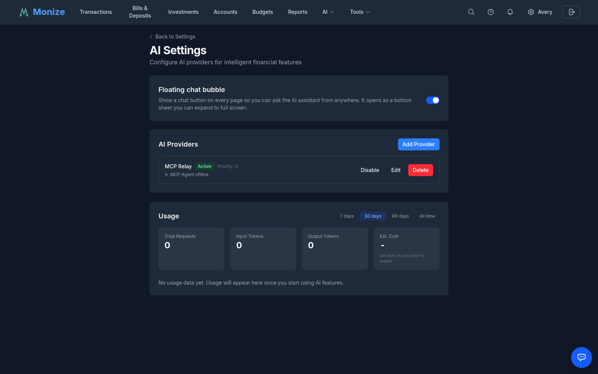
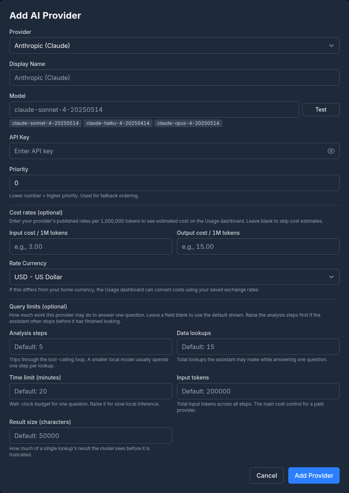
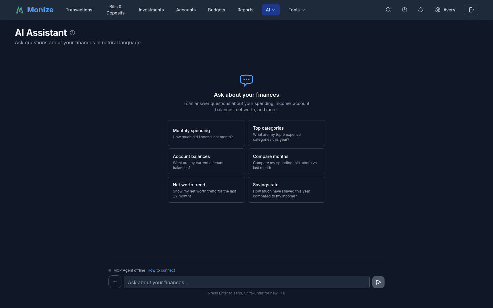
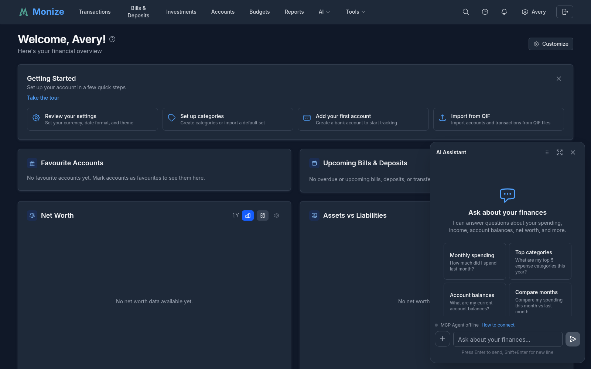
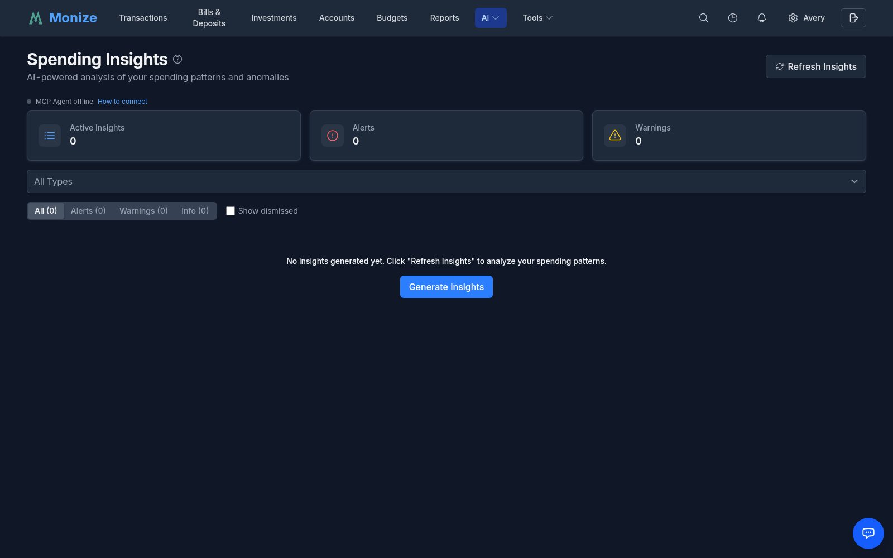
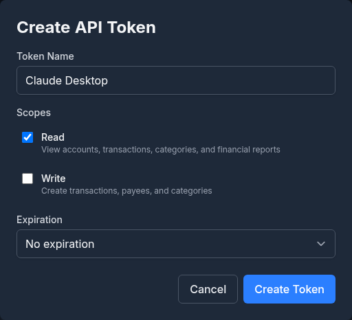
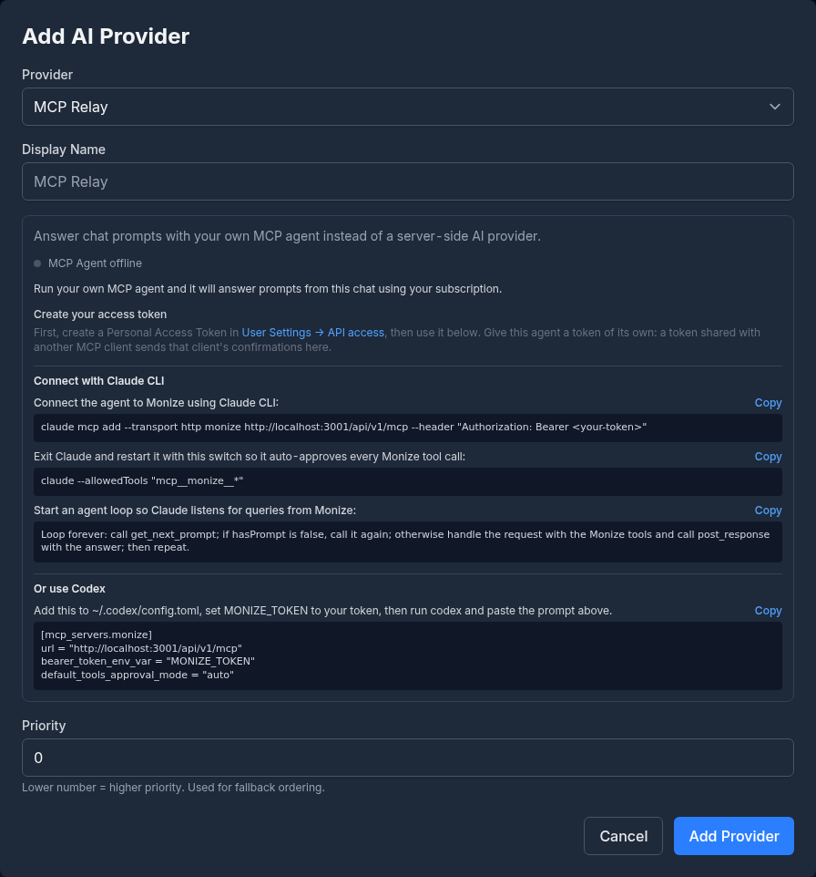
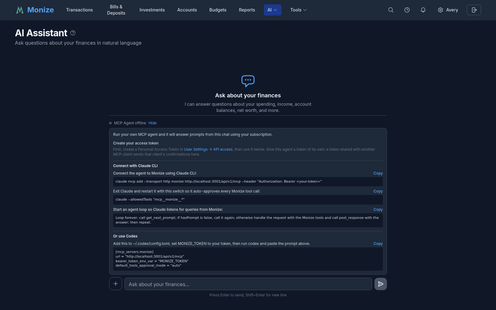
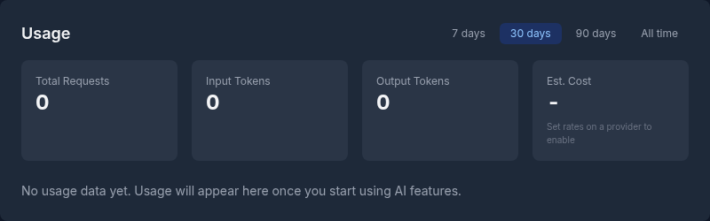

# AI
Monize includes an AI assistant that can answer natural language questions about your finances, generate insights about your spending habits, and integrate with external AI clients via the Model Context Protocol (MCP). You bring your own API key -- Monize supports Anthropic Claude, OpenAI, Ollama (local or Ollama Cloud), and any OpenAI-compatible provider -- or your own AI subscription through the [MCP Relay](#mcp-relay).

---

## Setting Up AI

Before using AI features, you need at least one configured AI provider -- either a central provider set up by the administrator, or a personal provider you configure yourself.

### Central AI Provider

An administrator can configure a shared AI provider at the server level so that all users have access to AI features without needing their own API keys. This is done by setting environment variables on the server.

| Variable | Description |
|----------|-------------|
| `AI_DEFAULT_PROVIDER` | Provider type: `anthropic`, `openai`, `ollama`, or `openai-compatible` |
| `AI_DEFAULT_API_KEY` | API key for the provider |
| `AI_DEFAULT_MODEL` | Optional -- specific model to use (falls back to the provider's default) |
| `AI_DEFAULT_BASE_URL` | Optional -- custom base URL for OpenAI-compatible or Ollama providers |

For example, in your `.env` file:

```
AI_DEFAULT_PROVIDER=anthropic
AI_DEFAULT_API_KEY=sk-ant-...
```

When a central provider is configured, all users can use the AI assistant and financial insights immediately, and **AI Settings** says *"System Default AI Provider Available"*. Users who configure their own provider use their personal provider instead of the central one.

How much work the central provider may do to answer one question is set with `AI_QUERY_MAX_ITERATIONS` (default 5), `AI_QUERY_MAX_TOOL_CALLS` (15), `AI_QUERY_TIMEOUT_MINUTES` (20), `AI_QUERY_MAX_INPUT_TOKENS` (200,000) and `AI_QUERY_MAX_TOOL_RESULT_CHARS` (50,000). A personal provider sets its own limits in its form (see [Query Limits](#query-limits)).

### Adding a Provider

1. Navigate to **Settings > AI Settings**
2. Click **Add Provider**
3. Select a **Provider** type, and optionally give it a **Display Name**
4. Enter your **API Key** (not needed for Ollama or the MCP Relay)
5. Optionally choose a specific **Model** (or leave it blank for the default), and enter a **Base URL** for Ollama or an OpenAI-compatible provider
6. Set its **Priority**
7. Click **Add Provider**





You can configure multiple providers (up to 10 by default; `AI_MAX_PROVIDERS_PER_USER` changes it) and assign priority levels: a lower number is a higher priority. Monize will fall back to the next provider if the primary one is unavailable.

Each provider card shows its status (**Active** or **Inactive**), priority, model, a masked key and any cost rates, with **Disable** / **Enable**, **Edit** and **Delete**. Deleting a provider removes its saved API key with it. When `ENCRYPTION_KEY` is not configured on the server, cloud providers cannot be added, because their API keys could not be stored securely; Ollama still works.

### Supported Providers

| Provider | Default Model | Description |
|----------|---------------|-------------|
| **Anthropic (Claude)** | claude-sonnet-4-20250514 | Claude models via the Anthropic API |
| **OpenAI (GPT)** | gpt-4o | GPT models via the OpenAI API |
| **Ollama (Local)** | (user-configured) | Local, self-hosted models -- your data never leaves your machine. Point its **Base URL** at your Ollama server, such as `http://localhost:11434` (see the note below). |
| **Ollama Cloud** | (user-configured) | Models hosted by Ollama, with an API key. Model names must include the `-cloud` suffix (for example `gpt-oss:20b-cloud`). |
| **OpenAI-Compatible** | (user-configured) | Any API that follows the OpenAI format (Groq, Together, LM Studio, etc.) |
| **MCP Relay** | -- | Answers chat prompts with your own MCP agent and subscription instead of a server-side model (see [MCP Relay](#mcp-relay)) |

For OpenAI-compatible providers, you can set a custom **Base URL** to point at your preferred endpoint.

> [!NOTE]
> A private or local base URL (`localhost`, `192.168.x.x`, a container name) works only for an administrator, or when the server operator lists that address in `AI_PRIVATE_BASE_URL_ALLOWLIST`. Otherwise the provider must use a public address. This stops any signed-up user from making the server call machines on its own network.

### Testing Your Connection

Click **Test** beside the **Model** field while adding or editing a provider, or **Test** on a saved provider's card, to verify that your API key and configuration are working. The test sends a minimal request to the provider and reports *"Connection successful. Model ... is ready."*, that the model is not available on this provider, or the error the provider returned.

### Cost Rates

Under **Cost rates (optional)**, enter your provider's published **Input cost / 1M tokens** and **Output cost / 1M tokens**, and the **Rate Currency** they are quoted in. They are used only to show an estimated cost on the [Usage](#usage-tracking) dashboard; leave them blank to skip cost estimates. When the rate currency differs from your default currency, the estimate is converted with your saved exchange rates.

### Query Limits

Under **Query limits (optional)** you decide how much work this provider may do to answer one question. Leave a field blank to use the default shown.

| Limit | Default | What it bounds |
|-------|---------|----------------|
| **Analysis steps** | 5 | Trips through the tool-calling loop. A smaller local model usually spends one step per lookup, so raise this first if the assistant often stops early. |
| **Data lookups** | 15 | Total lookups the assistant may make while answering one question |
| **Time limit (minutes)** | 20 | Wall-clock budget for one question. Raise it for slow local inference. |
| **Input tokens** | 200,000 | Total input tokens across all steps -- the main cost control for a paid provider |
| **Result size (characters)** | 50,000 | How much of a single lookup's result the model sees before it is truncated |

### Floating Chat Bubble

**Floating chat bubble** at the top of **AI Settings** puts a chat button on every page, so you can ask the assistant from anywhere. It opens as a panel (a bottom sheet on a phone) that you can expand to full screen. It is off until you turn it on, and is offered once an AI provider is available.

---

## AI Assistant

The AI Assistant lets you ask questions about your finances in plain language. It uses tool calling to query your actual financial data and return accurate, sourced answers.

### Asking Questions

1. Navigate to **AI > AI Assistant** (or open the floating chat bubble)
2. Type a question in the chat input. Press **Enter** to send, **Shift+Enter** for a new line.
3. The assistant streams its response in real time, showing each lookup it makes as it goes



The conversation is saved in your browser, so it is still there when you come back; **Clear conversation** starts a new one. Without any configured provider the page says *"AI Not Configured"* and links to the settings.

**Example questions:**

- "How much did I spend on groceries last month?"
- "What are my top 5 expense categories this year?"
- "Compare my spending this month vs last month"
- "What's my net worth trend over the past 6 months?"
- "How much can I still spend this month within my budget?"
- "What's my income breakdown by category?"

The assistant has access to the following financial tools:

| Tool | Description |
|------|-------------|
| **List Transactions** | Search and summarize transactions with filters |
| **List Accounts** | Account balances and net worth, with foreign accounts converted to your default currency |
| **List Categories** and **List Payees** | Your category tree and payees |
| **Compare Periods** | Side-by-side comparison of two time periods |
| **Generate Report** | A built-in report: spending by category or payee, income vs. expenses, trends, anomalies, month comparison, net-worth history |
| **Budget Status** | Current budget vs actual spending |
| **Upcoming Bills** | Scheduled bills and deposits |
| **Portfolio Summary**, **Investment Transactions**, **Capital Gains** | Holdings, performance, trades and realized gains |
| **Warranties** | Your [warranties](warranties.md) and when they expire |
| **Calculate** | Arithmetic over supplied values, including converting an amount between currencies at the rate on a date |
| **Render Chart** | Draws a chart in the chat |

### Suggested Queries

The AI page displays suggested query buttons to help you get started quickly: **Monthly spending**, **Top categories**, **Account balances**, **Compare months**, **Net worth trend** and **Savings rate**.

### Charts and Visualizations

When the assistant returns data that lends itself to visualization, an inline chart is rendered directly in the chat. For example, a spending-by-category query may display a bar or pie chart alongside the text response. A chart can be downloaded as a PNG and a table as a CSV.

### Entity Links

When the assistant mentions one of your accounts, categories, payees, or transactions by name, that name is rendered as a clickable in-app link. Clicking it takes you straight to that item -- or to a transaction list filtered to it -- so you can jump from an answer to the underlying records in one click. The same links appear on [insight cards](#financial-insights).

### Making Changes

Beyond answering questions, the assistant can make changes on your behalf -- creating, updating, and deleting transactions, transfers, payees, securities, investment transactions and transaction rules (**Tools > Rules**), changing a transaction's category, and running a rule on existing transactions.

Nothing is saved until you approve it. Each proposed change is presented as an on-screen confirmation card showing exactly what would be written, which you **Approve** or **Cancel**:

- **1-5 items** -- each item gets its own confirmation card.
- **6 or more items** (up to 25) -- the batch is grouped into a single bulk confirmation card that you approve or reject as a whole (**Approve all**). Ask for "individual" review to get one card per item at any size.

A card also says what your rules would do to a new transaction, warns when a change touches a reconciled transaction, and expires if left too long (ask again to retry).

### Attachments

You can attach files to a chat message with the **Add attachment** button, or by dropping them on the chat. Supported types are images (PNG, JPEG, GIF, WebP), PDF, CSV, and plain text -- up to **5 files per message**, each up to **5 MB** and **20 MB** in total. PDFs are text-extracted so the assistant can read their contents. On a phone, a file shared to an installed Monize can be sent straight to the assistant.

### Moving the Chat Panel

On desktop, the floating chat panel can be moved by its header: drag it, nudge it with the arrow keys, or click to snap it to the next corner. Its position is remembered per device. **Expand to full screen** and **Collapse to panel** switch between the two sizes.



---

## Financial Insights

Monize's AI automatically analyzes your financial data daily and generates actionable insights. Insights appear on the **AI > Insights** page (**Spending Insights**) and highlight patterns, anomalies, and opportunities you might otherwise miss.



The page shows how many insights are active and how many are alerts and warnings, and lets you narrow the list by **Type** and **Severity**. **Show dismissed** brings back the ones you dismissed, and **Refresh Insights** analyzes your data again on demand.

### Insight Types

| Type | Description | Severity |
|------|-------------|----------|
| **Anomaly** | Unusual spending -- significantly higher than your historical average for a category | Warning / Alert |
| **Trend** | A sustained increase or decrease in spending over 3+ months | Info / Warning |
| **Subscription** | A recurring charge that has changed in price or a consolidation opportunity | Info |
| **Budget Pace** | You're on track to exceed your budget for the current period | Warning |
| **Seasonal** | Seasonal spending patterns detected (e.g., holiday months, annual renewals) | Info |
| **New Recurring** | A newly detected recurring charge that wasn't previously flagged | Info |


<!-- Screenshot: The insights panel showing several insight cards with severity badges and descriptions -->

Insights are regenerated daily. A maximum of 50 insights are retained per user, and each insight expires after 7 days.

> [!NOTE]
> In [MCP Relay](#mcp-relay) mode, insights are generated by your connected agent rather than a server-side provider, so your agent must be online for generation to succeed. The daily background job skips relay-only users; you can instead generate insights on demand from the Insights page, which shows a live relay status bar indicating whether your agent is connected.

### Dismissing Insights

Click **Dismiss** on any insight card to remove it. Dismissed insights will not reappear unless you turn on **Show dismissed**.

---

## Forecast

Monize can project your finances forward using AI. The forecast analyzes your historical income and spending -- at least 2 months of transaction history is required -- and produces a month-by-month projection for up to 12 months ahead.

Like insights, forecast prose is written in your chosen language. In [MCP Relay](#mcp-relay) mode the forecast is generated by your connected agent rather than a server-side provider, so your agent must be online to generate one.

> [!NOTE]
> The AI forecast has no screen of its own in the web app yet; it is available through the API. The **Cash Flow Forecast** on [Bills & Deposits](bills-and-deposits.md) and on the dashboard is a separate, non-AI projection from your scheduled transactions.

---

## MCP Server

### What is MCP?

The Model Context Protocol (MCP) allows external AI clients -- such as Claude Desktop -- to connect to Monize and access your financial data directly. This means you can ask Claude Desktop questions about your finances without opening Monize in a browser.

### Choosing an Authentication Method

Monize supports two ways to authenticate an MCP client. Pick based on whether your Monize instance is reachable from the public internet.

| Method | Best for | Requires public HTTPS URL? | Setup effort |
|--------|----------|----------------------------|--------------|
| **OAuth ("Add Connector")** | Public deployments | **Yes** | Click-through |
| **Personal Access Token + local bridge** | Self-hosted / LAN-only / VPN-only | No | Manual config file |

> [!IMPORTANT]
> Claude Desktop's built-in **Add Connector** flow only works when your Monize instance is exposed on the public internet behind HTTPS. The connector handshake requires Claude Desktop to reach your Monize URL directly, and self-signed certificates or non-routable hostnames (e.g., `http://localhost:3001`, `http://192.168.x.x`, or `*.local` mDNS names) are rejected. If your instance is private, use the [Personal Access Token + Local Bridge](#option-2-personal-access-token--local-bridge) method instead.

### Option 1: OAuth (Claude Desktop "Add Connector")

This is the easiest method when your Monize instance is publicly reachable. Tokens are issued through a browser-based consent flow and managed automatically by Claude Desktop -- you never copy or paste a token, and revocation is per-app rather than per-token.

**What you'll need:**

- Monize running behind a public HTTPS URL (e.g., `https://monize.example.com`).
- The `PUBLIC_APP_URL` environment variable on the backend set to that same URL. The OAuth issuer, MCP resource URL, and consent redirects are all derived from `PUBLIC_APP_URL`, so it must match exactly what Claude Desktop will see in the browser.
- Claude Desktop signed in to your Monize account in a browser tab on the same machine. The consent flow piggybacks on your existing web session.

**Steps:**

1. In Claude Desktop, open **Settings > Connectors**.
2. Click **Add custom connector** (or **Add Connector**).
3. Enter your Monize URL: `https://monize.example.com` (no trailing path -- the connector resolves the MCP and OAuth metadata endpoints automatically via `/.well-known/oauth-protected-resource` and `/.well-known/oauth-authorization-server`).
4. Claude Desktop opens your browser to Monize's consent screen.
5. Review the requested scopes (`monize:read`, `monize:write`) and click **Allow**.
6. The browser redirects back to Claude Desktop, which stores the access + refresh tokens internally.

After consent, Claude Desktop automatically refreshes tokens (default access-token lifetime is 1 hour, refresh-token lifetime is 14 days). You can revoke access from either side:

- **From Claude Desktop:** remove the connector in **Settings > Connectors**.
- **From Monize:** an admin can disable the user account or reset their password in **Admin > User Management** -- both revoke every active OAuth token, refresh token, and authorization grant for that user immediately.

**Security notes:**

- All grants are PKCE-protected (S256). The OAuth flow rejects the legacy implicit and password grant types entirely.
- Tokens are audience-bound to your Monize MCP URL. A token issued for `https://monize.example.com/api/v1/mcp` cannot be replayed against a different Monize instance.
- Disabling a user in **Admin > User Management** immediately invalidates every existing OAuth access token, refresh token, and grant for that user, in addition to refresh tokens and PATs.

### Option 2: Personal Access Token + Local Bridge

Use this method when your Monize instance is private (LAN-only, behind a VPN, accessed via Tailscale/Cloudflare Tunnel, etc.) and Claude Desktop's connector flow can't reach it.

This method works because Claude Desktop spawns a local subprocess (the "bridge") on your machine, and that subprocess connects to your private Monize URL using whatever network access your machine has. Nothing has to be publicly exposed.

**Step 1: Generate a Personal Access Token**

1. In Monize, navigate to **Settings > API Access**.
2. Click **Create Token**.
3. Give the token a name (e.g., `Claude Desktop`), select scopes (**Read**, **Write**) and an expiration, and click **Create Token**. Monize asks you to confirm it is you first.
4. Copy the token -- it begins with `pat_` and is shown only once.



Tokens are stored as SHA-256 hashes in the database. You can revoke a token at any time from the settings page. The same section shows the instance's **MCP Server URL** with a **Copy** button. See [Personal Access Tokens](settings-and-security.md#personal-access-tokens-pats) for the details.

**Step 2: Configure Claude Desktop**

Edit your `claude_desktop_config.json` file. The location depends on your operating system:

| OS | Path |
|----|------|
| macOS | `~/Library/Application Support/Claude/claude_desktop_config.json` |
| Windows | `%APPDATA%\Claude\claude_desktop_config.json` |
| Linux | `~/.config/Claude/claude_desktop_config.json` |

Add the following entry under `mcpServers`. The `mcp-remote` package (from `@modelcontextprotocol`) acts as a stdio-to-HTTP bridge, accepting your PAT as an `Authorization: Bearer` header:

```json
{
  "mcpServers": {
    "monize": {
      "command": "npx",
      "args": [
        "-y",
        "mcp-remote",
        "https://monize.lan/api/v1/mcp",
        "--header",
        "Authorization: Bearer pat_your_token_here"
      ]
    }
  }
}
```

Replace `https://monize.lan/api/v1/mcp` with your Monize URL (LAN, VPN, tunnel -- whatever your machine can reach) and `pat_your_token_here` with the token you generated.

**Step 3: Restart Claude Desktop**

Fully quit and relaunch Claude Desktop. The Monize tools should appear in the tool picker once the bridge connects.

**Notes for self-hosted users:**

- If you use a self-signed TLS certificate, you may need to add `NODE_EXTRA_CA_CERTS` to the entry's `env` block pointing at your CA bundle.
- PATs do not auto-rotate. Set a reasonable expiry when you generate the token, or rotate manually on a schedule.
- You can revoke a PAT instantly from **Settings > API Access** without restarting Claude Desktop -- the next request from the bridge fails authentication and Claude Desktop surfaces the error.

### Available MCP Tools

External AI clients can use the following tools through MCP. Read tools require the `read` scope; write tools require the `write` scope and are additionally gated by an approval step and the [daily write limit](#privacy-and-security).

| Tool | Description | Scope |
|------|-------------|-------|
| `list_transactions` | Search and summarize transactions (opt in to include individual rows) | read |
| `list_accounts` | List accounts with balances and net worth | read |
| `list_categories` | Browse the category tree | read |
| `list_payees` | List payees | read |
| `list_upcoming_bills` | Upcoming scheduled bills and deposits | read |
| `list_capital_gains` | Realized capital gains | read |
| `list_investment_transactions` | Investment transactions (buys, sells, dividends, etc.) | read |
| `list_warranties` | Warranties and their expiry dates | read |
| `get_portfolio_summary` | Portfolio holdings and performance | read |
| `get_budget_status` | Budget vs. actual for the current period | read |
| `compare_periods` | Side-by-side comparison of two date ranges (absolute and percentage changes) | read |
| `calculate` | Arithmetic over supplied values (percentage, difference, ratio, sum, average, currency conversion) | read |
| `generate_report` | Run a built-in report (spending by category/payee, income vs. expenses, trends, anomalies, month comparison, net-worth history) | read |
| `lookup_securities` | Look up securities by name or symbol | read |
| `manage_transactions` | Create, update, or delete transactions | **write** |
| `manage_payees` | Create, update, or delete payees | **write** |
| `manage_securities` | Create, update, or delete securities | **write** |
| `manage_investment_transactions` | Create, update, or delete investment transactions | **write** |
| `manage_transaction_rules` | List and test transaction rules (read), or create, update, delete and run them (write) | read / **write** |
| `ai_review_requests` | List the AI review queue (read), or propose changes for its requests (write) | read / **write** |
| `email_receipt_parsers` | Read [email receipt](email-receipts.md) parsers, or save a draft parser (write) | read / **write** |
| `fetch_bond_series` | Store a government bond series from its official source | **write** |
| `enter_bond_series_manually` | Enter a bond series by hand (administrators only) | **write** |

### MCP Resources

MCP clients can also read these resources for context:

| Resource | Description |
|----------|-------------|
| **Account List** | All accounts with current balances |
| **Category Tree** | Full category hierarchy |
| **Recent Transactions** | Summarized transactions from the last 30 days |
| **Financial Summary** | High-level financial snapshot |

### MCP Prompts

Pre-built prompt templates are available for common analysis tasks:

| Prompt | Description |
|--------|-------------|
| **Financial Review** | Comprehensive financial health review |
| **Spending Analysis** | Detailed spending pattern analysis |
| **Transaction Lookup** | Guided transaction search |
| **Budget Check** | Budget status and recommendations |

---

## MCP Relay

### What is MCP Relay?

MCP Relay -- "bring your own assistant" -- lets the in-app AI chat run on **your own MCP agent and subscription** instead of a server-side API key. The [MCP Server](#mcp-server) lets an external client *pull* your Monize data; the relay flips that direction: the Monize web chat *pushes* each prompt out to your agent (Claude CLI, Codex, or any MCP client), the agent answers it using the Monize tools, and the answer streams back into the browser chat.

Use it when:

- You already pay for a Claude or Codex subscription and don't want to also configure a metered API key in **Settings > AI Settings**.
- No central AI provider is configured and you'd rather not paste an API key into the server at all.
- You want the answer computed on your own machine with your own model choice.

> [!NOTE]
> In relay mode **no LLM API key lives on the server**. Monize only routes the prompt text and your agent's answer; your subscription does the thinking. The agent reaches your data through the same authenticated MCP tools as any other MCP client.

### How It Works

The relay is a broker between two long-lived connections -- the browser waiting for an answer and your agent waiting for work:

1. You type a prompt in the Monize web chat. The browser opens a streaming request and the prompt is queued for your user.
2. Your agent, sitting in a poll loop, calls the `get_next_prompt` tool. It claims the queued prompt (with prior conversation history for context).
3. The agent does the work using the normal Monize MCP tools (`list_accounts`, `list_transactions`, etc.), calling `report_progress` with short status lines as it goes.
4. Live tool activity and progress narration stream back into the web chat -- the same "Looking up ..." chips and running text the native AI Assistant shows.
5. The agent calls `post_response` with the final answer, which is delivered to the waiting browser and persisted as the assistant's chat message.
6. The agent loops back to `get_next_prompt` and waits for the next one.

Three relay control tools drive this loop:

| Tool | Direction | Purpose |
|------|-----------|---------|
| `get_next_prompt` | Monize -> agent | Long-poll for the next chat prompt. Returns `{ hasPrompt: false }` if none arrives in the poll window -- call it again immediately to keep listening. |
| `report_progress` | agent -> Monize | Stream a one-line status update shown live in the chat while you work. Optional but recommended. |
| `post_response` | agent -> Monize | Deliver the final answer for a claimed prompt back to the browser. |

**Timeouts:** a prompt waits up to **5 minutes** for an agent to pick it up. Once your agent has claimed it, the browser keeps waiting as long as the agent shows signs of life (polls, progress, tool calls), giving up after **3 minutes** of silence or **20 minutes** in all. Each `get_next_prompt` long-poll parks for about 25 seconds, then returns empty so the agent polls again. If your agent isn't connected and listening when you send a prompt, the chat reports that your assistant did not respond.

### Connecting Your Assistant

**Step 1 -- Add the relay as a provider.** In **Settings > AI Settings**, click **Add Provider**, choose **MCP Relay** and click **Add Provider**. The relay needs no key, model or URL. It is the active provider while it has the highest priority (the lowest number) of your providers.



The exact commands (with your instance URL pre-filled, and **Copy** buttons) appear in that form and in the chat's **How to connect** panel.

**Step 2 -- Create an access token.** In **Settings > API Access**, create a Personal Access Token (starts with `pat_`, shown once). The relay authenticates with the same PAT as any MCP client. Give the agent a token of its own: a token shared with another MCP client sends that client's confirmations to the chat too.

**Step 3 -- Connect the agent.**

With Claude CLI:

```bash
claude mcp add --transport http monize https://monize.example.com/api/v1/mcp --header "Authorization: Bearer <your-token>"
```

Restart Claude with auto-approval so it doesn't prompt for every Monize tool call:

```bash
claude --allowedTools "mcp__monize__*"
```

Or with Codex -- add this to `~/.codex/config.toml`, set `MONIZE_TOKEN` to your token, then run `codex`:

```toml
[mcp_servers.monize]
url = "https://monize.example.com/api/v1/mcp"
bearer_token_env_var = "MONIZE_TOKEN"
default_tools_approval_mode = "auto"
```

Replace `https://monize.example.com/api/v1/mcp` with your own instance URL.

**Step 4 -- Start the agent loop.** Give the agent this instruction so it listens for prompts from Monize:

```
Loop forever: call get_next_prompt; if hasPrompt is false, call it again; otherwise handle the request with the Monize tools and call post_response with the answer; then repeat.
```

Once the loop is running, the chat's connection indicator turns to **MCP Agent listening** and anything you type in the web chat is answered by your agent.



### Using the Chat

Once connected, use the AI chat exactly as you would with a server-side provider -- ask questions in natural language, get charts and visualizations, and approve any writes via the in-chat confirmation card. The difference is purely behind the scenes: your subscription answers, and progress narration reflects your agent's real tool calls.

### Connection Indicator

The chat shows a tunnel status so you know whether your agent is reachable:

| State | Meaning |
|-------|---------|
| **MCP Agent offline** | No agent has polled recently. Start your agent loop. |
| **MCP Agent listening** | An agent is connected and idle, ready for prompts (blinking green). |
| **MCP Agent working** | Your agent is currently handling a prompt. |
| **Disconnected after inactivity** | No prompt arrived for 10 minutes, so Monize told the agent to stop its loop. Start the loop again to continue. |

If you send a prompt while offline, it queues briefly and then times out with a message to make sure your MCP agent is connected and listening.

### Limitations

- **Your agent must be running.** The relay only works while your agent's poll loop is active. Close the terminal and the chat goes offline.
- **The loop stops when you are idle.** After 10 minutes with no new prompt, the agent is told to stop polling, so an idle agent does not fill its own context with empty polls. Restart the loop when you want to continue.
- **One agent per user.** Prompts are queued in order per user and handed to whichever agent polls first.
- **Answer budget.** Long, multi-tool agent runs must keep reporting progress, and finish within 20 minutes, or the prompt times out.

---

## Usage Tracking

The **Usage** card on **Settings > AI Settings** shows how much you have used your AI providers over the last **7 days**, **30 days**, **90 days** or **All time**: the total requests, input tokens and output tokens, and an **Est. Cost** once you have entered [cost rates](#cost-rates) on a provider. **By Provider** breaks the totals down per provider, and **Recent Activity** lists each request with its date, provider, feature, tokens, duration and estimated cost.



The relay is the exception: it generally runs on a fixed-cost monthly subscription, so token counts and costs for relayed answers aren't exposed and aren't available.

---

## Privacy and Security

Monize takes several measures to protect your financial data when using AI features:

| Measure | Description |
|---------|-------------|
| **Aggregated Data First** | The AI receives aggregated summaries by default; individual transactions are sent only when a question asks for them |
| **Encrypted API Keys** | Provider API keys are encrypted at rest using AES-256-GCM with per-key random salts |
| **Local Provider Option** | Use Ollama to run models locally -- your data never leaves your machine |
| **Rate Limiting** | AI endpoints are rate-limited (10 queries/min, 5 test connections/min); MCP requests are limited to 30/min. AI and MCP write operations are additionally capped per user per day (default 50, configurable via `MCP_DAILY_WRITE_LIMIT`) |
| **SSRF Protection** | Custom base URLs are validated to prevent server-side request forgery; private addresses are refused unless allowed by an administrator |
| **Prompt Injection Prevention** | Financial data is delimited to prevent prompt injection attacks |
| **Scoped MCP Tokens** | Personal access tokens have configurable scopes (read, write) and can be revoked at any time |
| **Write Approval** | Every change the assistant or an MCP client proposes is shown for your approval before anything is saved |
| **Masked Keys** | API keys are masked in all API responses, showing only the last 4 characters |
