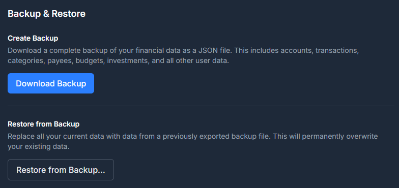
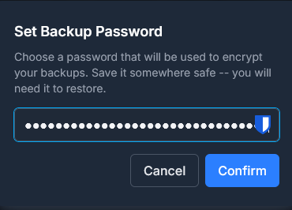
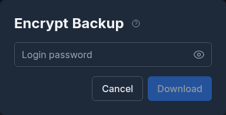
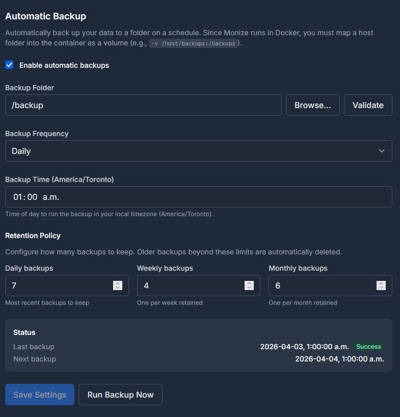
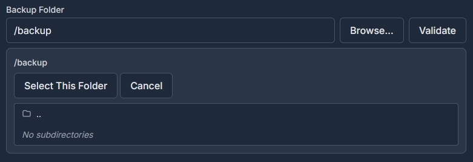
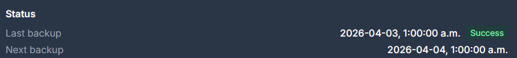

# Backup and Restore

Monize includes a full backup and restore system to protect your financial data. You can create manual backups on demand, schedule automatic backups with intelligent retention policies, and restore from any backup file.

**Backups are encrypted by default.** If you sign in with an email and password, every backup Monize writes is encrypted with that password -- there is nothing to switch on, and nothing extra to remember. That also means a backup file is only as recoverable as the password it was written under, so read [Passwords, Keys, and What You Must Not Lose](#passwords-keys-and-what-you-must-not-lose) before you rely on these files.

---

## Manual Backup

You can download a full backup of your data at any time from the **Settings** page.

1. Navigate to **Settings** (gear icon in the top-right corner)
2. Scroll to the **Backup & Restore** section
3. Click **Download Backup**
4. Enter your password when prompted -- this is the password the file will be encrypted with
5. Your browser will download a file named `monize-backup-YYYY-MM-DD.mzbe`

If your backups are not encrypted (an SSO account that has set no backup password), there is no prompt and the file is named `monize-backup-YYYY-MM-DD.json.gz` instead.


<!-- Screenshot: The Backup & Restore section showing the Export and Restore buttons -->

The backup contains all of your financial data as gzip-compressed JSON, wrapped in an encrypted envelope when encryption is on. It is streamed from the server to avoid memory issues with large datasets.

---

## Restoring from a Backup

Restoring replaces **all** of your existing data with the contents of the backup file. This is useful for recovering from data loss, migrating to a new server, or reverting after an unwanted change.

> **Caution:** Restoring a backup permanently replaces all of your current data. This operation cannot be undone. Consider exporting a backup of your current data first.

### How to Restore

1. Navigate to **Settings** (gear icon in the top-right corner)
2. Scroll to the **Backup & Restore** section
3. Click **Restore Backup**
4. Select a backup file (`.json`, `.json.gz`, or `.gz`)
5. Enter your password to confirm (or re-authenticate via SSO if using OIDC)
6. Click **Confirm Restore**

After a successful restore, a summary is displayed showing the number of records restored for each data type.


<!-- Screenshot: The restore success modal showing the count of restored records per data type -->

### How Restore Works

The restore process runs inside a database transaction with three phases:

1. **Delete** -- All existing user data is removed in foreign-key-safe order
2. **Insert** -- Backup data is inserted in dependency order to satisfy foreign key relationships
3. **Link** -- Deferred relationships (parent categories, linked accounts, linked transactions, etc.) are reconnected

If any step fails, the entire operation is rolled back and no data is changed.

---

## Passwords, Keys, and What You Must Not Lose

Encrypted backups protect your data from anyone who gets hold of the file. The
same property is what makes them unrecoverable if you lose what opens them, and
**Monize has no master override** -- the server genuinely cannot read a backup
without the password it was written under.

There are two separate secrets, they do different jobs, and losing them has
different consequences. Both are worth writing down somewhere durable.

### 1. The password a backup was written with (you)

A backup file opens with **the password that was in effect when that file was
written** -- not your current one.

- **If you sign in with an email and password**, that is your login password on
  the day of the backup. Change your password, and every backup taken before the
  change still needs the **old** one. Monize keeps your current password ready so
  restoring a recent backup usually asks nothing, but a six-month-old file taken
  before a password change will ask -- and only the old password will do.
- **If you sign in with SSO**, it is the backup password you set in Settings, as
  it was at the time of writing. Changing it later does not re-encrypt anything
  already on disk.

> **Before you change your password, ask what would open your oldest backup.**
> The safest habit is to keep every backup password you have ever used in a
> password manager, dated. The second safest is to download a fresh backup
> immediately after changing your password, and treat the older files as needing
> the old one.

### 2. `ENCRYPTION_KEY` (whoever runs the server)

`ENCRYPTION_KEY` is a server setting, not something you type. It encrypts what
the *database* holds: your AI provider API keys, your Google Places API key for
[payee lookup](settings-and-security.md#payee-lookup), emergency-access
credentials, the instance's browser-push key pair, and the copy of your password
that lets scheduled backups run without prompting you every night.

**If it is not set, your automatic backups are not encrypted.** Monize still
starts -- and says so loudly in its startup log every time, including that a
future release will refuse to start without it -- but until an administrator
sets it, there is nowhere to keep the password those backups would be encrypted
with. If your backup files are `.json.gz` rather than `.mzbe`, this is usually
why.

**Keep it safe, and keep it the same.** Store it with your other deployment
secrets -- the same place you keep `JWT_SECRET` and your database password.
Changing it does not re-encrypt anything; it simply makes what is already stored
unreadable.

If `ENCRYPTION_KEY` is lost or changed:

| What happens | What it takes to recover |
|---|---|
| Automatic backups **stop**, reporting an error rather than quietly writing unencrypted files (this is the *changed* case; a key that was never set at all just produces unencrypted backups) | Each user signs in again (or confirms their password in Settings), which stores a fresh copy |
| Stored AI provider API keys become unreadable | Re-enter them in **Settings > AI** |
| A stored Google Places API key becomes unreadable | Re-enter it in **Settings > Payee Lookup** |
| Emergency-access credentials and messages become unreadable | Re-configure emergency access |
| The instance's browser-push key pair becomes unreadable, so no push notification can be delivered | An admin rotates the key pair in **Admin > Notifications**; every device registers again |
| **Your existing backup files are unaffected** | Nothing -- they open with the password they were written under, exactly as before |

That last row is the one people get wrong in both directions. `ENCRYPTION_KEY`
does not unlock a backup file, so losing it does not strand your backups; and
having it does not rescue a backup whose password you have forgotten.

> **Upgrading from an older version?** This setting used to be called
> `AI_ENCRYPTION_KEY` and was documented as being for AI providers only. The old
> name still works and still takes precedence, so an existing deployment needs no
> changes. If you never set it, your automatic backups were -- and still are --
> being written **unencrypted**: set `ENCRYPTION_KEY` (`openssl rand -hex 32`),
> restart, and sign in once so Monize can capture your password. Backups written
> from then on will be `.mzbe`.

---

## Encrypted Backups

An unencrypted backup is a gzip-compressed JSON file -- anyone who obtains it (intercepted in transit, copied from a cloud-sync folder, recovered from an old drive) can read every transaction, payee, and account name. Encryption wraps the backup in a password-protected envelope so the contents stay confidential even if the file leaks.

Both manual downloads and scheduled [automatic backups](#automatic-backups) are encrypted whenever Monize has a usable password for your account, which for a password account is all the time.

### Why Encrypt Backups

Encryption is the default rather than an option because a backup is the one file that contains everything, and it is the file most likely to end up somewhere you did not plan:

- Backups folders get synced to cloud storage (Dropbox, OneDrive, Google Drive, Backblaze)
- Backups get emailed, copied to a NAS, or uploaded to remote storage
- Servers, volumes, and external drives get shared, sold, or stolen

The cost of that default is the thing to be deliberate about: an encrypted backup is exactly as recoverable as the password it was written with. See [Passwords, Keys, and What You Must Not Lose](#passwords-keys-and-what-you-must-not-lose).

### Encryption for Local-Password Users

If you log in with an email and password (the default), your backups are
encrypted with that password automatically. There is no separate password to
invent, and nothing to switch on: Monize captures your password at the only
moment it ever sees it -- when you register, sign in, or change it -- stores an
encrypted copy under the server's `ENCRYPTION_KEY`, and uses that copy so the
nightly job can encrypt without prompting you. **Your password is never stored
in plaintext.**

**Settings > Backup & Restore** shows the state under **Backup Encryption**:

| What you see | What it means |
|---|---|
| **Enabled** -- "Backups are encrypted with your login password." | Nothing to do. |
| **Not enabled**, with an **Enable with My Login Password** button | Monize has no copy of your password yet -- usually because you have stayed signed in since before this feature existed. Click the button and confirm your login password; backups from then on are encrypted. Signing out and back in does the same thing. |
| "This server is not configured to encrypt backups" | The server has no `ENCRYPTION_KEY`, so **your backups are being written unencrypted**. That is a deployment setting an administrator has to fix -- see [ENCRYPTION_KEY](#2-encryption_key-whoever-runs-the-server). |


<!-- Screenshot: The "Enable Encrypted Backups" modal showing the password confirmation field -->

There is no **Disable** button for a password account: your password is
re-captured every time you sign in, so turning encryption off would last until
your next login. When you change your login password, the stored copy is updated
automatically -- but files already on disk keep needing the password they were
written with.

### Setting a Backup Password (OIDC / SSO Users)

If your account uses [Single Sign-On (OIDC)](settings-and-security.md#single-sign-on-oidc), there is no login password to reuse. You set a dedicated backup password instead.

1. Navigate to **Settings > Backup & Restore**
2. In the **Backup Encryption** section, click **Set Backup Password**
3. Enter a new backup password (must be at least 12 characters and not appear in the [Have I Been Pwned](https://haveibeenpwned.com/) breach database)
4. Click **Confirm**

The backup password is independent from your SSO credentials -- you choose and manage it yourself. Save it somewhere secure (a password manager is ideal); without it, encrypted backups cannot be restored.

To change it later, click **Change Backup Password** and repeat the process. The new password takes effect for backups written from that point on; previously-written backups remain decryptable only with the password that was active when they were created.

### Downloading an Encrypted Backup

Once encryption is enabled, exporting a backup adds one extra step:

1. Click **Download Backup**
2. A modal appears asking you to enter the encryption password (your login password for local users, your backup password for OIDC users)
3. Click **Download**
4. The browser saves a file named `monize-backup-YYYY-MM-DD.mzbe`

The `.mzbe` extension (Monize Backup Encrypted) distinguishes encrypted backups from the unencrypted `.json.gz` format. The encryption password is sent over HTTPS in a request header and is never written to access logs.


<!-- Screenshot: The "Encrypt Backup" password prompt modal shown when downloading -->

### Restoring an Encrypted Backup

The restore flow accepts both unencrypted (`.json`, `.json.gz`, `.gz`) and encrypted (`.mzbe`) files. For an encrypted backup:

1. Navigate to **Settings > Backup & Restore** and click **Restore from Backup**
2. Select your `.mzbe` file
3. Authenticate as usual (current login password or OIDC re-authentication)
4. Click **Confirm Restore**

Monize first tries to decrypt the backup using your current password (or the password stored in your account for auto-backup use). If decryption succeeds, the restore proceeds normally.

If decryption fails -- typically because the backup was created when you had a *different* password -- a second prompt appears:

> **Backup Password Required.** This backup is encrypted, and your current password did not unlock it. Enter the password that was used when this backup was created.

Enter the original password (the one in effect at the time the backup was written) and click **Submit**. This handles cases where you have changed your password after creating the backup, or where you are restoring a very old backup onto a fresh install.

> **If you have lost the password,** an encrypted backup cannot be recovered. Monize has no master override -- by design, the server cannot decrypt the file without the password. Always keep a copy of your backup password in a password manager.

### Changing or Disabling the Backup Password

- **Local users:** changing your login password automatically updates the stored copy used by auto-backups, so backups written from then on use the new password. Files already written still need the password that was active when they were created -- keep it. There is no way to turn encryption off for a password account, because the password is re-captured at every sign-in.
- **OIDC users:** click **Change Backup Password** to set a new one, or **Disable** to turn encryption off entirely. As with local users, existing encrypted backups still require whichever password was active when they were written.

### Encrypted Backup File Format

An encrypted backup is a single binary file with a small header followed by the encrypted payload:

| Bytes | Length | Field |
|-------|--------|-------|
| 0--3  | 4      | Magic identifier: `MZBE` (ASCII) |
| 4     | 1      | Format version (`0x01`) |
| 5     | 1      | Key derivation function (`0x01` = scrypt) |
| 6--21 | 16     | Random salt |
| 22--33 | 12    | AES-GCM initialization vector |
| 34--49 | 16    | AES-GCM authentication tag |
| 50+   | --     | Ciphertext (the gzipped JSON backup payload) |

| Detail | Value |
|--------|-------|
| **Cipher** | AES-256-GCM (authenticated encryption) |
| **Key derivation** | scrypt with N=32768, r=8, p=1, 64 MB memory cap |
| **Per-backup salt** | 16 bytes random |
| **Per-backup IV** | 12 bytes random |
| **Wrong-password detection** | GCM authentication tag mismatch |

Any tampering with the file -- truncation, bit-flips, header swaps -- is detected by the GCM authentication tag and causes the restore to fail safely.

---

## Automatic Backups

Monize can automatically back up your data on a schedule, saving compressed backup files to a folder on the server.

Automatic backup is a deployment concern, so it is configured by an administrator on **Admin > Backups**. Everyone else is enrolled automatically on the deployment defaults and has nothing to set up; the manual export and restore on **Settings > Backup & Restore** are unaffected.

### Enabling Auto-Backup

1. Navigate to **Admin > Backups** (admin role required)
2. Toggle **Enable Automatic Backups** to on
3. Configure the folder path, frequency, timing, and retention settings
4. Click **Save Settings**


<!-- Screenshot: The Automatic Backup section showing the configuration form with folder path, frequency, timing, and retention settings -->

### Folder Configuration

Auto-backups are saved to a folder on the server filesystem. The folder path must be an absolute path (starting with `/`).

- Use the **Browse** button to navigate the server filesystem and select a folder
- Click **Validate** to confirm the folder exists and is writable
- A common choice is `/backups` (see [Docker Volume Configuration](#docker-volume-configuration) below)


<!-- Screenshot: The folder browser dialog showing directory navigation for selecting the backup folder -->

> **Note:** The folder must be writable by the backend process. In Docker deployments, you must map a host directory to the container path using a volume mount.

### Frequency and Timing

| Frequency | Description |
|-----------|-------------|
| **Every 6 hours** | Backs up 4 times per day, aligned to the configured backup time |
| **Every 12 hours** | Backs up twice per day, aligned to the configured backup time |
| **Daily** | Backs up once per day at the configured time |
| **Weekly** | Backs up once per week at the configured time |

Set the **Backup Time** to control when backups run (24-hour format, e.g., `02:00` for 2 AM).

The backup time is interpreted in your configured timezone. The timezone is automatically detected from your user preferences.

### Retention Policy

Monize uses a three-tier retention system to balance storage usage with backup history:

| Tier | Default | Range | Description |
|------|---------|-------|-------------|
| **Daily** | 7 | 0--365 | Number of most recent backups to keep |
| **Weekly** | 4 | 0--52 | One backup per week, kept for this many weeks |
| **Monthly** | 6 | 0--120 | One backup per month, kept for this many months |

#### How Retention Works

1. The most recent backups (up to the daily retention count) are always kept
2. Beyond the daily window, one backup per ISO week is promoted and renamed to a weekly backup
3. Beyond the weekly window, one backup per calendar month is promoted and renamed to a monthly backup
4. Files that do not fall into any retention tier are deleted

#### File Naming

Backup files are automatically named based on their retention tier:

| Tier | File Name Pattern |
|------|-------------------|
| Daily | `monize-backup-YYYY-MM-DDTHH-MM-SS.json.gz` |
| Weekly | `monize-backup-weekly-WW-YYYY-MM-DDTHH-MM-SS.json.gz` |
| Monthly | `monize-backup-monthly-MM-YYYY-MM-DDTHH-MM-SS.json.gz` |

When [encrypted backups](#encrypted-backups) are enabled, the extension changes from `.json.gz` to `.mzbe` (Monize Backup Encrypted). Retention promotion and cleanup recognise both extensions so unencrypted backups from before you enabled the feature are still managed correctly.

> **Note:** If the server cannot decrypt the stored backup password -- typically because `ENCRYPTION_KEY` changed -- the scheduled backup **fails** rather than silently writing an unencrypted file. Sign in again (or confirm your password in **Settings > Backup & Restore**) to store a fresh copy. A backup that goes out unencrypted for any other reason is recorded as a warning in the server log.

### Run Backup Now

Click **Run Backup Now** to trigger an immediate backup outside of the regular schedule. The backup is saved to the configured folder and follows the same retention rules.

### Status Monitoring


<!-- Screenshot: The auto-backup status area showing last backup time, status, and next scheduled backup -->

The auto-backup section displays the current status:

| Field | Description |
|-------|-------------|
| **Last Backup** | Date and time of the most recent backup |
| **Status** | `success` or `failed` |
| **Error** | Error message if the last backup failed |
| **Next Backup** | Scheduled time for the next automatic backup |

---

## What Is Backed Up

A backup includes all of your financial data:

| Category | Data Included |
|----------|---------------|
| **Preferences** | User preferences, currency preferences, auto-backup settings |
| **Accounts** | All account types and their settings |
| **Transactions** | Transactions, transaction splits, and associated tags |
| **Scheduled Transactions** | Recurring bills/deposits, splits, and overrides |
| **Categories & Payees** | Category hierarchy, payees, and payee aliases |
| **Tags** | All tags and tag assignments |
| **Loans** | Loan/mortgage interest-rate change history and saved overpayment scenarios |
| **Investments** | Securities, security prices, security tags, holdings, and investment transactions |
| **Budgets** | Budgets, budget categories, budget periods, and budget alerts |
| **Reports** | Custom report definitions |
| **Import Settings** | Saved column mapping presets |
| **Currencies** | Currency definitions |
| **Net Worth History** | Monthly account balance snapshots |

> **Note:** User credentials (password, 2FA secrets, trusted devices, refresh tokens) are **not** included in backups. After restoring on a new server, you will need to log in with your existing credentials.

---

## Support Backup (Share a Bug Report Safely)

When you hit a bug that is hard to describe, a **Support Backup** lets you attach real-looking data to a GitHub issue **without sharing your actual finances**. Find **Create Support Backup** under **Settings -> Help & Support**.

A support backup is an ordinary backup file that restores through the normal flow into a throwaway instance -- there is nothing new to install to open it -- but it is **de-identified** first:

- **Names are masked** and free text and secrets are dropped -- descriptions, notes, memos, account numbers, and API keys.
- **Your amounts are scaled** by a single hidden multiplier, while public values that would give the multiplier away -- FX rates, security prices, interest rates -- are kept intact.
- **Every UUID is remapped**, so the file cannot be correlated back to your account.
- The engine is a strict **allowlist**, so a future database column cannot silently start leaking.

You can **scope it to specific accounts**, protect it with a password, and **preview the before/after** (a two-column diff) before generating.

> **Important:** This is de-identification, not anonymity. Dates, frequencies, and structure survive **on purpose** so bugs still reproduce -- do not treat a support backup as fully anonymous, and do not share the multiplier.

---

## Backup File Format

Backups are gzip-compressed JSON files with the following structure:

```json
{
  "version": 1,
  "exportedAt": "2026-04-03T02:00:00.000Z",
  "currencies": [...],
  "user_preferences": [...],
  "accounts": [...],
  "transactions": [...],
  ...
}
```

- **version** -- Backup format version (currently `1`)
- **exportedAt** -- ISO 8601 timestamp of when the backup was created
- Each table is represented as an array of row objects

---

## Docker Volume Configuration

When running Monize in Docker, the backend container runs with a read-only filesystem for security. To enable auto-backups, you must map a host directory to a container path using a Docker volume.

Add a volume mount to the backend service in your `docker-compose.yml`:

```yaml
services:
  backend:
    # ... existing configuration ...
    volumes:
      - /path/on/host/backups:/backups
```

Then configure `/backups` as your auto-backup folder path on the **Admin > Backups** page.

> **Tip:** Choose a host path that is included in your server's own backup strategy (e.g., a path covered by your NAS snapshots or cloud sync) for an extra layer of protection.

---

## Security

Backup and restore operations include several security measures:

| Measure | Description |
|---------|-------------|
| **Authentication** | All backup operations require a valid login session |
| **Restore verification** | Restoring requires password re-entry or OIDC re-authentication |
| **File encryption by default** | Backups are wrapped in an AES-256-GCM envelope keyed by your own password whenever the server holds a usable copy of it -- automatic for password accounts (see [Encrypted Backups](#encrypted-backups)) |
| **Server-side key** | The stored copy of that password, AI provider keys, the Google Places key, emergency-access credentials and the browser-push key pair are encrypted with `ENCRYPTION_KEY`. Without it nothing can be stored encrypted and backups go out in the clear; the server warns at every start and a future release will require it |
| **User isolation** | Backups only contain data belonging to the authenticated user |
| **SQL injection prevention** | Column names are validated against the database schema; all values use parameterized queries |
| **Table allowlist** | Only the 24 approved data tables can be restored |
| **File size limit** | Restore files are limited to 100 MB |
| **Path traversal prevention** | Auto-backup folder paths are validated to prevent directory traversal attacks |
| **Transaction safety** | Restore runs in a database transaction with full rollback on error |
| **Demo restrictions** | Restore and auto-backup configuration are disabled in demo mode, with a note on the page saying why |

---

## Tips and Best Practices

- **Export a backup before major changes** -- Before bulk-deleting data, re-importing, or updating Monize, download a manual backup first
- **Test your backups** -- Periodically verify that a backup can be restored successfully by restoring on a test instance
- **Use auto-backup with retention** -- Administrators should enable automatic backups on **Admin > Backups** with the default retention settings (7 daily, 4 weekly, 6 monthly) for comprehensive coverage without excessive storage use
- **Check that your backups actually are encrypted** -- Look at **Settings > Backup & Restore**: it should say **Enabled**, and your backup files should end in `.mzbe`. A `.json.gz` file is readable by anyone who has it
- **Save every backup password you have used, dated** -- A backup opens with the password in effect when it was written, not your current one. A lost password means a lost backup: there is no master override. See [Passwords, Keys, and What You Must Not Lose](#passwords-keys-and-what-you-must-not-lose)
- **Back up `ENCRYPTION_KEY` with your other deployment secrets** -- If you run the server, store it wherever you keep `JWT_SECRET` and your database password. Losing it does not lock you out of your backup *files*, but it does make every stored API key and credential unreadable and stops automatic backups until each user signs in again
- **Map the backup volume to durable storage** -- Point your Docker volume at a path that is covered by your server's own backup or sync strategy
- **Keep off-site copies** -- Periodically download a manual backup and store it separately from your server (e.g., cloud storage or external drive) for disaster recovery
- **Set a quiet backup time** -- Schedule auto-backups during off-peak hours (e.g., 2:00 AM) to minimize any performance impact
