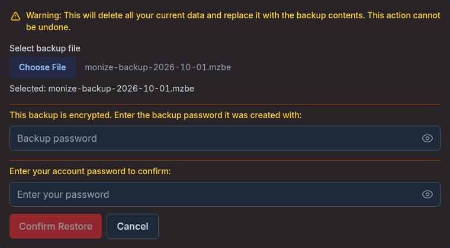
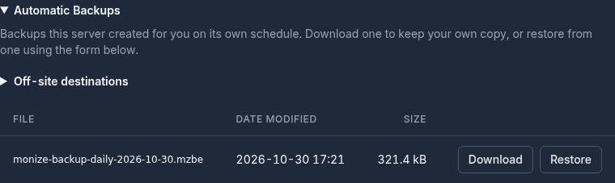
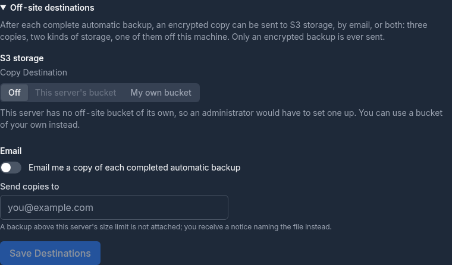
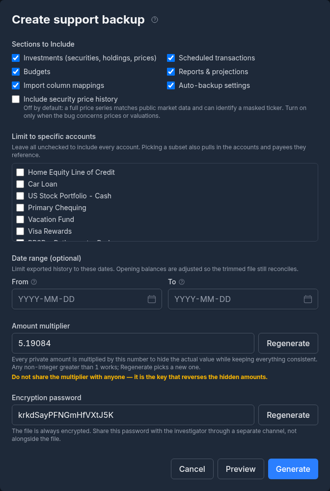
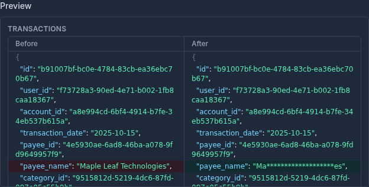

# Backup and Restore

Monize includes a full backup and restore system to protect your financial data. You can download a backup on demand, restore from any backup file, take and restore the automatic backups the server keeps for you, and send copies of those off the server. An administrator sets the schedule and retention of the automatic backups for the whole deployment.

**Backups are encrypted by default.** If you sign in with an email and password, every backup Monize writes is encrypted with that password -- there is nothing to switch on, and nothing extra to remember. That also means a backup file is only as recoverable as the password it was written under, so read [Passwords, Keys, and What You Must Not Lose](#passwords-keys-and-what-you-must-not-lose) before you rely on these files.

Everything for your own backups is in **Settings > Backup & Restore**: open **Settings** (the gear icon with your name in the top-right corner) and choose **Backup & Restore** in the settings menu.


---

## Manual Backup

You can download a full backup of your data at any time.

1. Open **Settings > Backup & Restore**
2. Under **Create Backup**, click **Download Backup**
3. In the **Encrypt Backup** dialog, enter the password to encrypt the file with -- your login password (or your backup password, if you sign in with SSO)
4. Click **Download**
5. Your browser downloads a file named `monize-backup-YYYY-MM-DD.mzbe`, dated in your own time zone


> [!WARNING]
> The file is encrypted with exactly what you type in that dialog. Monize does not check it against your login password, so a typo produces a file that only the mistyped password opens. Type carefully, or use a password manager.

If your backups are not encrypted (an SSO account that has set no backup password), there is no dialog and the file is named `monize-backup-YYYY-MM-DD.json.gz` instead.

The backup contains all of your financial data, including the files attached to your transactions, as gzip-compressed JSON, wrapped in an encrypted envelope when encryption is on. It is streamed from the server, so a large dataset does not have to fit in memory.

If some attachment files could not be read intact, the download still completes but you are told the backup is **incomplete** and how many attachments are missing or failed their integrity check. Do not treat such a file as a full backup: fix the attachment storage and export again.

---

## Restoring from a Backup

Restoring replaces **all** of your existing data with the contents of the backup file. This is useful for recovering from data loss, migrating to a new server, or reverting after an unwanted change.

> [!CAUTION]
> Restoring a backup permanently replaces all of your current data. This operation cannot be undone. Consider downloading a backup of your current data first.

### How to Restore

1. Open **Settings > Backup & Restore**
2. Under **Restore from Backup**, click **Restore from Backup...**
3. Read the warning, then use **Select backup file** to pick a backup (`.mzbe`, `.json.gz`, `.gz` or `.json`)
4. If the file is encrypted, a **Backup password** field appears: enter the password the backup was created with. You can leave it empty to try your current password first.
5. Enter your account password to confirm (SSO accounts click **Re-authenticate and Restore** instead, sign in again with their identity provider, and pick the file again when they come back)
6. Click **Confirm Restore**



You can also restore one of the [automatic backups the server keeps for you](#automatic-backups-kept-for-you): its **Restore** button puts that file into this same form.

After a successful restore, a **Restore Complete** dialog lists the number of records restored for each kind of data and the total. It also names anything that could not be brought back as it was:

- Attachments whose files the backup did not carry intact (export a fresh backup once attachment storage is healthy)
- AI providers restored without a usable API key (enter the key again in **Settings > AI Settings**)
- Government bond holdings that could not be linked to their bond on this server, or whose series could not be fetched from the official source, with what to do for each


### How Restore Works

A restore is all-or-nothing:

1. **Checks first.** The file is decrypted, decompressed and validated, your password is checked, and attachment files are prepared, before anything is deleted. A file that is too large for this server, damaged, or written by a newer version of Monize than this one, and a server whose database is missing an update, are refused at this point, with a message saying why and leaving your data untouched.
2. **Replace.** In one database transaction, all of your existing data is removed and the backup's data is inserted in dependency order, with links between records (parent categories, linked accounts, transfers and so on) reconnected at the end.
3. **Commit.** If any step fails, the entire transaction is rolled back and no data is changed.

If the connection drops before the server answers, Monize tells you so: reload the page to see whether the restore applied before trying again. A restore that was interrupted by a server restart can be retried after about 15 minutes, and the message says how long to wait.

The largest backup a server accepts for restore depends on how much memory the server has; an administrator can adjust the limits. A file over the limit is refused before anything changes.

---

## Passwords, Keys, and What You Must Not Lose

Encrypted backups protect your data from anyone who gets hold of the file. The
same property is what makes them unrecoverable if you lose what opens them, and
**Monize has no master override** -- the server genuinely cannot read a backup
without the password it was written under.

There are two separate secrets, they do different jobs, and losing them has
different consequences. Both are worth writing down somewhere durable.

### 1. The password a backup was written with (you)

A backup file opens with **the password that was in effect when that file was
written** -- not your current one.

- **If you sign in with an email and password**, that is your login password on
  the day of the backup (or, for a manual download, the password you typed in
  the **Encrypt Backup** dialog). Change your password, and every backup taken
  before the change still needs the **old** one. Restoring a recent backup
  usually asks nothing extra, but a six-month-old file taken before a password
  change will ask -- and only the old password will do.
- **If you sign in with SSO**, it is the backup password you set in Settings, as
  it was at the time of writing. Changing it later does not re-encrypt anything
  already on disk.

> [!IMPORTANT]
> **Before you change your password, ask what would open your oldest backup.**
> The safest habit is to keep every backup password you have ever used in a
> password manager, dated. The second safest is to download a fresh backup
> immediately after changing your password, and treat the older files as needing
> the old one.

### 2. `ENCRYPTION_KEY` (whoever runs the server)

`ENCRYPTION_KEY` is a server setting, not something you type. It encrypts what
the *database* holds: your AI provider API keys, your Google Places API key for
[payee lookup](settings-and-security.md#payee-lookup), emergency-access links and
messages, mailbox, bank sync and off-site storage credentials, the instance's
browser-push key pair, and the server's copy of each user's backup key -- which
is what lets scheduled backups run encrypted without prompting you every night.

**If it is not set, your automatic backups are not encrypted.** Monize still
starts -- and says so loudly in its startup log every time, including that a
future release will refuse to start without it -- but until an administrator
sets it, there is nowhere to keep the backup key those backups would be
encrypted with. If your backup files are `.json.gz` rather than `.mzbe`, this is
usually why.

**Keep it safe, and keep it the same.** Store it with your other deployment
secrets -- the same place you keep `JWT_SECRET` and your database password.
Changing it does not re-encrypt anything; it simply makes what is already stored
unreadable.

If `ENCRYPTION_KEY` is lost or changed:

| What happens | What it takes to recover |
|---|---|
| Automatic backups **stop**, reporting an error rather than quietly writing unencrypted files (this is the *changed* case; a key that was never set at all just produces unencrypted backups) | Each user signs in again (or confirms their password in **Settings > Backup & Restore**), which stores a fresh backup key |
| Stored AI provider API keys become unreadable | Re-enter them in **Settings > AI Settings** |
| A stored Google Places API key becomes unreadable | Re-enter it in **Settings > Payee Lookup** |
| Emergency-access links and messages become unreadable | Re-configure emergency access |
| Stored mailbox, bank sync and off-site bucket credentials become unreadable | Connect them again |
| The instance's browser-push key pair becomes unreadable, so no push notification can be delivered | An admin rotates the key pair in **Admin > Notifications**; every device registers again |
| **Your existing backup files are unaffected** | Nothing -- they open with the password they were written under, exactly as before |

That last row is the one people get wrong in both directions. `ENCRYPTION_KEY`
does not unlock a backup file, so losing it does not strand your backups; and
having it does not rescue a backup whose password you have forgotten.

> [!NOTE]
> **Upgrading from an older version?** This setting used to be called
> `AI_ENCRYPTION_KEY` and was documented as being for AI providers only. The old
> name still works and still takes precedence, so an existing deployment needs no
> changes. If you never set it, your automatic backups were -- and still are --
> being written **unencrypted**: set `ENCRYPTION_KEY` (`openssl rand -hex 32`),
> restart, and sign in once so Monize can make your backup key. Backups written
> from then on will be `.mzbe`.

---

## Encrypted Backups

An unencrypted backup is a gzip-compressed JSON file -- anyone who obtains it (intercepted in transit, copied from a cloud-sync folder, recovered from an old drive) can read every transaction, payee, and account name, and the API keys of your AI providers. Encryption wraps the backup in a password-protected envelope so the contents stay confidential even if the file leaks.

Both manual downloads and scheduled [automatic backups](#automatic-backups) are encrypted whenever Monize has a usable backup key for your account, which for a password account is all the time.

### Why Encrypt Backups

Encryption is the default rather than an option because a backup is the one file that contains everything, and it is the file most likely to end up somewhere you did not plan:

- Backups folders get synced to cloud storage (Dropbox, OneDrive, Google Drive, Backblaze)
- Backups get emailed, copied to a NAS, or uploaded to remote storage
- Servers, volumes, and external drives get shared, sold, or stolen

The cost of that default is the thing to be deliberate about: an encrypted backup is exactly as recoverable as the password it was written with. See [Passwords, Keys, and What You Must Not Lose](#passwords-keys-and-what-you-must-not-lose).

### Encryption for Local-Password Users

If you sign in with an email and password (the default), your backups are
encrypted with that password automatically. There is no separate password to
invent, and nothing to switch on.

**Monize never stores your password.** At the only moments it sees it -- when
you register, sign in, or change it -- it creates a random backup key and keeps
two copies of it: one locked with your password, which goes into the header of
every automatic backup so your password opens the file, and one locked with the
server's `ENCRYPTION_KEY`, so the nightly job can encrypt without asking you.
Each password change makes a new key, so an old password never opens a backup
written after the change.

**Settings > Backup & Restore** shows the state under **Backup Encryption**:

| What you see | What it means |
|---|---|
| **Enabled** -- "Backups are encrypted with your login password." | Nothing to do. |
| **Not enabled**, with an **Enable with My Login Password** button | Monize has no backup key for you yet -- usually because you have stayed signed in since before this feature existed. Click the button and confirm your login password in the **Enable Encrypted Backups** dialog; backups from then on are encrypted. Signing out and back in does the same thing. |
| "This server is not configured to encrypt backups, so they are written unencrypted." | The server has no `ENCRYPTION_KEY`, so **your automatic backups are being written unencrypted**. That is a deployment setting an administrator has to fix -- see [ENCRYPTION_KEY](#2-encryption_key-whoever-runs-the-server). |

There is no **Disable** button for a password account: your backup key is
remade every time you sign in, so turning encryption off would last until your
next sign-in. When you change your login password, a new key is made
automatically -- but files already on disk keep needing the password they were
written with.

### Setting a Backup Password (OIDC / SSO Users)

If your account uses [Single Sign-On (OIDC)](settings-and-security.md#single-sign-on-oidc), there is no login password to reuse. You set a dedicated backup password instead.

1. Open **Settings > Backup & Restore**
2. In the **Backup Encryption** section, click **Set Backup Password**
3. Enter a new backup password (at least 12 characters, and not in the [Have I Been Pwned](https://haveibeenpwned.com/) breach database)
4. Click **Confirm**

The backup password is independent from your SSO credentials -- you choose and manage it yourself. Save it somewhere secure (a password manager is ideal); without it, encrypted backups cannot be restored.

To change it later, click **Change Backup Password** and repeat the process. The new password takes effect for backups written from that point on; previously-written backups remain decryptable only with the password that was active when they were created.

### Downloading an Encrypted Backup

See [Manual Backup](#manual-backup): with encryption on, **Download Backup** first asks for the password in the **Encrypt Backup** dialog. The `.mzbe` extension (Monize Backup Encrypted) distinguishes encrypted backups from the unencrypted `.json.gz` format. The password is sent over HTTPS in a request header and is never written to access logs.

### Restoring an Encrypted Backup

The restore form accepts both unencrypted (`.json`, `.json.gz`, `.gz`) and encrypted (`.mzbe`) files, and recognises an encrypted file as soon as you pick it: the form then shows *"This backup is encrypted. Enter the backup password it was created with:"* above the account password.

Monize tries, in order, the backup password you entered, your account password, and the backup key it holds for you (which opens your automatic backups). If none of them opens the file -- typically because it was created when you had a *different* password -- you are asked to enter the password it was created with in the **Backup password** field and try again. This handles cases where you have changed your password since the backup, or are restoring a very old backup onto a fresh install.

> [!WARNING]
> **If you have lost the password,** an encrypted backup cannot be recovered. Monize has no master override -- by design, the server cannot decrypt the file without the password. Always keep a copy of your backup password in a password manager.

### Changing or Disabling the Backup Password

- **Local users:** changing your login password automatically makes a new backup key, so backups written from then on use the new password. Files already written still need the password that was active when they were created -- keep it. There is no way to turn encryption off for a password account.
- **OIDC users:** click **Change Backup Password** to set a new one, or **Disable** to turn encryption off entirely. As with local users, existing encrypted backups still require whichever password was active when they were written.

### How the Encryption Works

| Detail | Value |
|--------|-------|
| **Cipher** | AES-256-GCM (authenticated encryption) |
| **Key derivation** | scrypt (N=32768, r=8, p=1) from the password, with a random salt per file |
| **Integrity** | Every part of the file is authenticated, so a wrong password, truncation, bit-flips or a swapped header are all detected and the restore fails safely |
| **Automatic backups** | Encrypted with your random backup key; the key, locked with your password, travels in the file's header |

An encrypted backup starts with the four ASCII characters `MZBE`, which is how Monize (and you) can tell one apart from a plain gzip file.

---

## Automatic Backups

Monize can automatically back up every account's data on a schedule, writing a compressed (and, normally, encrypted) backup file per account to the server's backup storage.

Automatic backup is a deployment concern, so it is configured by an administrator on **Admin > Backups**, and the schedule and retention set there apply to **every active account** on the deployment. Everyone else has nothing to set up: they can download or restore the files kept for them (see [Automatic Backups Kept for You](#automatic-backups-kept-for-you)) and choose [off-site copies](#off-site-copies) of their own.

> [!NOTE]
> An automatic backup is **not** a full database backup. It holds each account's own financial records, in the same format as a manual download, and nothing else: no database schema, no server configuration, no other deployment's data. For whole-instance disaster recovery, back up the PostgreSQL database and the attachment storage with your own tools.

### Enabling Auto-Backup

1. Open **Admin > Backups** (admin role required)
2. Turn on **Enable automatic backups**
3. Configure the folder, frequency, time and retention
4. Click **Save Policy**


Saving applies the policy to every account at once. A line under the description says how far it reaches: *"Scheduled on N of M active accounts on this deployment."*

### Storage and Folder Configuration

The **Backup Storage** line shows where backups go, chosen by the server's `BACKUP_STORAGE_PROVIDER` setting: a **Local folder** (the default) or **S3-compatible object storage**. It also says how many backup files the store currently holds for your own account. Switching storage does not move existing backups.

With a local folder, the **Backup Folder** must be an absolute path inside a directory the server allows (`/data/backups` by default; see [Docker Volume Configuration](#docker-volume-configuration)):

- Use **Browse...** to navigate the server's backup directories and click **Select This Folder**
- Click **Validate** to confirm the folder exists and is writable
- Each account's backups go into a folder of their own inside it, named for the account's ID; the page shows an example path


With S3 storage there is no folder to choose: the bucket and key prefix are the deployment's, and each account's backups go under their own key prefix.

If the configured storage cannot be written to, the page says *"This deployment has no backup storage"* before you set a schedule, rather than after the first failed run.

> [!NOTE]
> The folder must be writable by the backend process. In Docker deployments, you must map a host directory to the container path using a volume mount.

### Frequency and Timing

| Frequency | Description |
|-----------|-------------|
| **Every 6 Hours** | Backs up 4 times per day, starting at the configured backup time |
| **Every 12 Hours** | Backs up twice per day, starting at the configured backup time |
| **Daily** | Backs up once per day at the configured time |
| **Weekly** | Backs up once per week at the configured time |

Set the **Backup Time** to control when backups run (24-hour format, e.g., `02:00` for 2 AM). The label shows the time zone it is interpreted in, which is the administrator's own time-zone preference. Backups start on the hour, so the minutes are not used.

### Retention Policy

Monize uses a three-tier retention system to balance storage usage with backup history:

| Tier | Default | Range | Description |
|------|---------|-------|-------------|
| **Daily backups** | 7 | 0--365 | The most recent days' backups to keep |
| **Weekly backups** | 4 | 0--52 | Weekly copies to keep |
| **Monthly backups** | 6 | 0--120 | Monthly copies to keep |

#### How Retention Works

1. Each run writes that day's **daily** backup. There is one daily file per day: with a 6- or 12-hour frequency, a later run the same day replaces the earlier file.
2. On the 7th, 14th, 21st and 28th of the month, the day's backup is also kept as a **weekly** copy.
3. On the 1st of the month, the day's backup is also kept as a **monthly** copy.
4. After each run, the oldest files beyond each tier's count are deleted.

A backup that could not include every attachment is saved as a separate **partial** file instead of a daily one, so it never takes the place of a complete backup. Partial files are kept to the same count as daily ones.

#### File Naming

Backup files are named by their retention tier and the date (in the policy's time zone):

| Tier | File Name Pattern |
|------|-------------------|
| Daily | `monize-backup-daily-YYYY-MM-DD.mzbe` |
| Weekly | `monize-backup-weekly-YYYY-MM-DD.mzbe` |
| Monthly | `monize-backup-monthly-YY-MM.mzbe` |
| Partial | `monize-backup-partial-YYYY-MM-DD.mzbe` |

An account whose backups are not [encrypted](#encrypted-backups) gets `.json.gz` instead of `.mzbe`. Retention recognises both extensions, so unencrypted backups from before encryption was turned on are still managed correctly. Files that do not follow these names -- including backups an older version wrote directly into the base folder -- are never deleted by retention; remove those by hand once you no longer need them.

> [!NOTE]
> If the server cannot use an account's stored backup key -- typically because `ENCRYPTION_KEY` changed -- that account's scheduled backup **fails** rather than silently writing an unencrypted file. The person signs in again (or confirms their password in **Settings > Backup & Restore**) to store a fresh key. A backup that goes out unencrypted for any other reason is recorded as a warning in the server log.

### Back Up Every Account Now

Click **Back Up Every Account Now** to back up every active account immediately, outside the regular schedule. The files are written to the same storage and follow the same retention rules; the regular schedule is not moved. When it finishes, a message says how many accounts were backed up, and how many were partial or failed.

### Status Monitoring

Once backups have run, the page shows a **Deployment Status** box:


| Field | Description |
|-------|-------------|
| **Most recent backup** | Date and time of the latest backup of any account, with its result: **Success**, **Partial** or **Failed** |
| **Error** | The error message, if the latest backup failed |
| **Next scheduled backup** | When the next automatic backup of any account is due |

A failed or partial backup also raises an alert in the administrators' notification bell.

---

## Automatic Backups Kept for You

When automatic backups run on your server, **Settings > Backup & Restore** has a folded **Automatic Backups** list of the files the server holds for your own account. Click the heading to open it.

Each file shows its name, **Date Modified** and **Size**, with two buttons:

- **Download** saves a copy to your device
- **Restore** puts that file into the restore form above, so it goes through the same password prompt, warning, confirmation and summary as a file picked from disk (see [How to Restore](#how-to-restore))



The list is absent on a server that runs no automatic backups. It stays while a switched-off schedule's files are still there to recover, and says so if it cannot be loaded rather than looking empty. Administrators also see a link to **Admin > Backups** here.

### Off-Site Copies

A backup that lives only on the server is lost with the server. Under **Off-site destinations** inside the Automatic Backups list, you can have an encrypted copy of each complete automatic backup sent elsewhere -- three copies, two kinds of storage, one of them off the machine:

- **S3 storage** -- set **Copy Destination** to **Off**, **This server's bucket** (when the administrator has configured one) or **My own bucket**. For your own bucket, enter the **Bucket**, **Region**, an optional **Key prefix**, an **Endpoint** for an S3-compatible service such as MinIO, R2 or B2 (with **Use path-style addressing** where it needs it), and an **Access key ID** and **Secret access key**. The keys are stored encrypted and never shown again; **Remove Stored Credentials** forgets them.
- **Email** -- turn on **Email me a copy of each completed automatic backup** and enter the address in **Send copies to**. A backup larger than the server's email size limit is not attached; you receive a notice naming the file instead.

Click **Save Destinations** to keep the settings.



Only an **encrypted** backup ever leaves the server: an unencrypted one is skipped and an administrator is alerted. A copy sent to a bucket is only ever added, never overwritten or deleted by Monize, so ageing old copies out is up to the bucket's own lifecycle rules. Each backup in the list shows a small icon per destination with the copy's state (for example **Copied**, **Sending**, **Failed** or **Skipped: not encrypted**); a failed copy is retried automatically.

---

## What Is Backed Up

A backup includes all of your own data:

| Category | Data Included |
|----------|---------------|
| **Preferences** | User preferences, currency preferences, notification preferences, reminders and notifications |
| **Accounts** | All account types and their settings, and financial institutions |
| **Transactions** | Transactions, splits, tags, and attachments **including the files themselves** |
| **Scheduled Transactions** | Recurring bills/deposits, splits, overrides, postings and payroll deduction rules |
| **Categories & Payees** | Category hierarchy, payees, and payee aliases |
| **Tags** | All tags and tag assignments |
| **Rules** | Transaction rules |
| **Calendar** | Day notes |
| **Loans** | Loan/mortgage interest-rate change history and saved overpayment scenarios |
| **Investments** | Securities, security prices and documents, security tags, holdings, investment transactions, and the identity of any government bond series you hold |
| **Budgets** | Budgets, budget categories, budget periods, and budget alerts |
| **Reports** | Custom report definitions, investment reports, retirement (Monte Carlo) scenarios and GEM strategies |
| **Warranties** | Warranties and their claims |
| **Email Receipts** | The parsers (profiles) that read your receipts |
| **AI and Payee Lookup** | AI provider settings with their API keys, and payee lookup settings with its key |
| **Import Settings** | Saved column mapping presets |
| **Currencies** | The definition of every currency your data uses |
| **Net Worth History** | Monthly account balance snapshots |
| **Automatic Backup** | Your automatic backup settings (the deployment's policy itself is not in anyone's backup) |

API keys are stored encrypted with the server's `ENCRYPTION_KEY`, which cannot travel with the file, so a backup carries them decrypted and the restoring server encrypts them again under its own key. That is one more reason to keep backups encrypted.

**Not included:** your login itself (password, two-factor secrets, trusted devices, sessions and personal access tokens), the people you [share with](shared-access.md) and your [emergency access](emergency-access.md) settings, connected mailboxes and the emails received from them, bank sync connections, the shared market exchange rates, the undo history, and caches Monize can rebuild. After restoring on a new server, sign in with your existing credentials and set those up again.

---

## Support Backup (Share a Bug Report Safely)

When you hit a bug that is hard to describe, a **support backup** lets you attach real-looking data to a GitHub issue **without sharing your actual finances**. Open **Settings > Help & Support** and click **Create a support backup**.



A support backup is an ordinary backup file that restores through the normal flow into a throwaway instance -- there is nothing new to install to open it -- but it is **de-identified** first:

- **Names are masked**, keeping the first and last two characters (`Biedronka` becomes `Bi*****ka`), and free text and secrets are dropped -- descriptions, notes, memos, reference and account numbers, and API keys.
- **Your amounts are scaled** by a single hidden multiplier, while public values that would give the multiplier away -- exchange rates, security prices, interest rates -- are kept intact. Balances and split totals are recomputed so everything still adds up.
- **Every ID is replaced**, so the file cannot be correlated back to your account or to another support backup.
- **Currencies you created yourself** get a random code and a masked name.
- The de-identification works from a strict **allowlist**, so a future database column cannot silently start leaking.

The dialog lets you shape the file:

| Option | What it does |
|--------|--------------|
| **Sections to Include** | Investments, scheduled transactions, budgets, reports and projections, import column mappings, and auto-backup settings, each on or off |
| **Include security price history** | Off by default: a full price series matches public market data and can identify a masked ticker. Turn it on only when the bug concerns prices or valuations. |
| **Limit to specific accounts** | Leave all unchecked to include every account. Picking some also brings in the accounts and payees they refer to. |
| **Date range (optional)** | Trims history outside the dates; opening balances are adjusted so the trimmed file still reconciles |
| **Amount multiplier** | The hidden factor, any non-integer greater than 1. **Regenerate** picks a new one. Never share it. |
| **Encryption password** | Pre-filled with a random password (at least 8 characters). The file is always encrypted. Share this password with the investigator through a separate channel, not alongside the file. |

Click **Preview** to see a before-and-after sample of what the de-identification does to your rows, then **Generate**. Monize asks you to confirm you saved the password (**I saved it -- generate**), because it is not stored anywhere and cannot be recovered later.



> [!IMPORTANT]
> This is de-identification, not anonymity. Dates, frequencies, and structure survive **on purpose** so bugs still reproduce -- it protects against casual exposure, not against someone who already knows you. Do not treat a support backup as fully anonymous, and do not share the multiplier.

---

## Backup File Format

Inside the encryption (or directly, for an unencrypted backup), a backup is a gzip-compressed JSON document with the following structure:

```json
{
  "version": 1,
  "exportedAt": "2026-04-03T02:00:00.000Z",
  "currencies": [...],
  "user_preferences": [...],
  "accounts": [...],
  "transactions": [...],
  ...
}
```

- **version** -- Backup format version (currently `1`)
- **exportedAt** -- ISO 8601 timestamp of when the backup was created
- Each table is represented as an array of row objects; attachment files travel base64-encoded with a size and SHA-256 checksum that are verified when the backup is written and again when it is restored

A backup restores onto the same or a newer version of Monize. A backup taken under one attachment storage (database, local disk or S3) restores under another.

---

## Docker Volume Configuration

When running Monize in Docker, the backend container runs with a read-only filesystem for security, so automatic backups need a host directory mapped into the container. The supplied `docker-compose` files already do this: `BACKUP_HOST_DIR` (default `./monize/backups`) is mapped to `BACKUP_CONTAINER_DIR` (default `/data/backups`) inside the backend container:

```yaml
services:
  backend:
    # ... existing configuration ...
    volumes:
      - ${BACKUP_HOST_DIR:-./monize/backups}:${BACKUP_CONTAINER_DIR:-/data/backups}
```

Then use `/data/backups` (or a folder inside it) as the backup folder on **Admin > Backups**. Folders outside `BACKUP_CONTAINER_DIR` are refused unless they are listed in the server's `BACKUP_ALLOWED_ROOTS` setting.

> [!TIP]
> Choose a host path that is included in your server's own backup strategy (e.g., a path covered by your NAS snapshots or cloud sync) for an extra layer of protection.

---

## Security

Backup and restore operations include several security measures:

| Measure | Description |
|---------|-------------|
| **Authentication** | All backup operations require a valid login session; the automatic backup policy is admin-only |
| **Restore verification** | Restoring requires password re-entry or a fresh SSO sign-in |
| **File encryption by default** | Backups are wrapped in an AES-256-GCM envelope keyed by your own password whenever the server holds a usable backup key for you -- automatic for password accounts (see [Encrypted Backups](#encrypted-backups)) |
| **Server-side key** | The server's copy of each backup key, AI provider keys, the Google Places key, emergency-access links, stored credentials and the browser-push key pair are encrypted with `ENCRYPTION_KEY`. Without it nothing can be stored encrypted and automatic backups go out in the clear; the server warns at every start and a future release will require it |
| **User isolation** | Backups only contain data belonging to the authenticated user, and each account's automatic backups live in their own folder or key prefix |
| **Validated restore** | Only known data tables and columns are restored, every value goes through parameterized queries, and every reference inside the file must point to a row of the same file |
| **Size limits** | Restore uploads are limited to what the server's memory can safely process; larger files are refused before anything changes |
| **Confined folders** | Automatic backup folders must sit inside the directories the server allows, and paths are checked so they cannot lead outside them |
| **Transaction safety** | Restore runs in one database transaction with full rollback on error |
| **Off-site copies** | Only encrypted backups are sent off the server, and copies in a bucket are never overwritten or deleted by Monize |
| **Demo restrictions** | Downloads, restores, off-site destinations and the automatic backup policy are disabled in demo mode, with a note on the page saying why |

---

## Tips and Best Practices

- **Download a backup before major changes** -- Before bulk-deleting data, re-importing, or updating Monize, download a manual backup first
- **Test your backups** -- Periodically verify that a backup can be restored successfully by restoring on a test instance
- **Use auto-backup with retention** -- Administrators should enable automatic backups on **Admin > Backups** with the default retention settings (7 daily, 4 weekly, 6 monthly) for comprehensive coverage without excessive storage use
- **Send a copy off the server** -- Turn on an [off-site destination](#off-site-copies) so losing the server's disk does not mean losing every backup
- **Check that your backups actually are encrypted** -- Look at **Settings > Backup & Restore**: it should say **Enabled**, and your backup files should end in `.mzbe`. A `.json.gz` file is readable by anyone who has it
- **Save every backup password you have used, dated** -- A backup opens with the password in effect when it was written, not your current one. A lost password means a lost backup: there is no master override. See [Passwords, Keys, and What You Must Not Lose](#passwords-keys-and-what-you-must-not-lose)
- **Back up `ENCRYPTION_KEY` with your other deployment secrets** -- If you run the server, store it wherever you keep `JWT_SECRET` and your database password. Losing it does not lock you out of your backup *files*, but it does make every stored API key and credential unreadable and stops automatic backups until each user signs in again
- **Map the backup volume to durable storage** -- Point your Docker volume at a path that is covered by your server's own backup or sync strategy
- **Keep off-site copies** -- Periodically download a manual backup and store it separately from your server (e.g., cloud storage or external drive) for disaster recovery
- **Set a quiet backup time** -- Schedule auto-backups during off-peak hours (e.g., 2:00 AM) to minimize any performance impact
