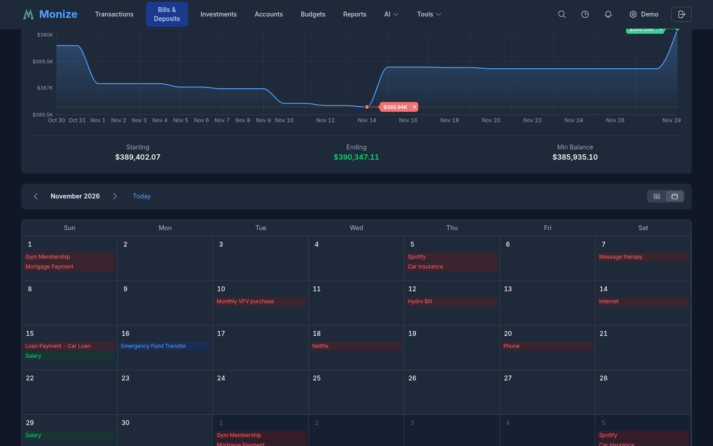
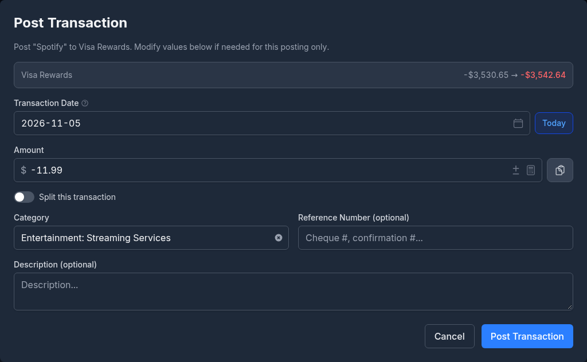
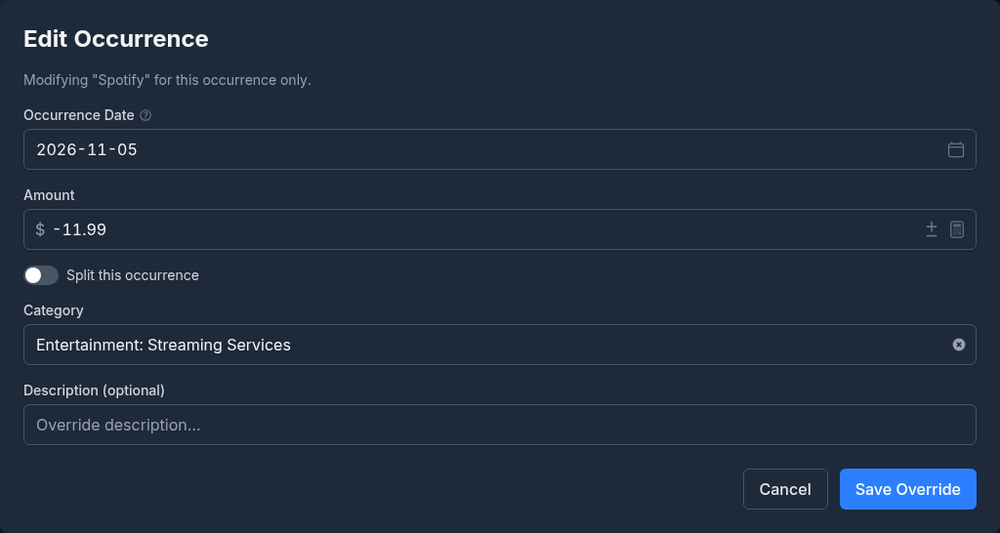

# Bills and Deposits

The Bills & Deposits feature lets you schedule recurring transactions so you never miss a payment or forget about regular income.

---

## Overview

Bills & Deposits manages your recurring financial obligations and expected income. It shows a cash flow forecast built from your schedules, lists every scheduled transaction (or shows them on a month calendar), and can post transactions automatically on their due dates.

The summary at the top counts your **Active Bills** and **Active Deposits**, the **Monthly Net** of all your active schedules converted to your home currency, and how many are **Due Now** (overdue or due today).

---

## Creating a Scheduled Transaction

1. Navigate to **Bills & Deposits** from the top navigation bar
2. Click **+ New Schedule**
3. Choose what you are scheduling with the buttons at the top: a **Transaction**, a **Split** across several categories, a **Transfer** between accounts, or an **Investment** transaction
4. Fill in the form:

5. Click **Create**

### Fields

| Field | Required | Description |
|-------|----------|-------------|
| **Name** | Yes | What the schedule is called, for example Rent, Netflix, or Salary |
| **Account** | Yes | Which account this transaction uses |
| **Next Due Date** | Yes | When the next occurrence is due; later occurrences follow from it |
| **Payee** | No | Who the transaction is with |
| **Category** | No | Expense or income category |
| **Amount** | Yes | Transaction amount (negative for a bill, positive for a deposit). Leave it at zero for a reminder of a bill whose amount varies. The currency button beside it lets you enter the amount in the currency the biller charges |
| **Reference Number** | No | Cheque number, confirmation number, or another reference |
| **Frequency** | Yes | How often the transaction recurs (default Monthly; see [Frequency Options](#frequency-options)) |
| **Remind Days Before** | No | How many days before the due date the schedule counts as coming up, for reminders and the dashboard's Due soon list (default 3) |
| **Description** | No | Additional notes |
| **End Condition** | No | Stop the schedule **End by date** (an **End Date**) or after a **Number of occurrences** |
| **Active** | No | Turn off to pause the schedule without deleting it |
| **Auto-post on due date** | No | Whether to create the transaction automatically on the due date (see [Auto-Posting](#auto-posting)) |
| **Tags** | No | One or more [tags](tags.md) applied when the transaction is posted |

### Split Scheduled Transactions

Like regular transactions, scheduled transactions support splits across multiple categories. Choose **Split** at the top of the form (or click **Split Transaction**) to add multiple category/amount rows; the rows must add up to the **Total Amount**. **Cancel Split** returns to a single category.

### Transfer Scheduling

You can schedule recurring transfers between accounts (e.g., a monthly transfer from chequing to savings). Choose **Transfer**, then the **From Account**, the **To Account**, and the **Transfer Amount**. You may optionally also assign a **Category**: the transfer is still not counted as income or expense, but it will appear in the monthly category breakdown (useful for tracking recurring investment contributions).

### Investment Scheduling

Choose **Investment** to schedule a recurring investment transaction, such as a monthly purchase of an ETF or a dividend reinvestment. Pick the **Investment Account**, the **Action** (Buy, Sell, Dividend, Reinvest Dividend, and so on), the **Security**, and the **Quantity (Shares)**, **Price per Share**, and **Commission**. The **Funding Account** defaults to the investment account's own cash; pick another account to model a contribution followed by a purchase. When the occurrence is posted, you can adjust the quantity, price, or total to what was actually traded.

---

## Frequency Options

| Frequency | Description |
|-----------|-------------|
| **One Time** | A single future transaction (useful for reminders) |
| **Daily** | Every day |
| **Weekly** | Once per week |
| **Every 2 Weeks** | Every two weeks |
| **Every 4 Weeks** | Every four weeks (useful for pay cycles that do not align to calendar months) |
| **Twice a Month** | Twice per month |
| **Monthly** | Once per month on the same date |
| **Every 2 Months** | Every two months |
| **Quarterly** | Every three months |
| **Every 4 Months** | Every four months |
| **Twice a Year** | Every six months |
| **Yearly** | Once per year |
| **Every 2 Years** | Every other year |

A monthly schedule on the 31st falls on the last day of shorter months.

---

## Bills List

Below the forecast, the list shows all scheduled transactions with:

| Column | Description |
|--------|-------------|
| **Name / Payee** | What the schedule is called and who it is with |
| **Account** | The account involved |
| **Category** | The category, the transfer's destination, or a **Split** badge |
| **Amount** | The amount of the next occurrence |
| **Schedule** | The next due date with an **Overdue**, **Due Today**, or **Due Soon** (within a week) badge, the frequency, and how many occurrences are left |
| **Auto-Post** | **On** when the schedule posts itself |
| **Actions** | **Post Transaction**, **Skip Occurrence**, **Edit Occurrence**, **Edit Schedule**, and **Delete** |

A **modified** badge counts the upcoming occurrences you have changed (see [Overriding Individual Occurrences](#overriding-individual-occurrences)), and paused schedules are marked inactive.

### Filtering

The **All**, **Bills**, and **Deposits** buttons narrow the list to one kind of schedule. **Filters** opens a panel to search by **Name** and narrow by **Payees**, **Accounts**, and **Categories**. The density button sets how much fits on screen.

### Calendar View

The **Table** and **Calendar** buttons switch between the list and a month calendar of every occurrence. Move between months with the arrows, or return to the current one with **Today**. Click an occurrence to edit its schedule.

---

## Posting a Transaction

To record an occurrence yourself, click **Post Transaction** on its row. The **Post Transaction** dialog lets you change the **Transaction Date**, the **Amount**, the **Category**, the **Description**, and the **Reference Number** for this posting only, or split it with **Split this transaction**. It shows what the posting does to the account's balance, and warns you when posting on that date would take an account below zero or over its credit limit.

Click **Post Transaction** to create the transaction and advance the schedule to its next due date. Clicking an item in the dashboard's [Upcoming Bills](dashboard.md#upcoming-bills) widget opens the same dialog.

---

## Auto-Posting

When **Auto-post on due date** is turned on for a scheduled transaction, Monize automatically creates the transaction on its due date without any manual intervention.

### How It Works

1. Every hour, Monize checks for active, auto-posting scheduled transactions that are due today or overdue in your timezone
2. Each due occurrence is created in the designated account, with any changes you made to that occurrence
3. The next due date is calculated based on the frequency
4. When the end date or the number of occurrences is reached, the schedule ends

A posting that fails (for example, for want of an exchange rate) raises a notification so you can post it by hand.

### When to Use Auto-Posting

- **Fixed-amount bills** (e.g., rent, subscription services) -- The amount is the same each time
- **Regular transfers** (e.g., monthly savings contribution) -- Predictable, consistent amounts

### When NOT to Use Auto-Posting

- **Variable-amount bills** (e.g., utilities, credit card payments) -- Use reminders instead and enter the actual amount manually
- **Bills your bank's import already brings in** -- the imported row and the auto-posted one would both be recorded

---

## Overriding Individual Occurrences

You can modify or skip individual occurrences of a scheduled transaction without changing the overall schedule.

### Modifying an Occurrence

1. In the bills list, click **Edit Occurrence** on the scheduled transaction
2. In **Select Occurrence Date**, choose which upcoming occurrence to change (occurrences you already changed are marked **Modified**)
3. In the **Edit Occurrence** dialog, change the **Occurrence Date**, **Amount**, **Category**, or **Description** for this occurrence only
4. To split just this occurrence across multiple categories, turn on **Split this occurrence** and add category/amount rows (independent of whether the underlying schedule is split)
5. Click **Save Override** (or **Update Override** for one you changed before)

The override only affects that single occurrence. All other future occurrences follow the original schedule. **Reset to Default** removes the override. When you later edit a schedule that has overrides, Monize asks whether to **Keep Modifications** or **Delete All Modifications**.

### Skipping an Occurrence

If a recurring bill does not apply for a particular period (e.g., a holiday causes a payment to be skipped):

1. Click **Skip Occurrence** on the scheduled transaction
2. Confirm in the **Skip Occurrence** dialog
3. The schedule advances to its next due date

---

## Cash Flow Forecast

The **Cash Flow Forecast** at the top of the page projects your account balances from today's balances, the transactions already dated in the future, and every scheduled occurrence.

- Choose how far ahead to look: **7D**, **30D**, **90D**, **6M**, or **1Y**
- **Accounts to forecast** picks the accounts. With none picked, all your accounts are drawn as one line; with two or more, each account gets its own line beside a **Total of Accounts** line
- Hover over the chart to see the balance on a day and the transactions that move it
- Below the chart: the **Starting** and **Ending** balances and the lowest point of the period (**Min Balance** for liability accounts)

An occurrence that fell due and was neither posted nor skipped counts on the first day of the forecast. If an exchange rate is missing for one of the currencies involved, the forecast says so rather than showing a total that leaves it out.

This helps you:
- Anticipate when account balances will be low
- Plan for upcoming large expenses
- Ensure sufficient funds for automatic payments

The same forecast is available as a [dashboard widget](dashboard.md#cash-flow-forecast).

---

## Loan Payment Scheduling

For loan and mortgage accounts, scheduled transactions track the regular payments.

### Setting Up Loan Payments

The easiest way is to let Monize create the schedule: fill in the payment details when you [create the loan or mortgage](accounts.md#loan-and-mortgage-setup), or use **Set Up Recurring Payments** on an existing one. The schedule it creates splits each payment into a principal transfer to the loan account and an interest line booked to the loan's interest category, priced from the balance and the rate in effect on each due date. The calendar, the Upcoming Bills widget, and **Edit Occurrence** each show that occurrence's own payment and split.

To set one up by hand, create a **Split** schedule from your bank account with a **Transfer** line to the loan account for the principal and a **Category** line for the interest.

> [!TIP]
> If your bank's import brings in the payment, turn on [payment matching](accounts.md#payment-matching) on the loan instead of auto-posting: the imported row then settles the scheduled payment rather than being recorded twice.

> [!NOTE]
> When importing from Microsoft Money, loan payment categories are automatically detected and mapped to the corresponding loan accounts. See [Importing from Microsoft Money](importing-from-microsoft-money.md) for details.

---

## Schedule as Recurring

You can create a scheduled transaction from any existing transaction without re-entering its details.

1. On the [Transactions](transactions.md) page, find the transaction you want to schedule
2. Click the **Copy** dropdown on the transaction row and select **Schedule as Recurring**
3. The scheduled transaction form opens pre-filled with the transaction's account, payee, amount, category, and tags
4. Set the frequency, next due date, and other scheduling options
5. Click **Create**

The original transaction is not modified -- a new scheduled transaction is created based on its details.

A credit card's detail page can also schedule a monthly payment with **Make a Payment**, and a bank account's detail page offers **Create bill** for recurring charges it finds in your transactions. See [Account Detail Pages](accounts.md#account-detail-pages).

---

## Email Reminders

Monize reminds you of scheduled transactions as they come due, in the notification bell and, when you turn them on under [Notifications](settings-and-security.md#notifications), by email or push. A schedule's **Remind Days Before** sets how early. Reminder emails are colour-coded to help you quickly distinguish between expenses and income at a glance.
