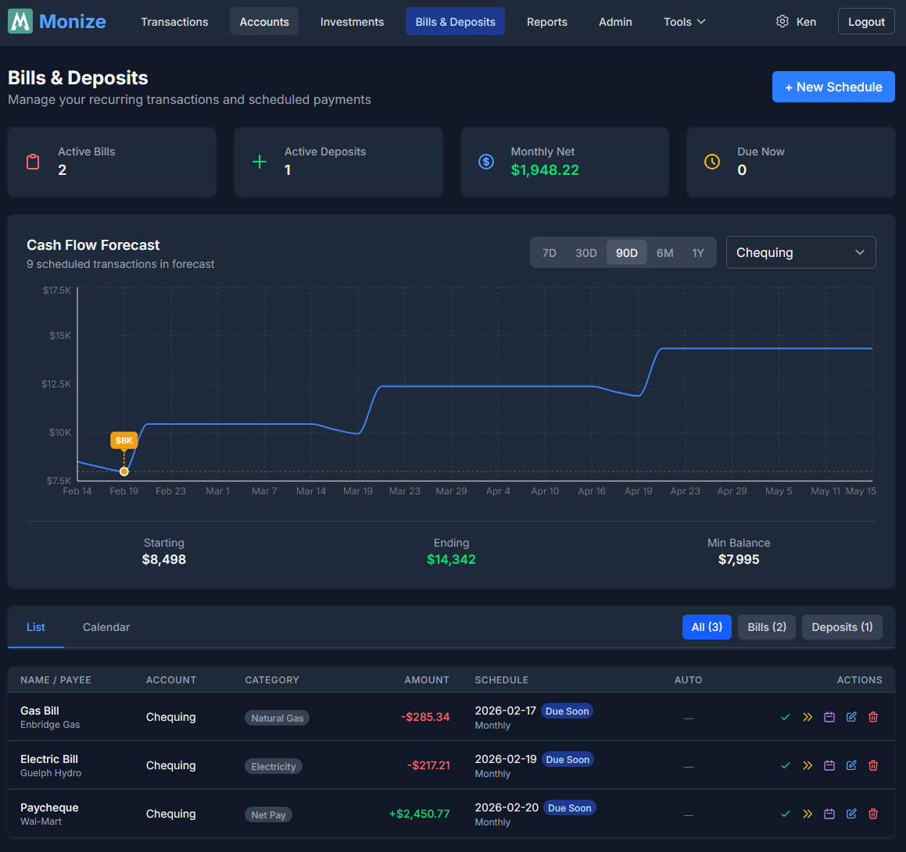
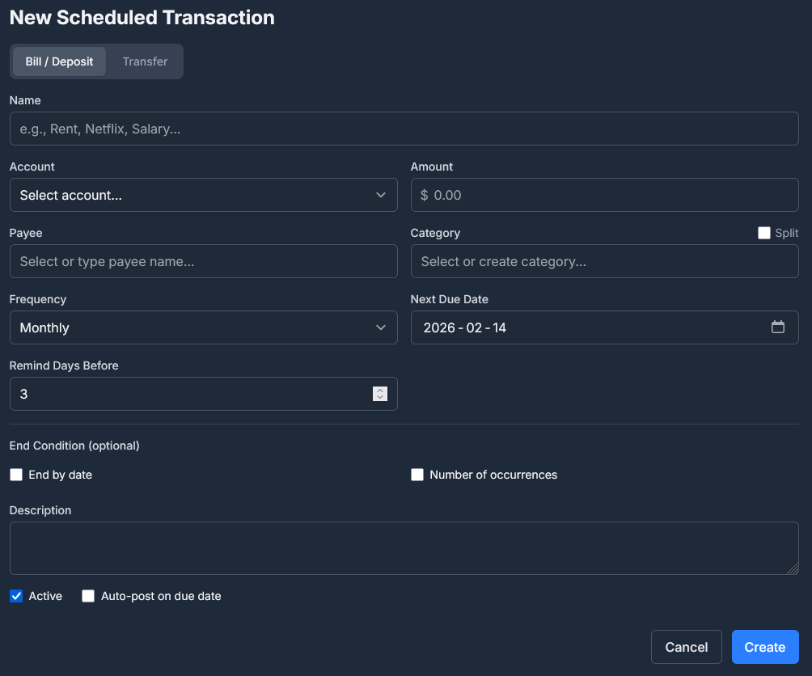
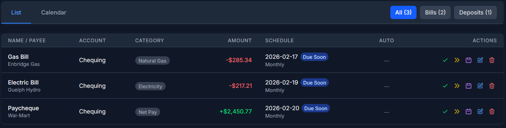
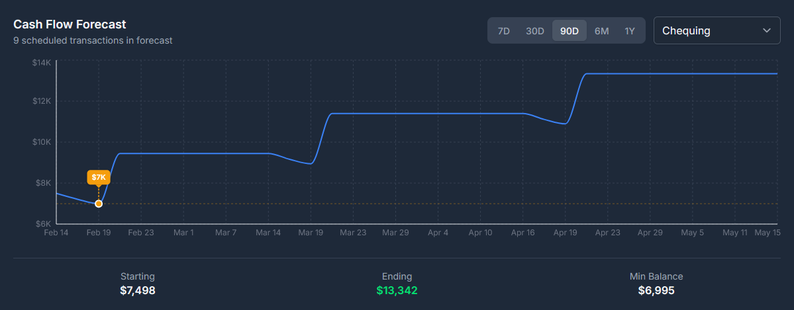

# Bills and Deposits

The Bills & Deposits feature lets you schedule recurring transactions so you never miss a payment or forget about regular income.

---

## Overview

Bills & Deposits manages your recurring financial obligations and expected income. It displays upcoming transactions, provides a cash flow forecast, and can automatically post transactions on their due dates.

<!-- Screenshot: The bills and deposits page showing the list of scheduled transactions with next due dates and amounts -->

---

## Creating a Scheduled Transaction

1. Navigate to **Bills & Deposits** from the top navigation bar
2. Click **Add Scheduled Transaction**
3. Fill in the form:

<!-- Screenshot: The scheduled transaction creation form showing all fields -->

### Fields

| Field | Required | Description |
|-------|----------|-------------|
| **Account** | Yes | Which account this transaction uses |
| **Payee** | No | Who the transaction is with |
| **Amount** | Yes | Transaction amount |
| **Category** | No | Expense or income category |
| **Frequency** | Yes | How often the transaction recurs |
| **Start Date** | Yes | When the recurring schedule begins |
| **End Date** | No | When to stop recurring (optional) |
| **Total Occurrences** | No | Maximum number of occurrences (alternative to end date) |
| **Tags** | No | One or more [tags](tags.md) applied when the transaction is posted |
| **Reminder Days** | No | How many days before due date to show a reminder |
| **Auto-Post** | No | Whether to automatically create the transaction on the due date |
| **Memo** | No | Additional notes |

### Split Scheduled Transactions

Like regular transactions, scheduled transactions support splits across multiple categories. Turn on the **Split this transaction** toggle in the form to add multiple category/amount rows.

### Transfer Scheduling

You can schedule recurring transfers between accounts (e.g., a monthly transfer from chequing to savings). Select a **Transfer to** account instead of a category. You may optionally also assign a category: the transfer is still not counted as income or expense, but it will appear in the monthly category breakdown (useful for tracking recurring investment contributions).

---

## Frequency Options

| Frequency | Description |
|-----------|-------------|
| **Once** | A single future transaction (useful for reminders) |
| **Daily** | Every day |
| **Weekly** | Once per week on a specific day |
| **Bi-Weekly** | Every two weeks |
| **Every 4 Weeks** | Every four weeks (useful for pay cycles that do not align to calendar months) |
| **Monthly** | Once per month on a specific date |
| **Quarterly** | Every three months |
| **Yearly** | Once per year |

---

## Bills List

The Bills & Deposits page shows all scheduled transactions with:

| Column | Description |
|--------|-------------|
| **Description/Payee** | Who or what the transaction is for |
| **Account** | The account involved |
| **Amount** | The scheduled amount |
| **Frequency** | How often it recurs |
| **Next Due Date** | When the next occurrence is due |
| **Status** | Active, paused, or completed |

<!-- Screenshot: The bills list showing multiple scheduled transactions with their frequencies and next due dates -->

---

## Auto-Posting

When auto-posting is enabled for a scheduled transaction, Monize automatically creates the transaction on its due date without any manual intervention.

### How It Works

1. Each day, the system checks for scheduled transactions that are due
2. If auto-post is enabled, the transaction is created in the designated account
3. The next occurrence date is calculated based on the frequency
4. If the total occurrences limit is reached, the scheduled transaction is marked as completed

### When to Use Auto-Posting

- **Fixed-amount bills** (e.g., rent, subscription services) -- The amount is the same each time
- **Regular transfers** (e.g., monthly savings contribution) -- Predictable, consistent amounts

### When NOT to Use Auto-Posting

- **Variable-amount bills** (e.g., utilities, credit card payments) -- Use reminders instead and enter the actual amount manually

---

## Overriding Individual Occurrences

You can modify or skip individual occurrences of a scheduled transaction without changing the overall schedule.

### Modifying an Occurrence

1. In the bills list, find the scheduled transaction
2. Click on the specific upcoming occurrence
3. Change the date, amount, or category for this occurrence only
4. To split just this occurrence across multiple categories, turn on the **Split this occurrence** toggle and add category/amount rows (independent of whether the underlying schedule is split)
5. Click **Save Override**

The override only affects that single occurrence. All other future occurrences follow the original schedule.

### Skipping an Occurrence

If a recurring bill does not apply for a particular period (e.g., a holiday causes a payment to be skipped):

1. Select the occurrence
2. Choose **Skip this occurrence**
3. The next occurrence continues as normal

---

## Cash Flow Forecast

The bills system provides a cash flow forecast showing your expected account balances based on scheduled transactions.

<!-- Screenshot: The cash flow forecast showing projected balances over the next 30-60 days -->

This helps you:
- Anticipate when account balances will be low
- Plan for upcoming large expenses
- Ensure sufficient funds for automatic payments

---

## Loan Payment Scheduling

For loan and mortgage accounts, scheduled transactions can be set up to track regular payments.

### Setting Up Loan Payments

1. Create a scheduled transaction with the loan payment amount
2. Set the **category** to the loan account (this creates a transfer to the loan)
3. Set the appropriate frequency (typically monthly)

This ensures each payment is recorded as a transfer to the loan account, properly reducing the outstanding balance.

> **Note:** When importing from Microsoft Money, loan payment categories are automatically detected and mapped to the corresponding loan accounts. See [Importing from Microsoft Money](importing-from-microsoft-money.md) for details.

---

## Schedule as Recurring

You can create a scheduled transaction from any existing transaction without re-entering its details.

1. On the [Transactions](transactions.md) page, find the transaction you want to schedule
2. Click the **Copy** dropdown on the transaction row and select **Schedule as Recurring**
3. The scheduled transaction form opens pre-filled with the transaction's account, payee, amount, category, and tags
4. Set the frequency, start date, and other scheduling options
5. Click **Save**

The original transaction is not modified -- a new scheduled transaction is created based on its details.

---

## Email Reminders

When email notifications are enabled in [Settings](settings-and-security.md#user-settings), Monize sends reminder emails before scheduled transactions come due. Reminder emails are colour-coded to help you quickly distinguish between expenses and income at a glance.
