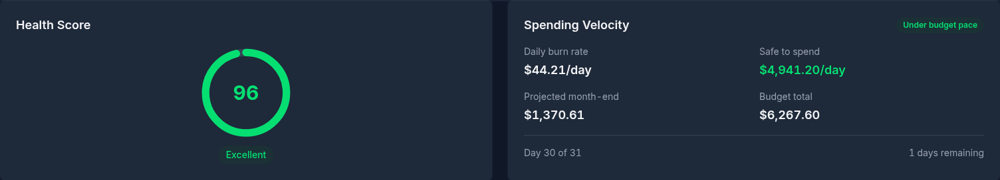
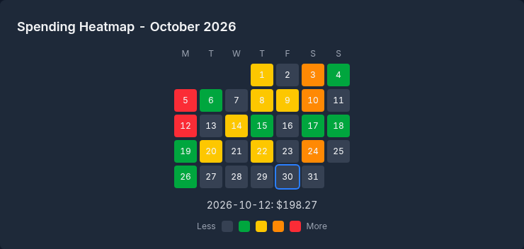
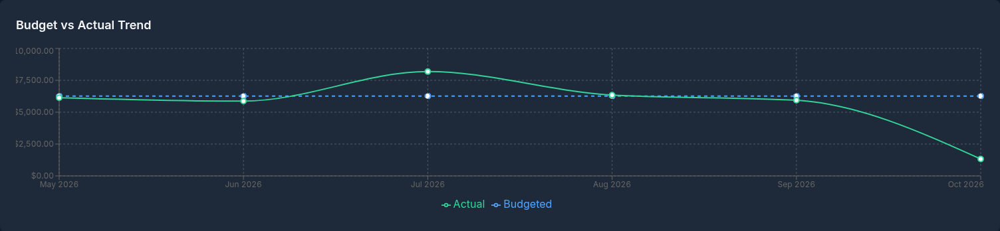
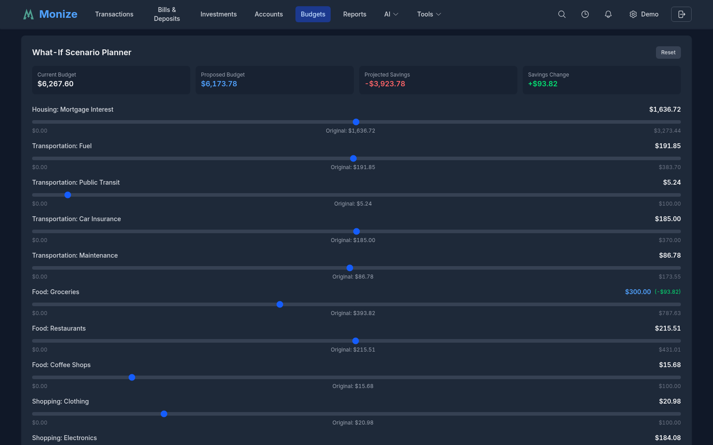
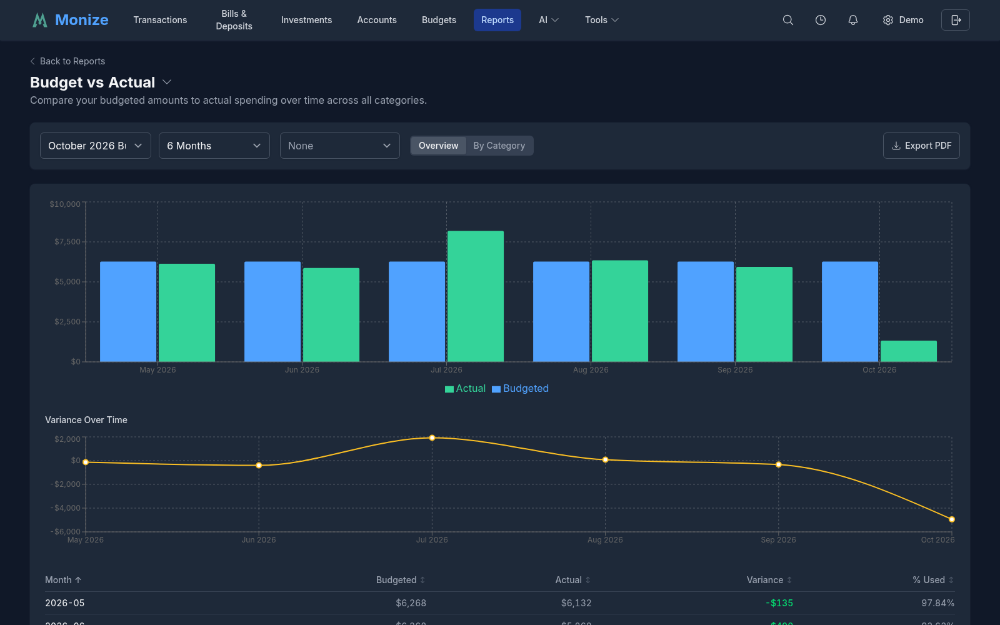
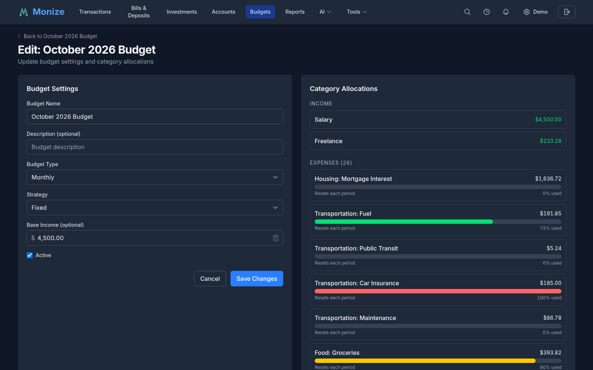
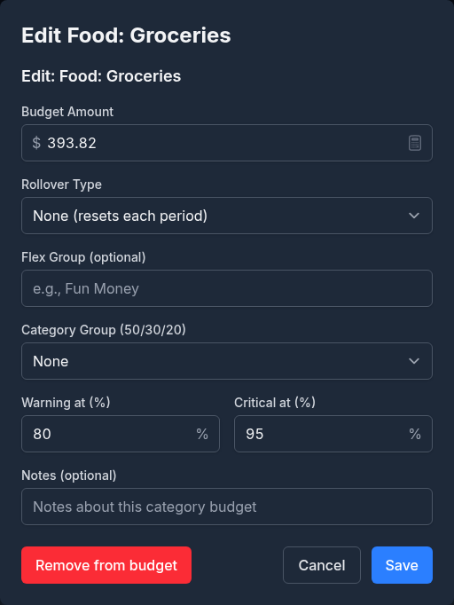

# Budgets

Monize includes a full-featured budget planner that analyzes your spending history to suggest realistic budgets, tracks spending in real time with velocity projections, supports rollover per category, groups categories into flexible spending pools, and alerts you before you overspend.

---

## Overview

Navigate to **Budgets** from the top navigation bar. The Budgets page lists every budget you have created with its **Name**, **Strategy**, **Type**, number of **Categories**, the date it **Started**, and its **Status** (Active or Inactive). Click a row to open that budget's dashboard, or click **+ New Budget** to start the budget wizard. If you have no budgets yet, the page offers **Create Your First Budget** instead.

The budget system integrates with your transactions, scheduled bills, and categories to give you a complete picture of your financial plan.

---

## Creating a Budget

Monize includes a **Budget Wizard** that analyzes your historical spending to suggest realistic targets -- no manual data entry required. The wizard walks you through four steps, shown along the top as **Analyze**, **Categories**, **Configure**, and **Review**. Use **Back** at any step to return to the previous one.

### Step 1: Analyze Spending

1. **Choose a Budget Strategy** -- Select one of four strategies (see [Budget Strategies](#budget-strategies) below). Selecting a card opens a detail panel with its **Pros**, **Cons**, and who it is **Best for**.
2. **Analysis Period** -- Choose **3 months**, **6 months** (the default), or **12 months** of transaction history to analyze. Longer periods smooth out anomalies; shorter periods reflect recent habits.
3. **Budget Profile** -- Pick how aggressive your targets should be:

| Profile | Description |
|---------|-------------|
| **Comfortable** | Based on your 75th percentile spending -- allows headroom |
| **On Track** (default) | Based on your median spending -- realistic targets |
| **Aggressive** | Based on your 25th percentile -- a stretch goal to save more |

4. Click **Analyze My Spending** to generate suggestions.

The analysis looks at how each category's spending is distributed month by month, spots fixed expenses (rent, subscriptions) as opposed to variable spending (dining, groceries), and estimates your monthly income.

### Step 2: Review Categories

This step lists every category found in your history, in three tables:

- **Income** -- your income categories
- **Expenses** -- your spending categories, largest first. Categories with a regular, unchanging amount carry a **Fixed** badge
- **Transfers / Savings** -- regular transfers to savings accounts and loan or card payments

Each row has:

| Column | Description |
|--------|-------------|
| *(checkbox)* | Include or leave out the category. Expense categories with no suggested amount start unticked |
| **Category** | The category (or transfer account) name |
| **Trend / Median** | A small sparkline of recent months, with your median monthly amount |
| **Amount** | The suggested budget amount -- edit it to your preference |

Use the profile buttons (**Comfortable**, **On Track**, **Aggressive**) at the top to switch the suggested amounts for all categories at once. The totals at the bottom show **Total Income**, **Total Expenses**, **Transfers**, and **Remaining**.

For **50/30/20** budgets, each expense row also has a Need / Want / Saving picker, and a **50/30/20 Allocation** box compares what you have assigned to each group against its target.

Only categories found in your history are listed here. To budget for a category you have never used, create the budget first and add it later. Click **Next: Configure** to continue.

### Step 3: Configure Options

Configure your budget settings, grouped into sections:

| Section | Settings |
|---------|----------|
| **Budget Details** | **Budget Name** (defaults to "*Month Year* Budget"), **Budget Type** (Monthly, Annual, or Pay Period), and **Start Date**. The strategy you chose in step 1 is shown here for reference |
| **Income** | **Link budget to income** -- category amounts become percentages of your base income (see [Income-Linked Budgets](#income-linked-budgets)) -- and **Base Monthly Income**, prefilled with the income estimated by the analysis |
| **Rollover Rules** | **Default Rollover Type** for every category: None, Monthly, Quarterly, or Annual. It defaults to Monthly for the Rollover strategy and None otherwise. You can change individual categories after the budget is created |
| **Alert Thresholds** | **Warning at (%)** (default 80) and **Critical at (%)** (default 95) |
| **Flex Groups** | Click **Configure** to give expense categories a flex group name (for example "Fun Money") -- see [Flex Groups](#flex-groups) |
| **Excluded Accounts** | Accounts whose transactions should not count toward the budget (for example an investment or business account) |

Click **Next: Review** to continue.

### Step 4: Review and Create

The review step shows a complete summary of your budget before it is created:

- **Summary cards** -- **Est. Income**, **Total Expenses**, **Transfers**, and **Remaining**
- **Budget details** -- **Name**, **Type**, **Strategy**, **Start Date**, **Rollover**, **Alerts**, **Income Linked**, and **Excluded Accounts**
- **Category table** -- every included category with its amount and type (Income, Expense, or Transfer)

On mobile, the Type column is hidden to give category names and amounts more room.

Click **Create Budget** to finish. The new budget appears on the Budgets page.

---

## Budget Dashboard

Click a budget on the Budgets page to open its dashboard, your main view for tracking the budget in real time. A **Back to Budgets** link returns to the list, and the arrow beside the budget's name (**Switch to another budget**) jumps straight to another budget. Under the name, a bar describes the budget's strategy. The **Edit** and **Delete** buttons are at the top right.

### Summary Cards

Four cards at the top provide an at-a-glance overview:

| Card | Description |
|------|-------------|
| **Total Budget** | Your total budgeted spending for the period |
| **Spent** | Total spending so far, with the percentage of the budget used |
| **Remaining** | Budget remaining, with the number of days left in the period (or **Period ended**) |
| **Savings** | Income received so far minus spending, marked **On track** or **Over budget** |

### Health Score

A circular gauge from 0 to 100 summarizing how well you are sticking to your budget.

| Score Range | Label |
|-------------|-------|
| 90--100 | Excellent |
| 70--89 | Good |
| 50--69 | Needs Attention |
| Below 50 | Off Track |

The score starts at 100 and:
- loses points for every category over budget, more the further over it is
- loses a few points for every category above 95% of its budget
- gains a point for every category below half of its budget
- loses points when total spending is over the whole budget

The [Budget Health Score report](#budget-reports) gives a more detailed version that weights essential (Needs) categories more heavily.

### Spending Velocity

Shows your spending pace and whether you will finish the period within budget:

- **Daily burn rate** -- How much you are spending per day
- **Safe to spend** -- How much you can spend per day and stay on track
- **Projected month-end** -- Where you will land at the current pace
- **Pace status** -- **Under budget pace** (green), **On track** (yellow), or **Over budget pace** (red)
- **Budget total**, **Bills coming** and **Truly available** -- your budget less the scheduled bills still to come this period
- A progress bar showing **Day X of Y** and the days remaining

Because the widget factors in upcoming bills from your scheduled transactions, "safe to spend" reflects your truly available discretionary budget.

### Category List

The **Category Budgets** list shows every expense category in the budget with a progress bar.

Each row shows:
- **Category name** -- including its parent category, for example "Food: Groceries"
- **Progress bar** -- Colour-coded by percentage used (green, yellow, red), with a marker showing where you should be today ("Expected pace")
- **Amount spent** of the **budgeted amount**, and the percentage used
- **Pace status** -- **Under pace**, **On pace**, or **Over pace** compared with how far through the period you are
- **Amount left**, or how much you are **over**

Use the **Sort** dropdown to sort by **% Used** (the default), **Spent**, **Remaining**, or **Name**, and the arrow beside it to reverse the order. On mobile, the sort controls stack below the heading.

Click a category row to open the Transactions page filtered to that category and the budget period.

### Strategy Widgets

Two widgets appear above the health score for specific strategies:

- **Zero-Based Assignment** (Zero-Based budgets) -- how much of your income is assigned (**Assigned: x / y**), marked **Fully assigned**, **Under-assigned**, or **Over-assigned**
- **50/30/20 Allocation** (50/30/20 budgets) -- for **Needs**, **Wants**, and **Savings**, the target percentage against the percentage and amount actually budgeted

### Flex Groups

A flex group pools several related categories under one shared limit -- for example, "Fun Money" for Restaurants, Movies, and Hobbies. Individual categories within a group can go over budget, but as long as the group total is within its limit, you have stayed on plan.

You assign categories to flex groups in step 3 of the wizard (**Flex Groups** > **Configure**), or later from the budget's edit page (**Flex Group (optional)** in a category's settings). When at least one group exists, a **Flex Groups** card on the dashboard shows each group's combined spending against its combined budget.

### Upcoming Bills

Integrates with your scheduled transactions to show:
- **Bills coming due** this period with dates and amounts
- **Total upcoming** -- the sum of those bills
- **Truly available** -- remaining budget minus upcoming bills

This prevents a false sense of security when you have budget left but bills still to pay. When nothing is due, the card says "No bills due this period."

### Spending Heatmap

A calendar for the current month in which each day is shaded by how much you spent, from **Less** to **More**. Darker days are your heavier spending days, which helps you spot patterns such as weekend spending. Hover over or tap a day to see its total.

### Budget vs Actual Trend

A chart of your **Budgeted** amount against your **Actual** spending over recent periods, so you can see whether you are improving over time. It needs at least a couple of periods of history.

### Scenario Planner

The **What-If Scenario Planner** at the bottom of the dashboard lets you try budget changes without committing them. Drag a category's slider to change its amount and the planner immediately shows the **Current Budget**, the **Proposed Budget**, the **Projected Savings**, and the **Savings Change**. Each changed category shows its **Original** amount.

Nothing is saved: click **Reset** to put every slider back, or leave the page. To make a change permanent, edit the budget (see [Editing a Budget](#editing-a-budget)).

---

## Budget Strategies

Monize supports four budget strategies, each suited to a different financial style:

| Strategy | Description |
|----------|-------------|
| **Fixed** | Set fixed amounts per category. Simple and predictable. Unused budget resets at the end of each period. |
| **Rollover** | Unused budget carries forward to the next period based on per-category rollover rules. Good for saving toward irregular expenses. |
| **Zero-Based** | Every dollar of income is assigned a purpose: income minus all budgeted amounts should equal zero. The dashboard shows how much is still unassigned. |
| **50/30/20** | Categories are grouped as Needs (50%), Wants (30%), or Savings (20%) of your income. The wizard and dashboard compare each group with its target. |

You can change a budget's strategy later from its edit page.

---

## Rollover Rules

Each category can have its own rollover setting:

| Rollover Type | Description |
|---------------|-------------|
| **None** | The budget resets each period -- no carry-forward |
| **Monthly** | Unused budget rolls forward into the next period |
| **Quarterly** | Unused budget rolls forward, intended for quarterly saving |
| **Annual** | Unused budget rolls forward, intended for saving across the year |

Whichever rolling type you choose, the unused amount carries into the next period when the current one closes. Overspending is not carried forward as a debt.

You can also set a **Rollover Cap** to limit how much accumulates. For example, a clothing category might roll over monthly with a $500 cap.

**Common patterns:**
- **Groceries** -- None (no point accumulating)
- **Clothing** -- Monthly with a cap (save for seasonal shopping)
- **Travel** -- Annual (vacation fund)
- **Car Maintenance** -- Annual with no cap (save for repairs)

---

## Income-Linked Budgets

For freelancers, gig workers, or anyone with variable income, you can tick **Link budget to income** in step 3 of the wizard. Category amounts then become percentages of your base income rather than fixed dollar amounts:

- If your income drops, your budget automatically tightens
- If your income rises, your budget grows proportionally

Set a **Base Monthly Income** to establish the baseline. The wizard suggests it from your historical income. An income-linked budget also raises an **Income Shortfall** alert when actual income falls well below the base (see [Alerts](#alerts)).

---

## Alerts

Monize checks every active budget once a day and raises alerts before you overspend. Alerts appear under the notifications bell in the header, and the most serious ones can also be emailed to you.

### Alert Types

| Alert Type | Trigger | Severity |
|------------|---------|----------|
| **Threshold Warning** | A category's spending reaches its warning threshold (default 80%) | Warning |
| **Threshold Critical** | A category's spending reaches its critical threshold (default 95%) | Warning |
| **Over Budget** | A category's spending exceeds 100% | Critical |
| **Projected Overspend** | At the current pace, a category that is still under budget is projected to finish more than 10% over (checked from the third day of the period) | Warning |
| **Flex Group Warning** | A flex group's total reaches 90% of its combined budget | Warning |
| **Income Shortfall** | On an income-linked budget, at least halfway through the period, actual income is below 80% of the base income | Critical |
| **Positive Milestone** | At least halfway through the period and under 60% of the budget spent | Good news |
| **Seasonal Spike** | Your history shows next month is usually much more expensive for a category, so you can plan ahead | Info |
| **Bill Due** | A scheduled bill that you pay by hand (not posted automatically) is coming due within its reminder window | Info |

Each alert is raised once per period, so you are not reminded of the same overspend every day.

### In-App Alerts

The bell icon (**Notifications**) in the top navigation bar shows the number of unread notifications. Click it to open the notifications panel.

The panel lists budget alerts alongside Monize's other notifications:
- **Severity filters** -- chips for **Critical**, **Warning**, **Good News**, and **Info** (red, yellow, green, and blue badges), plus **Financial** and **System** to narrow the list
- **Alert title and message** -- What happened and the details
- **Unread indicator** -- A dot on unread alerts
- **Mark all read** -- Clears every unread indicator at once
- **Delete all** -- Removes every notification (or every one matching the current filter), after a confirmation
- **Remind me about this** -- Brings a notification back later, once or repeatedly until you stop it
- **Dismiss** -- An X button on each alert (see below)

Clicking an alert takes you to the relevant budget. Bill due alerts open the Bills & Deposits page instead.

### Dismissing Alerts

Each alert in the panel has an X button that appears on hover. Clicking it:
1. Immediately removes the alert from the list
2. Shows a toast notification with an **Undo** button for 5 seconds
3. If you don't undo, the alert is permanently deleted after 5 seconds
4. If you click **Undo**, the alert is restored to the list

### Email Notifications

Budget emails are set up in **Settings > Notifications**, under **Budget Notifications**. Email must be enabled for your account and your administrator must have configured email for the instance.

| Email Type | Description |
|------------|-------------|
| **Immediate alerts** | Critical budget alerts (over budget, income shortfall) are sent as soon as they are raised, regardless of digest settings |
| **Weekly Budget Digest** | A weekly summary of your budget alerts and status. Turn it on with the **Weekly Budget Digest** switch; the **Digest day** setting chooses the day |
| **Monthly summary** | Sent when a period closes, with total budget against actual spending, savings achieved, and the health score |

The **Budgets** row of the "How to notify me" grid in the same section controls whether budget reports and alerts are emailed at all.

---

## Period Management

Budgets are divided into periods (monthly for a monthly budget). Shortly after midnight on the 1st of each month, Monize automatically:

1. **Closes** the current period
2. Records the actual spending for each category
3. Calculates rollover amounts per category
4. Opens the next period, carrying the rollover balances forward

### Viewing Historical Periods

Once a budget has more than one period, a **Period:** selector appears at the top of the dashboard. Choose **Current Period**, or any past period by month. A closed period shows:
- **Total Budgeted**, **Total Spent**, and whether you finished **Under Budget** or **Over Budget**, plus **Income**
- A **Rollover Summary** of the amounts carried in and carried out
- **Overall Budget Usage**
- The final actual amount for every category, under **Expense Categories** and **Income Categories**

---

## Budget Reports

Nine budget-specific reports are available in the **Budget** category of the [Reports](reports.md#budget-reports) page:

| Report | Description |
|--------|-------------|
| **Budget vs Actual** | Compare your budgeted amounts to actual spending over time across all categories |
| **Budget Health Score** | Get a 0--100 health score for your budget with detailed per-category impact analysis |
| **Seasonal Spending Patterns** | Discover seasonal trends and high-spending months across your budget categories |
| **Budget Trend** | Line chart showing total budgeted vs total actual spending over 6--12 months to track improvement |
| **Category Performance** | Table showing each category's budget performance over multiple months with trend indicators |
| **Savings Rate** | Track your savings rate (income minus expenses divided by income) over time vs your target |
| **Health Score History** | Line chart of monthly budget health scores showing your financial trajectory over time |
| **Flex Group Analysis** | Stacked bar chart for each flex group showing component categories with group limit reference |
| **Seasonal Spending Map** | Heatmap grid showing 12 months across all categories to identify seasonal spending patterns |

Additionally, a **Budget Variance** metric is available in the [custom report builder](reports.md#custom-report-builder), so you can create your own budget-related reports with flexible filters and groupings.

---

## Editing a Budget

To edit an existing budget:

1. Open the budget dashboard
2. Click **Edit** in the top right
3. Change the **Budget Settings**: **Budget Name**, **Description (optional)**, **Budget Type**, **Strategy**, **Base Income (optional)**, and **Active**
4. Click **Save Changes**

Below the settings, **Category Allocations** lists the budget's **Income** and **Expenses** categories with their amounts and rollover settings. Click a category to open its settings:

| Field | Description |
|-------|-------------|
| **Budget Amount** | The amount budgeted for the category each period |
| **Rollover Type** | None, Monthly, Quarterly, or Annual (see [Rollover Rules](#rollover-rules)) |
| **Rollover Cap (optional)** | The most that can accumulate; shown when the category rolls over |
| **Flex Group (optional)** | The flex group this category belongs to |
| **Category Group (50/30/20)** | Need, Want, or Saving |
| **Warning at (%)** / **Critical at (%)** | This category's own alert thresholds |
| **Notes (optional)** | Your own notes about the category budget |

Click **Save** to keep the changes, or **Remove from budget** to take the category out of the budget. Removing a category also deletes its history in past budget periods (your transactions are not affected), so Monize asks you to confirm.

Unticking **Active** stops the daily alert checks for the budget without deleting it.

## Deleting a Budget

Click **Delete** on the budget dashboard and confirm. Deleting a budget removes all of its data, including its periods and alerts; your transactions and categories are not affected. This cannot be undone.
