# Budgets

Monize includes a full-featured budget planner that analyzes your spending history to suggest realistic budgets, tracks spending in real time with velocity projections, supports rollover per category, groups categories into flexible spending pools, and alerts you before you overspend.

---

## Overview

Navigate to **Budgets** from the top navigation bar. The Budgets page lists every budget you have created with its **Name**, **Strategy**, **Type**, number of **Categories**, the date it **Started**, and its **Status** (Active or Inactive). Click a row to open that budget's dashboard, or click **+ New Budget** to start the budget wizard. If you have no budgets yet, the page offers **Create Your First Budget** instead.

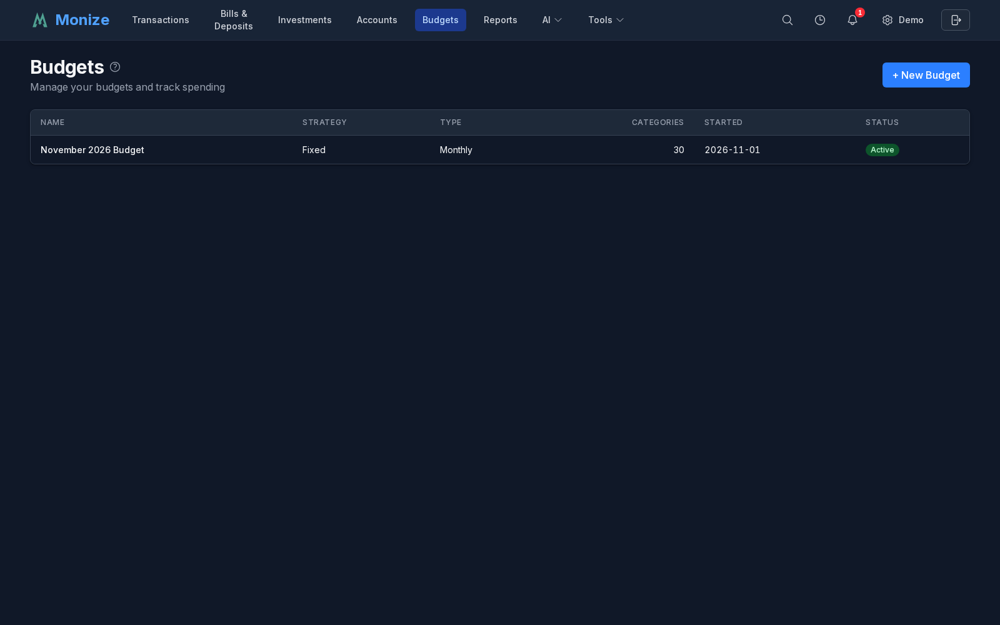

The budget system integrates with your transactions, scheduled bills, and categories to give you a complete picture of your financial plan.

---

## Creating a Budget

Monize includes a **Budget Wizard** that analyzes your historical spending to suggest realistic targets -- no manual data entry required. The wizard walks you through four steps, shown along the top as **Analyze**, **Categories**, **Configure**, and **Review**. Use **Back** at any step to return to the previous one.

### Step 1: Analyze Spending

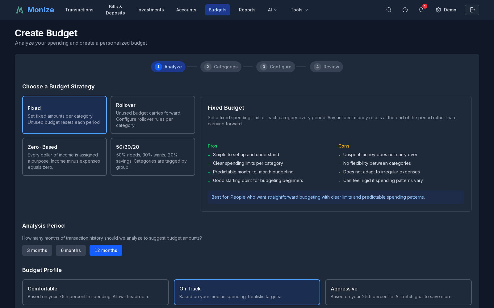

1. **Choose a Budget Strategy** -- Select one of five strategies (see [Budget Strategies](#budget-strategies) below). Selecting a card opens a detail panel with its **Pros**, **Cons**, and who it is **Best for**.
2. **Analysis Period** -- Choose **3 months**, **6 months** (the default), or **12 months** of transaction history to analyze. Longer periods smooth out anomalies; shorter periods reflect recent habits.
3. **Budget Profile** -- Pick how aggressive your targets should be:

| Profile | Description |
|---------|-------------|
| **Comfortable** | Based on your 75th percentile spending -- allows headroom |
| **On Track** (default) | Based on your median spending -- realistic targets |
| **Aggressive** | Based on your 25th percentile -- a stretch goal to save more |

4. Click **Analyze My Spending** to generate suggestions.

The analysis looks at how each category's spending is distributed month by month, spots fixed expenses (rent, subscriptions) as opposed to variable spending (dining, groceries), and estimates your monthly income.

### Step 2: Review Categories

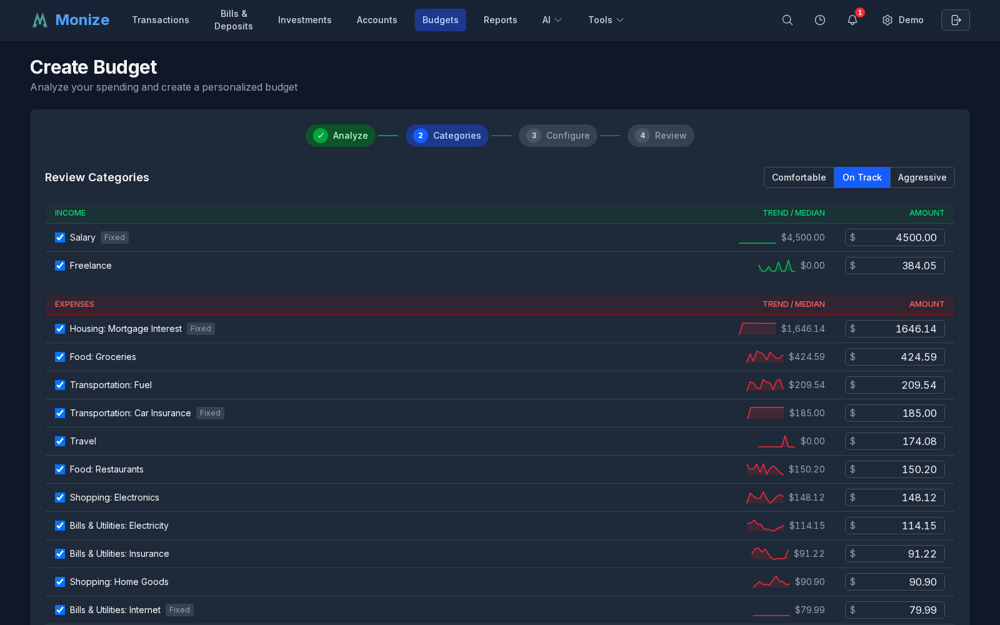

This step lists every category found in your history, in three tables:

- **Income** -- your income categories
- **Expenses** -- your spending categories, largest first. Categories with a regular, unchanging amount carry a **Fixed** badge
- **Transfers In (Income)** -- the accounts money was transferred in from, with the monthly net (what came in less anything moved back). None is ticked: tick an account, such as a savings reserve you draw from each month, to count what arrives from it as income (see [Transfers as Income](#transfers-as-income))
- **Transfers / Savings** -- regular transfers to savings accounts and loan or card payments

Each row has:

| Column | Description |
|--------|-------------|
| *(checkbox)* | Include or leave out the category. Expense categories with no suggested amount start unticked |
| **Category** | The category (or transfer account) name |
| **Trend / Median** | A small sparkline of recent months, with your median monthly amount |
| **Amount** | The suggested budget amount -- edit it to your preference |

Select a column heading to sort that table by it; select it again to reverse the order. Sorting by the category name keeps each subcategory directly under its parent (every **Taxes:** subcategory sits together under **Taxes**), and sorting by **Amount** puts unticked rows last.

An account can be ticked under **Transfers In (Income)** or under **Transfers / Savings**, not both: ticking one unticks the other.

Use the profile buttons (**Comfortable**, **On Track**, **Aggressive**) at the top to switch the suggested amounts for all categories at once. The totals at the bottom show **Total Income**, **Total Expenses**, **Transfers**, and **Remaining**.

For **50/30/20** budgets, each expense row also has a Need / Want / Saving picker, and a **50/30/20 Allocation** box compares what you have assigned to each group against its target.

For **Bucket** budgets, a **Buckets** panel above the category tables holds your buckets (see [Buckets](#buckets)), pre-filled with the **Three Buckets** preset the first time, and each ticked expense or transfer row has a **Bucket** select to choose the bucket it belongs to, or **Unassigned**. A tally shows how much each bucket's categories add up to.

Only categories found in your history are listed here. To budget for a category you have never used, create the budget first and add it later. Click **Next: Configure** to continue.

### Step 3: Configure Options

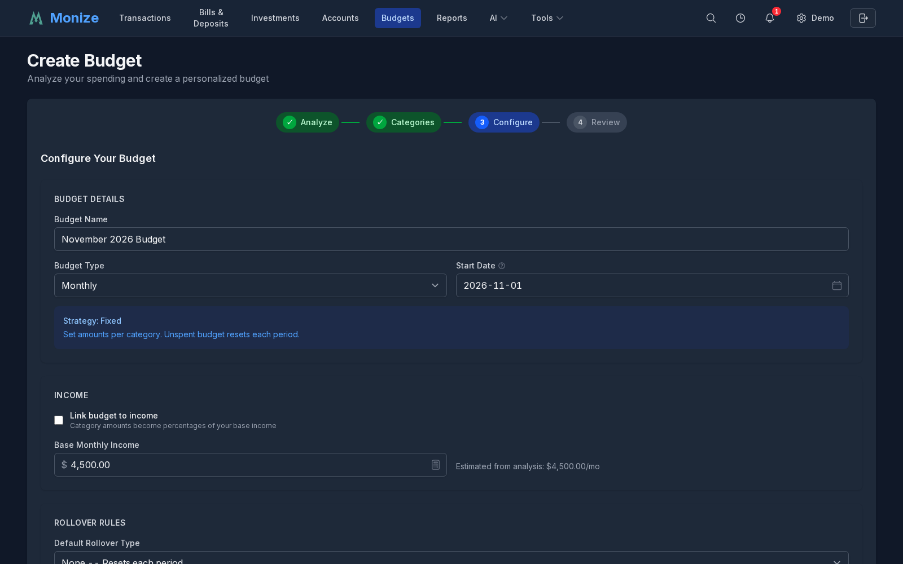

Configure your budget settings, grouped into sections:

| Section | Settings |
|---------|----------|
| **Budget Details** | **Budget Name** (defaults to "*Month Year* Budget"), **Budget Type** (Monthly, Annual, or Pay Period), and **Start Date**. The strategy you chose in step 1 is shown here for reference |
| **Income** | **Link budget to income** -- category amounts become percentages of your base income (see [Income-Linked Budgets](#income-linked-budgets)) -- and **Base Monthly Income**, prefilled with the income estimated by the analysis |
| **Rollover Rules** | **Default Rollover Type** for every category: None, Monthly, Quarterly, or Annual. It defaults to Monthly for the Rollover strategy and None otherwise. You can change individual categories after the budget is created |
| **Alert Thresholds** | **Warning at (%)** (default 80) and **Critical at (%)** (default 95) |
| **Flex Groups** | Click **Configure** to give expense categories a flex group name (for example "Fun Money") -- see [Flex Groups](#flex-groups) |
| **Excluded Accounts** | Accounts whose transactions should not count toward the budget (for example an investment or business account), and **Count transfers in from excluded accounts as income** (see [Transfers as Income](#transfers-as-income)) |

Click **Next: Review** to continue.

### Step 4: Review and Create

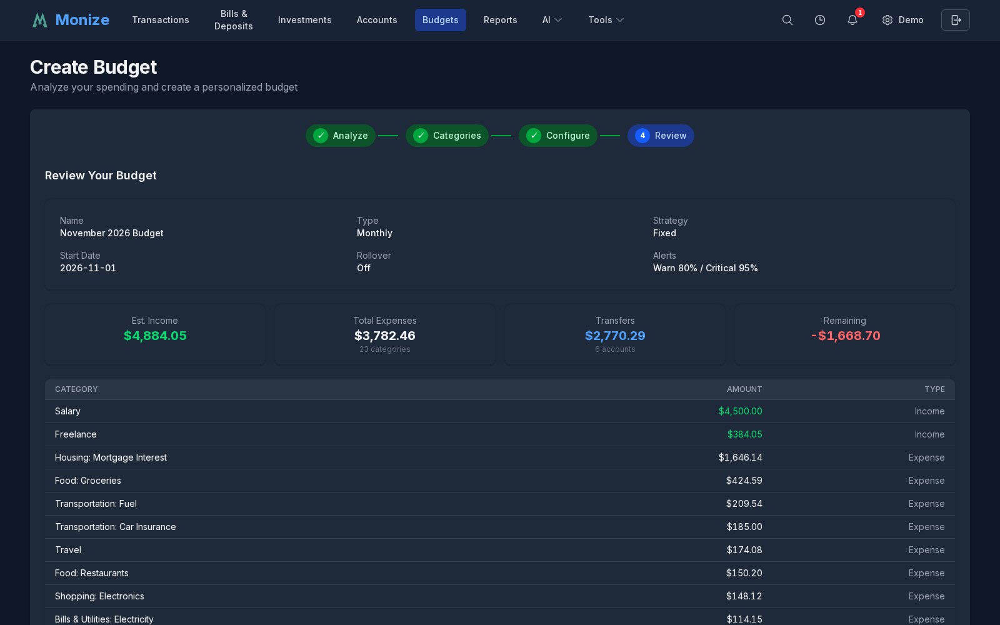

The review step shows a complete summary of your budget before it is created:

- **Summary cards** -- **Est. Income**, **Total Expenses**, **Transfers**, and **Remaining**
- **Budget details** -- **Name**, **Type**, **Strategy**, **Start Date**, **Rollover**, **Alerts**, **Income Linked**, **Excluded Accounts**, and **Transfers In** when transfers from excluded accounts count as income
- **Category table** -- every included category with its amount and type (Income, Transfer in, Expense, or Transfer)
- **Buckets** (Bucket budgets) -- each bucket with its target, whether it carries over, and how many categories it holds. A warning tells you how many categories are not in any bucket; you can still create the budget, and they show up as **Unassigned** on the dashboard

On mobile, the Type column is hidden to give category names and amounts more room.

Click **Create Budget** to finish. The new budget appears on the Budgets page.

---

## Budget Dashboard

Click a budget on the Budgets page to open its dashboard, your main view for tracking the budget in real time. A **Back to Budgets** link returns to the list, and the arrow beside the budget's name (**Switch to another budget**) jumps straight to another budget. Under the name, a bar describes the budget's strategy. The **Edit** and **Delete** buttons are at the top right.

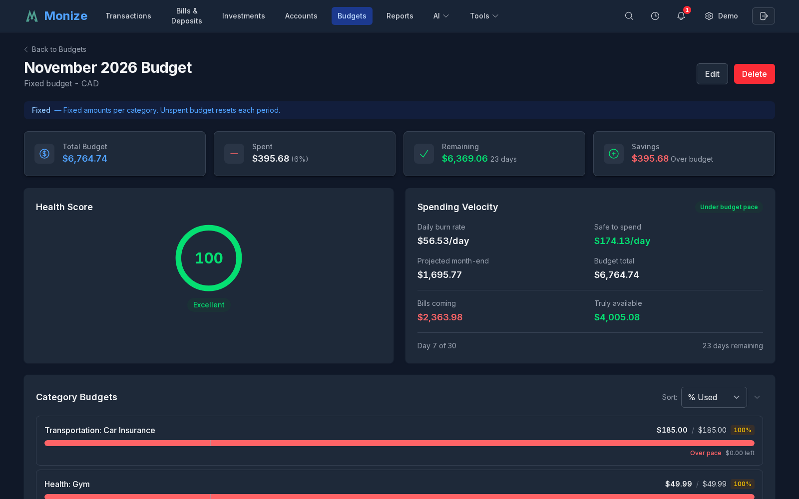

### Summary Cards

Four cards at the top provide an at-a-glance overview:

| Card | Description |
|------|-------------|
| **Total Budget** | Your total budgeted spending for the period |
| **Spent** | Total spending so far, with the percentage of the budget used |
| **Remaining** | Budget remaining, with the number of days left in the period (or **Period ended**) |
| **Savings** | Income received so far minus spending, marked **On track** or **Over budget** |

Purchases add to **Spent** and refunds in the same expense category reduce it. For a budget of 100, a purchase of 100 and a refund of 150 show **Spent −50** and **Remaining 150**. An ordinary income line likewise shows negative income if reversals exceed receipts. Open periods use these signed figures, and closing a period records them. Previously closed periods keep their saved figures.

If a transaction is in a currency with no exchange rate to the budget currency, Monize cannot work out the figures that depend on it. **Spent**, **Remaining**, **Savings**, the percentage, the health score, the safe daily spend and the category lines that include it show an unknown marker instead of a number. Point at the marker to see the missing currency pair. The dashboard widget lists those categories apart and does not rank them. On an income-linked budget the same applies when the income has no rate: **Total Budget** and the percentage lines are unknown, because they are a share of that income. Add the rate on the Currencies page to see the figures again.

### Health Score

A circular gauge from 0 to 100 summarizing how well you are sticking to your budget.

| Score Range | Label |
|-------------|-------|
| 90--100 | Excellent |
| 70--89 | Good |
| 50--69 | Needs Attention |
| Below 50 | Off Track |

The score starts at 100 and:
- loses points for every category over budget, more the further over it is
- loses a few points for every category above 95% of its budget
- gains a point for every category below half of its budget
- loses points when total spending is over the whole budget

The [Budget Health Score report](#budget-reports) gives a more detailed version that weights essential (Needs) categories more heavily.

### Spending Velocity

Shows your spending pace and whether you will finish the period within budget:

- **Daily burn rate** -- Purchases divided by elapsed days. Refunds do not reduce the purchase pace.
- **Safe to spend** -- How much you can spend per day and stay on track
- **Projected month-end** -- Net spending so far, plus expected purchases over the remaining days. If you buy 50 and receive a refund of 300 in the first five days of a 30-day month, the purchase pace is 10 per day. The remaining 25 days add 250, giving projected net spending of zero. Projected-overspend alerts use the same calculation for each category.
- **Pace status** -- **Under budget pace** (green), **On track** (yellow), or **Over budget pace** (red)
- **Budget total**, **Bills coming** and **Truly available** -- your budget less the scheduled bills still to come this period
- A progress bar showing **Day X of Y** and the days remaining

Because the widget factors in upcoming bills from your scheduled transactions, "safe to spend" reflects your truly available discretionary budget. A scheduled transfer between your own accounts counts as a bill only where a budget line takes it, and bills from accounts the budget excludes are left out (see **Upcoming Bills** below).

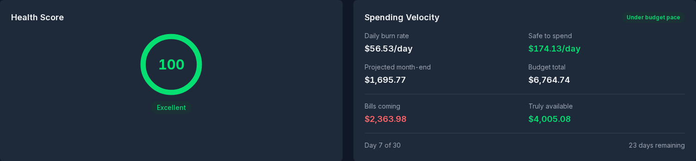

### Category List

The **Category Budgets** list shows every expense category in the budget with a progress bar.

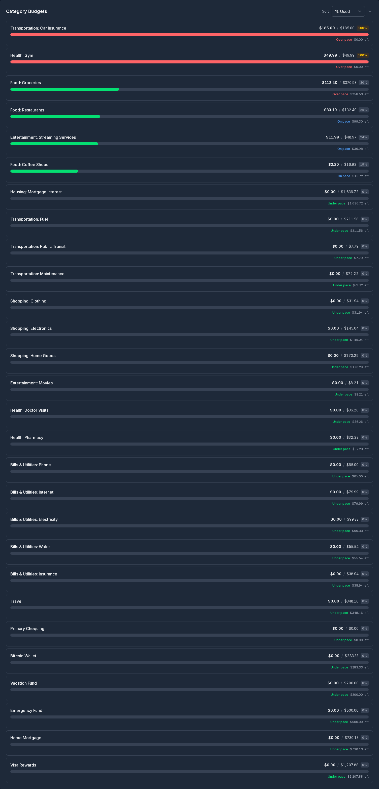

Each row shows:
- **Category name** -- including its parent category, for example "Food: Groceries"
- **Progress bar** -- Colour-coded by percentage used (green, yellow, red), with a marker showing where you should be today ("Expected pace")
- **Amount spent** of the **budgeted amount**, and the percentage used
- **Pace status** -- **Under pace**, **On pace**, or **Over pace** compared with how far through the period you are
- **Amount left**, or how much you are **over**

If refunds exceed purchases in the period, net spending and the percentage used can be negative. For a budget of 100 and net spending of −50, the progress bar is empty and the amount left is 150. Above 100% the bar stays full while the figure shows the actual percentage.

Use the **Sort** dropdown to sort by **% Used** (the default), **Spent**, **Remaining**, or **Name**, and the arrow beside it to reverse the order. On mobile, the sort controls stack below the heading.

Click a category row to open the Transactions page filtered to that category and the budget period.

### Strategy Widgets

Three widgets appear above the health score for specific strategies:

- **Zero-Based Assignment** (Zero-Based budgets) -- how much of your income is assigned (**Assigned: x / y**), marked **Fully assigned**, **Under-assigned**, or **Over-assigned**
- **50/30/20 Allocation** (50/30/20 budgets) -- for **Needs**, **Wants**, and **Savings**, the target percentage against the percentage and amount actually budgeted
- **Bucket allocation** (Bucket budgets) -- one row per bucket with its progress, plus the unassigned categories (see [Buckets](#buckets))

### Flex Groups

A flex group pools several related categories under one shared limit -- for example, "Fun Money" for Restaurants, Movies, and Hobbies. Individual categories within a group can go over budget, but as long as the group total is within its limit, you have stayed on plan.

You assign categories to flex groups in step 3 of the wizard (**Flex Groups** > **Configure**), or later from the budget's edit page (**Flex Group (optional)** in a category's settings). When at least one group exists, a **Flex Groups** card on the dashboard shows each group's combined spending against its combined budget.

### Buckets

A bucket is a named pot with its own target, for example "Fixed costs", "Everyday spending" and "Savings". Each expense or transfer category in a Bucket budget belongs to one bucket, so you watch a handful of buckets instead of every category. A flex group pools categories under their combined budget; a bucket has its own target and can carry what is left into the next period. A category can be in both.

**Targets.** Each bucket's target is either a **Percent of Income** or a **Fixed Amount** per period, and one budget can mix the two.

**Which income a percent is a share of.** The **Bucket allocation** card shows the figure as **Bucket income**, with where it came from:

- an income-linked budget uses the income actually received this period (**Based on actual income this period**)
- otherwise the budget's base income (**Based on the budget's base income**)
- otherwise the total of the budget's planned income categories (**Based on planned income categories**)

If none of these is known, the card shows **Unknown** and **No income found**, and each percent bucket's allocation is unknown rather than zero. It says "Set a base income on the budget, or add an income category"; the **Edit budget** link takes you to the edit page. Fixed-amount buckets still work.

**Targets need not add up.** Targets do not have to total 100%. The card shows **Total allocated** and **Unallocated** (your income less the allocations). When the buckets add up to more than your income it warns that you are over-allocated. If some allocations are unknown, the card shows **Allocated so far** as a partial figure and **Unallocated** as unknown.

**Assigning categories.** Choose a category's bucket in the wizard, or from its settings on the edit page (**Bucket**). Income categories and transfer income lines cannot be in a bucket. Categories with no bucket are not dropped: the card shows them in an **Unassigned** row with their planned and spent amounts and an **Assign them** link.

**What each bucket shows.** Its target, **Carried in** (when not zero), **Spent**, and **Available**: the allocation plus what was carried in, less what was spent. A bucket that has gone past that shows **Overspent**.

**Carry-over.** Turn on **Carry Over Balance** to carry a bucket’s closing balance into the next period. A surplus adds to the next allocation. A shortfall reduces it, even if the bucket starts the period below zero. **Carry Cap (optional)** limits how much surplus can carry over. With carry-over off, the bucket starts each period fresh.

A bucket's carry-over and a category's [rollover](#rollover-rules) are independent. A bucket's balance comes from its allocation and its categories' spending only; a category's own rollover does not enter it. To build balances at the bucket level, leave the categories' rollover on **None**.

**Presets.** The bucket editor offers **Start From a Preset**: **Three Buckets** (Fixed costs 50%, Everyday spending 30%, Savings 20%, with Savings carrying over), **Four Buckets (60/10/10/20)** (Daily expenses, Splurge, Long-term goals and Safety and debt, with the last two carrying over), or **Start From Scratch**. A preset only fills in a starting list: rename, retarget, add or remove buckets freely. Applying a preset to a budget that already has buckets asks for confirmation, because the current buckets are deleted. A budget can have at most 12 buckets.

**Deleting a bucket.** Its categories become unassigned. Closed periods keep their record of the bucket, under the name it had.

**Changing strategy.** Buckets are kept if you switch the budget to another strategy; they are only shown, and only used, while the strategy is **Bucket**.

### Upcoming Bills

Integrates with your scheduled transactions to show:
- **Bills coming due** this period with dates and amounts
- **Total upcoming** -- the sum of those bills
- **Truly available** -- remaining budget minus upcoming bills

Each row shows the whole amount that is due. The totals count only what posting the bill would add to your spending, the same rule the budget's actuals use. A scheduled transfer counts only where a budget line takes it: a transfer line for the account it pays, or a line for its category when the money leaves the accounts the budget tracks. Any other transfer, such as a payment to a credit card or a move between your own accounts, is left out because it is not spending. The same holds for a transfer line inside a split, such as the principal of a loan payment. Bills that leave an account the budget excludes are left out too. The Bills page and the calendar still list every transfer as an amount due.

This prevents a false sense of security when you have budget left but bills still to pay. When nothing is due, the card says "No bills due this period."

### Spending Heatmap

A calendar for the current month in which each day is shaded by how much you spent, from **Less** to **More**. Darker days are your heavier spending days, which helps you spot patterns such as weekend spending. Hover over or tap a day to see its total.

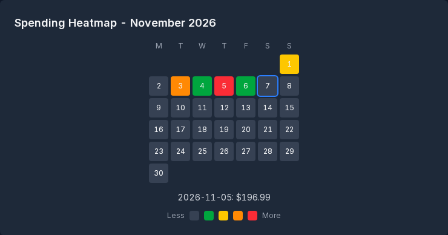

### Budget vs Actual Trend

A chart of your **Budgeted** amount against your **Actual** spending over recent periods, so you can see whether you are improving over time. It needs at least a couple of periods of history.

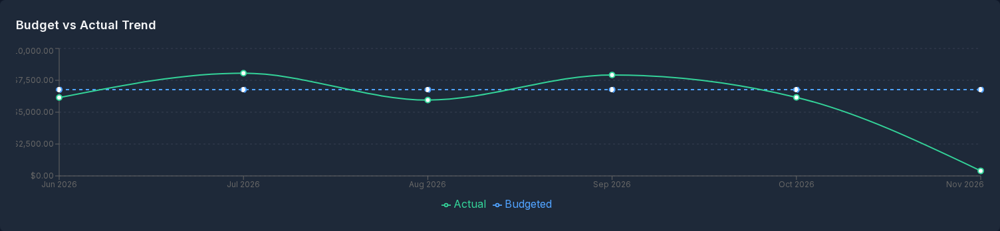

### Scenario Planner

The **What-If Scenario Planner** at the bottom of the dashboard lets you try budget changes without committing them. Drag a category's slider to change its amount and the planner immediately shows the **Current Budget**, the **Proposed Budget**, the **Projected Savings**, and the **Savings Change**. Each changed category shows its **Original** amount.

Nothing is saved: click **Reset** to put every slider back, or leave the page. To make a change permanent, edit the budget (see [Editing a Budget](#editing-a-budget)).

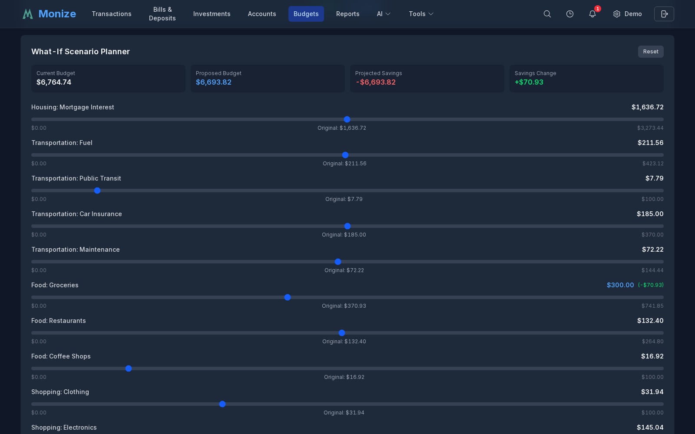

---

## Budget Strategies

Monize supports five budget strategies, each suited to a different financial style:

| Strategy | Description |
|----------|-------------|
| **Fixed** | Set fixed amounts per category. Simple and predictable. Unused budget resets at the end of each period. |
| **Rollover** | An expense category can carry its surplus or shortfall into the next period. Good for saving toward irregular expenses. |
| **Zero-Based** | Every dollar of income is assigned a purpose: income minus all budgeted amounts should equal zero. The dashboard shows how much is still unassigned. |
| **50/30/20** | Categories are grouped as Needs (50%), Wants (30%), or Savings (20%) of your income. The wizard and dashboard compare each group with its target. |
| **Bucket** | Income is split into a few named buckets, each with a target that is a share of income or a fixed amount. Every category belongs to one bucket, so you watch the bucket instead of each category, and a bucket can carry what is left into the next period. See [Buckets](#buckets). |

You can change a budget's strategy later from its edit page.

---

## Rollover Rules

Each category can have its own rollover setting:

| Rollover Type | Description |
|---------------|-------------|
| **None** | The budget resets each period -- no carry-forward |
| **Monthly** | The closing balance rolls into the next period |
| **Quarterly** | The closing balance rolls forward for quarterly saving |
| **Annual** | The closing balance rolls forward for saving across the year |

When an expense category rolls over, its closing balance increases or reduces what you can spend next period. Refunds count in full in the month you receive them. For example, with 100 budgeted per month and no cap, buying a TV for 300 in January carries −200 into February. February starts at −100. A full refund of 300 brings the balance to 200, so March starts at 300.

You can also set a **Rollover Cap** to limit how much surplus accumulates. A shortfall carries forward in full. For example, a clothing category might roll over monthly with a $500 cap.

**Common patterns:**
- **Groceries** -- None (no point accumulating)
- **Clothing** -- Monthly with a cap (save for seasonal shopping)
- **Travel** -- Annual (vacation fund)
- **Car Maintenance** -- Annual with no cap (save for repairs)

---

## Excluded Accounts

Accounts you exclude in step 3 of the wizard (or later, from the budget's edit page) are left out of this budget's own numbers: its spending totals, its income, its rollover calculations, its health score, and its alerts. An excluded account's transactions still show up everywhere else -- the Transactions page, reports, other budgets -- this setting only tells *this* budget to ignore them.

Exclude an account you do not want this budget judged by: an investment or brokerage account whose trades are not everyday spending, or a business account kept separate from your personal budget. A transfer *out of* an excluded account is also left out of the budget's progress, since it is not money the excluded account itself is accountable for.

---

## Transfers as Income

If you keep a reserve in one account and move a set amount out of it each month (a "bucket strategy"), a budget can count that money as income rather than ignoring it. There are two ways, and every budget type and strategy offers both:

- **A transfer income line** for one account: tick it under **Transfers In (Income)** in step 2 of the wizard, or click **Add Transfer Income** in the **Income** list of the budget's edit page and choose the account and a planned amount. The line appears as **Transfers from** *account* and counts what arrived from that account this period.
- **Count transfers in from excluded accounts as income**, a single option in step 3 of the wizard (beside **Excluded Accounts**) and on the budget's edit page. Money moved from any account the budget excludes into the budget's accounts counts as income. The edit page shows this period's figure as **Transfers from accounts outside this budget**.

Either way the figure is the net change: money moved in, less anything moved back to the same account in the period, and never below zero. A transfer between two accounts that are both in the budget, such as a credit card payment, is never income under the option. An account with its own transfer line is counted on that line, never twice, and an account can have only one transfer line in a budget: a savings line or an income line, not both. Voided transfers never count.

### A budget line on a Transfer category

A budget line can also name a [Transfer category](categories-and-payees.md#categories-on-transfers), as a planned outgoing amount (a savings or investment contribution) or as an income line. In step 2 of the wizard the **Transfer Categories** table lists them; on the edit page add the line as you would a category line. The line counts the transfers that hold that category in the budget's accounts, net of anything moved back, as a category line counts its rows. A transfer between two accounts of the budget nets to zero.

**The category line wins.** A transfer holding a Transfer category that has a line in the budget is counted on that line and left out of any per-account transfer line and of **Count transfers in from excluded accounts as income**. A transfer whose Transfer category has no line in the budget is counted by the account lines exactly as an uncategorized one. A line on an Income or Expense category counts what it counted before.

**Income is shown in three figures.** **Actual Income** is what your income categories received, **Transfer Funding** is money moved in from your own accounts (transfer income lines, income lines on a Transfer category and the excluded-accounts option), and **Total Budget Funding** is the two together. Transfer Funding funds the budget but is not income in your reports. A budget with no Transfer category line shows the same total as before; a period closed before the upgrade keeps its old figure under its old caption, because its split was not recorded.

Transfer income counts everywhere the budget's income does: the savings figures, an income-linked budget's percentages, the **Income Shortfall** alert, the income a closed period records, and the savings-rate report.

---

## Income-Linked Budgets

For freelancers, gig workers, or anyone with variable income, you can tick **Link budget to income** in step 3 of the wizard. Category amounts then become percentages of your base income rather than fixed dollar amounts:

- If your income drops, your budget automatically tightens
- If your income rises, your budget grows proportionally

Set a **Base Monthly Income** to establish the baseline. The wizard suggests it from your historical income. An income-linked budget also raises an **Income Shortfall** alert when actual income falls well below the base (see [Alerts](#alerts)).

---

## Alerts

Monize checks every active budget once a day and raises alerts before you overspend. Alerts appear under the notifications bell in the header, and the most serious ones can also be emailed to you.

### Alert Types

| Alert Type | Trigger | Severity |
|------------|---------|----------|
| **Threshold Warning** | A category's spending reaches its warning threshold (default 80%) | Warning |
| **Threshold Critical** | A category's spending reaches its critical threshold (default 95%) | Warning |
| **Over Budget** | A category's spending exceeds 100% | Critical |
| **Projected Overspend** | At the current pace, a category that is still under budget is projected to finish more than 10% over (checked from the third day of the period) | Warning |
| **Flex Group Warning** | A flex group's total reaches 90% of its combined budget | Warning |
| **Income Shortfall** | On an income-linked budget, at least halfway through the period, actual income is below 80% of the base income | Critical |
| **Positive Milestone** | At least halfway through the period and under 60% of the budget spent | Good news |
| **Seasonal Spike** | Your history shows next month is usually much more expensive for a category, so you can plan ahead | Info |
| **Bill Due** | A scheduled bill that you pay by hand (not posted automatically) is coming due within its reminder window | Info |

Each alert is raised once per period, so you are not reminded of the same overspend every day.

### In-App Alerts

The bell icon (**Notifications**) in the top navigation bar shows the number of unread notifications. Click it to open the notifications panel.

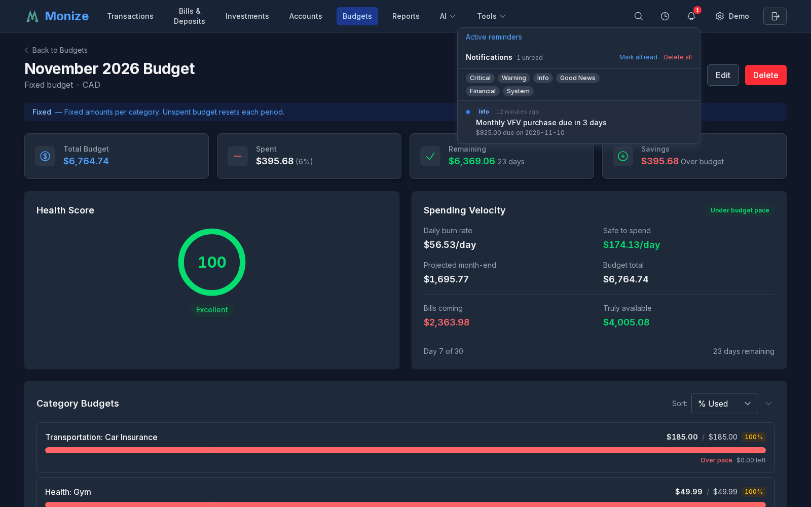

The panel lists budget alerts alongside Monize's other notifications:
- **Severity filters** -- chips for **Critical**, **Warning**, **Good News**, and **Info** (red, yellow, green, and blue badges), plus **Financial** and **System** to narrow the list
- **Alert title and message** -- What happened and the details
- **Unread indicator** -- A dot on unread alerts
- **Mark all read** -- Clears every unread indicator at once
- **Delete all** -- Removes every notification (or every one matching the current filter), after a confirmation
- **Remind me about this** -- Brings a notification back later, once or repeatedly until you stop it
- **Dismiss** -- An X button on each alert (see below)

Clicking an alert takes you to the relevant budget. Bill due alerts open the Bills & Deposits page instead.

### Dismissing Alerts

Each alert in the panel has an X button that appears on hover. Clicking it:
1. Immediately removes the alert from the list
2. Shows a toast notification with an **Undo** button for 5 seconds
3. If you don't undo, the alert is permanently deleted after 5 seconds
4. If you click **Undo**, the alert is restored to the list

### Email Notifications

Budget emails are set up in **Settings > Notifications**, under **Budget Notifications**. Email must be enabled for your account and your administrator must have configured email for the instance.

| Email Type | Description |
|------------|-------------|
| **Immediate alerts** | Critical budget alerts (over budget, income shortfall) are sent as soon as they are raised, regardless of digest settings |
| **Weekly Budget Digest** | A weekly summary of your budget alerts and status. Turn it on with the **Weekly Budget Digest** switch; the **Digest day** setting chooses the day |
| **Monthly summary** | Sent when a period closes, with total budget against actual spending, savings achieved, and the health score |

The **Budgets** row of the "How to notify me" grid in the same section controls whether budget reports and alerts are emailed at all.

---

## Period Management

Budgets are divided into periods (monthly for a monthly budget). Shortly after midnight on the 1st of each month, Monize automatically:

1. **Closes** the current period
2. Records the actual spending for each category
3. Calculates rollover amounts per category and, for a Bucket budget, each bucket's carry-over
4. Opens the next period, carrying the rollover balances forward

### Viewing Historical Periods

Once a budget has more than one period, a **Period:** selector appears at the top of the dashboard. Choose **Current Period**, or any past period by month. A closed period shows:
- **Total Budgeted**, **Total Spent**, and whether you finished **Under Budget** or **Over Budget**, plus **Income**
- A **Rollover Summary** of the amounts carried in and carried out
- For a Bucket budget, a **Buckets** table listing each bucket's **Target**, **Allocated**, **Carried in**, **Spent** and **Carried out**
- **Overall Budget Usage** shows the share spent when effective funding is positive. If funding is zero or negative, the period and category still show their monetary amounts and remaining balance.
- The final actual amount for every category, under **Expense Categories** and **Income Categories**

---

## Budget Reports

Nine budget-specific reports are available in the **Budget** category of the [Reports](reports.md#budget-reports) page:

| Report | Description |
|--------|-------------|
| **Budget vs Actual** | Compare your budgeted amounts to actual spending over time across all categories |
| **Budget Health Score** | Get a 0--100 health score for your budget with detailed per-category impact analysis |
| **Seasonal Spending Patterns** | Discover seasonal trends and high-spending months across your budget categories |
| **Budget Trend** | Line chart showing total budgeted vs total actual spending over 6--12 months to track improvement |
| **Category Performance** | Table showing each category's budget performance over multiple months. A rise from −20% to +10% is marked **Up**, and a fall from −20% to −40% is marked **Down** |
| **Savings Rate** | Track your savings rate (income minus expenses divided by income) over time vs your target. Without an income category in the budget, income is every deposit of the month, each line of a split on its own, leaving out transfers and investment trades |
| **Health Score History** | Line chart of monthly budget health scores showing your financial trajectory over time |
| **Flex Group Analysis** | Stacked bar chart for each flex group showing component categories with group limit reference |
| **Seasonal Spending Map** | Heatmap grid showing 12 months across all categories to identify seasonal spending patterns |

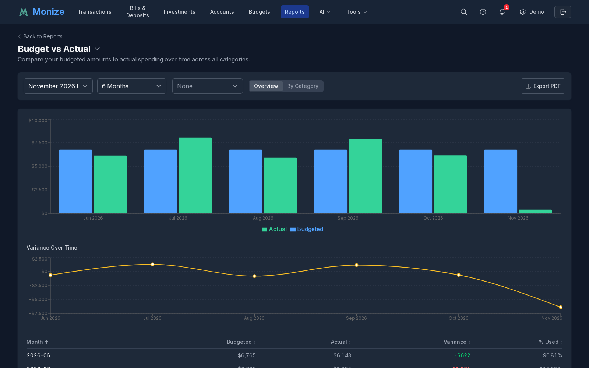

Additionally, a **Budget Variance** metric is available in the [custom report builder](reports.md#custom-report-builder), so you can create your own budget-related reports with flexible filters and groupings.

---

## Editing a Budget

To edit an existing budget:

1. Open the budget dashboard
2. Click **Edit** in the top right
3. Change the **Budget Settings**: **Budget Name**, **Description (optional)**, **Budget Type**, **Strategy**, **Base Income (optional)**, **Count transfers in from excluded accounts as income**, and **Active**
4. Click **Save Changes**

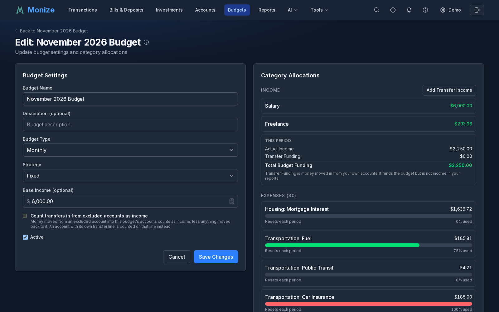

For a Bucket budget, a **Buckets** section appears with the bucket editor (**Add Bucket**, edit, delete, and the presets), described in [Buckets](#buckets).

Below the settings, **Category Allocations** lists the budget's **Income** and **Expenses** categories with their amounts and rollover settings. **Add Transfer Income** beside the **Income** heading adds a transfer income line for one of your accounts (see [Transfers as Income](#transfers-as-income)). Click a category to open its settings:

| Field | Description |
|-------|-------------|
| **Budget Amount** | The amount budgeted for the category each period |
| **Rollover Type** | None, Monthly, Quarterly, or Annual (see [Rollover Rules](#rollover-rules)) |
| **Rollover Cap (optional)** | The most that can accumulate; shown when the category rolls over |
| **Flex Group (optional)** | The flex group this category belongs to |
| **Category Group (50/30/20)** | Need, Want, or Saving |
| **Bucket** | The bucket the category belongs to, or **Unassigned**; shown on Bucket budgets for expense categories (see [Buckets](#buckets)) |
| **Warning at (%)** / **Critical at (%)** | This category's own alert thresholds |
| **Notes (optional)** | Your own notes about the category budget |

Click **Save** to keep the changes, or **Remove from budget** to take the category out of the budget. Removing a category also deletes its history in past budget periods (your transactions are not affected), so Monize asks you to confirm.

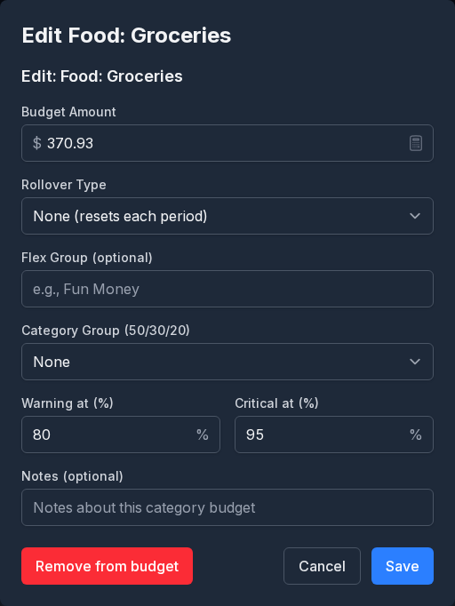

Unticking **Active** stops the daily alert checks for the budget without deleting it.

## Deleting a Budget

Click **Delete** on the budget dashboard and confirm. Deleting a budget removes all of its data, including its periods and alerts; your transactions and categories are not affected.

**Undo** brings the budget back with its category lines and buckets, but not its closed periods or alerts. **Redo** of the delete is refused if you added a period, or added or changed a line or bucket, after the restore. **Undo** of creating a budget is refused once the budget has periods, lines or buckets; delete the budget instead.
