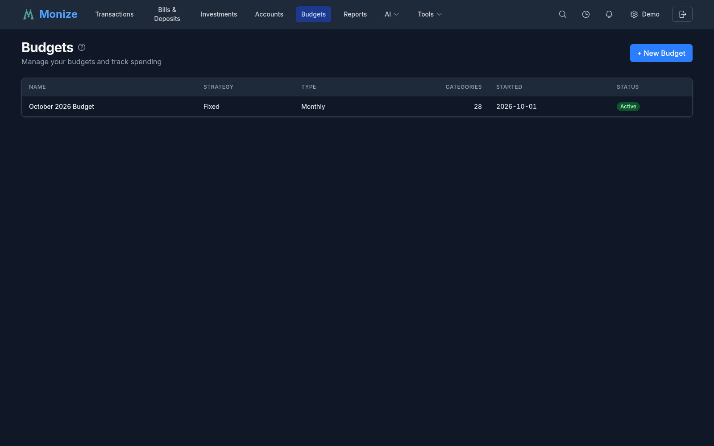
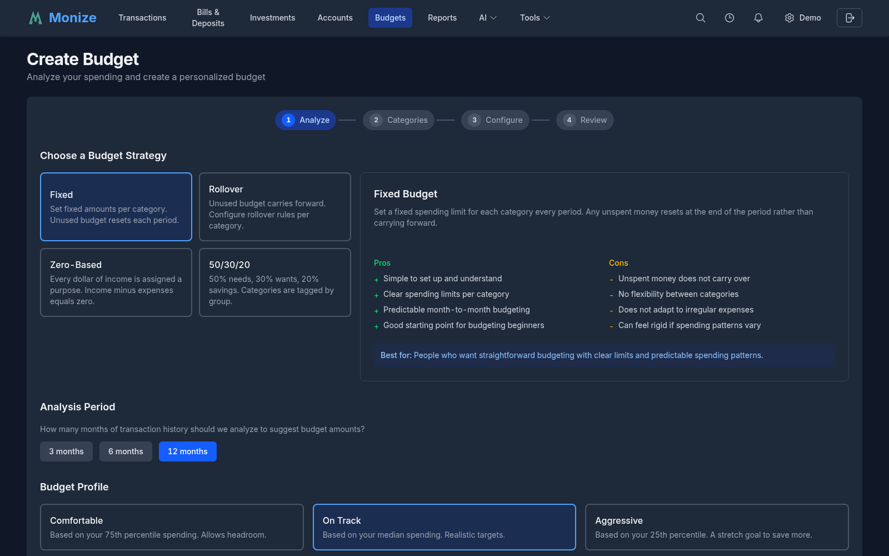
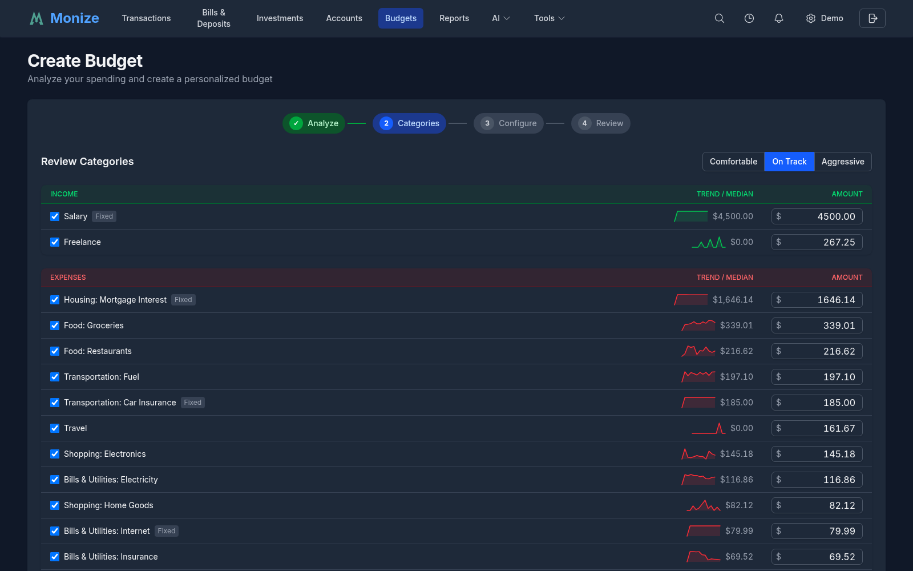
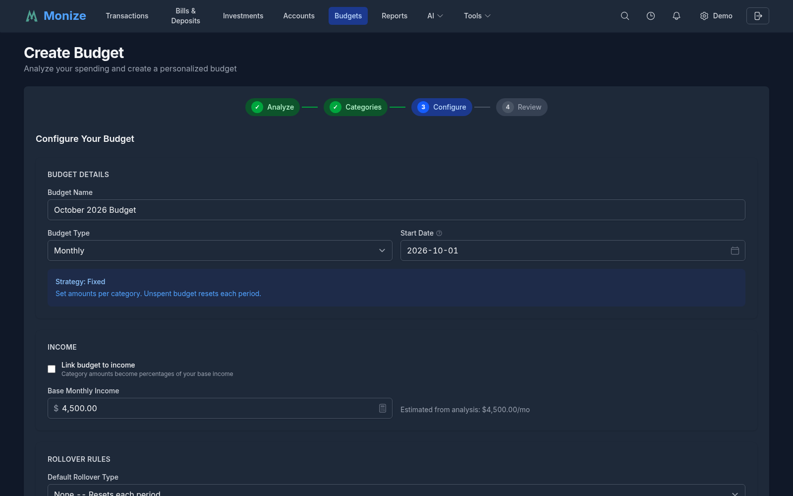
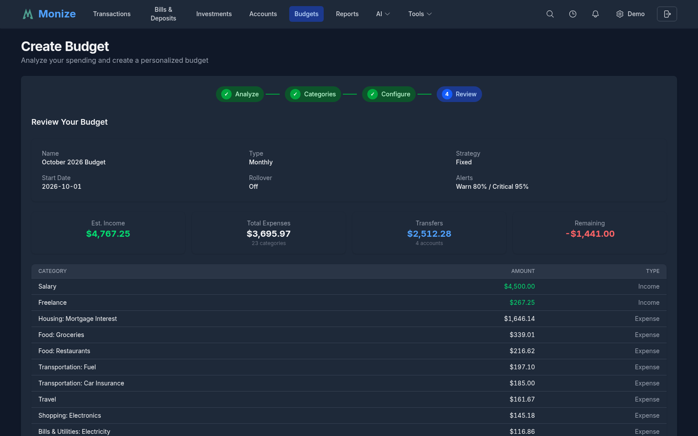
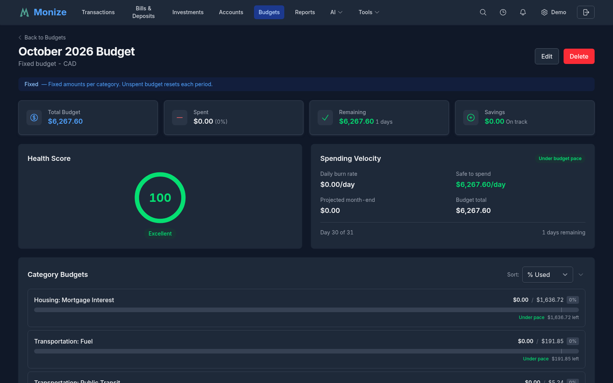
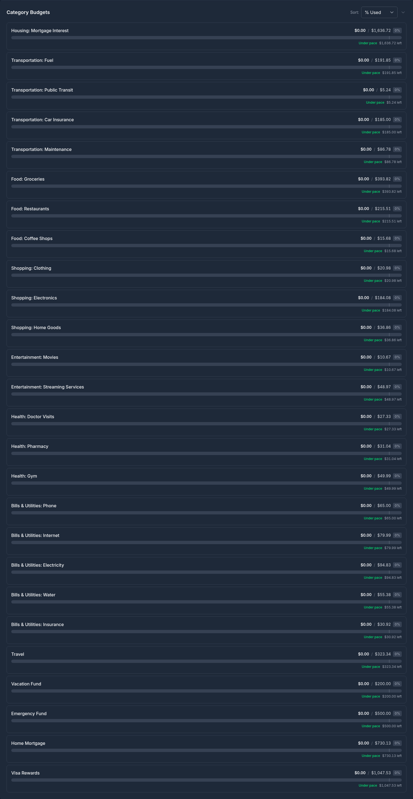
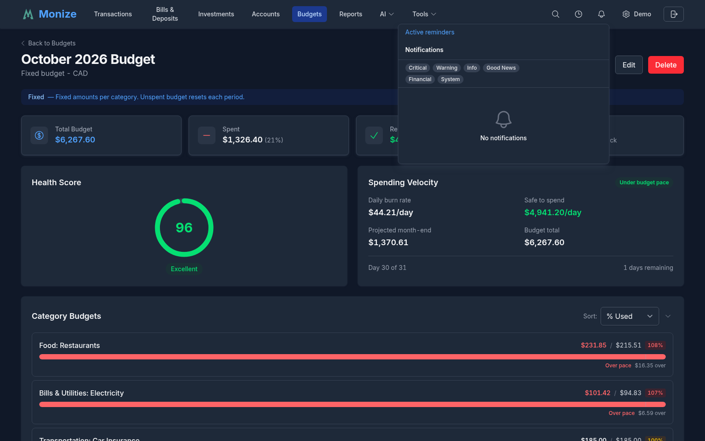

# Budgets

Monize includes a full-featured budget planner that analyzes your spending history to auto-generate realistic budgets, tracks spending in real-time with velocity projections, supports flexible rollover strategies per category, and proactively alerts you before you overspend.

---

## Overview

Navigate to **Budgets** from the top navigation bar to view your active budget or create a new one. The budget system integrates with your transactions, scheduled bills, and categories to provide a complete picture of your financial plan.

<!-- Screenshot: The budgets page showing the active budget overview or budget list -->

---

## Creating a Budget

Monize includes a **Budget Wizard** that analyzes your historical spending to suggest realistic targets -- no manual data entry required. The wizard walks you through four steps.

### Step 1: Analyze Spending

<!-- Screenshot: Budget wizard step 1 showing strategy selection, analysis period, and profile options -->

1. **Choose a strategy** -- Select one of four budget strategies (see [Budget Strategies](#budget-strategies) below). Each strategy is displayed as a card with a description.
2. **Select an analysis period** -- Choose 3, 6, or 12 months of spending history to analyze. Longer periods smooth out anomalies; shorter periods reflect recent habits.
3. **Choose a profile** -- Pick how aggressive your targets should be:

| Profile | Description |
|---------|-------------|
| **Comfortable** | Based on the 75th percentile of your spending -- allows headroom |
| **On Track** | Based on median spending -- a realistic, sustainable target |
| **Aggressive** | Based on the 25th percentile -- a stretch goal for maximum savings |

4. Click **Analyze My Spending** to generate suggestions.

The analysis calculates statistical distributions per category, identifies fixed expenses (rent, subscriptions) vs variable spending (dining, groceries), and estimates your monthly income.

### Step 2: Review Categories

<!-- Screenshot: Budget wizard step 2 showing the category table with suggested amounts and editable inputs -->

This step displays every spending category found in your history, grouped into:

- **Income categories** at the top
- **Expense categories** sorted by suggested amount (largest first)
- **Transfer accounts** (savings contributions, loan payments)

For each category, you can see:

| Column | Description |
|--------|-------------|
| **Category** | The spending category name |
| **Avg/mo** | Your average monthly spending |
| **Suggested** | The wizard's recommended budget amount |
| **Amount** | Editable -- adjust to your preference |

Use the **profile toggle buttons** (Comfortable / On Track / Aggressive) at the top to quickly switch between suggested amounts for all categories at once.

For **50/30/20 strategy** budgets, categories are grouped into Needs, Wants, and Savings with percentage targets shown.

You can also add categories that weren't found in your history, or remove categories you don't want to track.

### Step 3: Configure Options

<!-- Screenshot: Budget wizard step 3 showing budget name, type, rollover, alerts, and other configuration options -->

Configure your budget settings:

| Setting | Description |
|---------|-------------|
| **Budget Name** | A descriptive name (defaults to current month + year) |
| **Budget Type** | Monthly, Annual, or Pay Period |
| **Start Date** | When the budget takes effect |
| **Rollover** | Default rollover strategy for all categories (None, Monthly, Quarterly, Annual) |
| **Alert Thresholds** | Warning percentage (default 80%) and critical percentage (default 95%) |
| **Income Linked** | Enable percentage-based budgeting tied to actual income |
| **Base Monthly Income** | Your expected monthly income (uses the standard currency input with symbol and formatting) |
| **Excluded Accounts** | Accounts to exclude from budget tracking (e.g., investment accounts) |

### Step 4: Review and Create

<!-- Screenshot: Budget wizard step 4 showing the full budget summary with totals and category table -->

The review step shows a complete summary of your budget before creation:

- **Budget details** -- Name, type, strategy, start date, rollover setting, alert thresholds
- **Summary cards** -- Estimated income, total expenses, transfers, and remaining balance
- **Category table** -- All categories with amounts and types (income, expense, transfer)

On mobile, the Type column is hidden to provide more room for category names and amounts.

Click **Create Budget** to finalize.

---

## Budget Dashboard

The budget dashboard (`/budgets/[id]`) is your primary view for tracking budget progress in real time.

<!-- Screenshot: The full budget dashboard showing summary cards, health gauge, velocity, category list, and charts -->

### Summary Cards

Four cards at the top provide an at-a-glance overview:

| Card | Description |
|------|-------------|
| **Total Budget** | Your total budgeted amount for the period, with category count |
| **Spent** | Total spending so far, with percentage of budget used |
| **Remaining** | Budget remaining, with days left in the period |
| **Savings** | Projected savings (income minus expenses) |

### Health Score

A circular gauge (0--100) summarizing how well you're sticking to your budget.

| Score Range | Label |
|-------------|-------|
| 90--100 | Excellent |
| 70--89 | Good |
| 50--69 | Needs Attention |
| Below 50 | Off Track |

The score factors in:
- Categories over budget (deductions proportional to overage)
- Categories consistently under budget (bonus points)
- Essential categories weighted higher than discretionary
- Month-over-month improvement trends

### Spending Velocity

Shows your spending pace and whether you'll finish the month within budget:

- **Daily burn rate** -- How much you're spending per day
- **Safe to spend** -- How much you can spend per day and stay on track
- **Projected month-end** -- Where you'll land at the current pace
- **Pace indicator** -- Green (under pace), yellow (near pace), red (over pace)

The velocity widget also factors in upcoming bills from your scheduled transactions, so "safe to spend" reflects your truly available discretionary budget.

### Category List

A sortable list of all budget categories with progress bars and real-time tracking.

<!-- Screenshot: The category list showing categories with progress bars, amounts, and pace indicators -->

Each category row shows:
- **Category name** and group (if using 50/30/20)
- **Progress bar** -- Colour-coded by percentage used (green, yellow, red) with a pace marker showing where you should be today
- **Amount spent** vs **budgeted amount** and percentage
- **Pace status** -- Whether you're ahead of or behind the safe spending pace

Use the **Sort** dropdown to sort by name, percentage used, amount spent, remaining amount, or pace status. On mobile, the sort controls stack below the heading for better readability.

### Flex Groups

If you've assigned categories to flex groups, the Flex Groups widget shows aggregate spending. Individual categories within a group can be over budget, but as long as the group total is within limits, no alert fires.

### Upcoming Bills

Integrates with your scheduled transactions to show:
- **Bills coming due** this period with dates and amounts
- **Truly available** budget -- remaining budget minus upcoming bills
- This prevents a false sense of security when you have budget left but bills pending

### Spending Heatmap

A calendar-style heatmap showing daily spending intensity. Darker cells indicate higher spending days, helping you identify patterns.

### Budget vs Actual Trend

A line chart showing your budgeted amount vs actual spending over the past several months. Helps identify whether you're improving over time.

---

## Budget Strategies

Monize supports four budget strategies, each suited to different financial styles:

| Strategy | Description |
|----------|-------------|
| **Fixed** | Set fixed amounts per category. Simple and predictable. Unused budget disappears at the end of each period. |
| **Rollover** | Unused budget carries forward to the next period based on per-category rollover rules. Good for saving toward irregular expenses. |
| **Zero-Based** | Every dollar of income must be assigned to a category. Income minus expenses equals zero. Forces intentional allocation of every dollar. |
| **50/30/20** | Categories are tagged as Needs (50%), Wants (30%), or Savings (20%). The wizard auto-calculates targets based on your income. |

---

## Rollover Rules

Each category can have its own rollover strategy:

| Rollover Type | Description |
|---------------|-------------|
| **None** | Budget resets each period -- no carry-forward |
| **Monthly** | Unused budget rolls to the next month |
| **Quarterly** | Budget accumulates for 3 months then resets |
| **Annual** | Budget accumulates all year |

You can also set a **rollover cap** to limit how much accumulates. For example, a clothing category might roll over monthly with a $500 cap.

**Common patterns:**
- **Groceries** -- None (no point accumulating)
- **Clothing** -- Monthly with a cap (save for seasonal shopping)
- **Travel** -- Annual (vacation fund)
- **Car Maintenance** -- Annual with no cap (save for repairs)

---

## Income-Linked Budgets

For freelancers, gig workers, or anyone with variable income, you can enable income-linked budgeting. When enabled, category budget amounts are treated as percentages of your actual income rather than fixed dollar amounts.

- If your income drops, your budget automatically tightens
- If your income rises, your budget grows proportionally
- The dashboard shows both the percentage and the resulting dollar amount

Set a **Base Monthly Income** to establish the baseline. The budget wizard will suggest this based on your historical income data.

---

## Alerts

Monize proactively monitors your budget and sends alerts before you overspend.

### Alert Types

| Alert Type | Trigger | Severity |
|------------|---------|----------|
| **Pace Warning** | Daily burn rate projects >110% of budget by period end | Warning |
| **Threshold Warning** | Category spending reaches the warning threshold (default 80%) | Warning |
| **Threshold Critical** | Category spending reaches the critical threshold (default 95%) | Critical |
| **Over Budget** | Category spending exceeds 100% | Critical |
| **Flex Group Warning** | Flex group total reaching 90% | Warning |
| **Projected Overspend** | Current velocity projects >15% over budget | Warning |
| **Income Shortfall** | Actual income below 80% of expected (income-linked budgets) | Critical |
| **Positive Milestone** | 50%+ through the period and under 60% of budget | Success |
| **Bill Due** | A manually-tracked bill is coming due soon | Info |

### In-App Alerts

A bell icon in the top navigation bar shows the count of unread alerts. Click the bell to open the alert dropdown.

<!-- Screenshot: The alert bell icon in the header with an unread count badge -->

The alert dropdown displays:
- **Severity badges** -- Colour-coded (red for critical, yellow for warning, green for good news, blue for info)
- **Alert title and message** -- What happened and the details
- **Unread indicator** -- A dot on unread alerts
- **Mark All Read** button -- Clears all unread indicators at once
- **Dismiss button** -- An X button on each alert to remove it (see below)

Clicking an alert navigates to the relevant budget page. Bill due alerts navigate to the Bills & Deposits page instead.

### Dismissing Alerts

Each alert in the dropdown has an X button that appears on hover. Clicking it:
1. Immediately removes the alert from the list
2. Shows a toast notification with an **Undo** button for 5 seconds
3. If you don't undo, the alert is permanently deleted after 5 seconds
4. If you click **Undo**, the alert is restored to the list

Virtual bill due alerts (which are generated on-the-fly, not stored in the database) are removed from the list immediately but don't trigger a backend delete.

### Email Notifications

Budget alert emails can be enabled in **Settings**:

| Email Type | Description |
|------------|-------------|
| **Immediate alerts** | Sent for critical threshold, over-budget, and income shortfall alerts |
| **Weekly digest** | Summary of all alerts, health score, and safe daily spend (configurable for Monday or Friday) |
| **Monthly summary** | End-of-period report with total budget vs actual, savings achieved, and health score |

Configure email preferences in **Settings > Notifications**.

---

## Period Management

Budgets are divided into periods (typically monthly). At the end of each period:

1. The current period is **closed** automatically (via a daily cron job on the 1st of each month)
2. Actual spending is finalized
3. Rollover amounts are calculated per category
4. A new period is opened with rollover balances carried forward

You can also manually close a period from the budget settings.

### Viewing Historical Periods

Use the **Period Selector** dropdown on the budget dashboard to switch between the current period and historical periods. Historical periods show:
- Final actual amounts per category
- Rollover in/out amounts
- Budget vs actual comparison

---

## Budget Reports

Nine budget-specific reports are available in the **Reports** section:

| Report | Description |
|--------|-------------|
| **Budget vs Actual** | Compare your budgeted amounts to actual spending over time across all categories |
| **Budget Health Score** | Get a 0--100 health score for your budget with detailed per-category impact analysis |
| **Seasonal Spending Patterns** | Discover seasonal trends and high-spending months across your budget categories |
| **Budget Trend** | Line chart showing total budgeted vs total actual spending over 6--12 months to track improvement |
| **Category Performance** | Table showing each category's budget performance over multiple months with trend indicators |
| **Savings Rate** | Track your savings rate (income minus expenses divided by income) over time vs your target |
| **Health Score History** | Line chart of monthly budget health scores showing your financial trajectory over time |
| **Flex Group Analysis** | Stacked bar chart for each flex group showing component categories with group limit reference |
| **Seasonal Spending Map** | Heatmap grid showing 12 months across all categories to identify seasonal spending patterns |

Additionally, a **Budget Variance** metric is available in the custom report builder, so you can create your own budget-related reports with flexible filters and groupings.

---

## Scenario Planner

The Scenario Planner is a "what-if" tool for trying budget changes without committing them.

1. Navigate to your budget dashboard
2. Open the **Scenario Planner**
3. Adjust category amounts using sliders
4. See live projections: savings impact, flex group effects, zero-based balance changes
5. Click **Apply Changes** to save your adjustments, or discard them

This is entirely a frontend calculation -- no data is saved until you explicitly apply changes.

---

## Editing a Budget

To edit an existing budget:

1. Navigate to the budget dashboard
2. Click **Edit** in the top right
3. Modify budget settings (name, type, strategy, categories, amounts, rollover rules, alert thresholds)
4. Click **Save**

You can also:
- **Add categories** that weren't included in the original budget
- **Remove categories** you no longer want to track
- **Bulk update** all category amounts at once
- **Change rollover rules** per category
