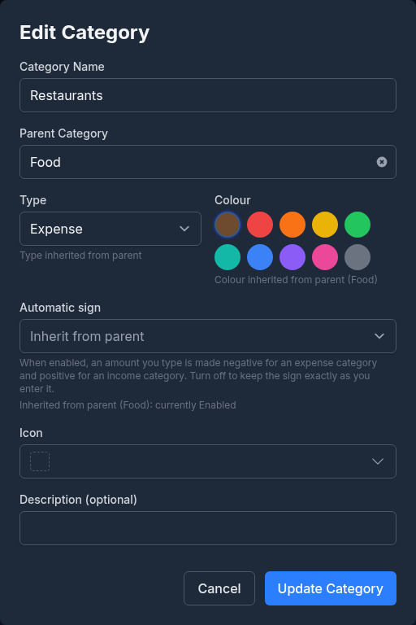
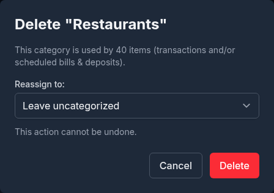
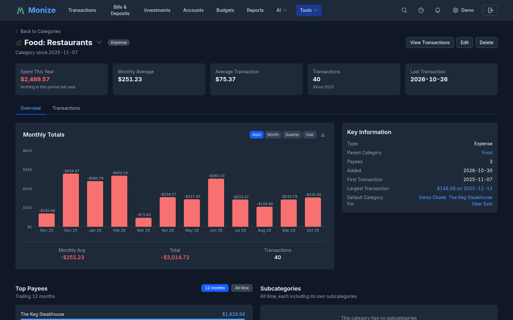
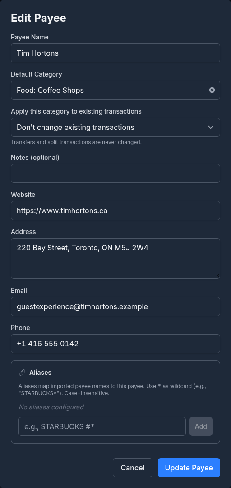
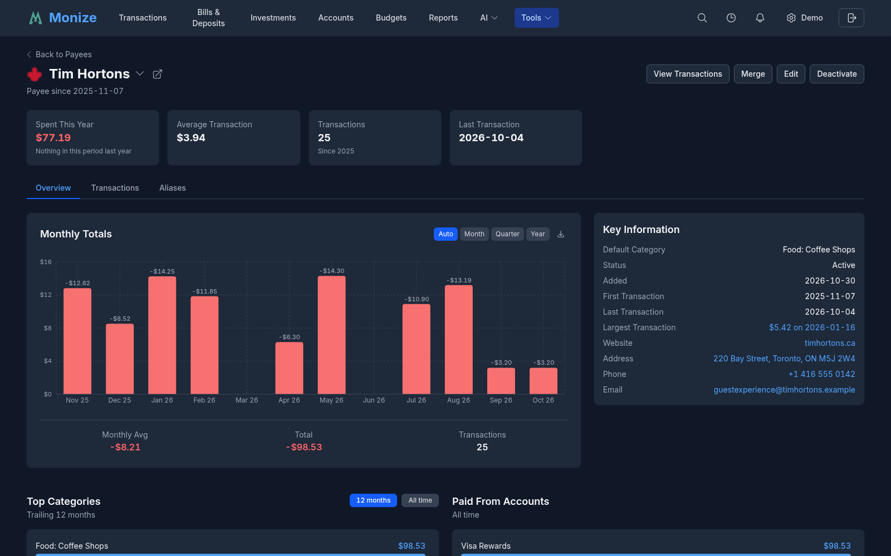
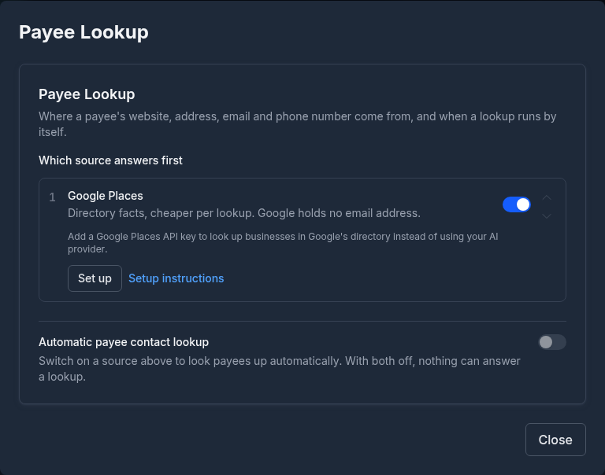
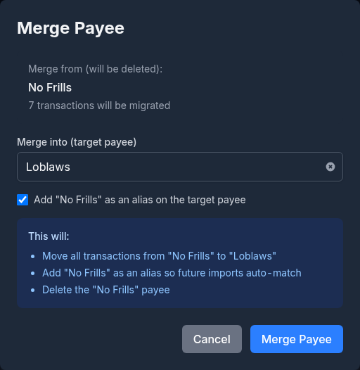
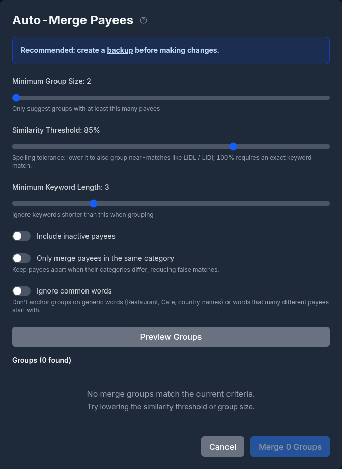
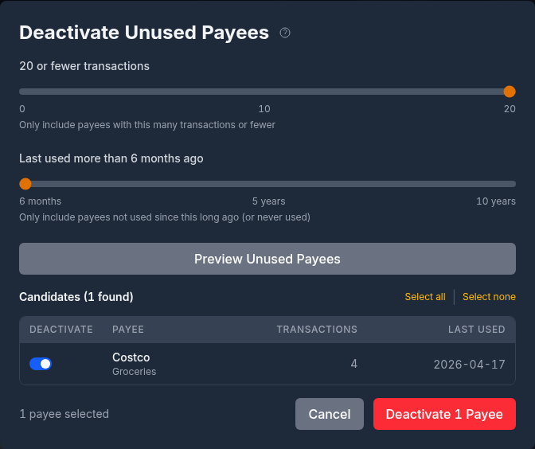
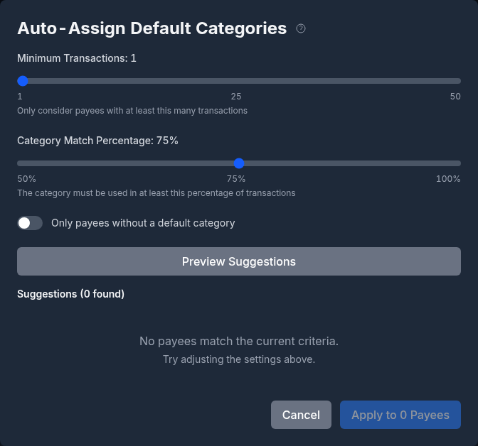

# Categories and Payees

Categories and payees are the organizational backbone of your financial data. Categories classify *what* the money was for, while payees track *who* the money went to or came from.

---

## Categories

Categories are used to classify transactions by purpose (e.g., "Groceries," "Rent," "Salary"). They form a hierarchical tree structure with parent and child categories.

> [!NOTE]
> A fresh account has no categories. The Categories page then offers **Import Default Categories** or **Create Your Own**. The import asks for a **Country** (Canada, the United Kingdom and the United States add their own tax and benefit categories; **Generic** adds none) and the **Language** the names are created in, from any of the languages Monize is translated into. The result is an ordinary set of income and expense categories with subcategories, which you can rename, recolour or delete like any other. The import is only possible while you have no categories of your own.

### Category Hierarchy

Categories support parent-child relationships for detailed tracking:

```
Food & Dining (parent)
  |- Groceries (child)
  |- Restaurants (child)
  |- Coffee Shops (child)

Housing (parent)
  |- Rent (child)
  |- Utilities (child)
  |- Maintenance (child)
```

When viewing reports, you can see totals at the parent level (all "Food & Dining") or drill down to individual children (just "Groceries"). A child is shown as `Parent: Child` wherever its parent matters, such as in the category picker.

### Managing Categories

Navigate to **Tools > Categories** to access the category management page.


Four cards at the top count your **Total Categories**, **Income Categories**, **Expense Categories** and **Top-Level** categories. Below them, **Search categories** finds a category by name (a matching subcategory brings its parent along, and a matching parent brings all of its subcategories), and the **All**, **Expenses** and **Income** buttons narrow the list by type.

The list shows each category's icon and colour, its **Name**, its **Type**, its transaction **Count** and its **Description**. Click a column header to sort by it. Click a row to open the category's [detail page](#category-detail-page); click the category's name to see its transactions instead (see [Viewing a Category's Transactions](#viewing-a-categorys-transactions)). **Edit** and **Delete** are at the end of each row (on a phone, press and hold the row, or right-click it, to open its actions).

#### Creating a Category

1. Click **+ New Category**
2. Enter the category details:

| Field | Description |
|-------|-------------|
| **Category Name** | Category name (e.g., "Groceries") |
| **Parent Category** | Optional parent for nesting; leave it on **No parent (top-level)** for a top-level category |
| **Type** | **Expense** or **Income**. A subcategory always has its parent's type (**Type inherited from parent**) |
| **Automatic sign** | Whether an amount you type is given the category's sign (see [Automatic Sign](#automatic-sign)) |
| **Colour** | A colour for reports and charts, picked from the palette, or none. A subcategory can **Inherit from parent** |
| **Icon** | An icon drawn beside the category's name, or **No icon** |
| **Description (optional)** | A note about what belongs in the category |

3. Click **Create Category**

#### Colours and Icons

A category's colour and icon appear in the category list, on its detail page, in the transaction register and in charts. A subcategory with no colour or icon of its own uses its parent's (the list says **Inherited from parent** when you point at it), so you can colour a whole branch by colouring its parent. In the category list at the **Dense** row density, the icon is reduced to a coloured dot.

#### Editing a Category

Click **Edit** on a category's row, or **Edit** on its detail page, to change any of the fields above, then click **Update Category**. Changing a top-level category's type changes the type of all of its subcategories too. A category cannot be moved under itself or under one of its own subcategories.



#### Deleting a Category

Click **Delete** on a category's row or detail page. Monize first checks how many transactions and scheduled bills and deposits use the category:

- If none do, the dialog says the category can be safely deleted.
- If some do, choose where they go under **Reassign to:** another category, or **Leave uncategorized**. They are moved before the category is deleted.



A category that still has subcategories cannot be deleted: move or delete its subcategories first. Payees that used the deleted category as their [default category](#default-categories) are left without one. Deleting cannot be undone from the dialog.

There is no separate merge for categories: to merge one category into another, delete it and reassign its transactions to the category you keep.

### Category Detail Page

Each category has a detail page with its history and analytics. Click a row on the Categories page to open it.



The header shows the category's name, icon and type (and **System** for a system category), with **View Transactions**, **Edit** and **Delete**. The name is also a switcher: click it to filter your categories and jump to another without going back to the list. Below it, the page has these tabs:

- **Overview**: **Spent This Year** (or **Received This Year** for an income category) compared with the same period last year, the **Monthly Average**, the **Average Transaction**, the number of **Transactions** and the **Last Transaction**; a chart of the monthly totals; **Top Payees** over the last 12 months or all time; the **Subcategories** breakdown with each one's share; the accounts it was **Paid From**; the **Upcoming Scheduled** bills and deposits in the category; a **Tag Breakdown** of the category's spending by the values of a [tag key](tags.md#keyvalue-tags); the category's **Key Information** (type, parent, subcategories, payees, first and largest transaction, the payees that use it as their default category); and its **Seasonality**, the typical cost of each month of the year once there is enough history.
- **Transactions**: every transaction in the category, editable in place, with **Open in the register** to see them on the Transactions page.
- **Subcategories** (for a category that has some): each subcategory with its total and its number of transactions.

Amounts in another currency are converted to your default currency, and the page says so.

### Viewing a Category's Transactions

Click a category's name on the Categories page (or **View Transactions** on its detail page) to open the Transactions page filtered to that category, so you can review every transaction assigned to it without setting up the filter by hand.

### Income vs Expense Categories

Each category is marked as either **Income** or **Expense**:

- **Income categories** -- Salary, freelance income, investment returns, etc.
- **Expense categories** -- Groceries, rent, utilities, entertainment, etc.

This classification determines how transactions are counted in reports (income vs. expenses charts).

### Automatic Sign

With **Automatic sign** on, an amount you type for a transaction in the category is made negative for an expense category and positive for an income category, so you never have to type the minus sign. Turn it off (**Disabled**) for a category that holds money in both directions, such as refunds you file under the same category as the purchase; the amount is then kept exactly as you enter it. A subcategory can **Inherit from parent**, and the form shows which state it inherits.

### Categories on Transfers

Transfers move money between your own accounts, so they are never counted as income or expense. You can still optionally assign a category to a transfer. When you do, the transfer appears under that category in the monthly category breakdown, giving you visibility into where transferred money goes, while remaining excluded from income and expense totals.

### System Categories

A category marked **(System)** cannot be edited or deleted; the list and the detail page mark it as such. The categories you create, and the ones the default import creates, are ordinary categories that you can change freely.

---

## Payees

Payees represent the people, businesses, or entities you transact with. Every transaction can optionally be assigned a payee.

### Managing Payees

Navigate to **Tools > Payees** to access the payee management page.


Four cards at the top count your **Total Payees**, the **Active** and **Inactive** ones, and those **Without Category**. Below them:

- **Search payees** finds a payee by name.
- **Status**: **All**, **Active** or **Inactive**.
- **Default Category**: **All Payees**, **No Default Category**, or **Uncategorized Txns** (payees that have transactions without a category).

The list shows each payee's logo, **Name**, **Default Category**, transaction **Count**, number of **Aliases**, **Last Used** date, **Created** date, **Status** and **Notes**; which columns fit depends on the width of the screen. A payee with uncategorized transactions shows how many beside its name. Click a column header to sort by it. Click a row to open the payee's [detail page](#payee-detail-page); click the payee's name to see its transactions instead. Each row has **Merge**, **Edit** and **Delete** (**Reactivate** in place of **Merge** for an inactive payee).

The **Maintenance** menu beside **+ New Payee** holds the bulk tools: **Auto-Merge Payees**, **Deactivate Unused**, **Auto-Assign Categories**, **Apply Default Categories** and **Payee Lookup settings**, each described below.

#### Creating a Payee

1. Click **+ New Payee**
2. Enter the payee details:

| Field | Description |
|-------|-------------|
| **Payee Name** | Payee name (e.g., "Amazon", "City Hydro") |
| **Default Category** | Auto-assigned category for new transactions with this payee |
| **Website** | The payee's website (see [Payee Contact Details](#payee-contact-details)) |
| **Address** | The payee's address |
| **Email** | The payee's email address |
| **Phone** | The payee's phone number, with its country code |
| **Notes (optional)** | Optional notes about the payee |
| **Aliases** | Wildcard patterns for matching imported transaction names (see [Payee Aliases](#payee-aliases)) |

3. Click **Create Payee**

You can add aliases directly during payee creation -- there is no need to save the payee first and then edit it to add aliases.

Payees can also be created inline when creating a transaction -- if you type a name that does not exist, you can create it on the fly. If the name you type belongs to a payee you deactivated, Monize offers to **Reactivate** it instead of creating a duplicate.

#### Editing a Payee

Click **Edit** on a payee's row, or on its detail page, to change its name, default category, contact details, notes or aliases, then click **Update Payee**.



When you set or change the default category of a payee that already has transactions, **Apply this category to existing transactions** lets you choose what happens to them: **Don't change existing transactions**, **Only transactions without a category**, or **All transactions** (each with its count). Transfers and split transactions are never changed.

#### Deleting a Payee

Click **Delete** on a payee's row and confirm. Only a payee that no transaction or scheduled transaction uses can be deleted; for one that is still in use, [merge](#merging-payees) it into another payee, or [deactivate](#deactivating-unused-payees) it to hide it from the payee lists while keeping its history.

### Payee Detail Page

Each payee has a detail page with its history, its contact details and its aliases. Click a row on the Payees page to open it.



The header shows the payee's logo and name (the logo links to its website), **Inactive** for a deactivated payee, and **View Transactions**, **Merge**, **Edit** and **Deactivate** (or **Reactivate**). The name is also a switcher: click it to filter your payees and jump to another. Below it, the page has three tabs:

- **Overview**: **Spent This Year** (or **Received This Year**) compared with the same period last year, the **Average Transaction**, the number of **Transactions**, the **Last Transaction**, the **Recurring** charge Monize detects (its cadence and usual amount, and whether the price went up or down), and the number of **Uncategorized** transactions (click it to apply the default category to them, or to set one); a chart of the monthly totals; **Top Categories** over the last 12 months or all time; the accounts it was **Paid From**; **Bills & Recurring**, the pattern detected over the last 12 months and the next scheduled bill; the payee's **Key Information** (default category, status, first, last and largest transaction, aliases, website, address, phone, email and notes, with **Look up contact details**); and its **Seasonality**.
- **Transactions**: every transaction with the payee, editable in place, with **Open in the register**.
- **Aliases**: the payee's [aliases](#payee-aliases), to add or remove.

### Payee Logos

Payees show a brand **logo** beside their name: in the payee list, on the detail page, in the register and on warranties. Monize finds it from the payee's **website**, fetching the site's icon on the server and keeping a copy, so your browser never contacts the business to draw it. A payee without a website, or whose site has no usable icon, shows its initial instead.

### Default Categories

One of the most powerful features of payees is the **default category**. When you assign a default category to a payee:

1. The next time you create a transaction for that payee, the category is automatically filled in
2. This saves time and ensures consistent categorization
3. You can always override the default for individual transactions
4. During [import](importing-transactions.md), the default category is applied automatically when the payee is matched

For example, if you set "Loblaws" with a default category of "Groceries," every new transaction to Loblaws will automatically be categorized as Groceries.

**Maintenance > Apply Default Categories** catches up on the past in one step: it categorizes every uncategorized transaction with its payee's default category, across all payees, after telling you how many transactions and payees it will change. Manually categorized transactions, transfers and split transactions are left unchanged.

To fill in a category by something other than the payee (an amount, an account, a word in the description), use a rule; see [Tags and Rules](tags.md#tags-and-rules).

### Payee Contact Details

A payee can carry a **website**, **address**, **email** and **phone number** alongside its name. They appear on the payee form and on the payee's detail page, and an address is clickable -- it opens in your device's map app, or on a desktop in the map service you chose under **Settings > Preferences > Map provider for addresses**.

Phone numbers are stored in one international form, so the same payee reads the same way whichever country you looked it up in. A number without a country code is refused with an example (`+1 206 448 8762`).

You can type them in yourself, or let Monize find them (see below).

### Payee Lookup

Rather than typing a payee's contact details in, Monize can look them up for you.

#### Looking Up a Payee

The lookup buttons appear once a lookup source is switched on (see [Configuring the Lookup](#configuring-the-lookup)).

- On the payee form (and on the transaction page when you create a new payee), click **Look up details**. The fields it fills in are listed under **Suggested by lookup** (and the ones it changed under **Replaced by lookup**); **Undo lookup changes** puts them back. Nothing is saved until you save the form.
- On a payee's detail page, click **Look up contact details**. A **Confirm contact details** dialog shows each proposed value marked **Add** or **Replace**, and nothing is saved until you click **Save**. Where the name matches more than one business, it asks you to choose the one you pay.


Monize sends the payee's name, together with any notes, website, address, email and phone it already has, so the lookup can tell the right business and the right branch apart. A lookup that fails says so, rather than reporting that nothing was found.

A lookup can also run **automatically** when you create a new payee -- see [Automatic payee contact lookup](settings-and-security.md#automatic-payee-contact-lookup).

#### Configuring the Lookup

The lookup is answered by one of two sources -- **Google Places** (directory facts, no email address) or an **AI provider** you have configured (can find an email address, costs a model call). You can reach the same settings panel from either place:

- **Tools > Payees > Maintenance > Payee Lookup settings**
- **Settings > Payee Lookup**



They render the same controls, so it does not matter which you use. The full reference -- the two sources, their on/off switches, source ordering, pinning a particular AI provider, and the automatic-lookup toggle -- is on the settings page: **[Payee Lookup](settings-and-security.md#payee-lookup)**.

#### Setting up Google Places

Google Places answers a payee lookup from Google's business directory. It needs an API key from a Google Cloud project with **Places API (New)** enabled, restricted **by IP address** rather than by HTTP referrer -- Monize calls Google from the server, not from your browser.

The step-by-step setup, the monthly request limit and its 1,000-request default, the server-wide `GOOGLE_PLACES_API_KEY` alternative, and troubleshooting are documented on the settings page:

> **[Setting up Google Places](settings-and-security.md#setting-up-google-places)** -- on the [Settings and Security](settings-and-security.md) page.

Once a key is saved, the **Payee Lookup settings** panel shows how many of this month's requests you have used. When the limit is spent, lookups fall back to your AI provider if you have one switched on; the payee form says so directly -- *"This month's Google Places lookups are used up. Raise the limit in Payee lookup settings, or wait until next month."*

### Payee Aliases

Payee aliases let you map multiple variations of a payee name to a single canonical payee. This is especially useful for imported transactions, where banks often append location codes, reference numbers, or other suffixes to payee names.

#### How Aliases Work

When a transaction is imported (via CSV, OFX/QFX, or QIF), Monize resolves the payee name in this order:

1. **Exact name match** -- If a payee with the same name exists, use it
2. **Alias match** -- If a payee alias pattern matches the imported name, use the canonical payee
3. **Create new** -- If no match is found, create a new payee

When an alias matches, the transaction is assigned to the alias's parent payee, and that payee's default category is applied.

#### Creating Aliases

Aliases are managed in the **Aliases** section of the payee form, or on the **Aliases** tab of the payee's detail page:

1. Navigate to **Tools > Payees**
2. Click **Edit** on a payee (or open the payee and choose the **Aliases** tab)
3. In the **Aliases** section, type a pattern and click **Add** (or press Enter)

#### Wildcard Patterns

Aliases support the `*` wildcard character, which matches zero or more characters. Matching is case-insensitive.

| Pattern | Matches | Does Not Match |
|---------|---------|----------------|
| `STARBUCKS*` | "STARBUCKS", "STARBUCKS #1234", "STARBUCKS MAIN ST" | "MY STARBUCKS" |
| `*Amazon*` | "Amazon", "Amazon AWS", "Pay Amazon" | -- |
| `SHELL*STATION` | "Shell Fuel Station", "SHELL GAS STATION #45" | "Shell" |
| `Tim Hortons` | "Tim Hortons" (exact, case-insensitive) | "Tim Hortons #1234" |

> [!TIP]
> Set up aliases for your most common payees before importing transactions. For example, create a "Starbucks" payee with alias `STARBUCKS*` to catch all Starbucks locations in your bank file.

#### Managing Aliases

- Aliases are displayed alphabetically below the alias input field
- Click **Remove** next to any alias to delete it
- Each payee can have multiple aliases, and one alias belongs to only one payee

### Merging Payees

If you have duplicate payees (e.g., "Amazon" and "Amazon.com"), you can merge them to consolidate all transactions under a single payee.

#### How to Merge

1. Navigate to **Tools > Payees**
2. Click **Merge** on the payee you want to eliminate (or **Merge** on its detail page)
3. In the **Merge Payee** dialog:
   - The payee being merged away is shown under **Merge from (will be deleted)**, with how many transactions will move
   - Select the payee to keep under **Merge into (target payee)**
   - Leave **Add "..." as an alias on the target payee** ticked (the default) so future imports with the old name match the payee you keep
   - The dialog lists what will happen under **This will:**
4. Click **Merge Payee**



#### What Happens During a Merge

| Action | Detail |
|--------|--------|
| **Transactions reassigned** | All transactions from the source payee are moved to the target payee |
| **Scheduled transactions reassigned** | All scheduled transactions from the source are moved to the target |
| **Alias created** (optional) | The source payee's name is added as an alias on the target payee |
| **Source deleted** | The source payee and all its aliases are permanently deleted |

> **Example:** You have "Tim Hortons" (50 transactions) and "TIM HORTONS #1234" (3 transactions). Merge "TIM HORTONS #1234" into "Tim Hortons" with the alias option ticked. Result: "Tim Hortons" now has 53 transactions and an alias `TIM HORTONS #1234` that will catch future imports with that name.

Only an active payee can be merged; reactivate an inactive one first.

### Auto-Merge Payees

While [Merging Payees](#merging-payees) handles duplicates one at a time, **Auto-Merge** is a bulk tool that scans your entire payee list and groups the name variants that build on one another (for example "Lidl", "LIDL sp. z o.o." and "LIDL WARSZAWA 0421") so you can consolidate them all in a single pass. Payees that merely share a common word (like "Royal Electric" and "Royal City Nursery") are kept apart.

#### Running the Scan

1. Choose **Maintenance > Auto-Merge Payees** on the Payees page
2. Configure how the scan finds groups:

| Setting | Description |
|---------|-------------|
| **Minimum Group Size** | The smallest number of payees a group must contain to be suggested (2 to 10, default 2) |
| **Similarity Threshold** | Spelling tolerance: lower it to also group near-matches like LIDL / LIDI; 100% requires an exact keyword match (50% to 100%, default 85%) |
| **Minimum Keyword Length** | Keywords shorter than this are ignored when grouping (2 to 6, default 3) |
| **Include inactive payees** | When on, deactivated payees are included in the scan |
| **Only merge payees in the same category** | Keeps payees apart when their categories differ, at the **Category** or **Subcategory** level, to reduce false matches |
| **Ignore common words** | Does not anchor groups on generic words (Restaurant, Cafe, country names) or on a leading word many different payees start with; **Common-word sensitivity** sets how many variants make a word common |

3. Click **Preview Groups** to see the suggested groups



> [!TIP]
> Auto-Merge makes sweeping changes across many payees at once. The dialog recommends creating a backup first, so you can roll back if a group merges more than you intended.

#### Reviewing and Applying Groups

Groups start de-selected, so you opt in to each merge deliberately. For every group you want to apply:

- Tick **Include this group**
- Choose which payee to keep (**Keep this payee**); the rest are merged into it
- Optionally untick individual members you do not want merged (**Include in merge**)
- Edit the name to **Keep as payee** and the **Alias for future imports** (a wildcard such as `*LIDL*`) if you wish
- Pick a **Default category (optional)** for the resulting payee
- Optionally tick **Also categorize N existing uncategorized transactions** to back-fill that category

Click **Merge N Groups**. Each selected group is merged into its chosen payee, the alias is created, and the default category (and optional back-fill) is applied. Groups are merged independently, so if one group fails (for example an alias is already in use) the rest still succeed, and you are told exactly what conflicted.

### Deactivating Unused Payees

Over time, you may accumulate payees that are no longer relevant. Rather than deleting them, you can deactivate them. Deactivated payees are hidden from the payee dropdowns but remain on existing transactions.

#### Bulk Deactivation

1. Choose **Maintenance > Deactivate Unused** on the Payees page
2. Configure the criteria:
   - **N or fewer transactions** -- Include payees with this many transactions or fewer (0-20, default 3)
   - **Last used more than ... ago** -- Include payees not used since this long ago, or never used (6-120 months, default 12)
3. Click **Preview Unused Payees** to see candidates
4. Review the list, which shows each payee's name, transaction count, and last used date (or **Never used**)
5. Use **Select all** / **Select none** or tick individual payees
6. Click **Deactivate N Payees**



A single payee can also be deactivated with **Deactivate** on its detail page.

#### Reactivating a Payee

To reactivate a deactivated payee:

1. Set the payee list's **Status** filter to **Inactive**
2. Click **Reactivate** on the payee's row

The payee is active again straight away. You can also click **Reactivate** on its detail page, or type its name in a transaction, where Monize offers to reactivate it.

### Auto-Assign Default Categories

Monize can analyze your transaction history to suggest default categories for payees.

1. Choose **Maintenance > Auto-Assign Categories** on the Payees page
2. Configure the criteria:
   - **Minimum Transactions** -- Only consider payees with at least this many transactions (1-50, default 10)
   - **Category Match Percentage** -- The category must be used in at least this percentage of the payee's transactions (50-100%, default 75%)
   - **Only payees without a default category** -- On by default
3. Click **Preview Suggestions** to see candidates
4. Each suggestion shows the payee name, suggested category, and match percentage (colour-coded: green for 90%+, blue for 75%+, yellow for below 75%)
5. Select the suggestions you want to apply
6. Optionally tick **Also categorize N existing uncategorized transactions** to apply the chosen categories to the selected payees' uncategorized transactions; without it, the category only affects new transactions going forward
7. Click **Apply to N Payees**



### Payee Auto-Complete

When typing a payee name in the transaction form, Monize suggests existing payees matching your typed text, with the payees you use most and most recently first. Inactive payees are left out. This makes data entry faster and more consistent.

The payee list's **Last Used** column shows the date of each payee's most recent transaction, making it easy to identify stale payees.

### Sort Preferences

Sort preferences on the Payees, Categories, Tags, Currencies, and Securities pages are saved in your browser. Your chosen sort column and direction persist between visits so you do not need to re-sort each time you open the page.
