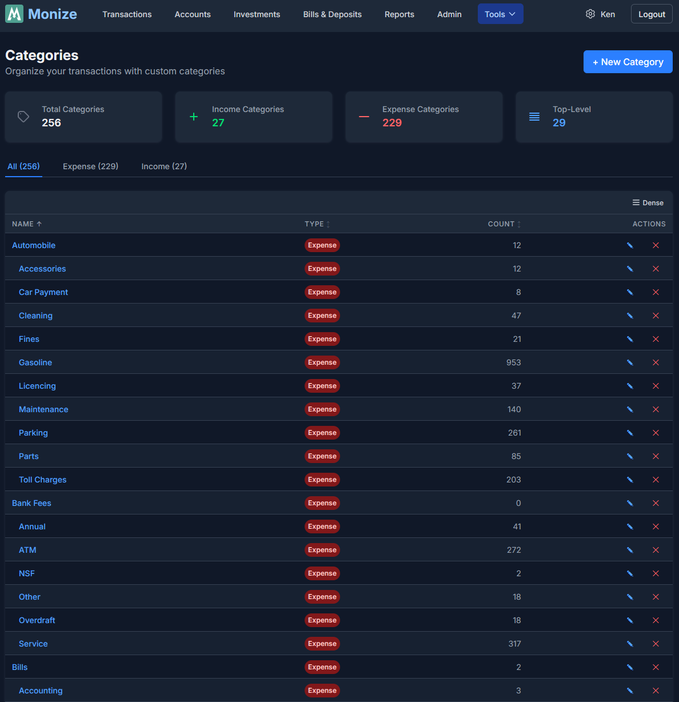
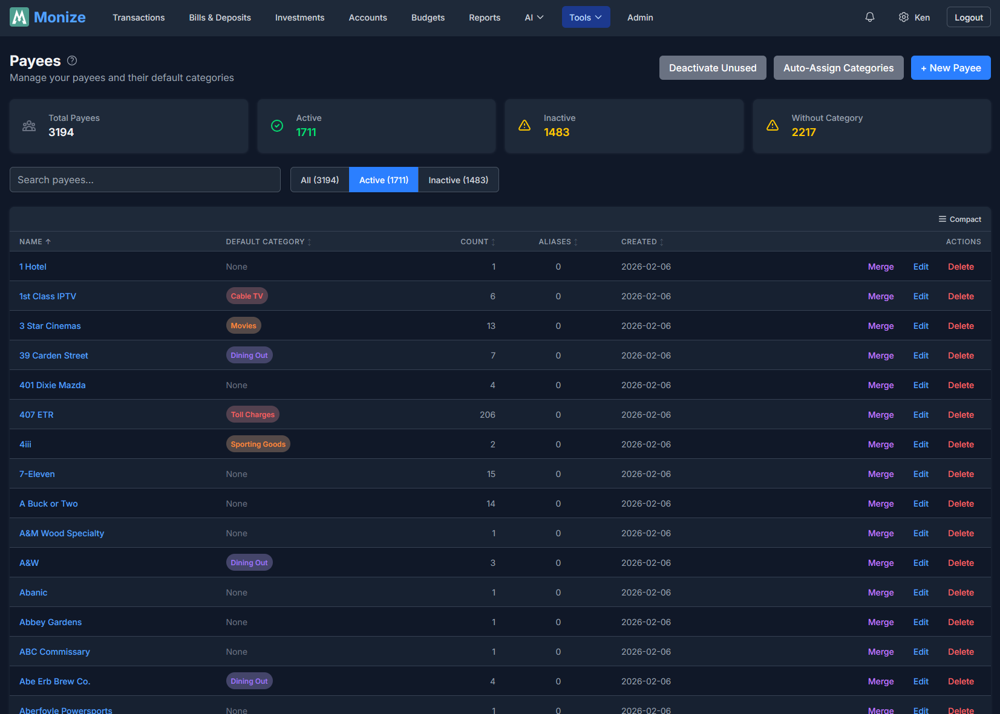

# Categories and Payees

Categories and payees are the organizational backbone of your financial data. Categories classify *what* the money was for, while payees track *who* the money went to or came from.

---

## Categories

Categories are used to classify transactions by purpose (e.g., "Groceries," "Rent," "Salary"). They form a hierarchical tree structure with parent and child categories.

> **Note:** A fresh account starts with a set of default expense and income categories, now **translated across all 21 supported locales**, so your starting categories appear in your own language. You can rename, recolour, or delete any of them.

### Category Hierarchy

Categories support parent-child relationships for detailed tracking:

```
Food & Dining (parent)
  |- Groceries (child)
  |- Restaurants (child)
  |- Coffee Shops (child)

Housing (parent)
  |- Rent (child)
  |- Utilities (child)
  |- Maintenance (child)
```

When viewing reports, you can see totals at the parent level (all "Food & Dining") or drill down to individual children (just "Groceries").

### Managing Categories

Navigate to **Tools > Categories** to access the category management page.


<!-- Screenshot: The categories management page showing the hierarchical list of categories with edit/delete buttons -->

#### Creating a Category

1. Click **Add Category**
2. Enter the category details:

| Field | Description |
|-------|-------------|
| **Name** | Category name (e.g., "Groceries") |
| **Parent** | Optional parent category for nesting |
| **Type** | Income or Expense |
| **Colour** | Visual colour for reports and charts |

3. Click **Save**

#### Editing a Category

Click the edit button next to any category to modify its name, parent, type, or colour.

#### Deleting a Category

Categories can only be deleted if no transactions reference them. If transactions use the category, you must reassign them first or choose to merge the category into another one.

### Viewing a Category's Transactions

Each category row has a **View transactions** action. Clicking it opens the Transactions page pre-filtered to that category, so you can review every transaction assigned to it without setting up the filter by hand.

### Income vs Expense Categories

Each category is marked as either **Income** or **Expense**:

- **Income categories** -- Salary, freelance income, investment returns, etc.
- **Expense categories** -- Groceries, rent, utilities, entertainment, etc.

This classification determines how transactions are counted in reports (income vs. expenses charts).

### Categories on Transfers

Transfers move money between your own accounts, so they are never counted as income or expense. You can still optionally assign a category to a transfer. When you do, the transfer appears under that category in the monthly category breakdown, giving you visibility into where transferred money goes, while remaining excluded from income and expense totals.

### System Categories

Monize includes a set of default system categories that cannot be deleted. These provide a starting point and cover common financial categories. You can rename them or add child categories to customize them for your needs.

---

## Payees

Payees represent the people, businesses, or entities you transact with. Every transaction can optionally be assigned a payee.

### Managing Payees

Navigate to **Tools > Payees** to access the payee management page.


<!-- Screenshot: The payees management page showing a list of payees with default categories and transaction counts -->

#### Creating a Payee

1. Click **Add Payee**
2. Enter the payee details:

| Field | Description |
|-------|-------------|
| **Name** | Payee name (e.g., "Amazon", "City Hydro") |
| **Default Category** | Auto-assigned category for new transactions with this payee |
| **Aliases** | Wildcard patterns for matching imported transaction names (can be added during creation) |
| **Website** | The payee's website (see [Payee Contact Details](#payee-contact-details)) |
| **Address** | The payee's address |
| **Email** | The payee's email address |
| **Phone** | The payee's phone number |
| **Notes** | Optional notes about the payee |

3. Click **Save**

You can add aliases directly during payee creation -- there is no need to save the payee first and then edit it to add aliases.

Payees can also be created inline when creating a transaction -- if you type a name that does not exist, you can create it on the fly.

#### Editing a Payee

Click the edit button next to any payee to modify its name, default category, contact details, or notes.

#### Deleting a Payee

Payees can be deleted. Transactions that referenced the deleted payee will have their payee field cleared.

### Viewing a Payee's Transactions

Each payee row has a **View transactions** action. Clicking it opens the Transactions page pre-filtered to that payee, so you can quickly see every transaction with that payee without building the filter yourself.

### Default Categories

One of the most powerful features of payees is the **default category**. When you assign a default category to a payee:

1. The next time you create a transaction for that payee, the category is automatically filled in
2. This saves time and ensures consistent categorization
3. You can always override the default for individual transactions
4. During [import](importing-transactions.md), the default category is applied automatically when the payee is matched

For example, if you set "Loblaws" with a default category of "Groceries," every new transaction to Loblaws will automatically be categorized as Groceries.

### Payee Contact Details

A payee can carry a **website**, **address**, **email** and **phone number** alongside its name. They appear on the payee form and on the payee's detail page, and an address is clickable -- it opens in the map service you chose under **Settings > Preferences > Map provider for addresses**.

You can type them in yourself, or let Monize find them (see below).

### Payee Lookup

Rather than typing a payee's contact details in, Monize can look them up for you.

#### Looking Up a Payee

- On the payee form (and on the transaction page when you create a new payee), click **Look up details**
- On a payee's detail page, click **Look up contact details**

Monize sends the payee's name, together with any notes, website, address, email and phone it already has, so the lookup can tell the right business and the right branch apart. Nothing is saved until you confirm: a **Confirm contact details** dialog shows each proposed value marked **Add** or **Replace**, and where the name matches more than one business it asks you to choose the one you pay.

A lookup can also run **automatically** when you create a new payee -- see [Automatic payee contact lookup](settings-and-security.md#automatic-payee-contact-lookup).

#### Configuring the Lookup

The lookup is answered by one of two sources -- **Google Places** or an **AI provider** you have configured. You can reach the same settings panel from either place:

- **Tools > Payees > Maintenance > Payee Lookup settings**
- **Settings > Payee Lookup**

They render the same controls, so it does not matter which you use. The full reference -- the two sources, their on/off switches, source ordering, pinning a particular AI provider, and the automatic-lookup toggle -- is on the settings page: **[Payee Lookup](settings-and-security.md#payee-lookup)**.

#### Setting up Google Places

Google Places answers a payee lookup from Google's business directory. It needs an API key from a Google Cloud project with **Places API (New)** enabled, restricted **by IP address** rather than by HTTP referrer -- Monize calls Google from the server, not from your browser.

The step-by-step setup, the monthly request limit and its 1,000-request default, the server-wide `GOOGLE_PLACES_API_KEY` alternative, and troubleshooting are documented on the settings page:

> **[Setting up Google Places](settings-and-security.md#setting-up-google-places)** -- on the [Settings and Security](settings-and-security.md) page.

Once a key is saved, the **Payee Lookup settings** panel shows how many of this month's requests you have used. When the limit is spent, lookups fall back to your AI provider if you have one switched on; the payee form says so directly -- *"This month's Google Places lookups are used up. Raise the limit in Payee lookup settings, or wait until next month."*

### Payee Aliases

Payee aliases let you map multiple variations of a payee name to a single canonical payee. This is especially useful for imported transactions, where banks often append location codes, reference numbers, or other suffixes to payee names.

#### How Aliases Work

When a transaction is imported (via CSV, OFX/QFX, or QIF), Monize resolves the payee name in this order:

1. **Exact name match** -- If a payee with the same name exists, use it
2. **Alias match** -- If a payee alias pattern matches the imported name, use the canonical payee
3. **Create new** -- If no match is found, create a new payee

When an alias matches, the transaction is assigned to the alias's parent payee, and that payee's default category is applied.

#### Creating Aliases

Aliases are managed from the payee edit form:

1. Navigate to **Tools > Payees**
2. Click **Edit** on a payee
3. In the **Aliases** section, type a pattern and click **Add** (or press Enter)

#### Wildcard Patterns

Aliases support the `*` wildcard character, which matches zero or more characters. Matching is case-insensitive.

| Pattern | Matches | Does Not Match |
|---------|---------|----------------|
| `STARBUCKS*` | "STARBUCKS", "STARBUCKS #1234", "STARBUCKS MAIN ST" | "MY STARBUCKS" |
| `*Amazon*` | "Amazon", "Amazon AWS", "Pay Amazon" | -- |
| `SHELL*STATION` | "Shell Fuel Station", "SHELL GAS STATION #45" | "Shell" |
| `Tim Hortons` | "Tim Hortons" (exact, case-insensitive) | "Tim Hortons #1234" |

> **Tip:** Set up aliases for your most common payees before importing transactions. For example, create a "Starbucks" payee with alias `STARBUCKS*` to catch all Starbucks locations in your bank file.

#### Managing Aliases

- Aliases are displayed alphabetically below the alias input field
- Click **Remove** next to any alias to delete it
- Each payee can have multiple aliases

### Merging Payees

If you have duplicate payees (e.g., "Amazon" and "Amazon.com"), you can merge them to consolidate all transactions under a single payee.

#### How to Merge

1. Navigate to **Tools > Payees**
2. Click the **Merge** button (purple) on the payee you want to eliminate
3. In the merge dialog:
   - The **source payee** (the one being merged away) is shown at the top with its transaction count
   - Select the **target payee** (the one to keep) from the dropdown
   - Optionally check **"Add as alias"** (checked by default) to create an alias on the target payee using the source payee's name
4. Click **Merge Payee**

#### What Happens During a Merge

| Action | Detail |
|--------|--------|
| **Transactions reassigned** | All transactions from the source payee are moved to the target payee |
| **Scheduled transactions reassigned** | All scheduled transactions from the source are moved to the target |
| **Alias created** (optional) | The source payee's name is added as an alias on the target payee |
| **Source deleted** | The source payee and all its aliases are permanently deleted |

> **Example:** You have "Tim Hortons" (50 transactions) and "TIM HORTONS #1234" (3 transactions). Merge "TIM HORTONS #1234" into "Tim Hortons" with "Add as alias" checked. Result: "Tim Hortons" now has 53 transactions and an alias `TIM HORTONS #1234` that will catch future imports with that name.

### Auto-Merge Payees

While [Merging Payees](#merging-payees) handles duplicates one at a time, **Auto-Merge** is a bulk tool that scans your entire payee list and groups together near-duplicate name variants (for example "Amazon", "Amazon.com", and "AMAZON MKTPLACE") so you can consolidate them all in a single pass.

#### Running the Scan

1. Click the **"Auto-Merge Payees"** button on the Payees page
2. Configure how the scan finds groups:

| Setting | Description |
|---------|-------------|
| **Minimum group size** | The smallest number of payees a group must contain to be suggested |
| **Similarity threshold** | How closely names must resemble each other to be grouped (higher = stricter matching) |
| **Minimum keyword length** | The shortest word length considered a meaningful keyword when comparing names, so short filler tokens are ignored |
| **Include inactive** | When on, deactivated payees are included in the scan; otherwise only active payees are considered |

3. Click **"Preview"** to see the suggested groups

> **Tip:** Auto-Merge makes sweeping changes across many payees at once. Back up your data before applying, so you can roll back if a group merges more than you intended.

#### Reviewing and Applying Groups

Groups start de-selected, so you opt in to each merge deliberately. For every group you want to apply:

- Toggle the group on to include it
- Choose which payee to **keep** (the canonical payee); the rest become **aliases** on it
- Optionally deselect individual members you do not want merged into the group
- Edit the canonical name and alias if you wish
- Pick a **default category** for the resulting payee
- Optionally enable **back-fill** to apply that default category onto the group's existing uncategorized transactions

When you apply, each selected group is merged into its chosen payee, the other members are added as aliases, and the default category (and optional back-fill) is applied. Groups are merged independently, so if one group fails (for example an alias name is already in use) the rest still succeed, and you are told exactly what conflicted.

### Deactivating Unused Payees

Over time, you may accumulate payees that are no longer relevant. Rather than deleting them (which clears the payee from historical transactions), you can deactivate them. Deactivated payees are hidden from dropdowns but remain on existing transactions.

#### Bulk Deactivation

1. Click the **"Deactivate Unused"** button on the Payees page
2. Configure the criteria:
   - **Maximum transactions** -- Include payees with this many transactions or fewer (0-20)
   - **Months unused** -- Include payees not used for this long (6-120 months)
3. Click **"Preview Unused Payees"** to see candidates
4. Review the list, which shows each payee's name, transaction count, and last used date
5. Use **"Select all"** / **"Select none"** or check individual payees
6. Click **"Deactivate"** to deactivate the selected payees

#### Reactivating a Payee

To reactivate a deactivated payee:

1. Filter the payee list by **Inactive** status
2. Click the **Reactivate** button on the payee row
3. Confirm in the dialog

### Auto-Assign Default Categories

Monize can analyze your transaction history to suggest default categories for payees that do not have one set.

1. Click the **"Auto-Assign Categories"** button on the Payees page
2. Configure the criteria:
   - **Minimum transactions** -- Only consider payees with at least this many transactions (1-50)
   - **Category match percentage** -- The category must be used in at least this percentage of transactions (50-100%)
   - **Only without category** -- Optionally limit to payees that do not already have a default category
3. Click **"Preview Suggestions"** to see candidates
4. Each suggestion shows the payee name, suggested category, and match percentage (colour-coded: green for 90%+, blue for 75%+, yellow for below 75%)
5. Select the suggestions you want to apply
6. Optionally enable **back-fill** to also apply the chosen category onto the selected payees' existing uncategorized transactions (the toggle shows how many transactions would be updated); without it, the category only affects new transactions going forward
7. Click **"Apply"** to set the default categories

### Payee Auto-Complete

When typing a payee name in the transaction form, Monize provides auto-complete suggestions based on:

1. **Existing payees** matching your typed text
2. **Most frequently used** payees appearing first
3. **Recently used** payees given priority

This makes data entry faster and more consistent.

### Most Used and Recently Used

The payee system tracks usage statistics to improve the auto-complete experience:

- **Most Used** -- Payees with the highest transaction count appear first in suggestions
- **Recently Used** -- Payees from recent transactions are prioritized for quick access

The payee list includes a **Last Used** column showing the date of each payee's most recent transaction, making it easy to identify stale payees.

### Sort Preferences

Sort preferences on the Payees, Categories, Currencies, and Securities pages are saved to your browser's local storage. Your chosen sort column and direction persist between sessions so you do not need to re-sort each time you visit the page.

These statistics are computed efficiently using a single database query that includes the default category information.
