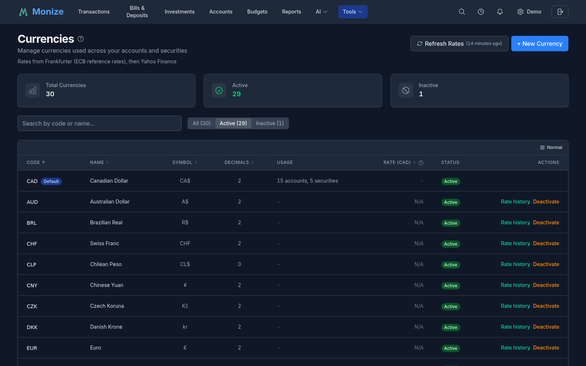
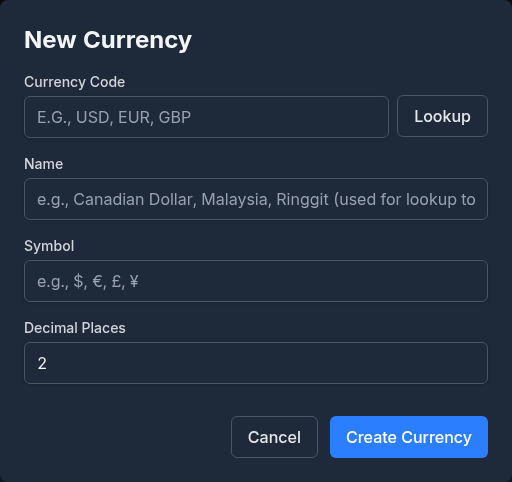
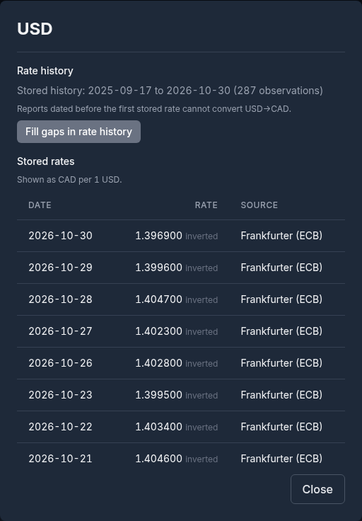
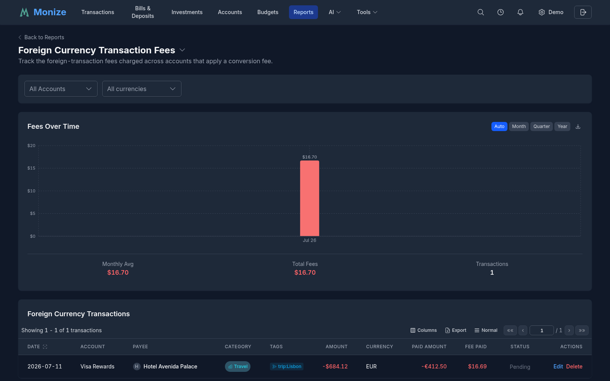
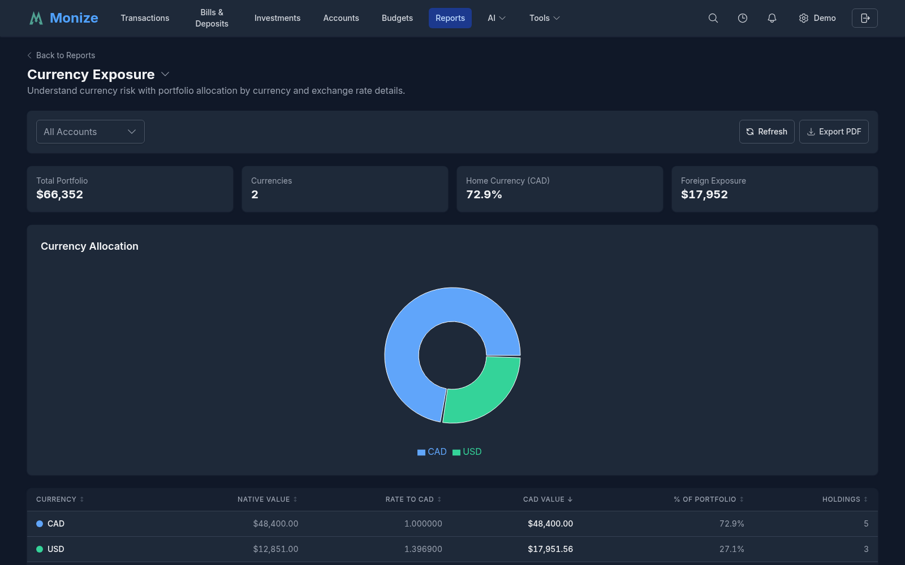

# Currency Management

Monize supports multiple currencies for international users or anyone with accounts, securities, or purchases in different currencies. Every figure is converted to your home currency at the exchange rate for its own date.

---

## Supported Currencies

Monize knows every ISO 4217 currency. You choose which ones you use: your home currency when you first sign in, and any others you add from the Currencies page, from the transaction form, or through an import. A currency you have not added stays out of your lists.

### Managing Currencies

Navigate to **Tools > Currencies** to view and manage your currencies.

The page shows the number of **Total Currencies**, **Active**, and **Inactive**, a search box, and an **All** / **Active** / **Inactive** filter. A line under the buttons names where the exchange rates come from. Each row shows:

| Column | Description |
|--------|-------------|
| **Code** | The three-letter currency code. Your home currency is marked **Default** |
| **Name** | The currency's name |
| **Symbol** | The symbol shown with amounts, such as $, €, or £ |
| **Decimals** | How many decimal places amounts in this currency have (2 for most, 0 for the yen) |
| **Usage** | How many of your accounts and securities use the currency |
| **Rate** | What one unit of the currency is worth in your home currency, from the latest stored rate (N/A when none is stored yet) |
| **Status** | Active or Inactive |
| **Actions** | **Rate history**, **Edit** (for currencies you created), **Deactivate** / **Activate**, and **Delete** |

A currency that is in use, and your home currency, cannot be deactivated or deleted. Deactivating a currency hides it from the currency lists without deleting it.

### Adding a Currency

1. Click **+ New Currency**
2. Type the **Currency Code** (for example `SEK`) or its name, and click **Lookup** to fill in the **Name**, **Symbol**, and **Decimal Places**
3. Check the details and click **Create Currency**

If the code is already in your list but inactive, the form offers **Reactivate** instead.

You can also add a currency without leaving a transaction: the transaction form's currency picker has **Add currency...**.

---

## Home Currency

Your home currency (the **Default Currency**) is the primary currency used for:

- **Dashboard totals** -- All account balances are converted to your home currency
- **Net worth calculations** -- All assets and liabilities are expressed in your home currency
- **Reports** -- Financial reports use your home currency for aggregation
- **Portfolio totals** -- Holdings in other currencies are converted for the Investments page totals

You choose it when you first sign in, and can change it at any time in **Settings > Preferences** under **Default Currency**. The Rate column on the Currencies page then shows every rate against the new home currency.

---

## Exchange Rates

### Automatic Updates

Monize fetches the latest exchange rates for the currencies you use every weekday at 5:05 PM New York time, after the markets close, and stores them so that every past date keeps its own rate. Click **Refresh Rates** on the Currencies page to fetch them immediately; the button shows how long ago the rates were last updated.

Rates come from **Frankfurter** (the European Central Bank's reference rates) first, then **Yahoo Finance** for any currency Frankfurter does not cover. An administrator can change the providers and their order for the whole instance.

### Rate History

Click **Rate history** on a currency's row to see the rates Monize holds for it against your home currency:

- **Stored history** -- the first and last dates stored, and the number of observations
- **Fill gaps in rate history** -- fetches the daily rates your reports are missing, from the first date your data uses the currency up to today
- **Stored rates** -- every stored rate, newest first, with its **Date**, **Rate**, and **Source** (Yahoo Finance, Frankfurter (ECB), or Money import)

Reports dated before the first stored rate cannot convert that currency, so after importing years of history, use **Fill gaps in rate history** for each foreign currency you use.

### Historical Rates

When Monize converts an amount, it uses the exchange rate for the transaction's own date -- the newest stored rate on or before that date -- not today's rate. This keeps historical reports accurate. If no rate close enough to that date is stored, Monize does not guess: the figure is shown as partial, and the page names the currency pair that needs a rate.

### Rates on Individual Transactions

A transaction that records its own exchange rate -- a cross-currency transfer, a purchase in a foreign currency, or an investment trade in a currency other than the account's -- is always converted at that rate, rather than the market rate of the day.

---

## Foreign-Currency Purchases

To record a purchase made in another currency, for example a hotel bill in euros paid with a Canadian-dollar card:

1. In the transaction form, click the currency picker beside the amount (**Entry currency**) and choose the currency you paid in
2. Enter the amount in that currency
3. Monize shows the **Total in** the account's currency, converted at the day's rate (shown as "1 EUR = ... CAD" with its date). If no rate is stored for that day, enter the converted amount yourself -- for example from your statement

The register can show such transactions in the account's currency or the original one.

### Foreign Transaction Fees

Many credit cards add a fee to purchases in a foreign currency. Set the account's **Foreign Currency Conversion Fee (optional)** in the account's settings, and Monize includes the fee in the converted total of each foreign purchase ("Includes a 2.5% foreign transaction fee"). The account's page then shows a **Foreign Currency Transaction Fees** section, and the **Foreign Currency Transaction Fees** report totals the fees across your accounts over time. See [Accounts](accounts.md) for the account settings.

---

## Cross-Currency Transfers

When you transfer money between accounts that use different currencies, Monize handles the conversion:

### How It Works

1. You create a transfer from Account A (e.g., USD) to Account B (e.g., CAD)
2. Enter the **Transfer Amount** in the source account's currency
3. The **Amount Received** in the destination currency is calculated from the exchange rate; correct it to the amount that actually arrived if your bank used a different rate
4. Both transactions are linked

### During Import

Cross-currency transfers imported from QIF files require special handling because the QIF format does not record exchange rate information:

1. The first side of the transfer is imported as a pending transaction
2. When the other account's file is imported, the system matches the pending transfer
3. You may need to manually adjust the destination amount to match the actual exchange rate used

This is noted in the transaction with a memo: *"PENDING IMPORT: Amount may need adjustment..."*

Importing a Microsoft Money `.mny` file brings across Money's own exchange rate history as well (shown with the source "Money import").

---

## Currency in Reports

### Conversion for Reports

All reports automatically convert amounts to your home currency using:

- The exchange rate on the transaction date for historical accuracy
- The latest rate for current balance reports

### Multi-Currency Accounts in Reports

When a report includes accounts in different currencies, the amounts are all converted to your home currency before aggregation. This means:

- A spending report correctly compares a $100 USD purchase with a $130 CAD purchase
- Net worth reports accurately combine assets across currencies

If a rate is missing for some amounts, the report says which figures are partial and which currency needs a rate, rather than leaving the amounts out silently or counting them unconverted.

### Currency Exposure

The **Currency Exposure** report (under **Investment** on the [Reports](reports.md#investment-reports) page) shows how much of your portfolio is held in each currency, with its native value, the exchange rate, and the converted value.

---

## Investment Securities and Currency

Each security trades in its own currency, which is filled in when you look the security up (for example USD for a NYSE or NASDAQ listing, CAD for the TSX, GBP for the London Stock Exchange). You can change it in the security's form.

If you hold securities that trade in a different currency than your investment account, the market values are converted to the account's currency for display, and to your home currency for portfolio totals. An investment transaction in a foreign security records its own **Exchange rate** and **Converted Total**. See [Investments](investments.md#transaction-fields).
