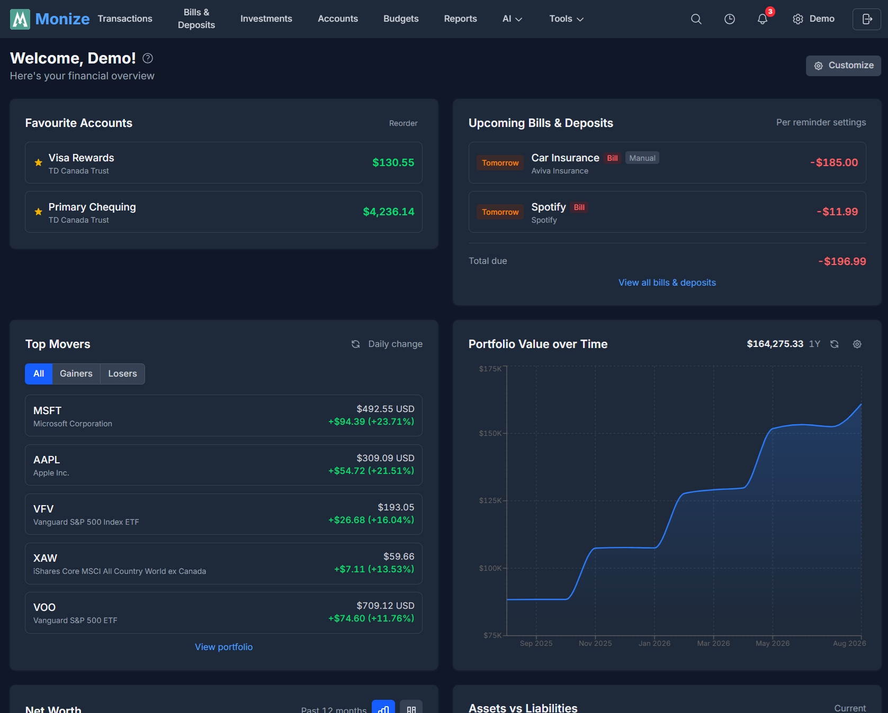
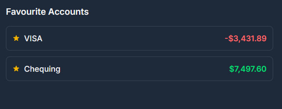
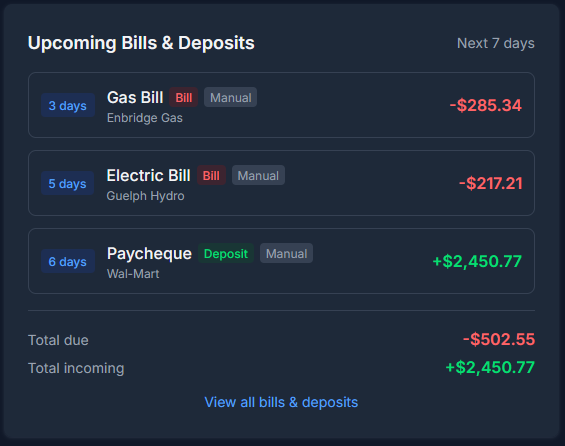
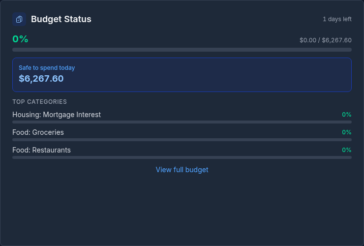
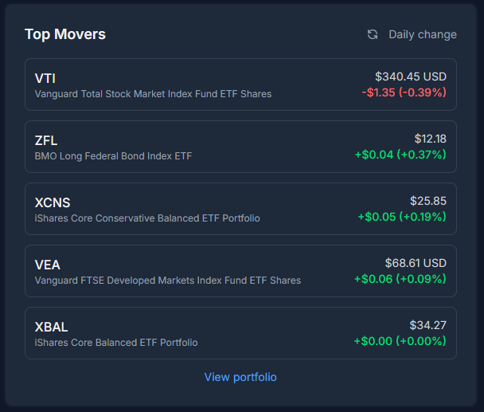
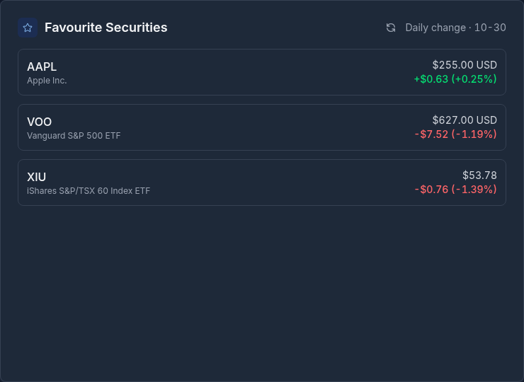
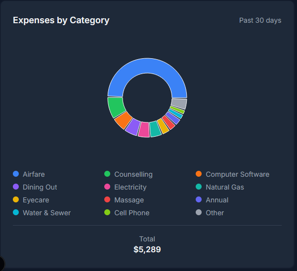
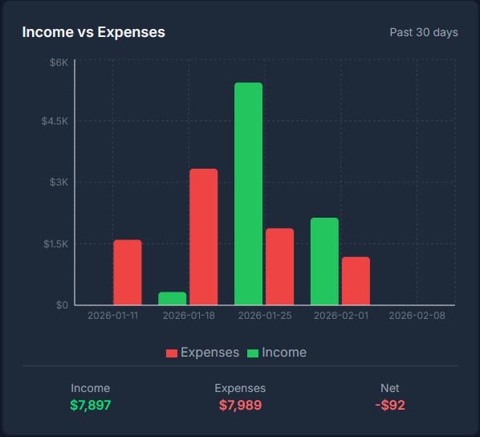
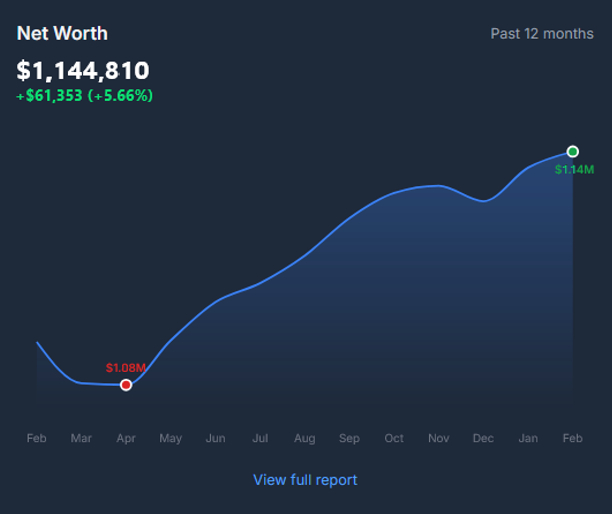
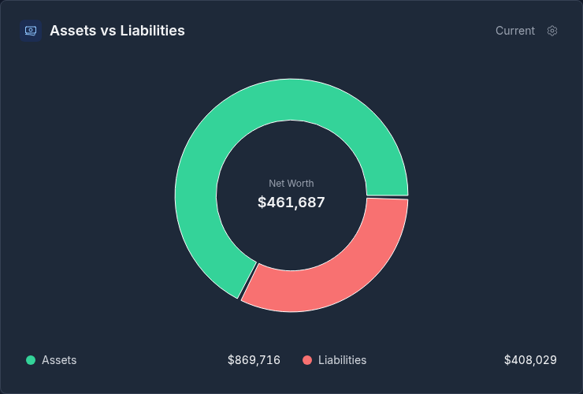

# Dashboard

The Dashboard is your financial command center -- a single-page overview of your accounts, spending, income, net worth, and upcoming bills.

---

## Overview

When you log in, the Dashboard is the first page you see. It provides a comprehensive snapshot of your financial health using interactive charts and summary widgets.

<!-- Screenshot: Full dashboard page showing all widgets - favourite accounts at top, charts below -->

---

## Customizing Your Dashboard

Click **Customize** in the top-right of the dashboard header to tailor which widgets appear and in what order:

- **Show or hide widgets** -- remove any widget you don't want, or add one back later
- **Reorder widgets** -- drag a widget tile to a new position, or use the up/down arrow buttons (the arrow buttons also work on mobile, where widgets stack in a single column)
- **Add opt-in widgets** -- hidden widgets appear in a **Hidden widgets** tray beneath the layout; click one to add it to your dashboard
- **Reset to default** -- restore the standard layout at any time

Your layout is saved to your account, so it **syncs across all your devices**.

### Per-Widget Settings

Configurable widgets show a **gear icon** in their header. Click it to open that widget's settings, where (depending on the widget) you can:

- Choose a **timeframe** preset -- 1M, 3M, 6M, 1Y, 2Y, 5Y, YTD, or All
- Filter the widget to specific **accounts**
- Toggle the **chart type** or **view** (for example, pie vs bar, or region vs country)
- Set a custom **display name** and **description** so the widget's header reads however you like

These per-widget settings also persist across your devices.

### Optional Widgets

The widgets below are hidden by default and can be added from the **Customize** dialog. Each is derived from a report, and most carry their own gear settings.

| Widget | Shows | Availability |
|--------|-------|--------------|
| Favourite Reports | The reports you've starred; click one to open it | Always |
| Portfolio Value | Your total investment value over time | Investments only |
| Spending by Payee | Spending grouped by payee | Always |
| Monthly Spending Trend | Spending (and income) trended by month | Always |
| Income by Source | Income grouped by source, as a pie or bar chart | Always |
| Credit Utilization by Account | Utilization for each credit account | Always |
| Total Credit Utilization | Combined used vs available credit | Always |
| Sector Allocation | Portfolio breakdown by sector | Investments only |
| Security Type Allocation | Holdings by security type (stocks, ETFs, and so on) | Investments only |
| Geographic Allocation | Holdings by region, exchange, or country | Investments only |
| Top Recurring Expenses | Your most frequent recurring expenses | Always |
| Weekend vs Weekday Spending | Spending split between weekends and weekdays | Always |

> **Note:** The investment-related widgets (Portfolio Value, Sector Allocation, Security Type Allocation, and Geographic Allocation) only appear as options when you have investment holdings.

> **Delegates:** If you're viewing an account you've been granted access to, the dashboard is limited to the Favourite Accounts widget (plus Upcoming Bills, if that access was granted). The **Customize** button is hidden for delegates.

---

## Favourite Accounts

The top section of the dashboard displays your favourite accounts as summary cards. Each card shows:

- **Account name** and type
- **Current balance** in the account's currency
- Quick access to account transactions

To mark an account as a favourite, go to **Accounts** and toggle the star icon on any account.

### Reordering Favourites

You can reorder your favourite account cards to arrange them in the order you prefer:

1. On the Dashboard, click the **Reorder** button next to the favourite accounts section
2. Drag and drop the account cards into your preferred order
3. The new order is saved automatically

### Brokerage Accounts

When a brokerage (investment) account is marked as a favourite, the dashboard card displays the account's **market value** rather than the cash balance. Clicking a brokerage favourite navigates to the Investments page filtered to that account.

<!-- Screenshot: The favourite accounts cards at the top of the dashboard showing account names and balances -->

---

## Upcoming Bills

This widget shows your scheduled bills and deposits that are coming due, ordered by date. Each entry shows:

- **Payee name** or transaction description
- **Due date** and how many days until due
- **Amount** of the scheduled transaction
- **Account** the transaction will be posted to

This helps you anticipate upcoming cash flow needs and ensure sufficient funds are available.

<!-- Screenshot: The upcoming bills widget showing a list of bills with dates, amounts, and accounts -->

---

## Budget Status

If you have an active budget, the Budget Status widget provides a quick summary of your current budget period:

- **Top 3 categories** closest to their budget limits, with progress bars
- **Safe to spend today** -- How much you can spend per day and stay on track
- **Days remaining** in the current budget period

Click the widget to navigate to the full [Budget Dashboard](budgets.md#budget-dashboard).

<!-- Screenshot: The budget status dashboard widget showing top categories with progress bars and safe daily spend -->

> **Note:** This widget only appears if you have an active budget.

---

## Spending Insights

The Spending Insights widget surfaces automatically generated observations about your finances -- notable changes in spending, recurring patterns, and other things worth your attention. Each insight is a short, plain-language note derived from your recent activity.

Click **View all insights** to open the full Insights page, where you can generate and review deeper analysis.

<!-- Screenshot: The spending insights widget showing a list of auto-generated observations -->

---

## Getting Started Widget

For new users, a Getting Started widget provides guidance on initial setup tasks:

- Creating accounts
- Adding transactions
- Setting up scheduled bills
- Importing data

This widget disappears once you have completed the basic setup steps.

---

## Top Movers

If you have investment accounts, the Top Movers widget shows the securities in your portfolio with the largest daily price changes (both gains and losses). This gives you a quick view of which investments are moving the most.

<!-- Screenshot: The top movers widget showing securities with daily price changes, green for gains and red for losses -->

> **Note:** This widget only appears if you have at least one investment account with holdings.

---

## Favourite Securities

The Favourite Securities widget lists the securities you've starred, each with its **live quote** and daily price change. It's a watchlist for the tickers you care about, whether or not you currently hold them.

To add a security here, visit the **Securities** page and star the securities you want to track. Prices can be refreshed with the widget's refresh button.

<!-- Screenshot: The favourite securities widget showing a list of starred securities with live quotes and daily changes -->

> **Note:** This widget only appears once you have at least one security to track.

---

## Expenses Pie Chart

A pie chart breaks down your spending by category over a selectable timeframe (default: last month), optionally filtered to specific accounts. This provides an instant visual of where your money is going.

- Hover over a segment to see the category name and amount
- Categories are colour-coded for easy identification
- The chart includes expense categories only (income is excluded)

<!-- Screenshot: The pie chart showing expense breakdown by category with a legend -->

---

## Income vs Expenses Bar Chart

This bar chart compares your income and expenses over a selectable timeframe, optionally filtered by account. Each period shows:

- A **green bar** for total income
- A **red bar** for total expenses
- The visual difference helps you see periods where you spent more than you earned

Income and expenses are classified by **category type** (income category vs expense category), not by the sign of the amount. Clicking on an income or expense bar navigates to the Transactions page filtered to the corresponding category type for that period.

<!-- Screenshot: Bar chart with green (income) and red (expense) bars side by side for each month -->

---

## Net Worth Chart

The Net Worth chart tracks your total net worth over time, calculated monthly. It shows:

- **Total assets** (all positive-balance accounts plus investment market values)
- **Total liabilities** (credit cards, loans, mortgages, lines of credit)
- **Net worth** (assets minus liabilities)

The chart provides a clear trend line showing whether your financial position is improving over time.

<!-- Screenshot: Line chart showing net worth trend over the past 12 months -->

---

## Assets vs Liabilities

The Assets vs Liabilities widget presents a bar chart comparing your **total assets** against your **total liabilities** over time. Where the Net Worth chart tracks the single net figure, this widget shows the two sides side by side so you can see how each is trending on its own.

- Each period shows a bar for assets and a bar for liabilities
- The gap between the two bars reflects your net worth for that period

<!-- Screenshot: Bar chart comparing total assets and total liabilities over time -->

---

## Refreshing Data

Investment prices and exchange rates can be refreshed manually from the dashboard using the refresh button. Prices are also updated automatically on weekdays at 5 PM EST.
