# Dashboard

The Dashboard is your financial command center -- a single-page overview of your accounts, spending, income, net worth, investments, and upcoming bills.

---

## Overview

When you log in, the Dashboard is the first page you see. It greets you by name and arranges its widgets in a two-column grid (one column on a phone). Every widget's title is a link to the page or report it summarizes, so you can go from the summary to the detail in one click.

The default layout shows these widgets, in this order:

| Widget | Shows |
|--------|-------|
| [Favourite Accounts](#favourite-accounts) | Balances of the accounts you starred |
| [Upcoming Bills & Deposits](#upcoming-bills) | Scheduled transactions coming due |
| [Top Movers](#top-movers) | The day's biggest price moves among your securities (with investments only) |
| [Portfolio Value over Time](#portfolio-value-over-time) | Your investments' value over time (with investments only) |
| [Net Worth](#net-worth-chart) | Net worth month by month |
| [Assets vs Liabilities](#assets-vs-liabilities) | What you own against what you owe today |
| [Expenses by Category](#expenses-pie-chart) | Where your money went |
| [Income vs Expenses](#income-vs-expenses-bar-chart) | Money in against money out |
| [Budget Status](#budget-status) | How your current budget period is going |
| [Spending Insights](#spending-insights) | Observations from the AI insights |

Many more widgets are available but hidden by default; see [Optional Widgets](#optional-widgets).

---

## Customizing Your Dashboard

Click **Customize** in the top-right of the dashboard header to tailor which widgets appear and in what order. The **Customize dashboard** dialog mirrors your dashboard: widgets flow left to right, two per row on large screens.

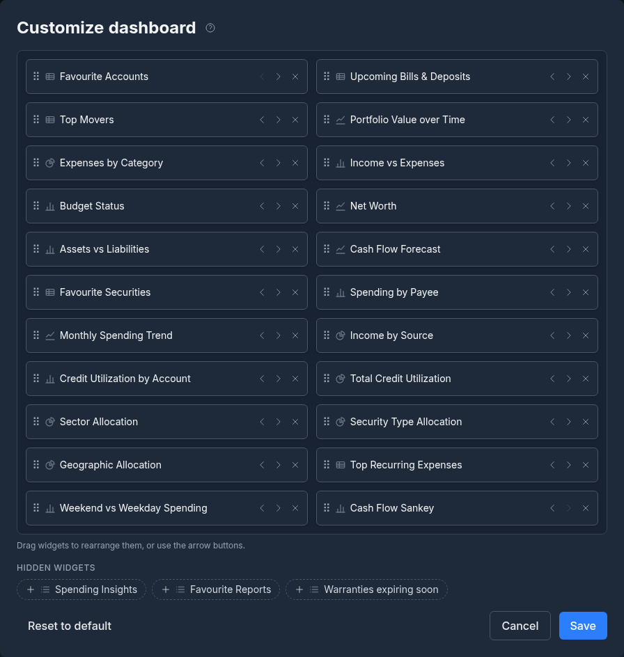

- **Show or hide widgets** -- click a widget's **X** to hide it, or add one back later
- **Reorder widgets** -- drag a widget tile to a new position, or use the arrow buttons (the arrow buttons also work on a phone, where widgets stack in a single column)
- **Add opt-in widgets** -- hidden widgets appear in a **Hidden widgets** tray beneath the layout; click one to add it to your dashboard
- **Reset to default** -- restore the standard layout at any time

Click **Save** to apply your changes. At least one widget must stay on the dashboard. Your layout is saved to your account, so it **syncs across all your devices**.

### Per-Widget Settings

Configurable widgets show a **gear icon** in their header. Click it to open that widget's settings, where (depending on the widget) you can:

- Choose a **Timeframe** preset. Each widget offers the ranges that suit it: the spending and income widgets offer MTD, 1M, 3M, 6M, 1Y and YTD; Portfolio Value offers 1W, MTD, 3M, 6M, YTD, 1Y, 2Y, 5Y and All; Net Worth offers 1Y, 2Y, 5Y and 10Y
- Filter the widget to specific **Accounts**
- Pick the **Chart type** or **View** (for example, pie or bar, region or country, labels or legend)
- Set a custom **Display name** and **Description** so the widget's header reads however you like

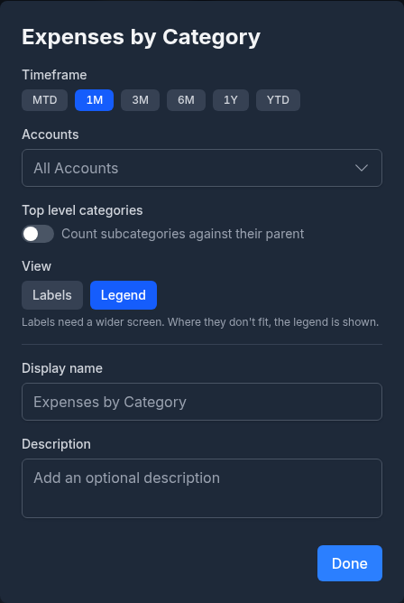

The chosen timeframe is shown beside the gear. These per-widget settings also persist across your devices.

### Optional Widgets

The widgets below are hidden by default and can be added from the **Customize** dialog. Most are derived from a report and carry their own gear settings.

| Widget | Shows | Availability |
|--------|-------|--------------|
| [Cash Flow Forecast](#cash-flow-forecast) | Projected balances from your scheduled transactions | Always |
| [Favourite Securities](#favourite-securities) | Quotes for the securities you starred | With securities only |
| Favourite Reports | The reports you've starred; click one to open it | Always |
| [Spending by Payee](#spending-by-payee) | Spending grouped by payee | Always |
| [Monthly Spending Trend](#monthly-spending-trend) | Spending and income trended by month | Always |
| [Income by Source](#income-by-source) | Income grouped by source, as a pie or bar chart | Always |
| [Credit Utilization by Account](#credit-utilization) | Utilization for each credit account | Always |
| [Total Credit Utilization](#credit-utilization) | Combined used vs available credit | Always |
| [Sector Allocation](#investment-allocation-widgets) | Portfolio breakdown by sector | Investments only |
| [Security Type Allocation](#investment-allocation-widgets) | Holdings by security type or asset class | Investments only |
| [Geographic Allocation](#investment-allocation-widgets) | Holdings by region, exchange, or country | Investments only |
| [Top Recurring Expenses](#top-recurring-expenses) | Your largest recurring expenses | Always |
| [Weekend vs Weekday Spending](#weekend-vs-weekday-spending) | Spending split between weekends and weekdays | Always |
| [Cash Flow Sankey](#cash-flow-sankey) | Where your income came from and where it went | Always |
| Warranties expiring soon | Warranties that expire in the next 30 days (see [Warranties](warranties.md#dashboard-widget)) | Always |

> [!NOTE]
> The investment widgets (Top Movers, Portfolio Value, Sector Allocation, Security Type Allocation, and Geographic Allocation) only appear when you have investment holdings, and Favourite Securities only when you have securities.

> [!NOTE]
> **Delegates:** If you're viewing an account you've been granted access to, the dashboard is limited to the Favourite Accounts widget, plus Upcoming Bills and the expiring-warranties widget if those sections were granted. The **Customize** button is hidden for delegates. See [Shared Access](shared-access.md).

---

## Favourite Accounts

This widget lists the accounts you starred as favourites. Each card shows:

- **Account name** and its institution
- **Current balance** in the account's currency (the currency is named when it is not your home currency)
- For credit cards with statement dates set, the payment **Due** day and the **Settlement** day of the billing cycle

Click a card to open that account's transactions, or its detail page if you chose **Show its dashboard** under **Default Account View** in [Settings -> Preferences](settings-and-security.md#preferences).

To mark an account as a favourite, go to **Accounts** and click the star beside it. See [Favourite Accounts](accounts.md#favourite-accounts).

### Reordering Favourites

You can reorder your favourite account cards to arrange them in the order you prefer:

1. Click **Reorder** in the widget's header
2. Drag the account cards into your preferred order, or use the up and down arrow buttons
3. Click **Done**; the new order is saved automatically

### Brokerage Accounts

When an investment account is a favourite, the dashboard card displays its **market value** rather than the cash balance. Clicking it opens the Investments page filtered to that account.

---

## Upcoming Bills

The **Upcoming Bills & Deposits** widget shows your scheduled transactions that are coming due, ordered by date. Each entry shows:

- **When it is due** -- Overdue, Today, Tomorrow, or the number of days left
- **Name** and payee, with a **Bill**, **Deposit**, **Transfer**, or **Reminder** badge
- A **Manual** badge on schedules that are not posted automatically
- **Amount** of the occurrence, flagged when posting it would take its account below zero

Two switches in the header change what the widget shows:

- **Due soon** lists only what is overdue or inside each schedule's reminder window; **All upcoming** lists the next occurrence of every active schedule, however far off
- The **List** and **Calendar** buttons switch between the list and a small month calendar

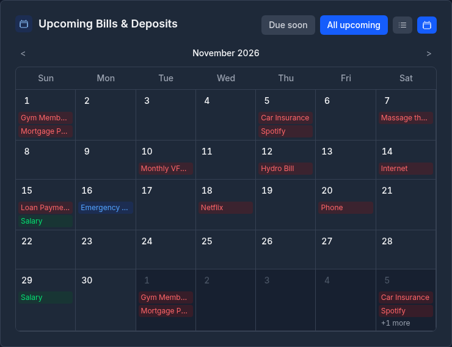

The list shows a few more entries than you have favourite accounts, with a **+N more** link to the rest. Click an entry to open it in [Bills & Deposits](bills-and-deposits.md), ready to post.

This helps you anticipate upcoming cash flow needs and ensure sufficient funds are available.

---

## Cash Flow Forecast

The **Cash Flow Forecast** widget (opt-in) is the same forecast as on the [Bills & Deposits](bills-and-deposits.md#cash-flow-forecast) page, with its own period and accounts. Choose **7D**, **30D**, **90D**, **6M**, or **1Y** in the header, and pick the accounts to forecast in the gear settings. No selection draws all your accounts as one line.

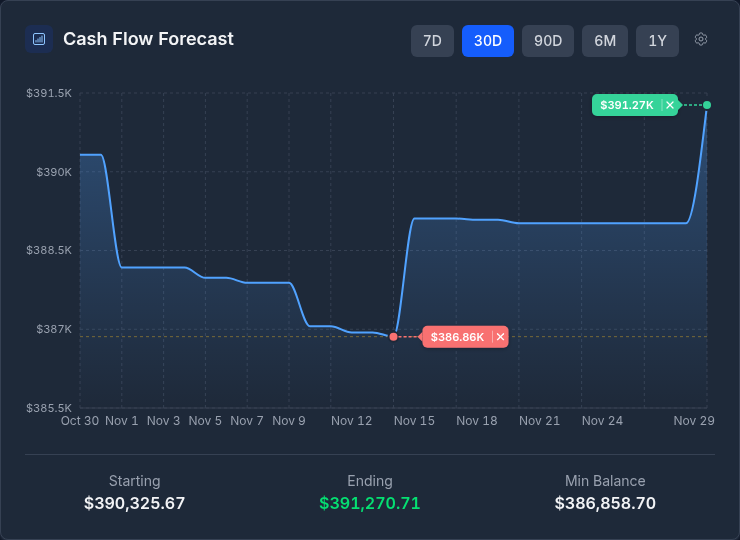

A scheduled transaction that fell due and was neither posted nor skipped counts on the first day of the forecast.

---

## Budget Status

If you have an active budget, the Budget Status widget summarizes your current budget period:

- **Overall progress** -- the share of the budget spent, and the amount spent against the total
- **Safe to spend today** -- how much you can spend per day and stay on track
- **Days left** in the current budget period
- **Top Categories** -- the categories closest to their limits, with progress bars

Click **View full budget** to open the full [Budget Dashboard](budgets.md#budget-dashboard).

> [!NOTE]
> Without an active budget, the widget offers a **Create Budget** button instead.

---

## Spending Insights

The Spending Insights widget lists the active observations from [Financial Insights](ai.md#financial-insights) -- notable changes in spending, unusual transactions, and other things worth your attention -- each as a short, plain-language note coloured by severity. The header counts how many are active.

Insights are generated by your AI provider on the Insights page. Until any exist, the widget offers **Go to Insights**, where you can generate them.

---

## Getting Started Widget

For new users, a **Getting Started** card above the widgets links to the first setup tasks:

- **Review your settings** -- currency, date format, and theme
- **Set up categories** -- create categories or import a default set
- **Add your first account**
- **Import from QIF** -- bring in accounts and transactions from QIF files

It also offers to start the guided introduction tour (**Retake** it once you have finished it). Click **Dismiss** (the X) to hide the card for good.

---

## Top Movers

If you hold investments, the Top Movers widget shows the securities in your portfolio with the largest daily price changes, with the trading day it compares named in the header.

- **All**, **Gainers**, and **Losers** filter the list by direction
- **Price** ranks by the change in each security's price; **Holdings** ranks by the change in the value of what you hold
- Click a security to open its price history, with your own buys and sells marked on the chart
- The refresh button fetches the latest prices; **View portfolio** opens [Investments](investments.md)

Only moves from the same trading day are compared, so a security whose price was not updated today is left out rather than ranked against today's moves.

---

## Portfolio Value over Time

If you hold investments, this widget charts your investments' total value over the chosen timeframe, with the current value and the **Investment result** for the period (what the investments themselves earned, with your own deposits and withdrawals and uninvested cash left out). The refresh button updates the current value. Filter it to specific investment accounts in the gear settings.

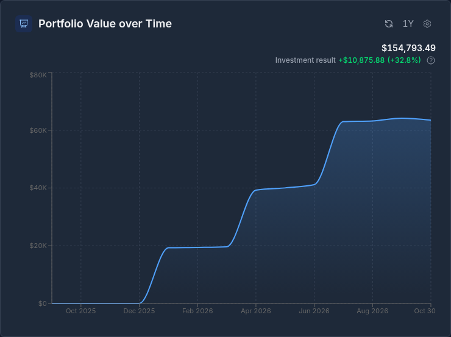

---

## Favourite Securities

The Favourite Securities widget (opt-in) lists the securities you've starred, each with its latest quote and daily price change. It's a watchlist for the tickers you care about, whether or not you currently hold them.

To add a security here, open **Tools -> Securities** and star the securities you want to track. The refresh button fetches the latest prices, and clicking a security opens its price history.

---

## Expenses Pie Chart

The **Expenses by Category** widget is a donut chart of your spending by category over a selectable timeframe (default: 1M), optionally filtered to specific accounts. The total spent sits inside the donut.

- Hover over a segment to see the category name and amount
- Click a segment to open its transactions for the same period
- Small categories are grouped into **Other**; click it to see what it contains
- Refunds reduce the category they were filed under, so the figures agree with the Spending by Category report
- In the gear settings, **Top level categories** counts subcategories against their parent, and the **View** choice names the categories in **Labels** beside the donut or in a **Legend** under it

---

## Income vs Expenses Bar Chart

This bar chart compares your income and expenses over a selectable timeframe (default: 1M), optionally filtered by account. Each period shows:

- A **green bar** for total income
- A **red bar** for total expenses
- Totals for **Income**, **Expenses**, and **Net** below the chart

Income and expenses are classified by **category type** (income category vs expense category), not by the sign of the amount. Clicking on an income or expense bar navigates to the Transactions page filtered to the corresponding category type for that period.

---

## Net Worth Chart

The Net Worth chart tracks your total net worth month by month, with the current figure and its change over the timeframe:

- **Assets** -- every account with a positive balance, plus investment market values
- **Liabilities** -- credit cards, loans, mortgages, and lines of credit
- **Net worth** -- assets minus liabilities

By default the bars are stacked **By account type**, showing what each type adds to (or takes from) your net worth, with net worth itself as a line across them. In the gear settings, choose **Net worth** for one solid bar per month, and a timeframe of 1Y, 2Y, 5Y, or 10Y. The two buttons in the header switch to a stacked view of the share of assets against liabilities each month.

Accounts you excluded from net worth are left out.

---

## Assets vs Liabilities

The Assets vs Liabilities widget compares your **current total assets** against your **total liabilities** as a donut, with your net worth inside it. Where the Net Worth chart tracks the trend, this widget shows the balance between the two sides today. In the gear settings, choose whether the two sides are named in **Labels** beside the donut or in a **Legend** under it.

---

## Spending by Payee

The Spending by Payee widget (opt-in) ranks your spending by payee over the chosen timeframe (default: 3M).

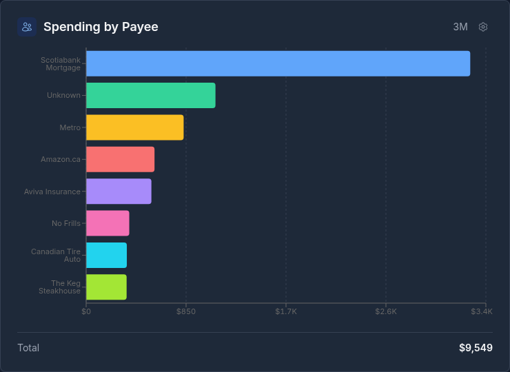

---

## Monthly Spending Trend

The Monthly Spending Trend widget (opt-in) trends your expenses and income month by month, over 6M, YTD, 1Y (the default), or 2Y.

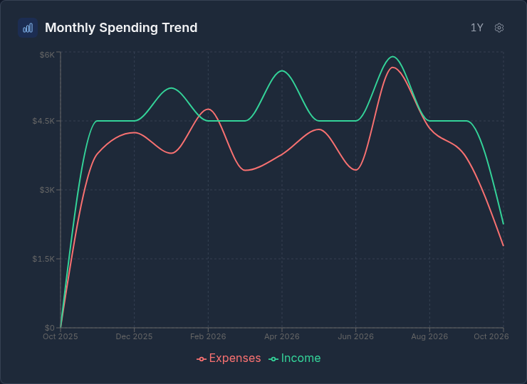

---

## Income by Source

The Income by Source widget (opt-in) breaks down your income by category over the chosen timeframe (default: 1Y), as a pie or a bar chart.

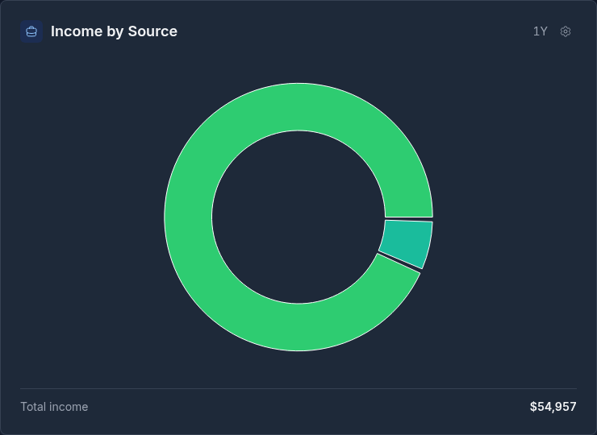

---

## Credit Utilization

Two opt-in widgets track how much of your available credit you are using. They include credit cards and lines of credit that have a credit limit set.

- **Credit Utilization by Account** shows the utilization of each account

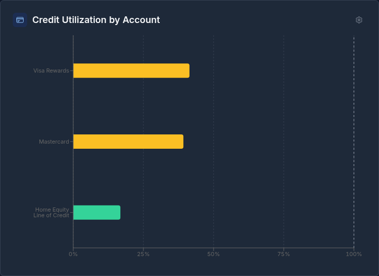

- **Total Credit Utilization** shows your combined used and available credit

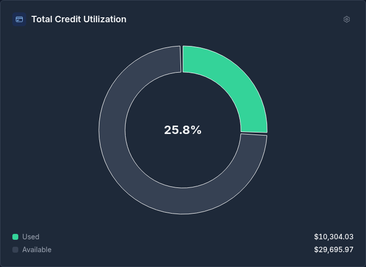

---

## Investment Allocation Widgets

Three opt-in widgets break down your holdings, each filterable to specific investment accounts:

- **Sector Allocation** -- your portfolio by sector, counting both the stocks you hold directly and the sectors inside your ETFs

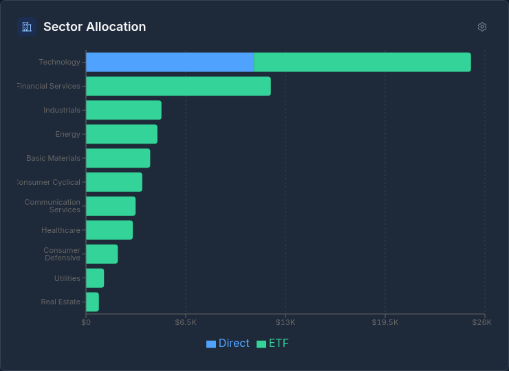

- **Security Type Allocation** -- your holdings by security type (stocks, ETFs, mutual funds, bonds, cash), or by **Asset class**, which looks inside funds

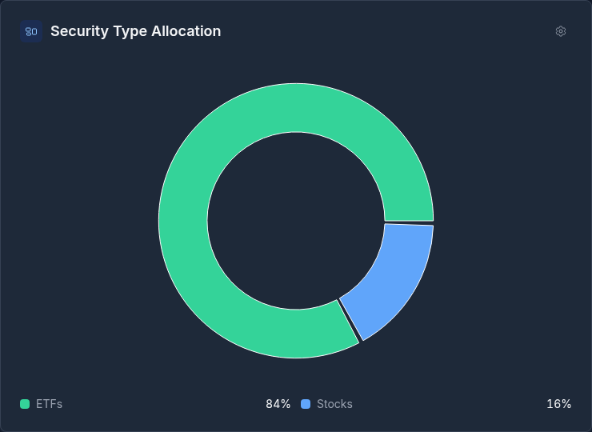

- **Geographic Allocation** -- your holdings by **Region**, **Exchange**, or **Country**; region and exchange group each holding by where it is listed, while country looks inside funds

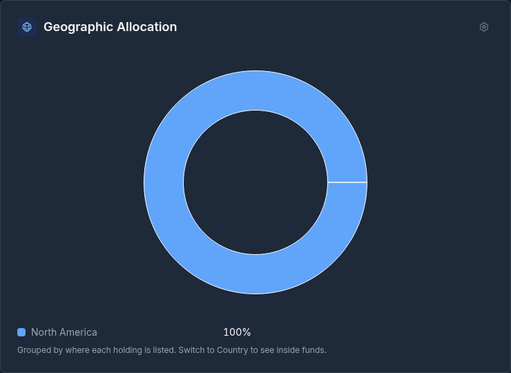

---

## Top Recurring Expenses

The Top Recurring Expenses widget (opt-in) finds the expenses that repeat and charts the largest, with your estimated monthly total inside the donut. In the gear settings, choose the range it looks back over (6M to All), the **Minimum occurrences** a charge needs to count, and whether to show **Labels** or a **Legend**.

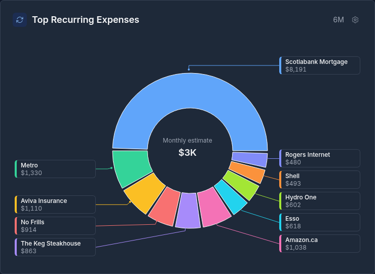

---

## Weekend vs Weekday Spending

The Weekend vs Weekday Spending widget (opt-in) splits your spending between weekends and weekdays over 1M, 3M (the default), 6M, or 1Y. The **By day** view breaks it down by day of the week.

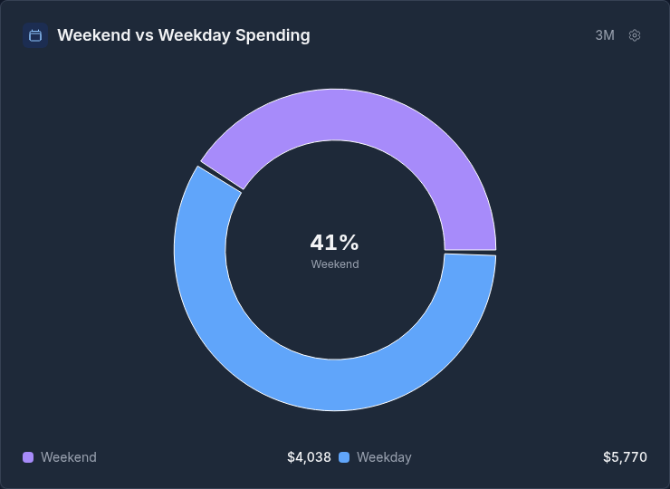

---

## Cash Flow Sankey

The Cash Flow Sankey widget (opt-in) is a flow diagram of the chosen period (default: MTD): income categories flow into your income, and out to expense categories, savings and investments, debt payments, and other accounts, with any leftover shown as unspent. In the gear settings, choose **Categories** or **Subcategories** for the level of **Detail**, and the **Diagram** or **Table** view. Click a node to open its transactions. The full version is the Cash Flow Sankey report in [Reports](reports.md).

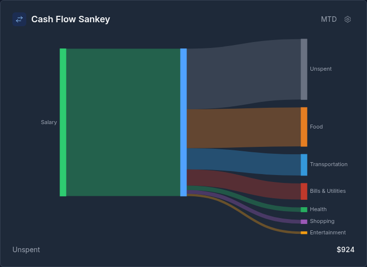

---

## Refreshing Data

Investment prices can be refreshed manually from the refresh buttons on the Top Movers, Favourite Securities, and Portfolio Value widgets. Prices and exchange rates are also updated automatically on weekdays at 5 PM New York time.
