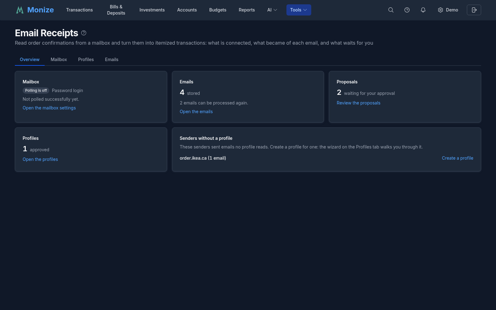
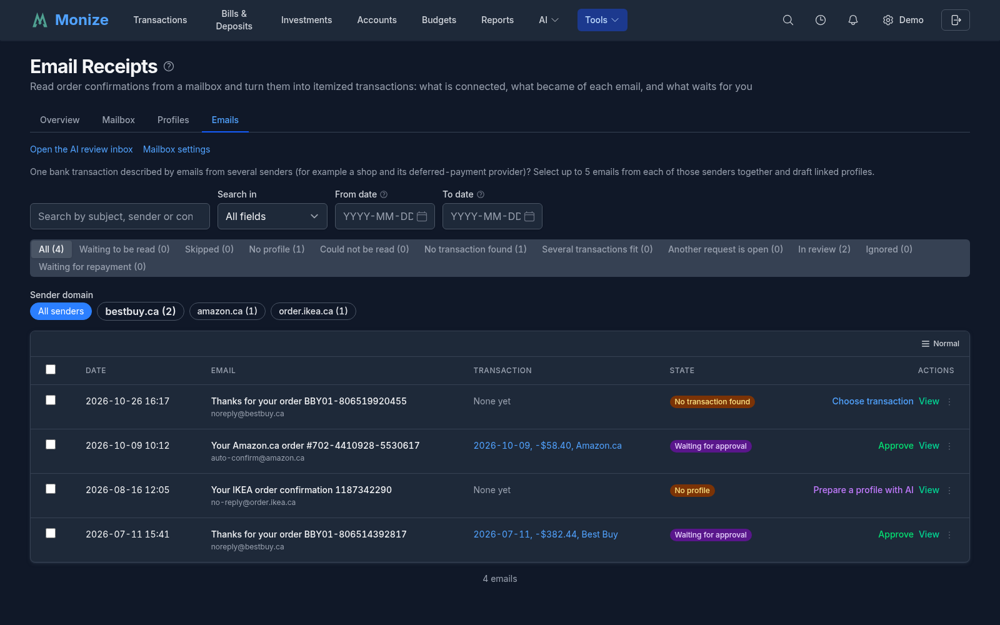
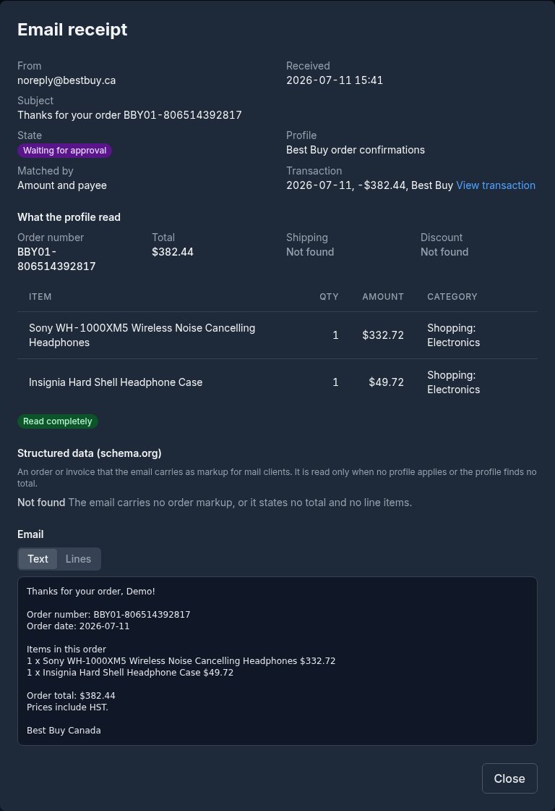
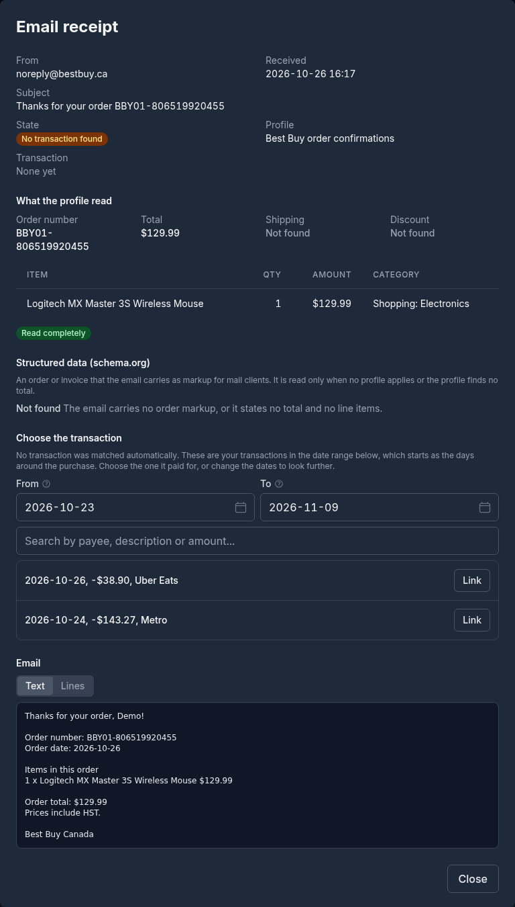
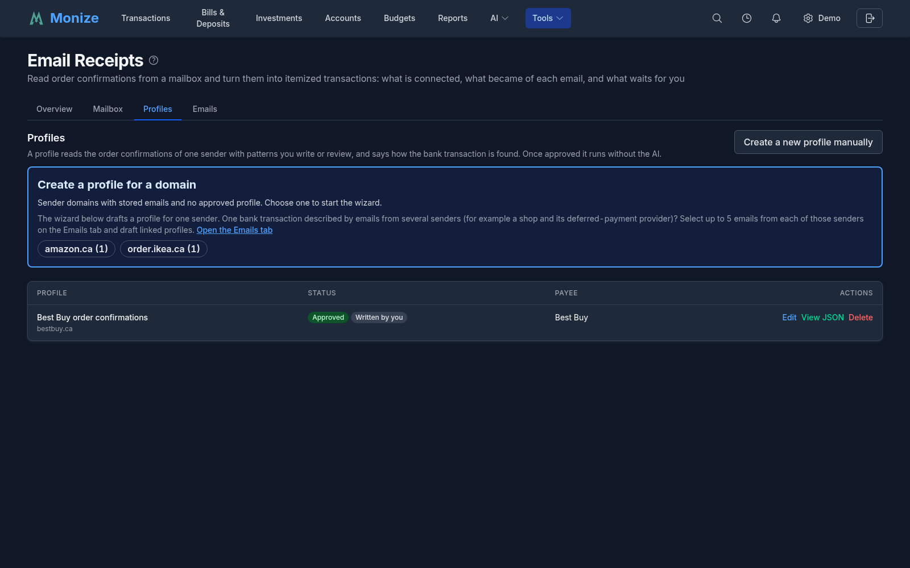
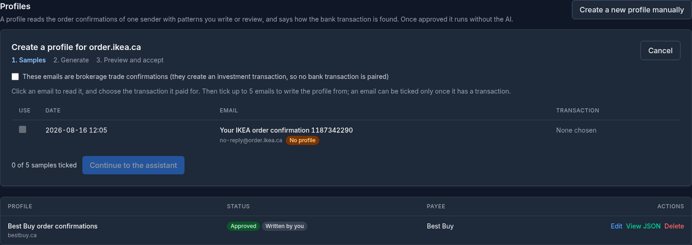
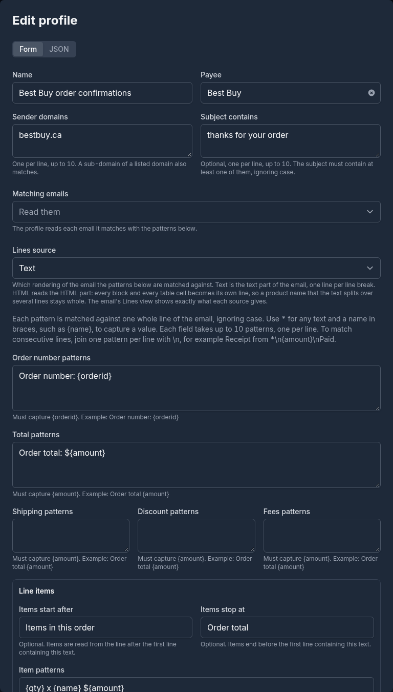
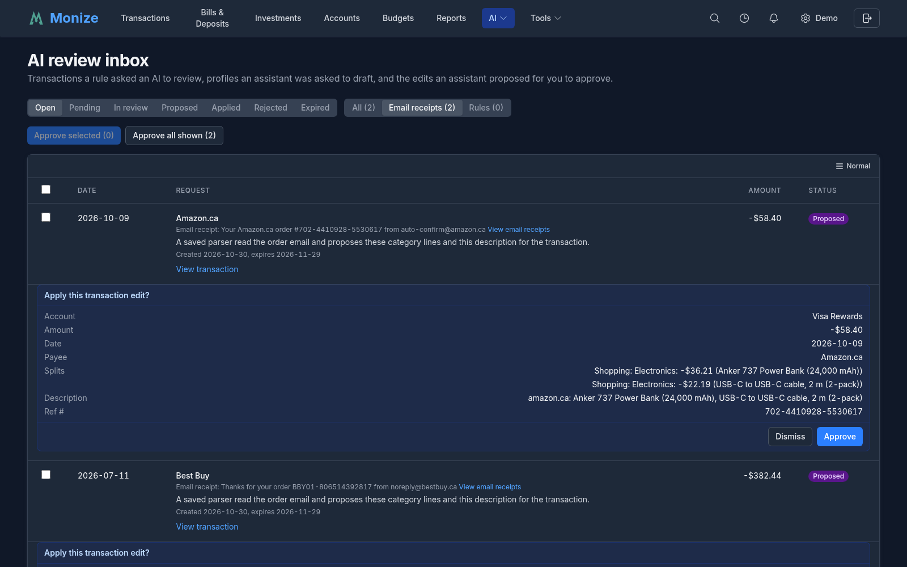
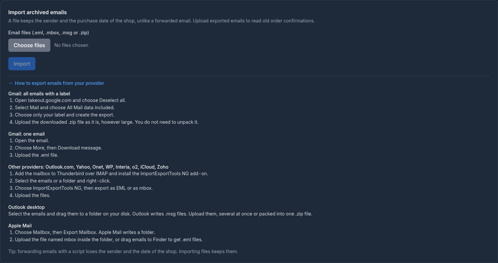
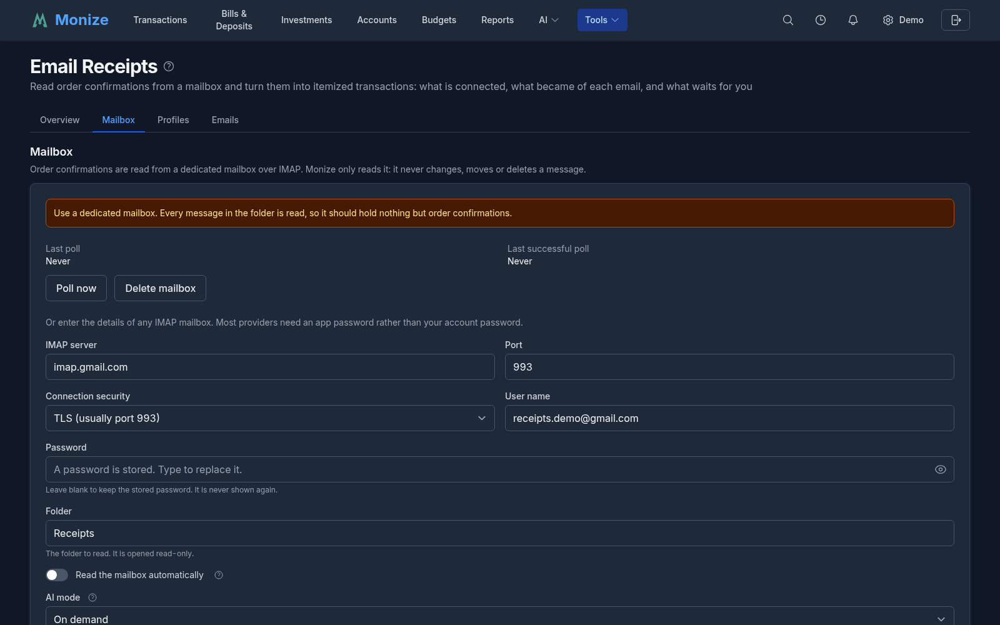

# Email Receipts

Monize can read **order confirmations from a mailbox** and turn them into itemized transactions: it finds the bank transaction the email belongs to, fills in the line items, and shows you what it proposes before anything changes.

A bank row says how much and when, not what you bought. An order email says both, so a single Amazon.ca charge can become a split with one line for each thing you bought, each with its own category, and the order number in the description.

This page covers the **Email Receipts** hub (its tabs, the emails it has read, the profiles that read them and the proposals waiting for you), then **connecting the mailbox** -- a Gmail account above all, since Google's rules decide how you should connect, then Microsoft 365 and any other IMAP server -- and what to do when the connection fails.

---

## How It Works

- **Where it lives.** **Email Receipts** is under **Tools** in the main menu, with four tabs: **Overview**, **Mailbox**, **Profiles** and **Emails**. The Settings page has an **Email Receipts** card that leads to it, and **Settings > Email Receipts** opens the **Mailbox** tab.
- **What it reads.** Order confirmations are read from a dedicated mailbox over IMAP. Monize **only reads** it: it never changes, moves or deletes a message, and it opens the folder read-only. Old emails can also be uploaded as files (see [Importing Archived Emails](#importing-archived-emails)).
- **How often.** With *Read the mailbox automatically* on, the folder is read every 15 minutes. **Poll now** reads it on demand at any time.
- **Use a dedicated mailbox.** Every message in the folder is read, so it should hold nothing but order confirmations. With Gmail the natural "dedicated mailbox" is a **label**: create a filter that applies a label such as `Receipts` to the shops' confirmations, and point Monize at that label. Gmail labels appear to IMAP as folders (a nested label is written `Parent/Child`).
- **Forwarded emails count.** An email you forward from your main mailbox is read by its original sender and date, so forwarding the shops' confirmations to the dedicated mailbox works.
- **Who can use it.** The account owner only. A delegate sees neither the hub nor the mailbox settings. In demo mode, connecting a mailbox and writing profiles are turned off.
- **What it needs on the server.** `ENCRYPTION_KEY` must be set: a mailbox password or sign-in is stored encrypted, and cannot be saved without it.

### From Email to Transaction

Each email goes through the same steps:

1. **Read.** The **profile** for the email's sender reads the total, the line items, the order number and so on (see [Profiles](#profiles)). An email with no profile can still be read when it carries an order as structured data (schema.org markup that mail clients use for their order cards); many large shops include it. With **AI mode** set to **Automatic**, the AI can also help (see [Mailbox Settings](#mailbox-settings)).
2. **Match.** Monize looks for the bank transaction the email paid for: by the order number or a reference in the transaction's text, by the amount and the payee, or by the amount within a few days of the purchase.
3. **Propose.** It proposes a change to that transaction: a split with one line per item and a category for each, the payee and a description. The proposal waits in the [AI review inbox](#reviewing-and-approving-proposals).
4. **Approve.** Nothing changes in your register until you approve the proposal, unless you turned on **Apply proposals automatically** and the email met its strict conditions.

---

## The Email Receipts Hub

### Overview



The **Overview** tab sums up the state of things:

- **Mailbox**: whether it is **Polling**, **Polling is off**, its **Last poll failed** or it is **Not connected**, how it signs in, and its last successful poll or last error.
- **Emails**: how many are stored, and how many can be processed again.
- **Proposals**: how many wait for your approval, with **Review the proposals**.
- **Profiles**: how many are approved, and how many drafts wait for your approval.
- **Senders without a profile**: each sender domain whose emails no profile reads, with **Create a profile**, which opens the [profile wizard](#creating-a-profile-with-the-wizard) for it.

Until a mailbox is connected, emails are stored and a profile is approved, the tab opens with **Get started with email receipts**: four steps (connect a mailbox, fetch the emails, create a profile for a sender, review the proposals), each with a link to where it is done.

### Emails



The **Emails** tab lists every email Monize has read, newest first, with the transaction it matched and its **State**:

| State | Meaning |
|-------|---------|
| **Waiting to be read** | Stored, not processed yet |
| **No profile** | No profile reads this sender, and the email carries no structured order |
| **Could not be read** | Its profile found no total, no items, or items that do not add up |
| **No transaction found** | No bank transaction fits it (yet: the bank may post it later) |
| **Several transactions fit** | More than one transaction fits equally well; choose the right one |
| **Another request is open** | The transaction already has an open review request |
| **Waiting for approval** | A proposal waits in the review inbox |
| **Waiting for the AI** | The email was handed to the AI and its answer has not arrived |
| **Applied**, **Dismissed**, **Expired** | What became of its proposal |
| **Waiting for its repayment** | A purchase email waiting for the repayment that pays for it (see [Linked Profiles](#linked-profiles-buy-now-pay-later)) |
| **Ignored**, **Skipped** | Ignored by you or by its profile; skipped because it was too large or could not be decoded |

Above the list:

- **Search emails** by subject, sender or content (**Search in**), and by **From date** and **To date**.
- **Filter by state**, each state with its count (**In review** groups the emails with an open proposal).
- **Sender domain** narrows the list to one sender and its sub-domains.

Each row's actions depend on its state: **Approve** a proposal from here, **Choose transaction** for an email with none, **Prepare a profile with AI** or **Create profile** for a sender without one, **View** the email, and under **More actions**: **Reprocess**, **Recognize with AI**, **Ignore** and delete. A reprocessed email is read again with the profiles as they are now.

**Selecting emails.** Tick emails (or **Select all emails on this list**, then **Select all N matching this filter**) to act on many at once: **Reprocess**, **Restore ignored**, **Approve proposals**, **Ignore** or **Delete**. **Deselect by** takes emails out of a large selection by state, by sender, or by the day they arrived. Deleting a stored email does not touch the mailbox, and a later poll does not fetch it again.

#### An Email's Details

**View** opens the email: its sender, the day it arrived (and the day the shop sent it, for a forwarded email), its **State**, the **Profile** that read it (or **Structured data**), how the transaction was **Matched by**, and the transaction itself. **What the profile read** lists the order number, the items with their categories, and the total. The email can be shown as **HTML** (remote images are not loaded), as **Text**, or as the numbered **Lines** a profile's patterns are matched against. When several transactions fit, the dialog lists them under **Transactions that fit** with **Link to this transaction**.



#### Choosing the Transaction Yourself

For an email with no transaction, **Choose transaction** opens the email with a **Choose the transaction** section: your transactions between **From** and **To** (at first the days around the purchase), with a search by payee, description or amount. Click **Link** on the one the email paid for, or change the dates to look further, and Monize proposes the change for it as if it had found it itself.



#### Recognize With AI

**Recognize with AI** (or **Recognize as a trade with AI** for a brokerage email) hands one email to the AI assistant in the chat, with the transaction it should describe. The assistant's answer is a proposal you approve like any other. It needs an AI provider (see [AI](ai.md)); without one, the request waits in the review inbox for an agent such as an MCP client.

### Profiles

A **profile** tells Monize how to read the order confirmations of one sender: which emails it reads (the sender domains, and optionally words the subject must contain), the patterns that find the total, the items and the order number, the categories the items get, and how the bank transaction is found. Once approved, a profile runs on its own, without the AI.



The **Profiles** tab lists every profile with its **Status** (**Draft** or **Approved**, **Written by you** or **Drafted by AI**), its **Payee** and its actions: **Edit**, **Approve** (for a draft), **View JSON** and **Delete**. Deleting a profile keeps what it already read. After you approve or change a profile, Monize offers to process the stored emails of its senders again (**Process now**).

#### Creating a Profile With the Wizard

**Create a profile for a domain** lists the senders whose emails no approved profile reads; choose one (or **Create a profile** on the Overview) to start the wizard:

1. **Samples.** Click an email to read it and choose the transaction it paid for, then tick up to five emails to write the profile from. For a broker's emails, tick **These emails are brokerage trade confirmations**: they need no transaction.
2. **Generate.** **Send to AI**: the assistant reads the samples and their transactions and writes a draft profile. Not happy? Write what to change under **Requested Changes** and **Send note to AI**. Without an AI provider in Monize, the request waits in the review inbox for your AI agent, and the wizard says so.
3. **Preview and accept.** The draft is run over the samples and the other emails of the sender, read-only: for each, the transaction you expected, what the draft read, whether they agree, and the outcome. **Accept and process** approves the profile and reads the sender's stored emails with it.



**Prepare a profile with AI** on the Emails tab does the same from emails you select there.

#### Writing or Editing a Profile

**Create a new profile manually**, or **Edit** on a profile, opens the editor:

- **Which emails it reads**: the **Name**, the **Payee** the transactions get, the **Sender domains** (a sub-domain of a listed domain also matches) and **Subject contains**.
- **Profile kind**: an order confirmation, or a brokerage trade confirmation (see [Trade Confirmations](#trade-confirmations)). **Matching emails** can also make a profile **ignore** or **delete** every email of a sender you never want to deal with.
- **Patterns**: **Order number patterns**, **Total patterns**, **Shipping**, **Discount** and **Fees patterns**, and the **Line items** (where the items start and stop, and the **Item patterns**). Each pattern is matched against one whole line of the email, ignoring case; `*` stands for any text and a name in braces, such as `{amount}`, captures a value. A profile can read the email's text or the lines of its HTML part (**Lines source**).
- **Categories**: a **Default category** for items no rule covers, the **Shipping category** and the **Fees category**, and rules that give a category to items whose name matches.
- **Matching**: the **Strategies, in the order tried** (order number, reference, amount and payee, amount and date), where to look for the order number or reference, the **Days before the purchase** and **Days after the purchase** a transaction may be dated, and the **Amount tolerance**.
- **Proposal**: a tag to add to the transactions the profile splits, and whether the AI may choose the category of items no rule matches.

**Form** and **JSON** at the top switch between the form and the profile's JSON definition (a definition that uses something the form cannot show opens as JSON). The test panel runs the profile, as it is in the editor, over a stored email you choose: what it read, line by line, and which transaction it would match.



#### Linked Profiles (Buy Now, Pay Later)

When a purchase is paid later or in instalments, the shop's itemized email and the bank transaction are linked by a third email from the payment provider. A **purchase profile** stores the shop's email, and a **repayment profile** reads the provider's email and matches the bank transaction. When the repayment arrives, its transaction is split into every item of the purchases it pays, spread proportionally over the instalments; a purchase email that arrives later updates the proposal. Linked proposals always wait for your approval. To draft both profiles, select up to five emails from each sender together on the Emails tab and choose **Prepare a profile with AI**.

#### Trade Confirmations

A **trade profile** reads a broker's "order filled" email and proposes the investment transaction it reports: a buy, a sell, a cash dividend or a reinvested dividend, with the symbol, the number of shares, the total or price, the commission, the date and the account. Accounts the broker prints alike (a CAD and a USD account) are told apart by currency. A trade already in your ledger is not proposed again, and one that pays a scheduled investment transaction posts that occurrence. A trade is applied without asking only when **Apply proposals automatically** is on and the price agrees with the shares and the total.

### Reviewing and Approving Proposals

Every proposal waits in the **AI review inbox** (**AI > AI Review Inbox**, or **Review the proposals** on the Overview); the **Email receipts** filter shows only these. Each request names the email it came from (**View email receipts** opens it) and the transaction it would change, and its **Apply this transaction edit?** card lists the result: the account, amount, date and payee, the split lines with their categories, the new description (the old one followed by the profile's name and the items) and the order number as **Ref #**. A proposal on a reconciled transaction says so.

- **Approve** rewrites the transaction as shown. **Approve** on the Emails tab does the same.
- **Dismiss** leaves the transaction as it is.
- **Approve selected** and **Approve all shown** apply several proposals at once; each is checked against its transaction as it is now, and one that no longer fits is skipped and reported.

Proposals that nobody approves expire after 30 days.



The **Email receipts** row of [Settings > Notifications](settings-and-security.md#notifications) tells you when emails need a profile or a fix, and the **AI review proposals** row when proposals are waiting or about to expire.

### Importing Archived Emails

The **Mailbox** tab's **Import archived emails** reads exported emails: `.eml`, `.mbox`, `.msg` or `.zip` files, several at once. A file keeps the shop's own sender and purchase date, unlike an email forwarded later, so it is the way to read old order confirmations. **How to export emails from your provider** explains how to get them out of Gmail (Google Takeout for a label, or one email at a time), Outlook, Apple Mail and other providers (Thunderbird with ImportExportTools NG). A Google Takeout `.zip` can be uploaded as it is. The import needs a mailbox to be set up, stores each email once (importing the same file again adds nothing) and processes them straight away.



---

## Gmail: Choosing How to Connect

There are two ways to connect a Gmail mailbox, and Google's policies -- not Monize -- decide which one fits you. IMAP has no narrower Google scope than `https://mail.google.com/`, which Google classes as **restricted**: an app that asks for it must either be verified by Google (an annual, paid security assessment) or live with the limits Google puts on unverified apps.

| Path | What you need | Limits | Best for |
|------|---------------|--------|----------|
| **A. App password** through the manual IMAP form | A personal Google account with **2-Step Verification** on | Not available for Google Workspace ("work, school or organization") accounts, accounts in Advanced Protection, or accounts whose 2-Step Verification uses security keys only | **Personal Gmail. Start here.** No Google Cloud project, nothing to verify, no expiry. |
| **B. Connect with Google**, audience *External*, status *Testing* | A Google Cloud project with an OAuth client (set up by the administrator) | Only the **test users** listed on the project (up to 100) can connect, and every grant **expires after 7 days** -- the mailbox then stops and asks to be reconnected | Trying the feature out, or a tiny group that accepts a weekly Reconnect |
| **C. Connect with Google**, audience *Internal* | A **Google Workspace** organisation, with the Cloud project inside it | Only accounts in that Workspace domain can connect | A family or business on Google Workspace. No verification, no 7-day expiry. |
| **D. Connect with Google**, *External*, *In production* | Google's restricted-scope verification (about 6 weeks) **plus** a CASA Tier 2 security assessment by a Google-authorised lab, repeated every year, costing hundreds to thousands of dollars | None after verification | Not realistic for a self-hosted deployment. Monize does not offer this. |


Both Google paths give Monize the same access: a scope that *could* write to the mailbox. Monize still opens the folder read-only and exposes no write operation, so the mailbox is never changed.

---

## Gmail with an App Password

An app password is a 16-character passcode that lets one app sign in to your Google account without your real password. It is the simplest way to connect a personal Gmail account.

### 1. Create the app password in Google

1. Turn on **2-Step Verification** for the Google account if it is not already on (Google Account > Security). App passwords exist only on accounts with 2-Step Verification.
2. Open [myaccount.google.com/apppasswords](https://myaccount.google.com/apppasswords), give the password a name such as `Monize receipts` and click **Create**.
3. Copy the 16 characters shown. Google shows them once; spaces are ignored.

> **Advanced Protection:** app passwords are not available on an account enrolled in Google's [Advanced Protection Program](https://landing.google.com/advancedprotection/), and enrolling later revokes any app password already created, so a mailbox saved with one stops working. Use a separate Gmail account for receipts instead.

If the page says app passwords are not available, the account is a Workspace account, is in Advanced Protection, or uses security keys only. Those accounts connect with Google instead (see below) or, for Workspace, ask the administrator for the Internal path.

### 2. Enter the mailbox in Monize

1. Go to **Tools > Email Receipts** and open the **Mailbox** tab.
2. In the manual form, fill in:

| Field | Value |
|-------|-------|
| **IMAP server** | `imap.gmail.com` |
| **Port** | `993` |
| **Connection security** | **TLS (usually port 993)** |
| **User name** | the full Gmail address |
| **Password** | the 16-character app password |
| **Folder** | `INBOX`, or the label you dedicated to receipts (a nested label is `Parent/Child`) |

3. Click **Test connection**. Monize logs in and reports *"The connection works. The folder holds N messages."* or the error the server returned.
4. Click **Save mailbox**.

Once saved, the password is never shown again. Editing the mailbox with the password left blank keeps the stored one.

---

## Connect with Google (OAuth)

With this path the user never types a password into Monize: they sign in at Google, approve the access, and Monize stores a refresh token (encrypted with `ENCRYPTION_KEY`) that it trades for a short-lived access token every time it reads the mailbox. The IMAP host is always Google's own `imap.gmail.com:993`; the user does not choose a host or port.

The **Connect with Google** button appears only after the administrator has registered an OAuth client and set both of its environment variables. One client serves every user of the deployment.

### For the administrator

Decide the **audience** first, using the table above: **Internal** if your deployment belongs to a Google Workspace organisation and everyone who will connect is in it; otherwise **External**, which stays in **Testing** with its 7-day expiry.

1. Sign in to the [Google Cloud console](https://console.cloud.google.com/) and create a project (or pick one). No billing account is needed, and no API has to be enabled: IMAP sign-in uses only the OAuth scope.
2. Open **Google Auth Platform** (the former "OAuth consent screen"; search for it in the console).
   - **Branding**: give the app a name such as `Monize` and a support email. Add your deployment's domain under *Authorized domains* if the console asks for one.
   - **Audience**: choose **Internal** or **External**. For External, add every Google account that will connect under **Test users** (up to 100). Leave the publishing status on **Testing**.
   - **Data Access**: click **Add or remove scopes** and add `https://mail.google.com/` (it is listed under *Gmail API* or can be pasted manually), plus `openid` and `.../auth/userinfo.email`. Save.
3. Open **Clients** > **Create client**. Application type **Web application**, any name, and under **Authorized redirect URIs** add exactly:

```
https://your-monize-host/settings/email-receipts/oauth-callback
```

   That is `PUBLIC_APP_URL` (no trailing slash) followed by `/settings/email-receipts/oauth-callback`. It must match character for character.

4. Copy the **Client ID** and **Client secret** into the backend environment:

```bash
PUBLIC_APP_URL=https://your-monize-host
ENCRYPTION_KEY=...                     # already required for other secrets
EMAIL_RECEIPTS_GOOGLE_CLIENT_ID=1234567890-abc.apps.googleusercontent.com
EMAIL_RECEIPTS_GOOGLE_CLIENT_SECRET=GOCSPX-...
```

5. Restart the backend. The **Mailbox** tab now shows **Connect with Google** under **Connect an account**, above the manual form. A provider with only one of the two variables set is not offered at all.

What Monize sends and stores: the authorization request asks for `https://mail.google.com/ openid email` with `access_type=offline` and `prompt=consent`, so Google returns a refresh token on every connection. The login name is the email address from the ID token. The refresh token is the only credential kept, encrypted; the access token lives in memory for one poll.

### For the user

1. Go to the **Mailbox** tab of **Tools > Email Receipts** and click **Connect with Google**.
2. Choose the Google account. On an External client in Testing, Google warns *"Google hasn't verified this app"*: click **Continue** (this is expected; the administrator's project is unverified by design). An account that is not on the test-user list is refused here.
3. Approve the access Google lists. The browser returns to Monize's *Connecting the mailbox* page, then to the settings with **Connected to Google as you@gmail.com.**
4. Set the **Folder** to read (`INBOX` or your receipts label), turn on **Read the mailbox automatically**, choose the **AI mode**, and click **Save settings**. See [Mailbox Settings](#mailbox-settings).
5. Click **Poll now** to read the folder straight away and follow *View the saved emails*.


### Reconnect, Disconnect and revoking

- **Reconnect** runs the Google sign-in again and replaces the stored token. Use it when the panel says *"The connection to Google is not active, so the mailbox is not being read. Connect again to resume."* -- on an External/Testing client that happens every 7 days.
- **Disconnect** deletes Monize's stored token and stops reading the mailbox. Emails already stored are kept.
- Disconnecting does **not** withdraw the permission you granted. To do that, remove Monize on [Google account permissions](https://myaccount.google.com/permissions); the panel links there. Revoking at Google without disconnecting in Monize is fine too: the next poll records *"The mailbox's sign-in was revoked or has expired"* and stops until you reconnect.

---

## Microsoft 365

Microsoft 365 works the same way as Google: the administrator registers one app, and users click **Connect with Microsoft**.

1. In the [Microsoft Entra admin center](https://entra.microsoft.com/), open **App registrations > New registration**. Platform **Web**, redirect URI `${PUBLIC_APP_URL}/settings/email-receipts/oauth-callback`.
2. Under **Certificates & secrets**, create a client secret and copy its value.
3. Under **API permissions**, add the **delegated** permission `IMAP.AccessAsUser.All` (Office 365 Exchange Online) plus the OpenID permissions `openid`, `email` and `offline_access`. An organisation may still need to enable IMAP for the mailbox and allow users to consent to the app.
4. Set the environment:

```bash
EMAIL_RECEIPTS_MICROSOFT_CLIENT_ID=...
EMAIL_RECEIPTS_MICROSOFT_CLIENT_SECRET=...
EMAIL_RECEIPTS_MICROSOFT_TENANT=common   # optional, default shown
```

`EMAIL_RECEIPTS_MICROSOFT_TENANT` decides who may sign in: `common` (work, school and personal accounts), `organizations`, `consumers`, or one tenant's GUID or domain. A value that is not a valid tenant disables Microsoft sign-in and logs a warning. The IMAP host is fixed to `outlook.office365.com:993`.

---

## Any Other IMAP Server

The manual form takes any IMAP server: host, port, **TLS** (usually 993) or **STARTTLS** (usually 143), user name and password. Most providers require an **app password** rather than the account password. The server's certificate is always verified; there is no "accept any certificate" switch.

Two server-side rules apply to the host:

- **Private addresses.** A host that is a private, loopback or link-local address (`localhost`, `192.168.x.x`, a container name, `.local`, `.internal`) can be used only by an **administrator**, unless the operator lists it in `EMAIL_RECEIPTS_PRIVATE_HOST_ALLOWLIST` (for example `mail.lan:993,192.168.1.30:993`). The check runs when the mailbox is saved and again on every connection.
- **How much one poll reads.** `EMAIL_RECEIPTS_MAX_MESSAGES_PER_POLL` (default 50) caps the messages read per poll; the rest wait for the next one. `EMAIL_RECEIPTS_MAX_MESSAGE_BYTES` (default 2,000,000) is the largest message downloaded; a larger one is recorded as skipped and never fetched.

---

## Mailbox Settings

The **Mailbox** tab holds the connection and these settings. They are the same for a password mailbox and a connected one.



| Setting | What it does |
|---------|--------------|
| **Folder** | The folder to read. It is opened read-only. Changing it starts reading the new folder from the beginning. |
| **Read the mailbox automatically** | When on, Monize reads the mailbox every 15 minutes. Turning it off does not disconnect the mailbox, and **Poll now** reads it whether this is on or off. |
| **AI mode** | **Off**: the poll never calls the AI for receipts. **On demand**: the poll never calls the AI, but you can ask the assistant yourself with **Recognize with AI** or **Prepare a profile with AI**. **Automatic**: the poll asks the AI about a matched receipt that no approved profile could read completely, and drafts a profile for a sender that has none. Every AI answer is a proposal you approve. |
| **Apply proposals automatically** | Off by default. A proposal is applied without asking only when an approved profile read the whole email, the transaction was found by an order number or reference, or by exact amount and payee with a single candidate, and the proposal adds up to the cent. A trade confirmation is booked without asking only when its approved trade profile read the whole trade, the price agrees with the shares and the total, and your ledger does not already hold the trade. Everything else waits for your approval. |
| **Count profile proposals toward the daily AI limit** | On by default. Turn it off when a large batch of stored emails would otherwise use up the daily limit of AI-proposed changes. Every proposal still waits for your approval. |

The status block shows the **Last poll**, the **Last successful poll** and the **Last error**, and offers **Poll now** and **Delete mailbox**. **Poll now** reports how many emails it saved, skipped and processed, with *View the saved emails*. Deleting the mailbox removes the settings and every stored email from Monize; the emails in the mailbox itself are not touched.

---

## Troubleshooting

| Message | What it means |
|---------|---------------|
| No **Connect with Google** button, only the manual form | The server has not set both `EMAIL_RECEIPTS_GOOGLE_CLIENT_ID` and `EMAIL_RECEIPTS_GOOGLE_CLIENT_SECRET`, or was not restarted after setting them. |
| *"Sign-in with this provider is not set up on this server."* | Same cause, reached by an old page or a stale link. Ask the administrator. |
| Google: **Error 400: redirect_uri_mismatch** | The redirect URI registered on the client does not equal `PUBLIC_APP_URL` + `/settings/email-receipts/oauth-callback`. Check the scheme (`https`), the host, the port, and that `PUBLIC_APP_URL` has no trailing slash. |
| Google: **Error 403: access_denied** or *"has not completed the Google verification process"* | The client is External in Testing and this account is not on its **Test users** list; or the client is Internal and the account is outside the Workspace domain. |
| *"Google hasn't verified this app"* | Expected for an unverified (Testing) client. Click **Continue**. |
| *"The provider did not grant lasting access. Remove this app's access in your account's security settings and connect again."* | Google returned no refresh token. Remove Monize on [Google account permissions](https://myaccount.google.com/permissions) and click **Connect with Google** again. |
| *"The mailbox's sign-in was revoked or has expired. Connect the mailbox again in the mailbox settings."* | On an External/Testing client this is the 7-day expiry; otherwise the grant was revoked or the account password changed. Click **Reconnect**. To stop it recurring, move to the Internal audience or to an app password. |
| *"This sign-in link is not valid any more. Start connecting the mailbox again."* | The sign-in took too long or the callback was opened twice. Start again from the settings. |
| *"The provider did not accept the sign-in, so the mailbox was not connected."* | The code exchange failed, most often a wrong client secret or a secret that has expired. The administrator should check the client's credentials. |
| *"This server has no encryption key configured, so a mailbox sign-in cannot be stored."* | The deployment has no `ENCRYPTION_KEY`. Nothing can be saved until the administrator sets one. |
| *"The stored sign-in cannot be read on this server. Connect the mailbox again in the mailbox settings."* | The token was stored under a different `ENCRYPTION_KEY`, typically after a restore onto another instance. Reconnect. |
| Test connection: *"Application-specific password required"* or *"Invalid credentials"* | The account password was used instead of an app password, or the account cannot have one (Workspace, Advanced Protection, security keys only). Create an app password, or use **Connect with Google**. |
| *"This mail server address is a private or local network address..."* | A non-administrator entered a private host. Only an administrator can use one, unless the operator allows it in `EMAIL_RECEIPTS_PRIVATE_HOST_ALLOWLIST`. |
| Connected, but the folder reads 0 messages | The **Folder** does not match: Gmail labels are case-sensitive, and a nested label is `Parent/Child`. **Test connection** on the manual form reports the count; on a connected mailbox use **Poll now**. |

---

## Related

- [Settings and Security](settings-and-security.md) -- the Settings page, the Email Receipts card and the notification settings
- [Getting Started](getting-started.md) -- the `.env.example` sections, including *Email receipts*
- [AI](ai.md) -- the AI providers the **AI mode** setting can use, and the AI review inbox
- [Tags](tags.md#tags-and-rules) -- rules, which can also send a transaction for an AI review
