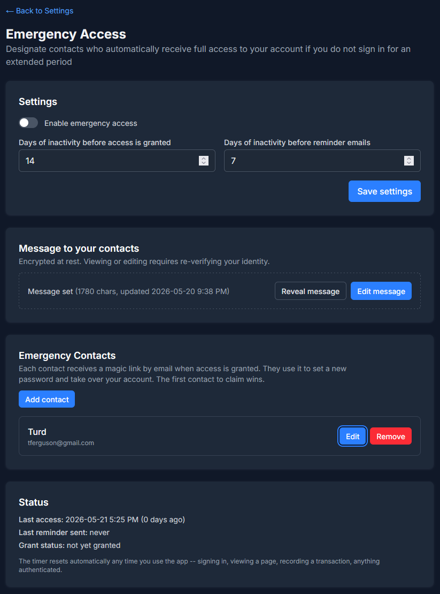
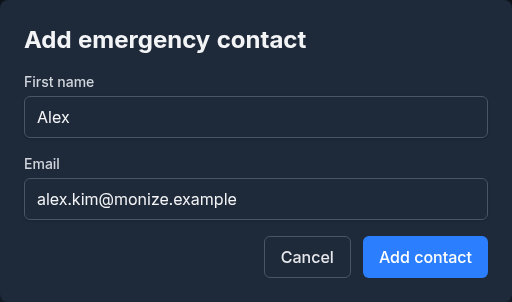
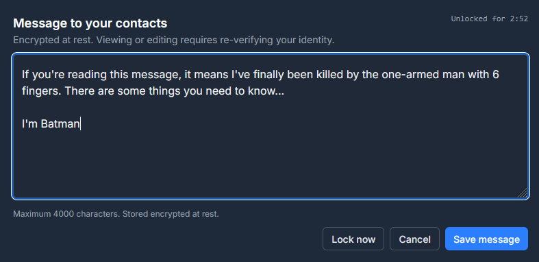

# Emergency Access

Emergency Access lets you designate one or more trusted contacts who will automatically receive a magic link to take over your Monize account if you do not sign in for an extended period. It is intended for incapacitation, hospitalization, or worst-case scenarios where a partner, family member, or executor needs to access your financial records on your behalf.

The feature is fully automated. Once configured, a daily background check watches for inactivity and, when the threshold is reached, emails each designated contact a single-use link that lets them set a new password on your account. You are reminded by email before the grant happens, giving you a chance to log in and reset the countdown.

---

## How It Works

| Step | What happens |
|------|--------------|
| 1. You enable the feature | You add one or more trusted contacts and pick two thresholds: when reminders start and when access is granted |
| 2. You stop logging in | The system tracks the timestamp of your last authenticated activity |
| 3. Reminder window is reached | Once per day, you receive an email warning that emergency access is approaching |
| 4. Grant window is reached | Each contact receives a single-use magic link by email; you receive no further reminders |
| 5. A contact claims the link | They set a new password, all existing sessions are revoked, and they sign in as you |
| 6. The feature auto-disables | Emergency Access turns itself off on the now-claimed account so the cycle does not repeat |

> **Important:** Emergency Access is a "dead-man's switch", not a real-time alert. It is designed to fire only after weeks of inactivity. It is not the right tool for ongoing shared access -- use [Shared Access](shared-access.md) for that.

---

## Prerequisites

Emergency Access depends on outbound email. If your administrator has not configured SMTP (the `SMTP_HOST`, `SMTP_USER`, and `SMTP_PASSWORD` environment variables), the Emergency Access page will show a warning banner and the settings will be read-only.

The feature is not available:

- In demo mode
- When viewing another user's account through [Shared Access](shared-access.md) (only the account owner can configure their own emergency access)

---

## Enabling Emergency Access

1. Navigate to **Settings** (gear icon in the top-right corner)
2. Click **Emergency Access** in the sidebar (or open `Settings > Emergency Access` directly)
3. Toggle **Enable emergency access** on
4. Set the inactivity thresholds (see [below](#inactivity-thresholds))
5. Click **Save settings**

<!-- Screenshot: The Emergency Access settings page showing the enable toggle, the grant/reminder day inputs, and the Save button -->

Enabling the feature does not, by itself, send any emails. Reminders and grants only fire when the inactivity thresholds are exceeded.

---

## Inactivity Thresholds

Emergency Access uses two day-count thresholds:

| Setting | Default | Range | Description |
|---------|---------|-------|-------------|
| **Days of inactivity before access is granted** | 14 | 2--365 | After this many days without an authenticated request from you, each contact is emailed a claim link |
| **Days of inactivity before reminder emails** | 7 | 1--364 | After this many days, you start receiving a once-per-day warning email |

The reminder threshold must be strictly less than the grant threshold (the form will reject saves that violate this).

### What counts as "activity"

Any authenticated request to the Monize backend resets the clock -- opening the dashboard, viewing a report, or running an API call from an integration. You do not need to log in fresh; an active session that quietly refreshes its token counts as activity.

If you have never been active since this feature was deployed, the system falls back to your last login timestamp.

---

## Adding Emergency Contacts

1. In the **Emergency Contacts** card, click **Add contact**
2. Enter the contact's **first name** and **email address**
3. Click **Save**

<!-- Screenshot: The Add contact modal showing first name and email fields -->

You can add as many contacts as you want. Each contact will receive their own magic link when access is granted -- whichever contact claims the link first wins, and the remaining contacts' links are automatically voided.

You can **edit** a contact's first name or email at any time. Editing the email invalidates any in-flight magic link that has already been issued to the old address, so you do not need to disable the feature while you make the change.

You can **remove** a contact from the list. Removing a contact also invalidates any link they may already be holding.

> **Tip:** Use the first name only -- the email template addresses the contact by first name ("Hi Alice"), so a last name is unnecessary.

---

## The Free-Form Message

You can write an optional message of up to 4,000 characters that will be included in the grant email and shown to the contact on the claim page. Typical contents:

- Where to find paper records, safe-deposit-box keys, or password managers
- Account numbers for institutions that are not in Monize
- Funeral wishes or instructions for executors
- A note explaining why they are receiving the email

### Adding or editing the message

The message is **encrypted at rest** with a server-held key, and reading or writing it requires re-verifying your identity (step-up authentication). This protects the message from someone who has hijacked an already-open Monize session.

1. In the **Message to your contacts** card, click **Add message** (first time) or **Edit message**
2. Re-verify your identity:
   - **Local-password users:** enter your current password
   - **OIDC users:** click through to your identity provider to re-authenticate
3. Type the message and click **Save message**

After verification, the message is unlocked for a few minutes -- a countdown displays in the message card. You can also click **Lock now** to re-lock immediately. Once locked, you must re-verify to view or edit it again.

<!-- Screenshot: The message editor showing the textarea, the "Unlocked for MM:SS" countdown, and the Lock now button -->

### Reading the message

The message card shows whether a message is set, its character count, and the last time it was updated -- but the content stays hidden until you click **Reveal message** and re-verify.

> **Security Note:** The message ciphertext is stored in the database under your account, encrypted with AES-256-GCM using the server's `ENCRYPTION_KEY`. A database dump alone cannot leak the plaintext. The running server holds the key and decrypts the message when including it in a grant email or showing it to you after step-up verification.

---

## Reminder Emails

Once you cross the reminder threshold, Monize sends you a daily email at 9:00 AM UTC. The email tells you:

- How many days you have been inactive
- How many days remain until access is granted
- Which contacts will be notified

Logging in resets the counter and stops the reminders.

If SMTP is not configured on the server, no reminders are sent (and grants are also suppressed). The Emergency Access page will display a warning when this is the case.

---

## What Happens When Access Is Granted

When the grant threshold is reached:

1. A single-use claim link is generated for each contact (32 random bytes, hashed with SHA-256 before storage)
2. Each contact receives an email titled "You have been granted emergency access to *[Your Name]*'s Monize account"
3. The link is valid for **30 days**
4. The page displays a red banner the next time you sign in: *"Emergency access already granted"*

You can clear the granted state to void all outstanding links (see [Clearing the Granted State](#clearing-the-granted-state)).

If you log in *after* the grant but *before* anyone claims it, the links remain valid until someone uses one or you clear the granted state. The cron does not re-issue links once a grant has fired -- it is a one-time event per cycle.

---

## Claiming Emergency Access (For the Contact)

If you have received an emergency access email, follow these steps to take over the account:

1. Open the link in the email. It looks like `https://your-monize-server/emergency-access/claim?token=...`
2. The page shows a preview with the owner's name and, if they wrote one, their free-form message
3. Set a new password (must meet Monize's standard complexity rules and not appear in the [Have I Been Pwned](https://haveibeenpwned.com/) breach database)
4. Confirm the password and click **Claim emergency access**

<!-- Screenshot: The emergency access claim page showing the owner's name, optional message, and new password fields -->

After a successful claim:

- The owner's previous password is replaced by yours
- All existing sessions, refresh tokens, and trusted devices on the account are revoked
- Two-factor authentication is disabled on the account (you will need to re-enable it under Settings if you want it)
- All sibling magic links for the same account are voided -- you are the sole new owner
- Emergency Access is automatically disabled on the now-claimed account
- You are signed in and redirected to the dashboard

> **One-shot only:** The claim link can be used only once. Refreshing the page after a successful claim, or opening it from a second browser, will fail with an "invalid, expired, or already used" error.

### Rate limiting

The claim endpoints (preview and complete) are rate-limited to 5 attempts per 15 minutes per IP, so a brute-force search for valid tokens is infeasible.

---

## Clearing the Granted State

If a grant fires by accident (e.g., you were on vacation and ignored the reminder emails), you can void all outstanding claim links once you log back in:

1. Open **Settings > Emergency Access**
2. A red banner reads *"Emergency access already granted"*
3. Click **Clear granted state**
4. Confirm in the dialog

Clearing the granted state:

- Voids every outstanding magic link for your contacts
- Resets the grant marker so the next cycle starts fresh from your current activity timestamp
- Leaves the feature enabled (so reminders will resume if you go inactive again)

If you want to switch it off entirely, disable the feature instead (see below).

---

## Disabling Emergency Access

1. Open **Settings > Emergency Access**
2. Toggle **Enable emergency access** off
3. Click **Save settings**

Disabling the feature:

- Stops the daily check immediately
- Voids any outstanding magic links (marked as "owner revoked")
- Keeps your contact list and message intact, so you can re-enable later without re-entering them

To remove the message or contacts permanently, edit them individually before disabling.

---

## Security Notes

| Concern | Mitigation |
|---------|------------|
| **Database leak of the message** | The message body is encrypted at rest with AES-256-GCM keyed by the server's `ENCRYPTION_KEY` |
| **Claim token leak from database** | Only the SHA-256 hash of the token is stored. The plaintext token only exists in the email and in the contact's browser |
| **Brute-forcing claim tokens** | 32-byte (256-bit) random tokens; 5-requests-per-15-minutes rate limit per IP on both preview and complete |
| **Token reuse / replay** | Single-use: once a token is consumed, all sibling tokens for the same owner are voided in the same transaction |
| **Stale tokens after the owner returns** | Disabling or clearing the granted state voids every outstanding token. Tokens also auto-expire after 30 days |
| **Stale session impersonating the owner during message edit** | Reading or writing the message requires step-up authentication (re-proving the strongest available factor in the last few minutes) |
| **Account hijack via emergency access** | The grant cascade only fires after the configured number of *consecutive* inactive days. Any authenticated request resets the counter |

---

## Limitations

- **Email delivery is critical.** If you change your email provider or your contact changes theirs, the grant email may bounce silently. Keep the contact list current.
- **The clock is server-side.** Time spent away from your computer but with an open Monize tab that quietly refreshes its session counts as activity -- close the tab if you genuinely want the timer to advance.
- **The first claim wins.** If you have multiple contacts, they cannot share access through this feature -- the first to click their link takes over the account, and the others are locked out. Use [Shared Access](shared-access.md) if you want multiple people to have ongoing access.
- **Two-factor authentication is disabled on claim.** The new account holder can re-enable it from Settings, but there is a brief window where the account has only password protection.
- **OIDC-only accounts become local accounts on claim.** Because the claim sets a password, the account's `authProvider` is switched to `local`. If the contact wants to keep using SSO afterward, an administrator would need to re-link the account.
