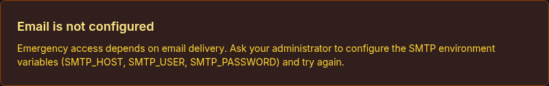
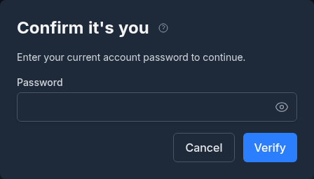

# Emergency Access

Emergency Access lets you designate one or more trusted contacts who will automatically receive a magic link to take over your Monize account if you do not sign in for an extended period. It is intended for incapacitation, hospitalization, or worst-case scenarios where a partner, family member, or executor needs to access your financial records on your behalf.

The feature is fully automated. Once configured, a daily background check watches for inactivity and, when the threshold is reached, emails each designated contact a single-use link that lets them set a new password on your account. You are reminded by email before the grant happens, giving you a chance to sign in and reset the countdown.

---

## How It Works

| Step | What happens |
|------|--------------|
| 1. You enable the feature | You add one or more trusted contacts and pick two thresholds: when reminders start and when access is granted |
| 2. You stop using Monize | The server tracks the time of your last authenticated activity |
| 3. Reminder window is reached | Once per day, you receive an email warning that emergency access is approaching |
| 4. Grant window is reached | Each contact receives a single-use magic link by email; you receive no further reminders |
| 5. A contact claims the link | They set a new password, all existing sessions are revoked, and they are signed in as you |
| 6. The feature auto-disables | Emergency Access turns itself off on the now-claimed account so the cycle does not repeat |

If you come back before anyone claims a link, the next daily check voids the links and starts the countdown again (see [What Happens When Access Is Granted](#what-happens-when-access-is-granted)).

> [!IMPORTANT]
> Emergency Access is a "dead-man's switch", not a real-time alert. It is designed to fire only after days or weeks of inactivity. It is not the right tool for ongoing shared access -- use [Shared Access](shared-access.md) for that.

---

## Prerequisites

Emergency Access depends on two things your administrator configures on the server:

- **Outbound email** (the `SMTP_HOST`, `SMTP_USER`, and `SMTP_PASSWORD` environment variables). Reminders and claim links are sent by email.
- **`ENCRYPTION_KEY`**. Each contact's claim link is stored encrypted so a failed delivery can be retried with the same link, and the message to your contacts is stored encrypted too.

When either is missing, the Emergency Access page says so at the top (**Email is not configured** or **Encryption key required**), and the controls that would arm the feature -- **Enable emergency access**, the two day counts, **Add contact** and the message buttons -- are disabled. A feature that is already enabled can always be switched off, even on a server that has since lost its email settings or its key.

The feature is not available:

- In demo mode
- When viewing another user's account through [Shared Access](shared-access.md) (only the account owner can configure their own emergency access)

---

## The Emergency Access Page

Open **Settings** (the gear icon with your name in the top-right corner) and choose **Emergency Access** in the settings menu, or click the **Emergency Access** card on the Settings page. The page has four cards:

- **Settings** -- the on/off switch and the two inactivity thresholds
- **Message to your contacts** -- an optional, encrypted note for your contacts
- **Emergency Contacts** -- the people who receive a claim link
- **Status** -- your last activity, the last reminder sent, and whether access has been granted

---

## Enabling Emergency Access

1. Open **Settings > Emergency Access**
2. Add at least one contact (see [Adding Emergency Contacts](#adding-emergency-contacts))
3. Turn on **Enable emergency access**
4. Set the inactivity thresholds (see [below](#inactivity-thresholds))
5. Click **Save settings**

Enabling the feature does not, by itself, send any emails. Reminders and grants only fire when the inactivity thresholds are exceeded. Access is never granted while you have no contacts: with an empty list the daily check simply skips you.

---

## Inactivity Thresholds

Emergency Access uses two day-count thresholds:

| Setting | Default | Range | Description |
|---------|---------|-------|-------------|
| **Days of inactivity before access is granted** | 14 | 2--365 | After this many days without an authenticated request from you, each contact is emailed a claim link |
| **Days of inactivity before reminder emails** | 7 | 1--364 | After this many days, you start receiving a once-per-day warning email |

Both are whole days, and the reminder threshold must be strictly less than the grant threshold (the form will reject saves that violate this).

### What counts as "activity"

Any authenticated request to the Monize server resets the clock -- opening the dashboard, viewing a report, recording a transaction, or an integration using one of your API tokens. You do not need to sign in fresh; an open session that quietly refreshes counts as activity.

The **Status** card shows **Last access** (with how long ago it was), **Last reminder sent**, and **Grant status** (*not yet granted*, or the date access was granted). If you have not been active since this feature was deployed, the server falls back to your last sign-in time.

---

## Adding Emergency Contacts

1. In the **Emergency Contacts** card, click **Add contact**
2. Enter the contact's **First name** and **Email**
3. Click **Add contact**

You can add as many contacts as you want, each with a different email address. Each contact receives their own magic link when access is granted -- whichever contact claims the link first wins, and the remaining contacts' links are automatically voided.

You can **Edit** a contact's first name or email at any time. Editing the email invalidates any link that has already been issued to the old address, so you do not need to disable the feature while you make the change.

You can **Remove** a contact from the list. Removing a contact also invalidates any link they may already be holding. A contact added *after* access was granted is sent a link of their own at the next daily check.

> [!TIP]
> Use the first name only -- the email addresses the contact by first name ("Hi Alice"), so a last name is unnecessary.

---

## The Free-Form Message

You can write an optional message of up to 4,000 characters that will be included in the grant email and shown to the contact on the claim page. Typical contents:

- Where to find paper records, safe-deposit-box keys, or password managers
- Account numbers for institutions that are not in Monize
- Funeral wishes or instructions for executors
- A note explaining why they are receiving the email

### Adding or editing the message

The message is **encrypted at rest** with a server-held key, and reading or writing it requires re-verifying your identity. This protects the message from someone who has hijacked an already-open Monize session.

1. In the **Message to your contacts** card, click **Add message** (first time) or **Edit message**
2. Confirm it is you in the **Confirm it's you** dialog:
   - **Password users:** enter your current account password
   - **Two-factor users:** enter the 6-digit code from your authenticator app
   - **Single sign-on users:** continue to your identity provider to sign in again
3. Type the message and click **Save message**

After verification, the message is unlocked for five minutes -- an *Unlocked for MM:SS* countdown displays in the message card. Click **Lock now** to re-lock immediately. Once locked, you must re-verify to view or edit it again. Saving an empty message removes it.

### Reading the message

While locked, the message card shows whether a message is set, its character count, and the last time it was updated -- but the content stays hidden until you click **Reveal message** and re-verify.

> [!NOTE]
> The message is stored encrypted with AES-256-GCM under the server's `ENCRYPTION_KEY`, so a copy of the database alone does not reveal it. The running server holds the key and decrypts the message when including it in a grant email or showing it to you after you re-verify.

---

## Reminder Emails

Once you cross the reminder threshold, Monize sends you a reminder email from its daily check, which runs at 9:00 AM server time. The email tells you:

- How many days you have been inactive
- How many days remain until access is granted
- Which contacts will be notified

At most one reminder is sent per day. Using Monize again resets the counter and stops the reminders.

If outbound email or `ENCRYPTION_KEY` is not configured on the server, no reminders are sent and no access is granted. The Emergency Access page displays a warning when this is the case.

---

## What Happens When Access Is Granted

When the grant threshold is reached:

1. A single-use claim link is generated for each contact
2. Each contact receives an email titled "You have been granted emergency access to *[Your Name]*'s Monize account"
3. The link is valid for **30 days**
4. The page displays a red banner the next time you sign in: *"Emergency access already granted"*, with the date it happened

**If you come back before anyone claims a link**, the next daily check notices that you are active again: it voids every outstanding link, resets the countdown and emails you to say so. A link cannot be claimed once you are back within the grant window, even before that check has run. To void the links straight away instead, clear the granted state (see [Clearing the Granted State](#clearing-the-granted-state)).

If a link could not be delivered to a contact (for example, the email server was briefly unavailable), the daily check sends that contact the same link again.

---

## Claiming Emergency Access (For the Contact)

If you have received an emergency access email, follow these steps to take over the account:

1. Open the link in the email. It looks like `https://your-monize-server/emergency-access/claim?token=...`
2. The page greets you by name, names the account holder, and shows their message if they wrote one
3. Enter a **New Password** (it must meet Monize's standard requirements and must not appear in the [Have I Been Pwned](https://haveibeenpwned.com/) breach database)
4. Enter it again in **Confirm Password** and click **Claim emergency access**

After a successful claim:

- The owner's previous password is replaced by yours
- All existing sessions are signed out, and the account's trusted devices, personal access tokens and connected AI or MCP client authorizations are revoked
- Two-factor authentication is disabled on the account (you will need to re-enable it under Settings if you want it)
- All sibling magic links for the same account are voided -- you are the sole new holder
- Emergency Access is automatically disabled on the now-claimed account
- You are signed in and taken to the dashboard

> [!IMPORTANT]
> **One-shot only.** The claim link can be used only once. Refreshing the page after a successful claim, or opening it from a second browser, fails with "This emergency access link is invalid, expired, or has already been used."

### Rate limiting

The claim page's requests (showing the preview and completing the claim) are limited to 5 attempts per 15 minutes per IP address, so a brute-force search for valid links is infeasible.

---

## Clearing the Granted State

If a grant fires by accident (e.g., you were on vacation and ignored the reminder emails), you can void all outstanding claim links once you sign back in:

1. Open **Settings > Emergency Access**
2. A red banner reads *"Emergency access already granted"*
3. Click **Clear granted state**
4. Confirm with **Clear** in the dialog

Clearing the granted state:

- Voids every outstanding magic link for your contacts
- Resets the grant marker and the reminder schedule, so the next cycle starts fresh from your current activity
- Leaves the feature enabled (so reminders will resume if you go inactive again)

If you want to switch it off entirely, disable the feature instead (see below).

---

## Disabling Emergency Access

1. Open **Settings > Emergency Access**
2. Turn off **Enable emergency access**
3. Click **Save settings**

Disabling the feature:

- Stops the daily check for your account immediately
- Voids any outstanding magic links
- Keeps your contact list and message intact, so you can re-enable later without re-entering them

To remove the message or contacts permanently, edit them individually.

---

## Security Notes

| Concern | Mitigation |
|---------|------------|
| **Database leak of the message** | The message body is encrypted at rest with AES-256-GCM keyed by the server's `ENCRYPTION_KEY` |
| **Claim link leak from the database** | A link only works with its random token, and the database holds the token's hash plus a copy encrypted under `ENCRYPTION_KEY` -- never the token in the clear |
| **Brute-forcing claim links** | 256-bit random tokens; a limit of 5 requests per 15 minutes per IP address on both preview and claim |
| **Link reuse / replay** | Single-use: the claim consumes the link and voids every sibling link for the same owner in the same database transaction |
| **Stale links after the owner returns** | Links stop working as soon as the owner is active again, the daily check voids them, and disabling or clearing the granted state voids them immediately. Links also expire after 30 days |
| **Stale session reading the message** | Reading or writing the message requires re-proving your identity within the last five minutes |
| **Account hijack via emergency access** | Access is only granted after the configured number of *consecutive* inactive days. Any authenticated request resets the counter |

---

## Limitations

- **Email delivery is critical.** If you change your email provider or your contact changes theirs, the grant email may bounce silently. Keep the contact list current.
- **The clock is server-side.** An open Monize tab that quietly refreshes its session counts as activity -- close the tab if you genuinely want the timer to advance.
- **The first claim wins.** If you have multiple contacts, they cannot share access through this feature -- the first to claim takes over the account, and the others are locked out. Use [Shared Access](shared-access.md) if you want multiple people to have ongoing access.
- **Two-factor authentication is disabled on claim.** The new account holder can re-enable it from Settings, but there is a brief window where the account has only password protection.
- **Single sign-on accounts become password accounts on claim.** Because the claim sets a password, the account signs in with that password from then on. If the contact wants to keep using SSO afterward, an administrator would need to re-link the account.
- **Not part of a backup.** Emergency access settings, contacts and the message are not included in [backups](backup-and-restore.md#what-is-backed-up); after restoring onto a new server, set them up again.
