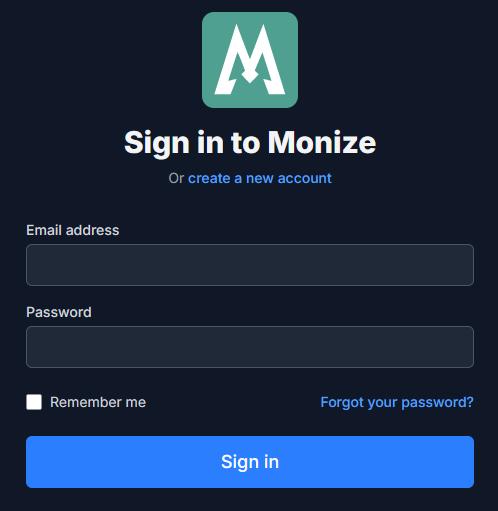
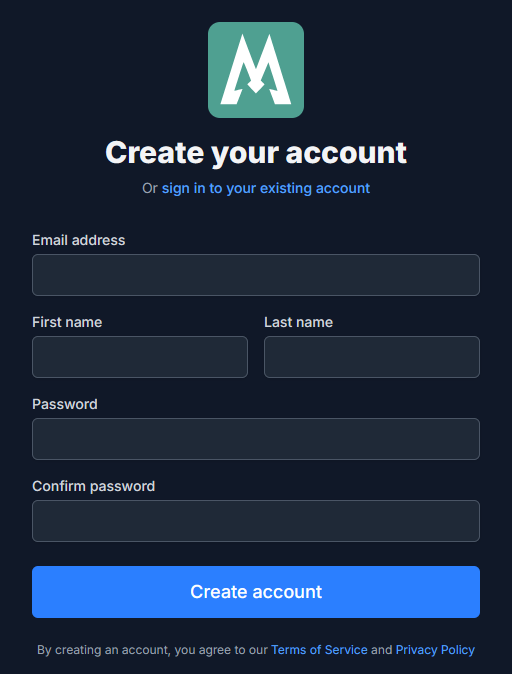
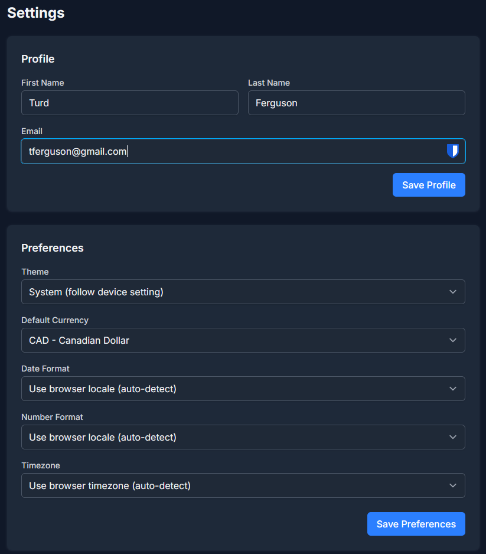
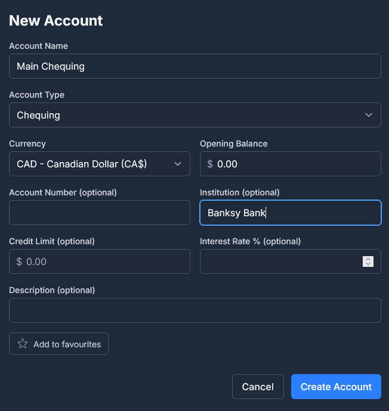
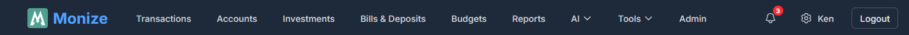
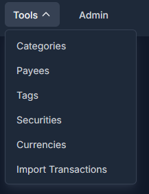

# Getting Started

This guide walks you through setting up Monize and getting your financial data organized.

---

## Prerequisites

Before installing Monize, ensure you have:

- **Docker** and **Docker Compose** installed on your server
- A minimum of 1 GB RAM available
- A modern web browser (Chrome, Firefox, Safari, or Edge)

---

## Installation

### Using Docker Compose (Recommended)

1. Clone the repository:

```bash
git clone https://github.com/your-repo/monize.git
cd monize
```

2. Create your `.env` file by copying the bundled example:

```bash
cp .env.example .env
```

The repository ships a `.env.example` that documents **every** setting Monize
supports, grouped into sections and with the defaults and explanatory comments
inline. Anything you do not need can be left commented out -- you do not have to
hunt for settings elsewhere. The sections are:

| Section | What it covers |
|---------|----------------|
| Database | PostgreSQL connection, TLS, and the optional Row-Level Security roles |
| Application | `JWT_SECRET`, encryption keys, and general app settings |
| URLs & Ports | Host port mappings and the public frontend URL |
| Authentication | Local login and registration toggles |
| OIDC / OpenID Connect | Single sign-on provider configuration (optional) |
| Email Notifications | SMTP server settings (optional) |
| Demo Mode | Demo restrictions and the daily reset (optional) |
| MCP / OAuth Debug Logging | Extra diagnostics for MCP and OAuth (optional) |
| AI Integration | Anthropic, OpenAI, and Ollama settings (optional) |
| Email receipts | Mailbox polling limits, the private-host allowlist, and Google / Microsoft 365 sign-in (optional; see [Email Receipts](email-receipts.md)) |
| Attachments | Transaction attachment storage: database, local filesystem, or S3 |
| Backup | Backup directory and scheduling |
| Quote Providers | Investment price/quote sources |
| Update Checks | New-version notifications |
| Frontend | Local development only |

At minimum, set `JWT_SECRET`, `ENCRYPTION_KEY` and a database password before starting:

```bash
# Required
JWT_SECRET=your-secret-key-minimum-32-characters-long
ENCRYPTION_KEY=your-encryption-key-minimum-32-characters

# Database (defaults shown)
POSTGRES_USER=monize
POSTGRES_PASSWORD=your-database-password
POSTGRES_DB=monize
```

> **Important:** Both must be at least 32 characters long. The application
> refuses to start without `JWT_SECRET`; `ENCRYPTION_KEY` is not enforced yet,
> but the server warns about it on every start and a future release **will**
> require it. Generate them with `openssl rand -base64 32` and
> `openssl rand -hex 32`.

> **Set `ENCRYPTION_KEY`, keep it safe, and never change it.** It encrypts what
> Monize stores in the database: AI provider API keys, Google Places API keys,
> emergency-access credentials, the instance's browser-push key pair, and the
> copy of each user's password that automatic backups are encrypted with.
> **Without it, your automatic backups are written unencrypted**, no API key or
> emergency-access contact can be saved at all, and browser push cannot be
> configured. Changing it
> later does not re-encrypt anything -- it makes what is already stored
> unreadable, and automatic backups stop until every user signs in again. Store
> it wherever you keep your other deployment secrets, and back it up.
> ([Backup and Restore](backup-and-restore.md#passwords-keys-and-what-you-must-not-lose)
> has the full picture of what depends on it.)
>
> Upgrading from a version before this setting existed? It was called
> `AI_ENCRYPTION_KEY`. The old name is still accepted, so an existing deployment
> keeps working untouched -- but if you never set it, your automatic backups
> were, and still are, being written unencrypted. The server now says so in its
> startup log on every boot.

3. Start the application:

```bash
docker compose up -d
```

4. Access Monize at `http://localhost:3001`

### Using Kubernetes (Helm)

Helm charts are provided in the `helm/` directory for Kubernetes deployments. Refer to the Helm README for detailed configuration options.

---

## Updating Docker Images

Monize publishes prebuilt images to the GitHub Container Registry
(`ghcr.io/kenlasko/monize-backend` and `ghcr.io/kenlasko/monize-frontend`). To
update, pull the new images and recreate the containers:

```bash
docker compose -f docker-compose.prod.yml pull
docker compose -f docker-compose.prod.yml up -d
```

Use whichever compose file you started Monize with. `up -d` only recreates the
services whose image changed, and your data stays in the `postgres` volume.

- **Database migrations run automatically.** The backend applies any pending
  migrations each time it starts, so there is no separate upgrade step.
- **Back up first.** Take a backup before updating (see
  [Backup and Restore](backup-and-restore.md)), especially across several versions.
- **Pinned tags.** If you pin an image tag instead of `latest`, edit the tag in
  your compose file before running `pull`.
- **Clean up.** Run `docker image prune` to remove the old, unused images.

---

## First-Time Setup

### Registration

When you first access Monize, you will be presented with the login page.


<!-- Screenshot: The login page showing email/password fields and the Register link -->

1. Click **Register** to create your account
2. Enter your **first name**, **email address**, and **password**
3. Click **Register** to complete account creation
4. You will be redirected to the dashboard


<!-- Screenshot: The registration form with first name, email, and password fields -->

### Setting Your Home Currency

After registration, navigate to **Settings** (gear icon in the top-right corner) to configure your home currency. This is the primary currency used for reporting and net worth calculations.


<!-- Screenshot: The settings page showing currency selection and user preferences -->

---

## Creating Your First Account

1. Navigate to **Accounts** from the top navigation bar
2. Click **Create Account**
3. Fill in the account details:
   - **Account Name** -- A descriptive name (e.g., "Main Chequing")
   - **Account Type** -- Select from the available types (see [Accounts](accounts.md) for details)
   - **Currency** -- The currency this account operates in
   - **Opening Balance** -- The starting balance as of a specific date
4. Click **Save**


<!-- Screenshot: The account creation form showing name, type, currency, and opening balance fields -->

---

## Navigating the Application

The main navigation bar provides access to all major features:


<!-- Screenshot: The top navigation bar showing all menu items -->

### Primary Navigation

| Menu Item | Description |
|-----------|-------------|
| **Transactions** | View, search, and manage all transactions |
| **Accounts** | Manage your accounts and view balances |
| **Investments** | Track your investment portfolio |
| **Bills & Deposits** | Manage scheduled and recurring transactions |
| **Reports** | Access built-in and custom reports |

### Tools Menu

Click the **Tools** dropdown to access additional features:

| Tool | Description |
|------|-------------|
| **Categories** | Manage income and expense categories |
| **Payees** | Manage payee records |
| **Tags** | Manage transaction tags for flexible labelling |
| **Securities** | Manage investment securities |
| **Currencies** | View and manage currencies and exchange rates |
| **Import Transactions** | Import CSV, OFX/QFX, and QIF files from banks and financial software |


<!-- Screenshot: The Tools dropdown menu showing Categories, Payees, Securities, Currencies, and Import Transactions -->

### User Menu

The top-right corner shows your name and provides access to:

- **Settings** -- Configure preferences, two-factor authentication, and trusted devices
- **Logout** -- Sign out of the application

---

## Installing as a Progressive Web App

Monize is a **Progressive Web App (PWA)**, which means it can be installed directly from your browser and launched like a native application -- no app store required.

### What You Get

- **Standalone window** -- Monize opens in its own window without browser tabs, address bar, or other browser chrome, giving it a native app feel
- **Home screen / app launcher icon** -- Launch Monize with a single tap or click, just like any other installed app
- **Faster startup** -- Static assets (JavaScript, stylesheets, fonts, images) are cached locally by the service worker, so the app shell loads quickly on subsequent visits
- **Works on any modern device** -- Desktop (Windows, macOS, Linux) and mobile (Android, iOS / iPadOS)

> **Note:** The PWA caches the app itself, but your financial data still requires a network connection to your Monize server. The PWA does not provide fully offline access to transactions, accounts, or reports.

### Before You Install

- Monize must be accessed over **HTTPS** (or over `http://localhost` for local development). Browsers will not offer installation on plain HTTP URLs.
- Use a modern browser that supports PWAs (Chrome, Edge, Safari, Firefox, Brave, Opera, or Samsung Internet).

### Installing on Desktop (Chrome, Edge, Brave)

1. Open Monize in your browser and sign in
2. Look for the **install icon** in the address bar (a small monitor or computer icon, often on the right-hand side)
3. Click the icon, then click **Install**
4. Monize will open in its own window and an icon will be added to your applications list, Start menu, or Dock

Alternatively, open the browser menu (three dots) and choose **Install Monize...** or **Apps > Install this site as an app**.

### Installing on Android (Chrome, Edge, Samsung Internet)

1. Open Monize in your mobile browser and sign in
2. Tap the **menu button** (three dots in the top-right corner)
3. Tap **Install app** or **Add to Home screen**
4. Confirm by tapping **Install**
5. The Monize icon will appear on your home screen and app drawer

### Installing on iPhone or iPad (Safari)

Safari does not show an automatic install prompt, so you need to add Monize from the Share menu:

1. Open Monize in **Safari** (other iOS browsers do not support PWA installation)
2. Tap the **Share** button (the square with an upward arrow) at the bottom of the screen
3. Scroll down and tap **Add to Home Screen**
4. Edit the name if desired, then tap **Add**
5. The Monize icon will appear on your home screen

### Installing on Firefox for Android

1. Open Monize in Firefox and sign in
2. Tap the **menu button** (three dots)
3. Tap **Install** or **Add to Home screen**
4. Confirm the installation

### Uninstalling

To remove the installed PWA:

- **Desktop** -- Open the installed Monize window, click the three-dot menu inside it, and choose **Uninstall Monize...**. On Windows and macOS you can also uninstall from the operating system's usual apps list.
- **Android** -- Long-press the Monize icon and tap **Uninstall** (or drag it to the uninstall zone)
- **iOS / iPadOS** -- Long-press the Monize icon on the home screen and tap **Remove App > Delete App**

### Troubleshooting

- **I don't see an install option.** Confirm you are accessing Monize over HTTPS, that you are using a supported browser, and that the site is fully loaded. Some browsers require a short interaction with the page before offering installation.
- **The app shows stale content after an update.** Close and reopen the installed window to let the service worker pick up the new version. On desktop you can also right-click the app icon and reload.
- **I want to reinstall after uninstalling.** Clear the site's cache and service worker data in your browser, then revisit Monize to see the install prompt again.

---

## Next Steps

Once you have Monize installed and your first account created, here are recommended next steps:

1. **Migrating from Microsoft Money?** Follow the detailed [Importing from Microsoft Money](importing-from-microsoft-money.md) guide
2. **Migrating from Quicken?** Follow the detailed [Importing from Quicken](importing-from-quicken.md) guide
3. **Set up your categories** -- Customize the default categories in [Categories and Payees](categories-and-payees.md)
4. **Add your accounts** -- Create all your financial accounts in [Accounts](accounts.md)
5. **Schedule recurring transactions** -- Set up your bills and regular deposits in [Bills and Deposits](bills-and-deposits.md)
6. **Explore reports** -- Check out the [Reports](reports.md) section to see what insights are available
