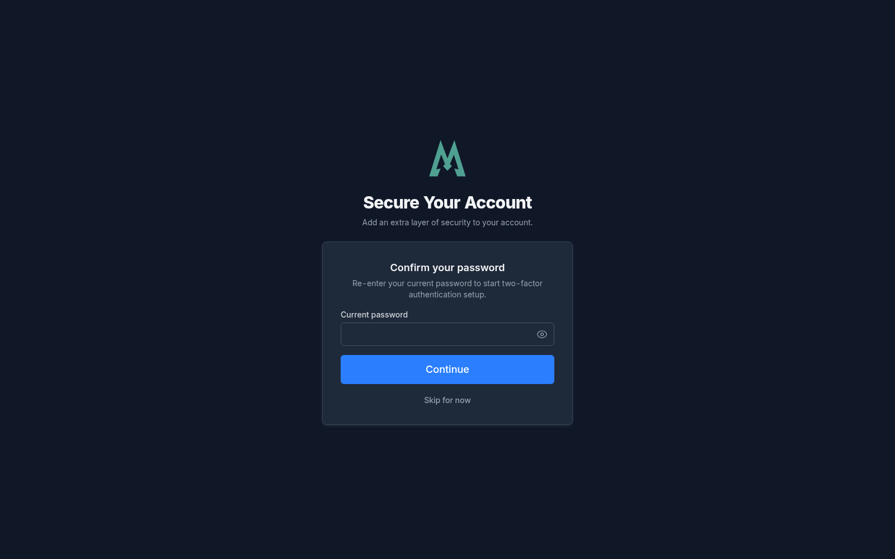
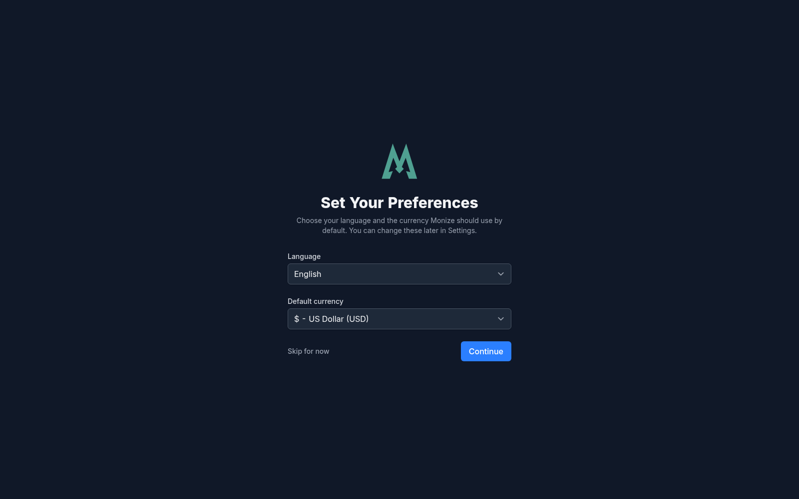
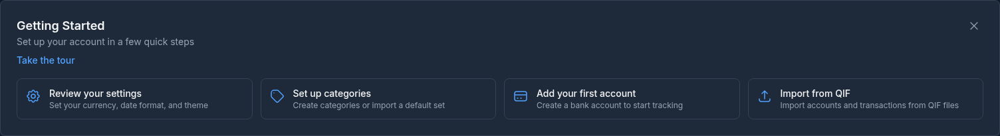
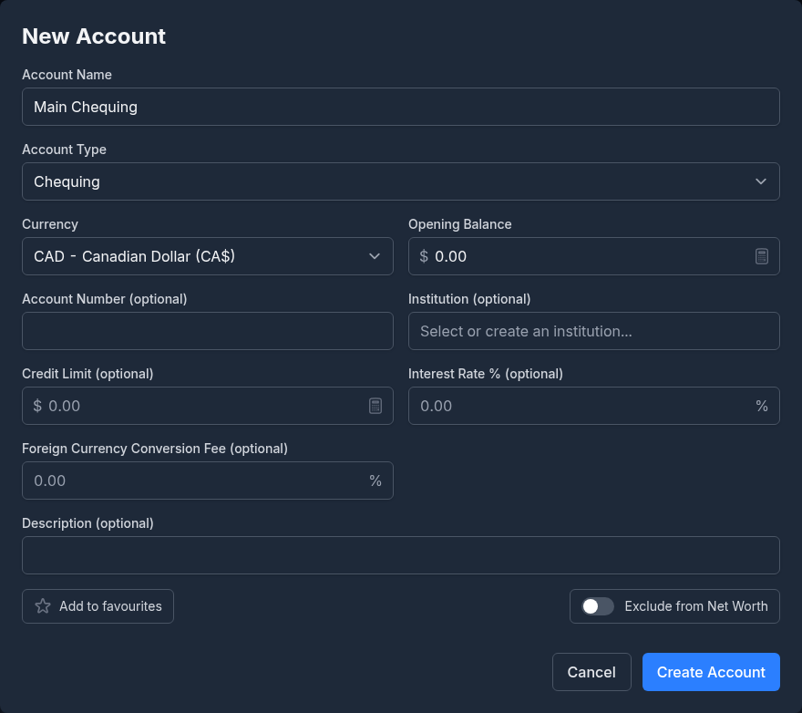

# Getting Started

This guide walks you through setting up Monize and getting your financial data organized.

---

## Prerequisites

Before installing Monize, ensure you have:

- **Docker** and **Docker Compose** installed on your server
- A minimum of 1 GB RAM available
- A modern web browser (Chrome, Firefox, Safari, or Edge)

---

## Installation

### Using Docker Compose (Recommended)

1. Clone the repository (or download `docker-compose.prod.yml` and `.env.example` from it):

```bash
git clone https://github.com/kenlasko/monize.git
cd monize
```

2. Create your `.env` file by copying the bundled example:

```bash
cp .env.example .env
```

The repository ships a `.env.example` that documents **every** setting Monize
supports, grouped into sections and with the defaults and explanatory comments
inline. Anything you do not need can be left commented out -- you do not have to
hunt for settings elsewhere. The sections are:

| Section | What it covers |
|---------|----------------|
| Database | PostgreSQL connection, TLS, and the optional Row-Level Security roles |
| Application | `JWT_SECRET`, `ENCRYPTION_KEY`, and general app settings |
| URLs & Ports | Host port mappings and the public address of the app (`PUBLIC_APP_URL`) |
| Authentication | Local login and registration toggles |
| OIDC / OpenID Connect | Single sign-on provider configuration (optional) |
| Bank Sync Diagnostics | Extra logging for the Open Banking connection (optional) |
| Email Notifications | SMTP server settings (optional) |
| Demo Mode | Demo restrictions and the daily reset (optional) |
| MCP / OAuth Debug Logging | Extra diagnostics for MCP and OAuth (optional) |
| AI Integration | Anthropic, OpenAI, and Ollama settings (optional), including the **Email receipts** settings: mailbox polling limits, the private-host allowlist, and Google / Microsoft 365 sign-in (see [Email Receipts](email-receipts.md)) |
| Attachments | Transaction attachment storage: database, local filesystem, or S3 |
| Backup | Backup directory, scheduling, and off-site copies |
| Quote Providers | Investment price/quote sources |
| Exchange Rate Providers | Where exchange rates come from |
| Update Checks | New-version notifications |
| Microsoft Money (.mny) Import | The largest Money file that can be uploaded (see [Importing from Microsoft Money](importing-from-microsoft-money.md#self-hosting-failures)) |
| Frontend | Local development only |

At minimum, set `JWT_SECRET`, `ENCRYPTION_KEY` and a database password before starting:

```bash
# Required -- both ship empty, and the server will not start until they are set
JWT_SECRET=your-secret-key-minimum-32-characters-long
ENCRYPTION_KEY=your-encryption-key-minimum-32-characters

# Database (the example file's values)
POSTGRES_DB=monize
POSTGRES_USER=monize_user
POSTGRES_PASSWORD=your-database-password
```

> [!IMPORTANT]
> Both keys must be at least 32 characters long, and the server refuses to start
> without either of them. Generate them with `openssl rand -base64 32` and
> `openssl rand -hex 32`. A published placeholder or an obviously typed
> `JWT_SECRET` still starts, but is logged as a warning and shown to
> administrators until you replace it.

> [!CAUTION]
> **Set `ENCRYPTION_KEY`, keep it safe, and never change it.** It encrypts what
> Monize stores in the database: AI provider API keys, emergency-access
> credentials, the key your automatic backups are encrypted with, and the
> browser-push and OIDC signing keys. Changing or losing it later does not
> re-encrypt anything -- it makes what is already stored unreadable, and
> automatic backups stop until every user signs in again. Store it wherever you
> keep your other deployment secrets, and back it up.
> ([Backup and Restore](backup-and-restore.md#passwords-keys-and-what-you-must-not-lose)
> has the full picture of what depends on it.)
>
> Upgrading from a version where this setting was called `AI_ENCRYPTION_KEY`?
> The old name is still accepted (and wins if both are set), so an existing
> deployment keeps working untouched. Set `ENCRYPTION_KEY` to the **same** value
> if you want to move to the new name.

Likewise, changing `JWT_SECRET` later signs everyone out, stops authenticator
(two-factor) codes from working and forgets trusted devices.

3. Start the application with the prebuilt images:

```bash
docker compose -f docker-compose.prod.yml up -d
```

The `-f` is required: the repository has no default Compose file. To build the
images from source instead (for development), use `docker-compose.dev.yml`.

4. Open Monize at `http://localhost:3001` (the `FRONTEND_PORT` and
   `PUBLIC_APP_URL` settings in `.env`). If you reach it through a reverse proxy
   or another host name, set `PUBLIC_APP_URL` to that address.

### Using Kubernetes (Helm)

Helm charts are provided in the `helm/` directory for Kubernetes deployments. Refer to the Helm README for detailed configuration options.

---

## Updating Docker Images

Monize publishes prebuilt images to the GitHub Container Registry
(`ghcr.io/kenlasko/monize-backend` and `ghcr.io/kenlasko/monize-frontend`). To
update, pull the new images and recreate the containers:

```bash
docker compose -f docker-compose.prod.yml pull
docker compose -f docker-compose.prod.yml up -d
```

Use whichever compose file you started Monize with. `up -d` only recreates the
services whose image changed, and your data stays in the `postgres` volume.

- **Database migrations run automatically.** The backend applies any pending
  migrations each time it starts, so there is no separate upgrade step.
- **Back up first.** Take a backup before updating (see
  [Backup and Restore](backup-and-restore.md)), especially across several versions.
- **Pinned tags.** If you pin an image tag instead of `latest`, edit the tag in
  your compose file before running `pull`.
- **Clean up.** Run `docker image prune` to remove the old, unused images.

---

## First-Time Setup

### Registration

When you first open Monize, you see the sign-in page.


1. Click **create a new account** under the title
2. Enter your **Email address**, **First name**, **Last name**, **Password** and **Confirm password**. The password must be at least 12 characters and contain an uppercase letter, a lowercase letter, a number and a special character
3. Click **Create account**


> [!IMPORTANT]
> **The first account registered on a new server becomes its administrator.**
> Register your own account before you share the address with anyone else. The
> administrator sees an extra **Admin** menu (see [Settings and Security](settings-and-security.md)).

What happens next depends on how the server is set up:

- **Email verification.** When the server can send email (SMTP is configured), every account after the first is sent a verification link instead of being signed in. The **Check your email** screen offers **Resend verification email**; click the link in the email, then sign in.
- **Single sign-on.** When OIDC is configured, the page also offers **Sign up with SSO**, and an administrator can turn off local registration altogether, in which case the link does not appear.

Once your account is created, two short screens follow before the dashboard:

1. **Secure Your Account** offers to set up two-factor authentication: re-enter your password, scan the QR code with an authenticator app, and enter its 6-digit code. Click **Skip for now** to do it later from **Settings > Security**. If the administrator requires two-factor authentication, there is no skip button.

   

2. **Set Your Preferences** asks for the **Language** of the interface and your **Default currency**. Click **Continue** to save them, or **Skip for now** to keep the defaults. Both can be changed later in Settings.

   

You then land on the dashboard. Until you dismiss it, a **Getting Started** card at the top links to the first things to set up -- your settings, your categories, your first account, and an import -- and **Take the tour** starts a short guided introduction to the app. Every guided tour can be started again later from **Settings > Guided Tours**.



### Setting Your Home Currency

Your default currency is the primary currency used for reporting and net worth calculations. If you skipped it during registration, or want to change it, click **Settings** (the gear icon with your name in the top-right corner), then choose **Default Currency** under **Preferences > Language & Region**. The same section holds the language, theme, date and number formats, and timezone.


### Setting Up Categories

A new account starts with no categories. Open **Tools > Categories** and click **Import Default Categories** to start from a ready-made set of income and expense categories: pick your **Country** to also get its tax and benefit categories, and the **Language** the names are created in. Or click **Create Your Own** to build the list yourself. See [Categories and Payees](categories-and-payees.md) for the details.

If you are about to import from Quicken or Microsoft Money, you can skip this: the import creates the categories your file uses.

---

## Creating Your First Account

1. Navigate to **Accounts** from the top navigation bar
2. Click **+ New Account**
3. Fill in the account details:
   - **Account Name** -- A descriptive name (e.g., "Main Chequing")
   - **Account Type** -- Chequing, Savings, Credit Card, Investment, Loan, Line of Credit, Mortgage, Asset, Cash or Other (see [Accounts](accounts.md) for details)
   - **Currency** -- The currency this account operates in
   - **Opening Balance** -- The balance the account starts from, before any transaction you record or import
   - Optional details: the account number, the **Institution**, a credit limit, an interest rate, a foreign currency conversion fee and a description, plus **Add to favourites** and **Exclude from Net Worth**. Some types ask for more, such as a credit card's statement dates or a loan's terms
4. Click **Create Account**



An **Investment** account is created as a linked pair by default: a cash account for money moving in and out, and a brokerage account for the securities (see [Investments](investments.md)).

If you already have your history in another program or in your bank's downloads, you can create accounts as part of an import instead -- see [Importing Transactions](importing-transactions.md).

---

## Navigating the Application

The bar at the top of every page gives access to all major features. Click the Monize logo to return to the dashboard.


### Primary Navigation

| Menu Item | Description |
|-----------|-------------|
| **Transactions** | View, search, and manage all transactions |
| **Bills & Deposits** | Manage scheduled and recurring transactions |
| **Investments** | Track your investment portfolio |
| **Accounts** | Manage your accounts and view balances |
| **Budgets** | Plan and track spending against budgets |
| **Reports** | Access built-in and custom reports |
| **AI** | A menu with **Insights**, the **AI Assistant** and the **AI Review Inbox** (see [AI](ai.md)) |

### Tools Menu

Click the **Tools** dropdown to access additional features:

| Tool | Description |
|------|-------------|
| **Payees** | Manage payee records, aliases and default categories |
| **Categories** | Manage income and expense categories |
| **Securities** | Manage investment securities |
| **Currencies** | View and manage currencies and exchange rates |
| **Institutions** | The banks and brokerages your accounts belong to |
| **Tags** | Manage transaction tags for flexible labelling |
| **Warranties** | Track warranties, their receipts and their claims (see [Warranties](warranties.md)) |
| **Taxes** | Payroll deduction rules with yearly maximums. See [Taxes](taxes.md) |
| **Rules** | Fill in categories, payees and tags automatically when a transaction is created or imported. See [Rules](rules.md) |
| **Email Receipts** | Turn order confirmations from a mailbox into itemized transactions (see [Email Receipts](email-receipts.md)) |
| **Import Transactions** | Import CSV, OFX/QFX and QIF files, or a whole Microsoft Money file |


### Admin Menu

The instance administrator also sees an **Admin** menu with **User Management**, **Notification Settings** and **Backups** (see [Settings and Security](settings-and-security.md)).

### Header Buttons

The right-hand side of the bar holds:

- **Search** -- Search your transactions from anywhere
- **Action History** -- Your recent changes, with **Undo** and **Redo**
- **Notifications** -- The bell, with a count of unread notifications
- **Settings** -- The gear icon with your first name: preferences, security, two-factor authentication, trusted devices, sharing, backups and more
- **Logout** -- Sign out of the application

On a phone, the menus move into a drawer opened with the menu button at the top left.

---

## Installing as a Progressive Web App

Monize is a **Progressive Web App (PWA)**, which means it can be installed directly from your browser and launched like a native application -- no app store required.

### What You Get

- **Standalone window** -- Monize opens in its own window without browser tabs, address bar, or other browser chrome, giving it a native app feel
- **Home screen / app launcher icon** -- Launch Monize with a single tap or click, just like any other installed app
- **Faster startup** -- Static assets (JavaScript, stylesheets, fonts, images) are cached locally by the service worker, so the app shell loads quickly on subsequent visits
- **Works on any modern device** -- Desktop (Windows, macOS, Linux) and mobile (Android, iOS / iPadOS)

> **Note:** The PWA caches the app itself, but your financial data still requires a network connection to your Monize server. The PWA does not provide fully offline access to transactions, accounts, or reports.

### Before You Install

- Monize must be accessed over **HTTPS** (or over `http://localhost` for local development). Browsers will not offer installation on plain HTTP URLs.
- Use a modern browser that supports PWAs (Chrome, Edge, Safari, Firefox, Brave, Opera, or Samsung Internet).

### Installing on Desktop (Chrome, Edge, Brave)

1. Open Monize in your browser and sign in
2. Look for the **install icon** in the address bar (a small monitor or computer icon, often on the right-hand side)
3. Click the icon, then click **Install**
4. Monize will open in its own window and an icon will be added to your applications list, Start menu, or Dock

Alternatively, open the browser menu (three dots) and choose **Install Monize...** or **Apps > Install this site as an app**.

### Installing on Android (Chrome, Edge, Samsung Internet)

1. Open Monize in your mobile browser and sign in
2. Tap the **menu button** (three dots in the top-right corner)
3. Tap **Install app** or **Add to Home screen**
4. Confirm by tapping **Install**
5. The Monize icon will appear on your home screen and app drawer

### Installing on iPhone or iPad (Safari)

Safari does not show an automatic install prompt, so you need to add Monize from the Share menu:

1. Open Monize in **Safari** (other iOS browsers do not support PWA installation)
2. Tap the **Share** button (the square with an upward arrow) at the bottom of the screen
3. Scroll down and tap **Add to Home Screen**
4. Edit the name if desired, then tap **Add**
5. The Monize icon will appear on your home screen

### Installing on Firefox for Android

1. Open Monize in Firefox and sign in
2. Tap the **menu button** (three dots)
3. Tap **Install** or **Add to Home screen**
4. Confirm the installation

### Sharing Files into Monize

Once installed, Monize appears in the operating system's share sheet on Android and in desktop Chromium browsers (Safari on iPhone and iPad does not support this). Share a receipt or a bank download to Monize and a **Shared with Monize** screen lists every file it received, with the reason beside any it cannot use, and offers what to do with them:

- **Attach to a new transaction** -- for images and PDFs
- **Import as a statement** -- for CSV, OFX, QFX and QIF files; this opens the import wizard with the files already loaded (see [Importing Transactions](importing-transactions.md#sharing-files-from-another-app))
- **Send to AI Assistant** -- when an AI provider is set up
- **Discard**

Nothing is saved until you choose. Shared files wait on the device for an hour, and Monize must have been opened on the device at least once before the share sheet can hand it files.

### Uninstalling

To remove the installed PWA:

- **Desktop** -- Open the installed Monize window, click the three-dot menu inside it, and choose **Uninstall Monize...**. On Windows and macOS you can also uninstall from the operating system's usual apps list.
- **Android** -- Long-press the Monize icon and tap **Uninstall** (or drag it to the uninstall zone)
- **iOS / iPadOS** -- Long-press the Monize icon on the home screen and tap **Remove App > Delete App**

### Troubleshooting

- **I don't see an install option.** Confirm you are accessing Monize over HTTPS, that you are using a supported browser, and that the site is fully loaded. Some browsers require a short interaction with the page before offering installation.
- **The app shows stale content after an update.** Close and reopen the installed window to let the service worker pick up the new version. On desktop you can also right-click the app icon and reload.
- **I want to reinstall after uninstalling.** Clear the site's cache and service worker data in your browser, then revisit Monize to see the install prompt again.

---

## Next Steps

Once you have Monize installed and your first account created, here are recommended next steps:

1. **Migrating from Microsoft Money?** Follow the detailed [Importing from Microsoft Money](importing-from-microsoft-money.md) guide -- Monize reads your `.mny` file directly
2. **Migrating from Quicken?** Follow the detailed [Importing from Quicken](importing-from-quicken.md) guide
3. **Set up your categories** -- Customize the default categories in [Categories and Payees](categories-and-payees.md)
4. **Add your accounts** -- Create all your financial accounts in [Accounts](accounts.md)
5. **Schedule recurring transactions** -- Set up your bills and regular deposits in [Bills and Deposits](bills-and-deposits.md)
6. **Explore reports** -- Check out the [Reports](reports.md) section to see what insights are available
7. **Import from your bank** -- Bring in CSV, OFX/QFX or QIF downloads with [Importing Transactions](importing-transactions.md)
8. **Secure your account** -- Set up two-factor authentication and review the other options in [Settings and Security](settings-and-security.md)
