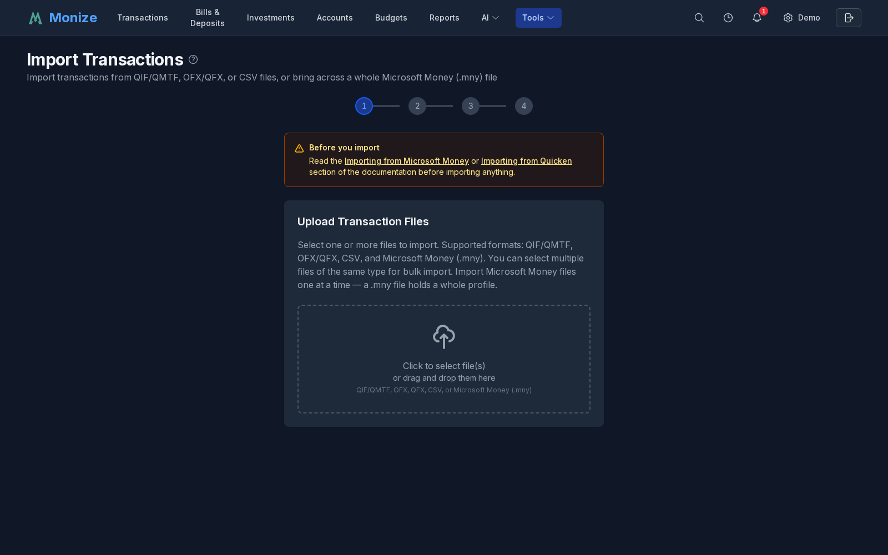
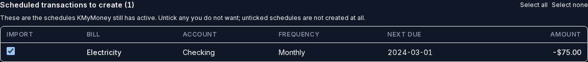

# Importing from KMyMoney

This is the complete guide to migrating your financial data from KMyMoney to Monize. You import the KMyMoney file itself -- no QIF or CSV export is needed.

For importing from other sources using CSV or OFX/QFX files, see [Importing Transactions](importing-transactions.md). If you are coming from Microsoft Money, see [Importing from Microsoft Money](importing-from-microsoft-money.md).

---

## Overview

Monize reads a KMyMoney file directly -- `.kmy` (KMyMoney's default, a compressed XML document) or a plain `.xml` file -- with its accounts, category tree, payees, tags, transactions, transfers, splits, securities, price history, exchange rates and scheduled transactions intact. Nothing needs to be installed, KMyMoney does not need to be on the machine, and the file never leaves your Monize server.

The import follows the same flow as the [Microsoft Money import](importing-from-microsoft-money.md): upload, review, a background import, and a verification report. The difference that matters to you: Monize works out what **every account balance and every holding should be straight from your KMyMoney file**, using KMyMoney's own arithmetic, and compares the result against what it actually imported. A mapping problem therefore shows up as a difference you can see, not as a silent error.

---

## Before You Start

**Save the file unencrypted.** KMyMoney's only encryption is GPG over the whole file, and Monize cannot decrypt it. In KMyMoney turn off encryption (**Settings > Configure KMyMoney > Encryption**) and save the file again, or decrypt a copy with `gpg --decrypt`, then import that.

**Use a `.kmy` or `.xml` file.** Monize decides what a file is from its contents, not its name, but the upload step accepts `.kmy` and `.xml`.

**If your data is in an SQL database, save it as a file first.** A KMyMoney SQL database (SQLite) cannot be imported. Open it in KMyMoney, choose **File > Save As**, pick the KMyMoney (`.kmy`) format, and import the saved file.

**Do not use an anonymized file.** KMyMoney can write an anonymized copy (`.anon.xml`) for bug reports. It scrambles every amount and replaces the names, so it is not your data and Monize refuses it. Import your original file.

**Very old files.** The binary format of KMyMoney 0.8 and earlier is refused. Open the file in a current KMyMoney, save it again, and import the result.

**Nothing needs closing, and nothing is changed.** Monize reads the copy you upload and never writes to your KMyMoney file. Making a spare copy of years of finances still costs nothing.

**Import into an empty profile.** The import does not merge at the transaction level. It creates what the file describes; an account of the same name that already exists receives the file's transactions without Monize working out which ones it already has. On a profile with data you will get duplicates. If you have been trying Monize out and want to start over, the review step offers **Start fresh**, which runs the same Delete My Data operation as **Settings > Danger Zone** before the import begins. It asks you to type a confirmation word and re-enter your password, and it cannot be undone.

**Import the same file once.** Monize refuses a file whose exact bytes it already imported into your account, so a second click cannot double your data. Saving an unchanged file again in KMyMoney writes different bytes, so a re-saved copy is not recognised as the same file and would import a second time. To import a file again, use **Start fresh**.

**Check the file size limit if you self-host.** The default ceiling is 300 MB, set by `MNY_IMPORT_LIMIT_MB`, and it applies to the file both as uploaded and once uncompressed. See [Troubleshooting the KMyMoney Import](#troubleshooting-the-kmymoney-import) if a large upload fails.

---

## Step by Step

Navigate to **Tools > Import Transactions** to begin.

**Step 1: Upload the file**

Select or drag your `.kmy` or `.xml` file onto the upload area. Import KMyMoney files **one at a time** -- a KMyMoney file holds a whole profile, so there is nothing to bulk-select. Monize reads the file on the server and shows a preview. Nothing is written yet.

If the file cannot be opened, the reason appears in red on the upload step (see [Troubleshooting the KMyMoney Import](#troubleshooting-the-kmymoney-import)). Unlike Microsoft Money files, a KMyMoney file never asks for a password.

**Step 2: Review what will be imported**

This step is worth the minute it takes.

- The file summary names the file, the KMyMoney file format version, and the base currency, and says that the balances shown are computed from the file.
- **Counts** for transactions (with the number of transfers linked), payees, categories, tags, accounts, securities, investment transactions, price history, exchange rates and scheduled transactions are each shown against the total in the file, so "40 of 500 payees" is visible before rather than after.
- **Every account** is listed with its type, currency, transaction count, opening balance and the **final balance computed from the KMyMoney file itself**. Compare a few against KMyMoney -- that same number is what the verification report reconciles against afterwards. A KMyMoney investment account appears as its two Monize halves, " - Cash" and " - Brokerage". An account Monize had to rename (two accounts sharing a name) shows "named X in KMyMoney" underneath, and closed, favourite and excluded-from-net-worth accounts are marked.
- **Untick any account you do not want**, or use **Select all** / **Select none**. Closed accounts are included by default and stay closed; they still hold history worth keeping.
- **Override an account's currency** with its dropdown if KMyMoney had it wrong.

- **Scheduled transactions to create** appear as a checkbox list with each schedule's account, frequency, next due date and amount, and whether it is a transfer. All active schedules are pre-ticked; schedules KMyMoney marks finished are not offered. An unticked schedule is simply not created. A frequency Monize cannot express exactly is marked as the closest shorter one, so no occurrence is missed.

- **Notes about this file** collects anything ambiguous or left behind -- budgets that were not imported, a security without a symbol, a transaction that does not balance. Where a note is about particular transactions, **Show the *n* transactions** lists them with their date, account, payee and amount, so you can find them in KMyMoney. Worth reading; none of it stops the import. One note deserves special attention: if Monize reports that an account or holding **would end with a balance that differs from the one computed from the file**, do not import until that is explained.

**Step 3: Start the import**

Choose the [import options](#import-options) under the accounts, then click **Start import**. It runs on the server, so you can leave the page and come back. A large file takes a few minutes. The progress list shows which phase is running, with a row counter: preparing; accounts, categories and payees; transactions; investments; scheduled transactions; prices and exchange rates; recalculating balances; verifying.

Only one import can run at a time for your account. If the server restarts mid-import, nothing is left half-written: **Try again** runs it again from the file you already uploaded, and **Start over** goes back to the upload step.

**Step 4: Check the verification report**

See [After the Import](#after-the-import) for how to read it.

---

## Import Options

Set on the review step, before you start the import.

| Option | Default | What it does |
|---|---|---|
| **Only import payees that are used** | On | Skips payees no transaction refers to |
| **Only import categories that are used** | On | KMyMoney seeds its category tree from a template whether you use it or not. Leaving this on imports only the categories your transactions use, plus their parent categories |
| **Import closed accounts** | On | Closed accounts keep their history and are created closed |
| **Import price history** | On | KMyMoney's own record of what each security was worth, day by day. Turn it off if you would rather start from live quotes |
| **Import exchange rates** | On | Historical rates between the currencies in your file, used only for dates Monize has no rate for. Rates already stored are never replaced |
| **Start fresh: remove my existing Monize data first** | Off | Removes your existing Monize data before importing. Typed confirmation and password required |

With **Start fresh** ticked, **Start import** first opens **Remove Existing Data**. It lists what is removed and warns that this cannot be undone, even if the import then fails. Type `DELETE` and your **Password** (an account that signs in through single sign-on confirms with its identity provider instead), then click **Delete my data and import**.

---

## What Is Imported

- **Accounts.** Checking, savings, cash, credit card, loan, investment, money market, certificate of deposit, asset, liability and currency accounts, with opening balances, currencies, and closed and favourite flags. A KMyMoney account's institution becomes the account's institution name. See the table below for how each KMyMoney type maps.
- **Categories**, at their full depth. Income and expense categories keep their parent and child structure however many levels it has.
- **Transactions**, including splits, reference numbers (check numbers), memos, tags, and the cleared or reconciled state and reconciled date of each side. KMyMoney's "frozen" state arrives as reconciled.
- **Transfers**, linked exactly from the two sides KMyMoney records. A transaction that mixes transfers and categories, such as a paycheque that also puts money into savings, arrives as one split transaction with a transfer leg and category legs. A cross-currency transfer keeps each side's own amount in its own account's currency and the exchange rate it implies.
- **Opening balances.** KMyMoney stores an opening balance as a transaction against an equity account. Monize folds the earliest one into the account's opening balance so it does not appear as a transaction.
- **Payees.** Payees are imported with their matching rules and their default category. The other payee details are not carried over (see [What Is Not Imported](#what-is-not-imported)).
- **Tags**, on the transactions and splits that carry them.
- **Investments.** Buys, sells, dividends, interest, reinvested dividends, added and removed shares, and stock splits. Commissions and fees are kept, the executed total is treated as the fact, and the per-share price is derived from it. A security moved between brokerage accounts (removed from one, added to another on the same date in the same quantity) becomes a linked transfer out and in that carries its cost basis. A KMyMoney investment account becomes Monize's linked cash and brokerage pair; Monize finds the cash side from the brokerage account KMyMoney links to the investment account, or failing that by KMyMoney's own naming (`<account name> (Brokerage)`, in English or any language KMyMoney ships).
- **Stock splits are applied.** A KMyMoney stock split is the share movement itself, so each becomes a split in Monize with the same ratio (a 3:2 split is 1.5).
- **Securities and price history.** Only securities that a holding in an imported account refers to, with their type (stock, mutual fund, bond) where KMyMoney records one.
- **Exchange rates**, for the currencies your accounts and securities actually use. Rates already stored in Monize are never replaced, and every imported rate and price is labelled as coming from the KMyMoney import.
- **Scheduled transactions** you ticked, with their frequency and next due date, created active and set **not** to post automatically, so nothing lands in your accounts without you.
- **Loans.** The payment structure is kept: the principal leg is a transfer to the loan account and the interest leg is a category. Where payments and a selected schedule make it unambiguous, the loan's funding account, payment amount, frequency and start date are filled in too.

### How KMyMoney account types map

| KMyMoney | Monize |
|---|---|
| Checking | Chequing |
| Savings, Money Market, Certificate of Deposit | Savings |
| Cash | Cash |
| Credit Card | Credit Card (the credit limit comes across) |
| Loan, Liability | Loan |
| Investment (with its brokerage cash account) | Investment: a cash and a brokerage account |
| Asset, Currency trading, Loan to someone else (Asset Loan) | Asset |
| Income, Expense | Categories |
| Equity | Not an account; see below |
| An account whose currency is a cryptocurrency | Crypto |

**Equity.** Monize has no equity accounts. Apart from an opening balance, money moved to or from an equity account arrives with that equity account as an income-type category, so every account balance stays exact and the movement shows in reports.

---

## What Is Not Imported

| Data type | Notes |
|---|---|
| **Budgets** | KMyMoney's budgets have no clean equivalent. Recreate with [Budgets](budgets.md) -- Monize can generate budgets from your imported spending history |
| **Saved reports** | Recreate them with [Reports](reports.md) |
| **Online banking settings and online transfer orders** | Not read. You can set up bank sync in Monize |
| **Account numbers and IBANs** | Not imported |
| **Payee addresses, email, notes, reference numbers and bank identifiers** | Not imported. Payee matching rules and default categories are imported |
| **Cost centers** | Monize has no cost centers |
| **Tax and VAT settings on categories** | Not imported |
| **Tag colours, notes and closed state** | Tags import by name only |
| **The account hierarchy between asset and liability accounts** | Monize lists accounts side by side, so an account nested under another becomes a top-level account |
| **Schedule options** | The weekend rule (move a due date off weekends), automatic entry, and fixed-versus-estimated amounts. Recorded past payments are not imported either |
| **Entry date of a transaction** | Monize has no such field |
| **Unused securities and unused currency rates** | Securities no imported holding refers to, and rates for currencies none of your accounts or securities use, are skipped so the import does not create things nobody uses |

Not supported at all: KMyMoney files encrypted with GPG, SQL databases, anonymized files and the pre-0.9 binary format (each is refused with a message saying what to do), and writing KMyMoney files.

Each of the items above that exists in your file is counted in the **Notes about this file** list, so you know what was left behind.

---

## Known Limitations

**Stock-split precision.** KMyMoney multiplies your share balance by the split ratio and rounds the result to the security's own fraction. Monize stores ratios to 8 decimal places and keeps fractions of a share. Two things can therefore differ by a tiny amount: a ratio such as 1-for-3 that cannot be written exactly, and a split that leaves a fraction of a share KMyMoney rounded away. Each such split is listed in the notes so a holdings difference arrives already explained. Monize also checks each split against the prices around it, and tells you when a split looks inverted compared with them; it never changes the ratio itself, so check it against your statement.

**Shares added without cost.** KMyMoney records "Add shares" with no cost. Monize cannot calculate a gain on shares it has no cost for, so a sale drawn on them reports an unknown gain rather than treating them as free. Shares added in one account and removed from another on the same date in the same quantity are paired as a transfer and carry their cost; any other addition is listed. Edit it in Monize to add the cost if you know it.

**Schedules.** The weekend rule and automatic entry are not carried over: a due date stays on the date as scheduled, and a schedule KMyMoney would have entered automatically waits for you to post it. A schedule whose next due date was already in the past arrives overdue, as it shows in KMyMoney. Monize also writes every imported schedule without auto-posting. A loan payment schedule imports as one transfer of the payment amount, because KMyMoney works out the principal and interest split when the payment is entered and does not store it.

**Loan interest rate.** KMyMoney stores a loan's interest rate, original principal and term on the account. Monize does not import them; the notes name each loan and its latest rate so you can enter it on the loan account.

**Investment accounts without a findable cash account.** If Monize cannot find an investment account's brokerage account, it creates an empty cash account for it and says so. Trades paid from other accounts still move those accounts correctly.

**Transactions that do not balance.** KMyMoney marks a transaction whose splits do not add up as erroneous. Monize imports the difference as an uncategorized split so the account balance stays what KMyMoney shows, and lists the transaction.

**Cryptocurrency.** A coin can only be the currency of a Crypto account in Monize. A security priced in a cryptocurrency is not imported, and its trades come across as plain cash movements.

**Securities sharing a symbol.** Monize's symbols are unique, so the second security with the same symbol gets a suffix (`VOO-2`) and a note. A security with no symbol gets a generated placeholder and is excluded from automatic price updates.

**No merge, no de-duplication.** See [Before You Start](#before-you-start).

**A failure after the data was saved says so.** If an import fails after its records were written (a final check, for example), the wizard tells you the records are in your account and does not offer to try again: importing the same file again would duplicate them. Check your accounts before importing anything else.

---

## After the Import

When the import finishes, the **Balance verification** table lists every account with three things: the balance **From KMyMoney file**, the balance **In Monize**, and the difference. **Holdings verification** does the same for every investment account's shares: **Shares in KMyMoney** against the shares Monize now holds. Both are KMyMoney's own balance computation, done independently of Monize's mapping. The counts above the tables say what was created.

- **A green run** says every account and holding reconciles.
- **A row with a difference** is listed with the figure so you can look at it directly. A balance that differs is a defect rather than a rounding effect, so report it.
- **"Import rows sum to X"** appears under the expected figure when what Monize's own mapping produced differs from the figure computed from the file. It tells you whether the difference arose in reading your file or in writing it.
- A share count that differs after a stock split is normally explained by one of the stock-split notes (see Known Limitations).
- **Notes about this import** repeats anything the import had to decide. **Download report** saves it as JSON; **Done** returns to the upload step.

Then:

1. **Review auto-created securities** in **Tools > Securities**. A security that had no symbol gets a placeholder and is excluded from price updates until you give it a real symbol and exchange.
2. **Enter loan interest rates** on your loan accounts (see Known Limitations).
3. **Recreate budgets** -- see [Budgets](budgets.md).
4. **Check your scheduled transactions** in [Bills and Deposits](bills-and-deposits.md). Imported schedules are active but set not to post automatically; switch on auto-posting for the ones you want it on, and post or skip anything that arrived overdue.
5. **Check net worth** on the Dashboard against your KMyMoney net worth report.

If the result is not what you wanted, re-run the import with **Start fresh** ticked.

---

## Troubleshooting the KMyMoney Import

Nothing is written unless the whole import succeeds, so a failure leaves your data as it was, and the uploaded file is kept for one more attempt.

| What you see | What it means |
|---|---|
| "No KMyMoney file was uploaded." | The upload was empty. Choose the file again |
| "That file is not a KMyMoney file." | Wrong file, a category template, or some other XML. Choose the `.kmy` or `.xml` file KMyMoney saves. If your data is in an SQL database, open it in KMyMoney and use **File > Save As** to save it as a `.kmy` file first |
| "That KMyMoney file is encrypted with GPG, which Monize cannot open." | Turn off encryption in KMyMoney (**Settings > Configure KMyMoney > Encryption**) and save the file again, or decrypt a copy with `gpg --decrypt`, then import that |
| "That is a KMyMoney SQL database." | Open it in KMyMoney, choose **File > Save As**, pick the KMyMoney (`.kmy`) format, and import the saved file |
| "That is an anonymized KMyMoney file" | An anonymized file has scrambled amounts and replaced names. Import your original `.kmy` file instead |
| "That file uses the binary format of KMyMoney 0.8 or earlier." | Open it in a current KMyMoney and save it again, then import the result |
| "That KMyMoney file is damaged or incomplete and could not be read." | If it was copied or downloaded, try the original file again |
| "That KMyMoney file is larger than the N MB import limit." | See Self-Hosting Failures below. The same message says "once uncompressed" when the compressed file fit but its contents did not |
| "The existing account ... is closed, so the KMyMoney file cannot be merged into it." | An account of that name already exists in Monize and is closed. Reopen or rename it, then import again |
| "The existing account ... uses X, but the KMyMoney file account uses Y." | Rename one of the two accounts, then import again |
| "This file was already imported into your account" | Importing it again would duplicate its records. To replace them, start over with **Start fresh** ticked |
| "The import saved your data, but a step after that failed" or "...stopped responding after it had already saved your data" | The records are in your account. Check your accounts before importing anything else; importing the same file again would duplicate them |
| "The import stopped responding" | The server restarted mid-import. Your file is still here: press **Try again** |
| "The uploaded KMyMoney file is no longer available." | Uploaded files are kept 24 hours. Upload it again |
| "This KMyMoney file is being imported." | Wait for the import to finish before discarding the file |
| "An import is already running" | Wait for it to finish -- possibly in another tab |

### Self-Hosting Failures

Two failures look like the app is broken and are configuration:

- **The upload is refused as too large.** The frontend passes a KMyMoney file to the backend through its own upload route, which refuses anything over `MNY_IMPORT_LIMIT_MB` (default 300). The variable must be set on the **frontend** as well as the backend. The same limit applies to the file once uncompressed.
- **The server is killed partway through every attempt.** It is running out of memory. A KMyMoney file is held in memory while it is read, in compressed and uncompressed form, so the backend needs a multiple of the file size available. See `helm/README.md` for the sizing rules.
