# Importing from Microsoft Money

This is the complete guide to migrating your financial data from Microsoft Money to Monize.

There are two ways to do it:

1. **Import your `.mny` file directly** -- Monize reads the Microsoft Money file itself. This is the recommended method and the one you should use unless something prevents it.
2. **Export QIF files from Microsoft Money and import those** -- the older, manual method. Use it only if the direct import cannot read your file.

For importing from other sources using CSV or OFX/QFX files, see [Importing Transactions](importing-transactions.md).

---

## Overview

Monize reads Microsoft Money `.mny` files directly -- not a QIF export of one, but the file itself, with its accounts, transactions, transfers, splits, securities, price history, exchange rates and scheduled bills intact. Nothing needs to be installed, Microsoft Money does not need to be on the machine, and the file never leaves your Monize server.

The older route is to export one QIF file per account from Microsoft Money and import those. Monize still supports it in full, but it asks considerably more of you and carries less information across.

### Which Method to Use

| | Direct `.mny` import | QIF export |
|---|---|---|
| **Effort** | One file, one upload | One export per account (two per investment account), then mapping each file |
| **Transfers** | Linked using Money's own record of which two rows are the two sides | Matched by name and amount; import order matters |
| **Splits** | Imported | Imported (requires "Loose QIF") |
| **Closed accounts** | Imported, and stay closed | Must be reopened in Money before they can be exported |
| **Price history** | Imported | Not available |
| **Exchange rates** | Imported | Not in QIF -- cross-currency transfers need manual fixing |
| **Scheduled bills** | Imported (you choose which) | Not exported -- must be recreated by hand |
| **Loan payments** | Principal leg wired to the loan account; funding account, payment amount and interest category filled in where unambiguous | Detected from category names, with confirmation |
| **Verification** | Every account's balance is reconciled against the balance computed from the Money file | Manual comparison against Money |
| **Merging into existing data** | Not supported in v1 -- import into an empty profile | Possible, but duplicates are your problem |

**Use the direct `.mny` import.** Fall back to QIF only if your file cannot be read -- in practice that means Money 97 and 98 files you cannot convert (see [Before You Start](#before-you-start)).

---

## Part 1: Direct .mny Import (Recommended)

### Before You Start

**Import into an empty profile.** Version 1 does not merge. It creates what the file describes, and if an account of the same name already exists it adds transactions to it rather than working out which ones you already have. On a profile that already has data you will get duplicates.

If you have been trying Monize out and want to start over from Money, the review step offers **Start fresh**, which runs the same Delete My Data operation as **Settings > Danger Zone** before the import begins. It asks you to type a confirmation word and re-enter your password, and it cannot be undone.

**Work from a copy.** Monize never writes to the file, but a spare copy of three decades of finances costs nothing.

**Money 97 and 98 files are not supported.** Those predate the format Monize reads. Open the file once in the free Money Plus Sunset edition and save it; that converts it, and the result imports normally. Monize detects these files and says so rather than failing obscurely.

**`.mbf` backup archives are not supported.** Restore the backup in Money first and import the resulting `.mny`.

**Check the file size limit if you self-host.** The default ceiling is 300 MB, set by `MNY_IMPORT_LIMIT_MB`. See [Troubleshooting the .mny Import](#troubleshooting-the-mny-import) if a large upload fails.

### Step by Step

Navigate to **Tools > Import Transactions** to begin.

**Step 1: Upload the file**

Select or drag your `.mny` file onto the upload area. Import Microsoft Money files **one at a time** -- a `.mny` file holds a whole profile, so there is nothing to bulk-select. Monize reads the file on the server and shows a preview. Nothing is written yet.

<!-- Screenshot: The import upload step with a .mny file selected, showing the accepted formats line "QIF, OFX, QFX, CSV, or Microsoft Money (.mny)" -->

**Step 2: Enter the password, if asked**

Every Money file is encrypted, but most are encrypted with a blank password and open without asking. The prompt -- *"This Money file needs a password"* -- appears only when a real password is set. The password is used once to read the file and is never stored. A wrong password says so specifically, so you can tell "this needs a password" apart from "that one was wrong". Money passwords are case sensitive.

<!-- Screenshot: The Money file password dialog -->

**Step 3: Review what will be imported**

This step is worth the minute it takes.

<!-- Screenshot: The Money review step showing the file summary line, the counts row, and the account table with balances -->

- The file summary names the detected Money format (Money 2001, Money 2002, or Money Plus / Sunset) and the base currency.
- **Every account** is listed with its type, currency, transaction count, opening balance and the **final balance computed from the Money file itself**. Compare a few against Money -- that same number is what the verification report reconciles against afterwards.
- **Untick any account you do not want.** Closed accounts are included by default and stay closed; they still hold history worth keeping.
- **Override an account's currency** if Money had it wrong.
- **Counts** for transactions, transfers, payees, categories, securities, investment transactions, prices, exchange rates and bills are each shown against the total in the file, so "40 of 500 payees" is visible before rather than after.
- **Scheduled bills** appear as a checkbox list. Money keeps one row per occurrence, so a long history holds thousands of rows for a handful of real bills; Monize detects the live series and pre-ticks those. An unticked bill is simply not created. Bill series missing a template or a usable date are reported as skipped.
- **Notes about this file** collects anything ambiguous -- securities sharing a symbol, an action code Money did not document, a repeat interval with no exact equivalent. Worth reading; none of it stops the import.

**Step 4: Start the import**

Click **Start import**. It runs on the server, so you can leave the page and come back. A large file takes a few minutes. The progress list shows which phase is running: preparing; accounts, categories and payees; transactions; investments; scheduled bills; prices and exchange rates; recalculating balances; verifying.

<!-- Screenshot: The Money import progress panel showing the phase list and row counter -->

**Step 5: Check the verification report**

Every account is listed with the balance computed from your Money file, the balance it ended up with in Monize, and the difference. Investment accounts additionally compare share counts against Money's own open tax lots -- Money reconciles against those lots itself, so they are the number to trust.

A green run says every account reconciles; anything that does not is listed with the delta so you can look at it directly. The report downloads as JSON with **Download report** if you want to keep it.

<!-- Screenshot: The Money import complete step showing the reconciliation table and the counts summary -->

### Import Options

Set on the review step, before you start the import.

| Option | Default | What it does |
|---|---|---|
| **Only import payees that are used** | On | Money keeps payees long after their last transaction. Leaving this on skips the unused ones |
| **Only import categories that are used** | On | Money seeds a full category tree whether you use it or not |
| **Import closed accounts** | On | Closed accounts keep their history and are created closed |
| **Import price history** | On | Money's own record of what each security was worth, day by day. Turn it off if you would rather start from live quotes |
| **Import exchange rates** | On | Historical rates, so past foreign-currency transactions convert the way Money had them |
| **Start fresh** | Off | Removes your existing Monize data before importing. Typed confirmation and password required |

### What Is Imported

- **Accounts** of every type, with opening balances, currencies, and closed and favourite flags. A Money investment account becomes Monize's linked cash and brokerage pair, matching how Money itself stores them.
- **Transactions**, including splits, reference numbers, memos, and the cleared/reconciled status of each. Voided transactions are imported as voided rather than dropped.
- **Transfers**, using Money's own record of which two rows are the two sides. Nothing is matched by guesswork.
- **Loan and mortgage payments**, with the principal leg wired to the loan account as a transfer split. Where the payments make it unambiguous, the loan's funding account, payment amount and interest category are filled in too.
- **Securities and investment transactions**: buys, sells, dividends, reinvestments, share transfers between accounts, and stock splits.
- **Price history and exchange rates**, both additive -- importing twice, or importing on top of prices a quote provider already fetched, converges rather than duplicating.
- **Scheduled bills** you ticked, created active and set **not** to post automatically, so nothing lands in your accounts without you.

### What Is Not Imported

| Data type | Notes |
|---|---|
| **Budgets** | Money's budget tables have no clean equivalent in Monize's. Recreate with [Budgets](budgets.md) -- Monize can auto-generate budgets from your imported spending history |
| **Savings goals** | No equivalent entity |
| **Classifications** | Anything beyond ordinary categories |
| **Attachments** | Files embedded in the Money file |
| **Categories deeper than two levels** | Flattened into `Parent:Child` names; Monize's category tree is two levels deep |

### Known Limitations

**No merge, no de-duplication.** Version 1 targets a fresh profile. Importing the same file twice creates the transactions twice.

**Foreign-currency cost basis.** Money stores a foreign holding's cost basis converted to your base currency at the historical rate, not in the security's own currency. Monize imports what the file says, so a holding bought in a currency other than your base one can show a cost basis that differs from what you paid in the original currency. The verification report flags these, and the share counts themselves are unaffected.

**Two Money codes are still unconfirmed.** Money's `act` 5 and 14 -- a reinvestment variant and a cash corporate action -- have never appeared in any file available to this project, so their handling is inferred. Any transaction mapped through one carries a note in the report rather than being silently accepted.

**Securities sharing a symbol.** Money allows two funds with the same ticker. Monize's symbols are unique per user, so the second gets a suffix (`VOO-2`) and a note in the report -- never collapsed into the first. A security with no symbol gets a generated placeholder and is excluded from automatic price updates.

### After the Import

The verification report does most of the checking for you, so the post-import work is short:

1. **Read the report.** Any account or holding that does not reconcile is named with the difference.
2. **Review auto-created securities** in **Tools > Securities**. Securities with a generated placeholder symbol are excluded from price updates until you give them a real symbol and exchange.
3. **Recreate budgets and savings goals** -- see [Budgets](budgets.md).
4. **Check your scheduled bills** in [Bills and Deposits](bills-and-deposits.md). Imported bills are active but set not to post automatically; switch on auto-posting for the ones you want it on.
5. **Check net worth** on the Dashboard against your Money net worth report.

If the result is not what you wanted, see [Starting Over](#part-8-starting-over) -- or simply re-run the import with **Start fresh** ticked.

### Troubleshooting the .mny Import

Nothing is written unless the whole import succeeds, so a failure leaves your data as it was, and the uploaded file is kept for one more attempt.

| What you see | What it means |
|---|---|
| "That file was written by Money 97 or 98" | Convert it through Money Plus Sunset first (see [Before You Start](#before-you-start)) |
| "That file is not a Microsoft Money (.mny) file" | Wrong file, or the upload was corrupted |
| "That Money file looks incomplete" | The upload was cut short -- try again |
| "That Money file was decrypted but its contents could not be read" | The file decrypted but its internals are damaged. Open it in Money and save a fresh copy |
| "That Money file is password protected" | Enter the file's password when prompted |
| "That password does not open the Money file" | Money passwords are case sensitive -- check and retry |
| "The import stopped responding" | The server restarted mid-import. Your file is still here: press **Try again** |
| "The uploaded Money file is no longer available" | Uploaded files are kept 24 hours. Upload it again |
| "An import is already running" | Wait for it to finish -- possibly in another tab |

#### Self-Hosting Failures

Two failures look like the app is broken and are configuration:

- **The upload dies immediately and the backend logs `Request aborted`.** The Next.js proxy in front of the API caps a forwarded request body at 10 MB by default and *truncates* rather than rejecting anything larger, so nothing reports a size problem. `MNY_IMPORT_LIMIT_MB` (default 300) sizes that ceiling and must be set on the **frontend** as well as the backend.
- **The server is killed partway through every attempt.** It is running out of memory. A Money file is held in memory while it is read, so the backend needs roughly twice the file size available, and the frontend needs another copy because the proxy buffers the upload. See `helm/README.md` for the sizing rules.

---

## Part 2: The QIF Method (Alternative)

Everything from here on describes the older QIF route: exporting one file per account from Microsoft Money and importing those. It is still fully supported, and the QIF import wizard handles:

- Regular banking transactions (chequing, savings, credit cards)
- Investment transactions (buy, sell, dividends, splits, reinvestments)
- Split transactions (multiple categories per transaction)
- Account-to-account transfers
- Category creation and mapping
- Security creation and mapping
- Multi-currency accounts

The process is designed for bulk operations -- you can import multiple QIF files at once, and the system coordinates between files to link transfers, reuse categories, and handle cross-references.

> **Prefer the direct `.mny` import.** QIF carries no price history, no exchange rates and no scheduled bills, cannot export closed accounts without reopening them first, and matches transfers by inference rather than from Money's own records. Use QIF only when the direct import cannot read your file.

---

## Part 3: Preparing Microsoft Money for Export

Before exporting, take these preparatory steps in Microsoft Money to ensure a clean migration.

### 3.1 Note Your Account Details

Create a spreadsheet or list with the following for each account:

| Detail | Example |
|--------|---------|
| Account Name | "Main Chequing" |
| Account Type | Chequing, Savings, Credit Card, Investment, etc. |
| Currency | USD, CAD, GBP, etc. |
| Opening Balance | $1,234.56 |
| Opening Balance Date | January 1, 2005 |

> **Why this matters:** The opening balance and date are critical. For imported accounts to show the correct current balance, the opening balance must be set to the balance as of the first transaction date in the QIF file. Microsoft Money often includes an "Opening Balance" transaction in the QIF export, which Monize detects automatically. However, having this information written down gives you a fallback if the auto-detection does not match.

### 3.2 Open Closed Accounts (if needed)

If you have closed accounts in Microsoft Money that you want to import, you may need to temporarily reopen them -- Microsoft Money does not allow exporting closed accounts. The easiest way to do this is to go to **Tools - Settings - Account settings (global) - Close or Reopen Accounts**

> The direct `.mny` import has no such restriction: closed accounts come across with their history and stay closed.

### 3.3 Make a List of All Accounts

Microsoft Money exports one account at a time, so make a checklist:

```
[ ] Main Chequing (Regular)
[ ] Savings (Regular)
[ ] Visa Credit Card (Regular)
[ ] Emergency Fund (Regular)
[ ] RRSP Brokerage (Investment)
[ ] RRSP Brokerage (Regular - for cash transactions)
[ ] TFSA Brokerage (Investment)
[ ] TFSA Brokerage (Regular - for cash transactions)
[ ] Home (Asset)
```

> **Important for Investment Accounts:** Each investment account requires TWO exports -- one as "Investment" type (for securities transactions) and one as "Regular" type (for cash transactions). Mark both on your checklist.

### 3.4 Create export folders

Monize supports bulk-upload of .QIF files. We suggest you create the following folders to store your exported QIFs:
- 1-Assets
- 2-NativeAccounts
- 3-ForeignAccounts
- 4-Investments-Cash
- 5-Investments-Brokerage

This makes it easy to select all the files a certain type for bulk-import.

---

## Part 4: Exporting from Microsoft Money

### Exporting Regular Accounts

Follow these steps for each chequing, savings, credit card, cash, line of credit, and asset account:

**Step 1:** Open Microsoft Money and load your `.mny` file

**Step 2:** Go to **File > Export**

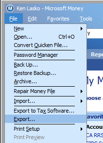
<!-- Screenshot: Microsoft Money File menu with Export highlighted -->

**Step 3:** In the export dialog, select **Loose QIF** format

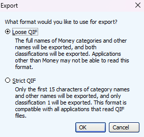
<!-- Screenshot: The Microsoft Money export format selection dialog showing "Loose QIF" selected -->

> **Always choose "Loose QIF"** -- it carries more information than "Strict QIF," including split transaction details and transfer references.

**Step 4:** Choose a save location (Desktop is easiest) and name the file after the account

**Step 5:** Select **Regular** as the account type

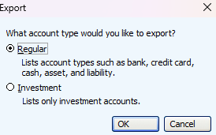
<!-- Screenshot: The Microsoft Money export dialog showing "Regular" account type selected -->

**Step 6:** Select the specific account to export from the account list

**Step 7:** Click **Continue** to export

**Step 8:** Check the account off your list and repeat for the next account

### Exporting Investment Accounts

Investment accounts in Microsoft Money contain two types of data:
- **Investment transactions** (buy, sell, dividend, etc.)
- **Cash transactions** (deposits, withdrawals, fees)

You must export each investment account **twice**.

#### Export 1: Investment Transactions

1. Go to **File > Export**
2. Select **Loose QIF**
3. Name the file with the account name and "-Investment" suffix (e.g., `RRSP-Investment.qif`)
4. Select **Investment** as the account type
5. Select the specific investment account
6. Click **Continue**

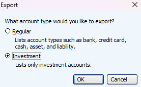
<!-- Screenshot: The Microsoft Money export dialog showing "Investment" account type selected and an investment account highlighted -->

#### Export 2: Cash Transactions

1. Go to **File > Export** again
2. Select **Loose QIF**
3. Name the file with the account name and "-Regular" suffix (e.g., `RRSP-Regular.qif`)
4. Select **Regular** as the account type
5. Select the same investment account
6. Click **Continue**

### File Naming Convention

We recommend you give the files the same name as the source account. Monize attempts to auto-match QIF files to accounts by filename, so closer names mean less manual mapping during import.

---

## Part 5: Recommended Import Order

The order in which you import your QIF files matters. Monize handles transfers between accounts by matching pending transactions from previously imported files. Importing in the right order ensures transfers are linked correctly and reduces manual cleanup.

> This ordering applies to the QIF method only. A direct `.mny` import brings every account across in one pass and links transfers from Money's own records, so there is no order to get right.

### Recommended Order

Import your accounts in this order:

```
1. Asset Accounts
      |
2. Bank, Credit Card and Line of Credit Accounts (Home Currency)
      |
3. Bank, Credit Card and Line of Credit Accounts (Foreign Currency)
      |
4. Investment Cash Accounts (-Regular exports)
      |
5. Investment Brokerage Accounts (-Investment exports)
```

Loan accounts can't be exported from Microsoft Money, but the transactions will be built via the payments made from the source accounts. The import process will recognize this and ask for confirmation.

### Why This Order?

| Order | Account Type | Reason |
|-------|-------------|--------|
| **1** | **Asset Accounts** | Assets rarely have transfers to other accounts. Import them first to establish any asset-related categories. |
| **2** | **Bank Accounts (Home Currency)** | These are your primary accounts and typically the source/destination of most transfers. Importing them early means subsequent imports can link transfers to these accounts. |
| **3** | **Bank Accounts (Foreign Currency)** | Foreign currency accounts may have transfers to/from home currency accounts. Importing after home currency accounts ensures the other side of cross-currency transfers already exists. |
| **4** | **Investment Cash Accounts** | Import the "-Regular" (cash) QIF files for investment accounts next. These contain deposits/withdrawals to the investment account's cash balance, often transferred from bank accounts (already imported). |
| **5** | **Investment Brokerage Accounts** | Import the "-Investment" QIF files last among the investment pair. These contain buy/sell/dividend transactions. Monize automatically creates the corresponding cash-side transactions in the linked cash account. |

### Bulk Import

Monize supports importing multiple QIF files in a single bulk operation. When you select multiple files:

1. Files are processed sequentially in the order listed
2. Categories, payees, and accounts created in file 1 are available for file 2, and so on
3. Transfer matching happens across all files in the batch

**The best approach is to select ALL your QIF files at once** and let Monize process them in order. 

---

## Part 6: Importing QIF Files into Monize Step by Step

Navigate to **Tools > Import Transactions** to begin the import process.

### Step 1: Upload QIF Files

The upload step presents a drag-and-drop area where you can select your QIF files.

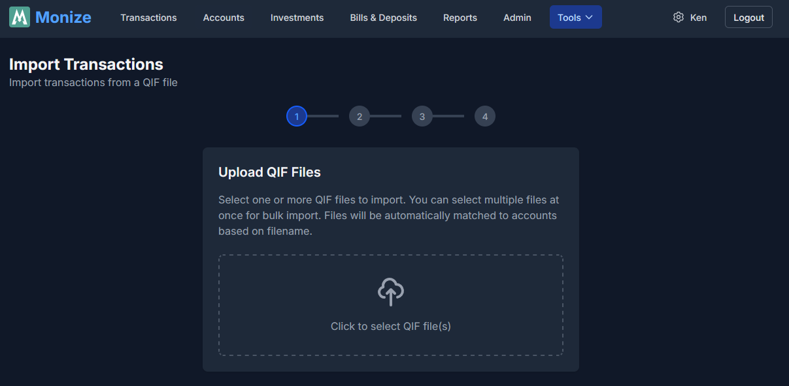
<!-- Screenshot: The import upload step showing the drag-and-drop area with "Click to select QIF file(s)" text -->

1. Click the upload area or drag your QIF files onto it
2. You can select **multiple files** at once for bulk import
3. Monize parses each file and extracts metadata:
   - Account type detected from the QIF header
   - Number of transactions
   - Date range of transactions
   - Categories found
   - Transfer accounts referenced
   - Securities found (for investment files)

After parsing, you advance to account selection.

> **Pre-Selection:** If you navigate to the import page from a specific account, that account is pre-selected. A blue banner shows "Importing to: [Account Name]".

### Step 2: Select Destination Account

For each QIF file, you need to specify which Monize account the transactions should be imported into.

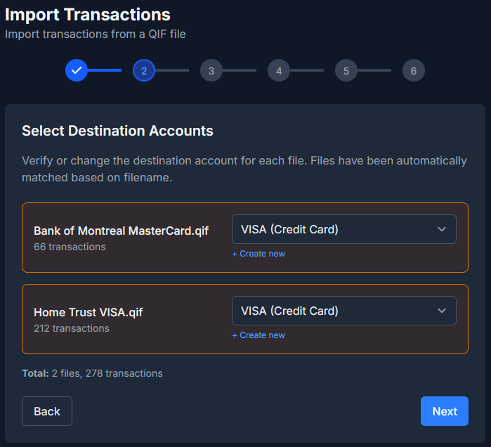
<!-- Screenshot: The select account step showing the file info box (filename, transaction count, date range, detected type) and the account dropdown -->

#### File Information

A gray information box shows:
- **File:** The filename being imported
- **Transactions:** Number of transactions found
- **Date Range:** Earliest to latest transaction dates
- **Detected Type:** Account type identified from the QIF header (e.g., Bank, Investment, Credit Card)

#### Selecting an Account

Choose from the **"Import into account"** dropdown. The dropdown shows all compatible accounts:
- For **investment QIF files** (detected type: Investment), only brokerage accounts are shown
- For **regular QIF files**, all non-brokerage accounts are shown

> **Auto-Matching:** Monize attempts to match QIF filenames to account names automatically. If a match is found, it is pre-selected in the dropdown.

#### Creating a New Account

If the destination account does not exist yet:

1. Click **"+ Create new account"**
2. Fill in:
   - **Account name** (e.g., "My Chequing")
   - **Account type** (Chequing, Savings, Credit Card, etc.)
   - **Currency** (USD, CAD, etc.)
3. Click **Create**

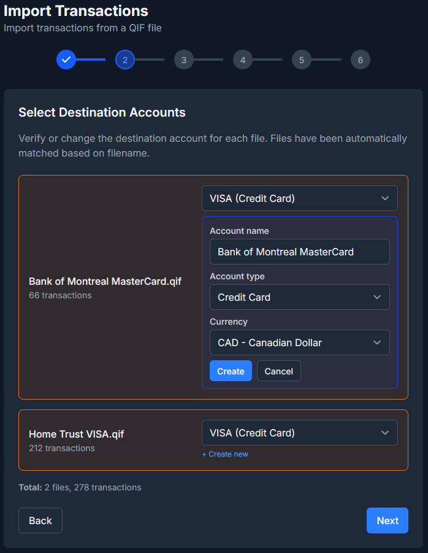
<!-- Screenshot: The inline account creation form during import showing name, type, and currency fields -->

The new account is created immediately and auto-selected as the destination.

> **Investment accounts:** When you create an Investment type account during import, both the brokerage and linked cash accounts are created automatically.

#### Date Format

If the detected date format does not look correct (e.g., dates seem to be swapped between MM/DD and DD/MM), you can override the date format using the date format dropdown. Monize supports:
- MM/DD/YYYY (US format)
- DD/MM/YYYY (International format)
- YYYY-MM-DD (ISO format)

### Step 3: Map Categories

If the QIF file contains category references, you need to map them to Monize categories.

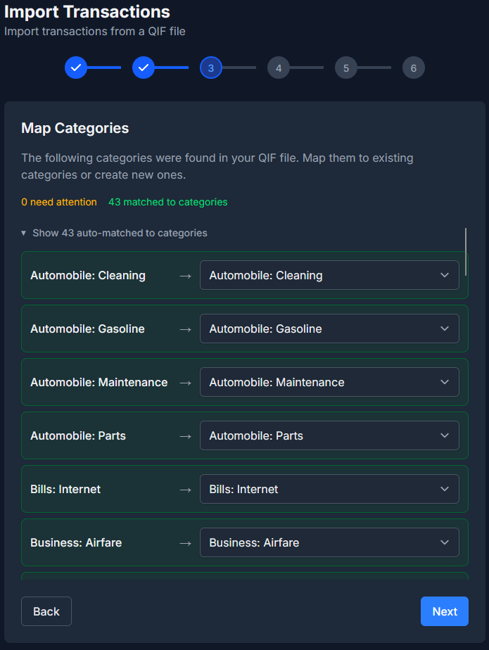
<!-- Screenshot: The map categories step showing unmatched categories (amber), auto-matched categories (green, collapsed), and loan categories (blue, collapsed) -->

#### Understanding the Display

Categories are displayed in three groups:

1. **Needs Attention** (amber/yellow border) -- Categories that could not be auto-matched. These require your input.
2. **Auto-Matched to Categories** (green, collapsed by default) -- Categories that Monize matched to existing categories. Click to expand and verify.
3. **Auto-Matched to Loan Accounts** (blue, collapsed by default) -- Categories that match loan or mortgage account names, indicating loan payments.

#### Summary Badges

At the top of the list, badges summarize the mapping status:
- **Amber badge:** "[X] need attention" -- categories requiring manual mapping
- **Green badge:** "[X] matched to categories" -- successfully auto-matched
- **Blue badge:** "[X] matched to loans" -- matched to loan accounts

#### Mapping a Category

For each unmatched category, you can:

**Option A: Map to an existing category**
- Select from the dropdown of existing Monize categories

**Option B: Create a new category**
- Enter a new category name
- Optionally select a parent category
- The category is created during import

**Option C: Skip the category**
- Leave unmapped (select "Skip") to import transactions without a category
- You can categorize them later in the Transactions page

#### Loan Category Detection

If a QIF category name matches an existing loan or mortgage account name, Monize detects it as a loan payment. These transactions are imported as transfers to the loan account rather than regular categorized transactions.

If the loan account does not exist yet, you can create it during this step.

### Step 4: Map Securities

This step appears only when importing investment QIF files that contain security references.

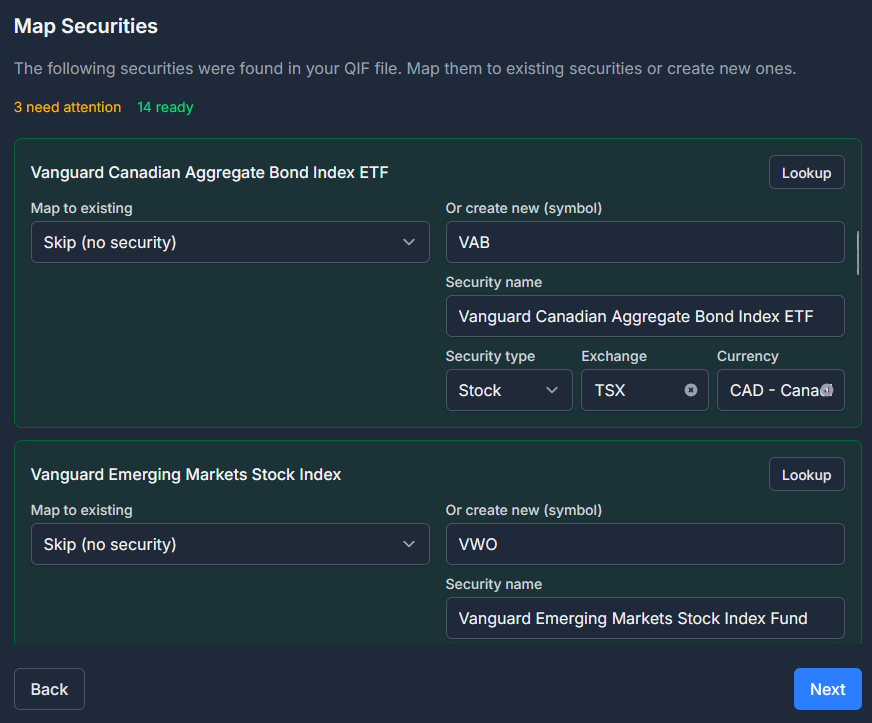
<!-- Screenshot: The map securities step showing security mapping rows with lookup buttons, existing security dropdowns, and new security creation fields -->

#### Security Lookup

Monize can look up securities automatically:
- Click **"Lookup"** next to any security to search by name/symbol
- A bulk lookup runs automatically for all securities when you first reach this step
- Lookup results include the security name, symbol, type, and exchange

#### Mapping a Security

For each security, you can:

**Option A: Map to an existing security**
- Select from the "Map to existing" dropdown

**Option B: Create a new security**
- Enter the **symbol** (e.g., "AAPL")
- Enter the **name** (e.g., "Apple Inc.")
- Select the **type** (Stock, ETF, Mutual Fund, Bond, GIC, Cash, Other)
- Enter the **exchange** (e.g., "NYSE", "TSX")

#### Row Status Indicators

Each security row is colour-coded:
- **Green border** -- Ready to import (mapped to existing or new security details filled in)
- **Amber border** -- Needs attention (no mapping selected)

### Step 5: Map Transfer Accounts

This step appears when the QIF file references transfers to other accounts (e.g., `[Savings Account]` notation in QIF).

> **Note:** This step is skipped for investment QIF files. Investment transfers are handled automatically through the linked cash account.

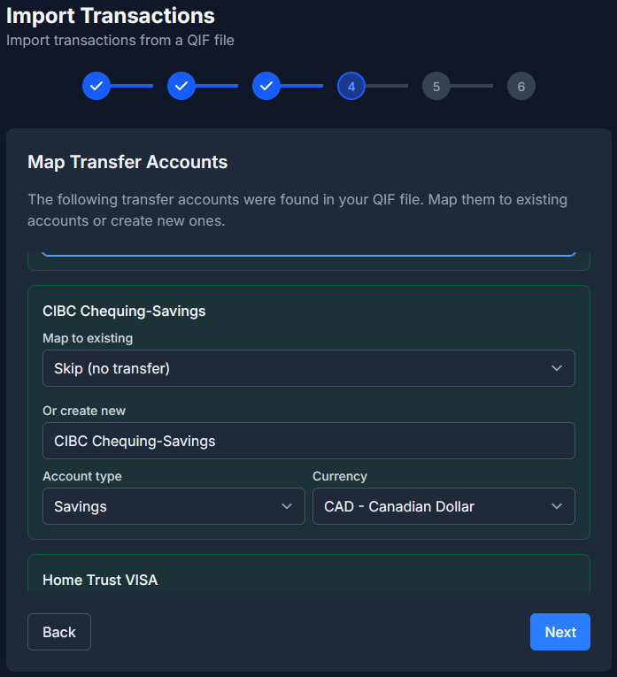
<!-- Screenshot: The map transfer accounts step showing account mapping rows with existing account dropdown and new account creation fields -->

#### Mapping a Transfer Account

For each referenced transfer account:

**Option A: Map to an existing account**
- Select from the "Map to existing" dropdown

**Option B: Create a new account**
- Enter the account name
- Select the account type
- Select the currency

> **Tip:** If you are importing all files in bulk, transfers between imported accounts are linked automatically. You only need to map accounts that are not part of the current import batch.

### Step 6: Review and Import

The review step shows a summary of everything that will happen during import.

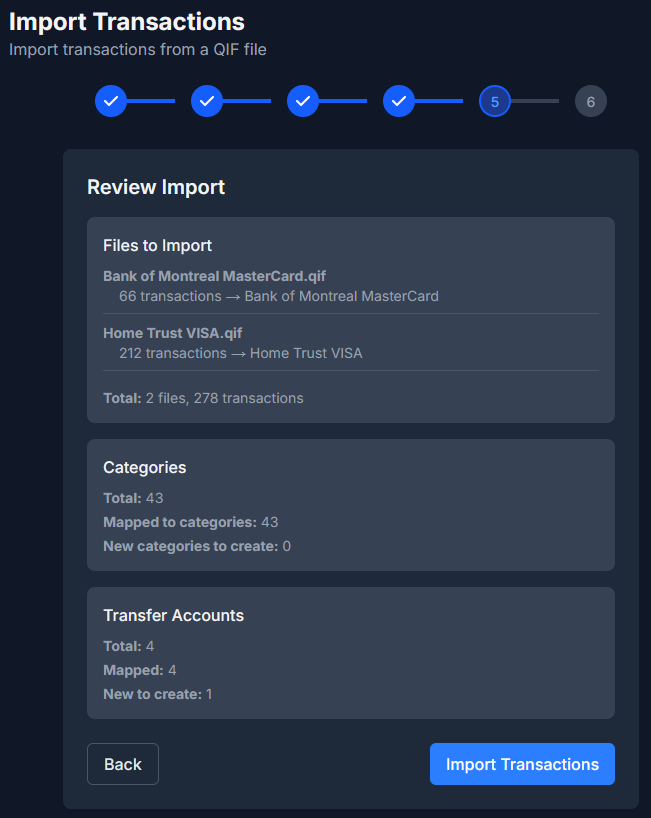
<!-- Screenshot: The review step showing the summary of files, transaction counts, categories, accounts, and securities to be created -->

#### Single File Import Summary

- **File:** filename.qif
- **Transactions to import:** [count]
- **Target account:** [account name]

#### Bulk Import Summary

- **Files to Import:** List of each file with transaction count and target account
- **Total:** [X] files, [Y] transactions

#### Entity Creation Summary

- **Categories:** Total, mapped, new to create, mapped to loans, new loans to create
- **Transfer Accounts:** Total, mapped, new to create
- **Securities:** Total, mapped, new to create

#### Executing the Import

Click **"Import Transactions"** to begin. The button shows a loading spinner while processing.

For bulk imports, files are processed sequentially. Entities created in earlier files (categories, accounts, payees, securities) are available for subsequent files.

> **Important:** The import runs inside a database transaction. If an error occurs, changes are rolled back -- no partial imports.

### Step 7: Import Complete

After successful import, the complete step shows detailed results.

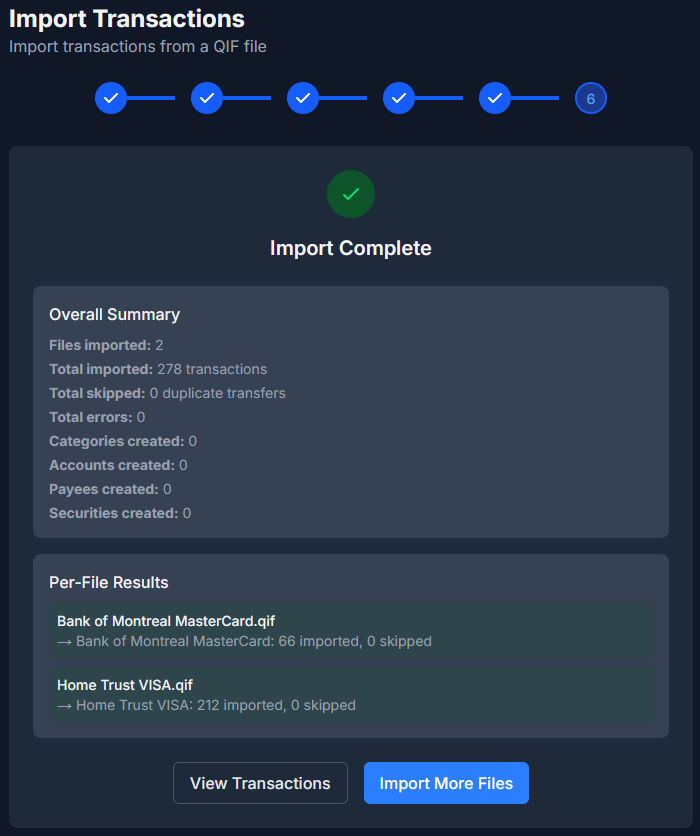
<!-- Screenshot: The import complete step showing the green checkmark, summary statistics, and per-file results -->

#### Results Displayed

| Metric | Description |
|--------|-------------|
| **Imported** | Number of transactions successfully imported |
| **Skipped** | Number of duplicate transfers skipped (already existed) |
| **Errors** | Number of transactions that failed to import |
| **Categories created** | New categories added |
| **Accounts created** | New accounts added |
| **Payees created** | New payees added |
| **Securities created** | New securities added |

#### Per-File Results (Bulk Import)

For bulk imports, each file shows its individual results with success/error indicators:
- Green background for files with no errors
- Red background for files with errors, including the first 3 error messages

#### Next Steps

After import, you have two options:
- **"View Investments"** / **"View Transactions"** -- Go directly to see your imported data. These take you to the account(s) you *just imported* -- single, bulk, or multi-account QIF -- not whichever account you last happened to view; imports into closed accounts stay visible too.
- **"Import More Files"** -- Return to the upload step for additional imports

---

## Part 7: Post-Import Steps

These steps apply to the QIF method. After a direct `.mny` import, see [After the Import](#after-the-import) instead -- the verification report covers most of this for you.

### 7.1 Verify Account Balances

Compare each account's current balance in Monize against your Microsoft Money records. If balances do not match:

1. Check the opening balance -- it should match the balance as of the first transaction date
2. Look for missing or duplicate transactions
3. Check that transfers between accounts were matched correctly (not doubled)

### 7.2 Review Cross-Currency Transfers

Cross-currency transfers from Microsoft Money may need manual adjustment because the QIF format does not include exchange rate information. Look for transactions with a memo containing *"PENDING IMPORT"* and update the amounts to reflect the actual exchange rates.

### 7.3 Verify Investment Holdings

1. Navigate to **Investments**
2. Check that each holding shows the correct quantity and cost basis
3. Compare against your Microsoft Money portfolio summary
4. If any securities were auto-created (marked with `*` suffix), update their symbols and names

### 7.4 Set Up Security Price Updates

Auto-created securities during import have price updates disabled by default. For each security:

1. Navigate to **Tools > Securities**
2. Edit each security to ensure the correct symbol, exchange, and type
3. Price updates will start automatically once the security has a valid symbol

### 7.5 Review Categories

Navigate to **Tools > Categories** and review the category hierarchy. Categories imported from Microsoft Money use the QIF naming convention (with `/` separating parent and child). You may want to reorganize or rename them.

### 7.6 Set Up Scheduled Transactions

QIF export from Microsoft Money does **not** include scheduled/recurring transactions. You must recreate these manually:

1. Navigate to **Bills & Deposits**
2. Create each recurring bill and deposit
3. See [Bills and Deposits](bills-and-deposits.md) for details

> The direct `.mny` import brings scheduled bills across, so this step is not needed there.

### 7.7 Check for Uncategorized Transactions

Run the **Uncategorized Transactions** report (**Reports > Uncategorized Transactions**) to find any transactions that were imported without a category. Assign categories as needed.

### 7.8 Verify Net Worth

Navigate to the Dashboard and check the Net Worth chart. Monize automatically calculates monthly net worth snapshots after import. Compare the trend against your Microsoft Money net worth report.

---

## Part 8: Starting Over

If your import did not go as expected and you want to start fresh, you can delete all your financial data without losing your user account or settings.

1. Navigate to **Settings**
2. Scroll to the **Danger Zone** section
3. Click **"Delete Data..."**
4. Check all four optional boxes (Accounts, Categories, Payees, Currency preferences) for a completely clean slate
5. Enter your password to confirm

This removes all transactions, accounts, categories, securities, budgets, and other financial data. Your user account, preferences, and security settings (2FA, trusted devices) are preserved. You can then re-import your files.

> If you are re-running a direct `.mny` import, you do not need to do this first -- tick **Start fresh** on the review step and the same operation runs as part of the import.

For more details, see [Settings and Security > Danger Zone](settings-and-security.md#danger-zone).

---

## Part 9: Troubleshooting the QIF Import

For `.mny` import problems, see [Troubleshooting the .mny Import](#troubleshooting-the-mny-import).

### Common Issues

#### "Account type mismatch" Error

**Cause:** Trying to import an Investment QIF file into a non-brokerage account, or a Regular QIF file into a brokerage account.

**Solution:** Make sure you select the correct account type:
- Investment QIF files (-Investment) go into brokerage accounts
- Regular QIF files (-Regular or standard banking) go into non-brokerage accounts

#### Dates Appear Wrong

**Cause:** The date format was detected incorrectly (e.g., MM/DD was interpreted as DD/MM).

**Solution:**
1. Go back to the Select Account step
2. Change the date format dropdown to the correct format
3. The file will be re-parsed with the new format

#### Duplicate Transactions After Import

**Cause:** Importing the same file twice, or transfer transactions appearing in both accounts.

**Solution:**
- Monize skips duplicate transfers when importing the second account
- If duplicates still appear, use the **Duplicate Transaction Finder** report to identify and remove them
- For future imports, always import all related files in a single bulk operation

#### Transfer Not Linked Between Accounts

**Cause:** The transfer accounts were not mapped correctly, or the files were imported in separate sessions.

**Solution:**
- When possible, import all files at once using bulk import
- Check that account names in QIF match the Monize account names
- Manually link unmatched transfers by editing the transactions

#### Investment Securities Not Found

**Cause:** Microsoft Money does not include a security master list in QIF exports.

**Solution:**
1. During the Map Securities step, use the "Lookup" button to search for each security
2. If lookup fails, manually enter the symbol, name, type, and exchange
3. After import, edit any auto-created securities (with `*` suffix) in **Tools > Securities**

#### Opening Balance Incorrect

**Cause:** Microsoft Money's opening balance transaction may not match the expected starting point.

**Solution:**
1. Navigate to **Accounts**
2. Edit the account
3. Adjust the opening balance and opening date to match your records
4. The current balance will be recalculated

#### Cross-Currency Transfer Amounts Wrong

**Cause:** QIF files do not contain exchange rate information.

**Solution:**
1. Search transactions for "PENDING IMPORT" in the memo field
2. Edit each flagged transaction
3. Adjust the amount in the destination account to match the actual transfer amount
4. This correctly sets the effective exchange rate

#### Import Times Out

**Cause:** Very large QIF files (near the 10 MB limit or files with thousands of transactions).

**Solution:**
- The import has a 5-minute timeout
- If a single file is too large, try splitting it into smaller date ranges in Microsoft Money

---

## Part 10: What Cannot Be Imported via QIF

The QIF format and Microsoft Money export have limitations. The following data must be recreated manually in Monize. Several of these limits do not apply to the direct `.mny` import -- the right-hand column says which.

| Data Type | Status (QIF) | Notes |
|-----------|--------|-------|
| **Account balances** | Auto-detected | Extracted from QIF "Opening Balance" record. The `.mny` import computes and verifies every balance from the file |
| **Transactions** | Imported | All regular and investment transactions |
| **Voided transactions** | Imported (as void) | Money exports these as $0.00 rows with a `VOID ` payee prefix and the amount dropped. Monize strips the prefix (so no separate "VOID ..." payees are created), marks the transaction **void**, and adds a note that the original amount was lost in the export. The `.mny` import keeps the original amount |
| **Categories** | Imported | Created during import mapping |
| **Payees** | Imported | Created automatically from QIF data |
| **Securities** | Imported | Created during import mapping |
| **Price history** | Not exported | Imported by the `.mny` import |
| **Exchange rates** | Not exported | Imported by the `.mny` import |
| **Scheduled transactions** | Not exported | Must be recreated in Bills & Deposits. Imported by the `.mny` import |
| **Budgets** | Not exported | Must be recreated using [Budgets](budgets.md) -- Monize can auto-generate budgets from your imported spending history. Not imported by the `.mny` import either |
| **Savings goals** | Not exported | No equivalent entity in Monize. Not imported by the `.mny` import either |
| **Reports** | Not applicable | Monize has its own reporting system |
| **Loan amortization** | Not exported | Loan payment transactions are imported, but amortization schedules must be set up manually |
| **Account numbers** | Not in QIF | QIF format does not include account numbers |
| **Cheque images** | Not in QIF | Physical cheque images cannot be exported. Attachments are not imported from `.mny` either |
| **Online banking links** | Not applicable | Monize does not use online banking connections |
| **Planner/forecast data** | Not exported | Financial plans must be recreated |
| **Invoices/customers** | Not exported | Business data is not supported |

---

## Quick Reference Card

### Recommended: Direct .mny Import

1. Work from a copy of the `.mny` file, into an empty Monize profile
2. **Tools > Import Transactions**, select the `.mny` file (one at a time)
3. Enter the file password if prompted
4. Review accounts, balances, options and scheduled bills -- untick what you do not want
5. **Start import**, then read the verification report

### Alternative: Export from Microsoft Money as QIF

1. **File > Export > Loose QIF**
2. One file per account
3. Investment accounts need two exports (Investment + Regular)
4. Name files with numeric prefix for sort order

### Importing QIF into Monize

1. **Tools > Import Transactions**
2. Select all files at once for bulk import
3. Map accounts, categories, securities, and transfer accounts
4. Review and click "Import Transactions"

### Recommended QIF Import Order

```
1. Asset accounts
2. Home currency bank accounts
3. Foreign currency bank accounts
4. Credit card accounts
5. Investment cash accounts (-Regular files)
6. Investment brokerage accounts (-Investment files)
7. Line of credit / loan accounts
```

### After a .mny Import Checklist

```
[ ] Read the verification report -- every account should reconcile
[ ] Give auto-created securities a real symbol and exchange
[ ] Recreate budgets and savings goals
[ ] Check imported scheduled bills in Bills & Deposits
[ ] Check net worth trend on Dashboard
```

### After a QIF Import Checklist

```
[ ] Verify all account balances match Microsoft Money
[ ] Fix cross-currency transfer amounts ("PENDING IMPORT" memos)
[ ] Verify investment holdings and cost basis
[ ] Update auto-created securities with correct symbols
[ ] Recreate scheduled transactions (bills and deposits)
[ ] Run "Uncategorized Transactions" report and fix gaps
[ ] Review category hierarchy and reorganize if needed
[ ] Check net worth trend on Dashboard
```
