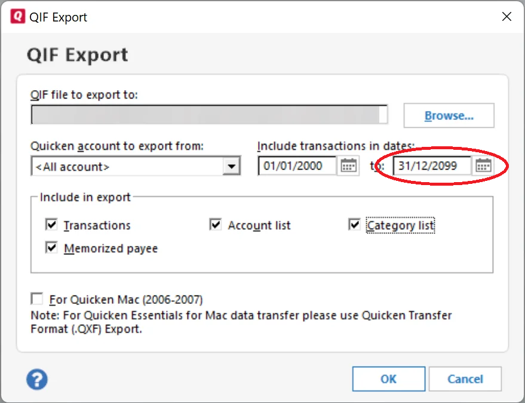

# Importing from Quicken

This is the complete guide to migrating your financial data from Quicken to Monize using QIF file exports. It covers exporting from Quicken, preparing your data, and importing into Monize. For importing from other sources using CSV or OFX/QFX files, see [Importing Transactions](importing-transactions.md). For migrating from Microsoft Money, see [Importing from Microsoft Money](importing-from-microsoft-money.md).

---

## Overview

Quicken uses QIF (Quicken Interchange Format) for data export. Monize includes a comprehensive QIF import wizard that handles:

- Regular banking transactions (chequing, savings, credit cards)
- Investment transactions (buy, sell, dividends, splits, reinvestments)
- Split transactions (multiple categories per transaction)
- Account-to-account transfers
- Category creation and mapping (with colon-separated hierarchy support)
- Tag definitions from Quicken's tag system
- Security creation and mapping
- Multi-account full-file exports (all accounts in a single QIF file)

Monize auto-detects whether a QIF file is a single-account export or a full-file export and adapts the import wizard accordingly.

---

## Important Limitations

> **Future-Dated Transactions Are Not Supported**
>
> Monize does not support importing future-dated transactions. Quicken's QIF export defaults to a far-future end date that includes scheduled and future transactions. **When exporting, always set the "to" date to today's date** to exclude them. See [Removing Future-Dated Transactions](#removing-future-dated-transactions) if you need to clean up a file that was already exported with future transactions.

---

## Part 1: Exporting from Quicken

Quicken offers two ways to export your data as QIF files.

### Single-Account Export

Export one account at a time:

1. In Quicken, select the account you want to export
2. Go to **File > Export > QIF File**
3. **Important:** Change the **"to"** date to **today's date**. Quicken defaults this to a far-future date (e.g., 31/12/2099), which will include scheduled and future-dated transactions that Monize cannot import.
4. Select the transactions to include
5. Save the `.qif` file with a descriptive name (e.g., `Chequing.qif`, `Visa.qif`)
6. Repeat for each account



> **Investment Accounts:** Unlike Microsoft Money, Quicken's QIF export for investment accounts includes both securities transactions and cash transactions in a single file. You do not need to export twice.

### Full-File Export (All Accounts)

Export your entire Quicken data file at once:

1. In Quicken, go to **File > Export > QIF File**
2. Select **All Accounts** (or select multiple accounts)
3. **Important:** Change the **"to"** date to **today's date**. Quicken defaults this to a far-future date (e.g., 31/12/2099), which will include scheduled and future-dated transactions that Monize cannot import. Set it to today's date to export only past and present transactions.
4. Ensure categories and tags are included in the export
5. Save the `.qif` file


A full-file export produces a single QIF file that contains:

- **Category definitions** (`!Type:Cat` sections) -- your full category hierarchy with tax-related flags
- **Tag definitions** (`!Type:Tag` sections) -- your Quicken tags
- **Account blocks** (`!Account` sections) -- each account's transactions grouped together
- **Transaction data** -- all transactions across all included accounts

### Which Export Method to Use

| Method | Best For | Advantages | Disadvantages |
|--------|----------|------------|---------------|
| **Single-account** | Selective migration, importing specific accounts | Full control over what to import; can import in a specific order | Must handle transfer linking across separate imports |
| **Full-file** | Complete migration from Quicken | One file, one import; transfers auto-linked; categories and tags included | All-or-nothing |

---

## Part 2: Preparing Your QIF Files

### Removing Future-Dated Transactions

The easiest fix is to **re-export from Quicken** with the "to" date set to today. See [Full-File Export](#full-file-export-all-accounts) for details.

If you prefer to fix an already-exported file, open it in a text editor (Notepad, VS Code, etc.) and delete any transactions with future dates. Each transaction looks like this:

```
D3/14/2026
T-45.00
PGrocery Store
LFood:Groceries
^
```

The `D` line is the date and `^` marks the end of the transaction. Delete the entire block (from `D` through `^`) for any transaction dated after today, then save the file.

---

## Part 3: Importing Single-Account QIF Files

Navigate to **Tools > Import Transactions** to begin.

### Recommended Import Order

If you are importing multiple single-account QIF files, the order matters for transfer linking. Import in this order:

```
1. Asset Accounts
      |
2. Bank, Credit Card and Line of Credit Accounts (Home Currency)
      |
3. Bank, Credit Card and Line of Credit Accounts (Foreign Currency)
      |
4. Investment Accounts
```

Monize matches pending transfers from previously imported files, so importing accounts with the most outgoing transfers first ensures correct linking.

> **Tip:** Select all your QIF files at once for bulk import. Monize processes them sequentially and coordinates transfer matching across files.

### Step 1: Upload QIF Files

1. Click the upload area or drag your QIF files onto it
2. You can select **multiple files** at once for bulk import
3. Monize parses each file and extracts:
   - Account type detected from the QIF header
   - Number of transactions
   - Date range of transactions
   - Categories found (including colon-separated hierarchy)
   - Transfer accounts referenced
   - Securities found (for investment files)

### Step 2: Select Destination Account

For each QIF file, specify which Monize account the transactions should be imported into.

#### File Information

A gray information box shows:
- **File:** The filename being imported
- **Transactions:** Number of transactions found
- **Date Range:** Earliest to latest transaction dates
- **Detected Type:** Account type from the QIF header (e.g., Bank, Investment, Credit Card)

#### Selecting an Account

Choose from the **"Import into account"** dropdown:
- For **investment QIF files** (detected type: Investment), only brokerage accounts are shown
- For **regular QIF files**, all non-brokerage accounts are shown

> **Auto-Matching:** Monize attempts to match QIF filenames to account names automatically.

#### Creating a New Account

If the destination account does not exist:

1. Click **"+ Create new account"**
2. Fill in the account name, type, and currency
3. Click **Create**

The new account is auto-selected as the destination.

#### Date Format

Quicken QIF files may use different date formats. Monize auto-detects the format, but you can override it if dates look wrong:
- MM/DD/YYYY (US format -- most common for Quicken)
- DD/MM/YYYY (International format)
- YYYY-MM-DD (ISO format)

> **Quicken Date Quirk:** Quicken may pad single-digit days with spaces (e.g., `2/ 4/19` instead of `2/4/19`). Monize handles this automatically.

### Step 3: Map Categories

Quicken uses colon-separated category paths (e.g., `Food:Groceries`, `Auto:Fuel`, `Fees & Charges:Bank Fee`). Monize automatically parses this hierarchy.

Categories are displayed in three groups:

1. **Needs Attention** (amber) -- Categories that could not be auto-matched. Require your input.
2. **Auto-Matched to Categories** (green, collapsed) -- Successfully matched to existing Monize categories.
3. **Auto-Matched to Loan Accounts** (blue, collapsed) -- Matched to loan or mortgage account names (imported as transfers to the loan account).

For each unmatched category, you can:
- **Map to existing** -- Select an existing Monize category
- **Create new** -- Enter a new category name, optionally under a parent
- **Skip** -- Leave unmapped; categorize later

#### Automatic Category Hierarchy Creation

When Monize creates new categories from Quicken's colon-separated paths:

1. It detects the parent-child relationship from the colon separator
2. Creates the parent category if it does not exist
3. Creates the child category under the correct parent
4. Deduplicates parents across multiple children

For example, importing categories `Food:Groceries`, `Food:Restaurants`, and `Food:Coffee` creates one "Food" parent with three children.

### Step 4: Map Securities

This step appears only for investment QIF files containing security references.

For each security, you can:
- **Map to existing** -- Select from the dropdown of existing Monize securities
- **Create new** -- Enter the symbol, name, type (Stock, ETF, Mutual Fund, etc.), and exchange
- **Lookup** -- Click to search by name or symbol

### Step 5: Map Transfer Accounts

This step appears when the QIF file references transfers to other accounts (using Quicken's `[Account Name]` notation).

For each referenced account:
- **Map to existing** -- Select from the dropdown of existing Monize accounts
- **Create new** -- Enter the account name, type, and currency

> **Bulk Import Tip:** If you are importing all files at once, transfers between accounts in the batch are linked automatically. You only need to map accounts that are not part of the current import.

### Step 6: Review and Import

The review step shows a summary of everything that will happen:

- Files and transaction counts
- Target accounts
- Categories, accounts, securities, and payees to be created

Click **"Import Transactions"** to execute. The import runs inside a database transaction -- if an error occurs, all changes are rolled back.

### Step 7: Import Complete

After import, Monize displays:

| Metric | Description |
|--------|-------------|
| **Imported** | Transactions successfully imported |
| **Skipped** | Duplicate transfers skipped |
| **Errors** | Transactions that failed (with details) |
| **Categories created** | New categories added |
| **Accounts created** | New accounts added |
| **Payees created** | New payees added |
| **Securities created** | New securities added |

---

## Part 4: Importing a Full-File QIF Export

When you upload a full-file QIF export, Monize detects it automatically (by the presence of multiple `!Account` sections or `!Type:Cat` / `!Type:Tag` definition blocks) and adapts the import wizard.

### How Full-File Import Differs

| Aspect | Single-Account Import | Full-File Import |
|--------|----------------------|------------------|
| **Account selection** | Choose one account per file | Review all detected accounts; map, create, or skip each one |
| **Category definitions** | Extracted from transaction data | Pre-loaded from `!Type:Cat` sections (with tax flags) |
| **Tag definitions** | Extracted from transaction data | Pre-loaded from `!Type:Tag` sections |
| **Transfer linking** | Across files in a bulk import | Automatic within the single file |
| **Number of files** | One or more | Typically one file |

### Full-File Import Steps

1. **Upload** -- Select your full-file `.qif` export
2. **Review Accounts** -- Monize displays all account blocks found in the file. For each account:
   - **Map** to an existing Monize account
   - **Create** a new account (the account type is auto-detected from the QIF header)
   - **Skip** to exclude that account's transactions from the import
3. **Map Categories** -- Map all categories across all accounts at once. Category definitions from `!Type:Cat` sections are pre-loaded with their hierarchy.
4. **Map Securities** -- Map any securities found across all investment account blocks
5. **Map Transfer Accounts** -- Map transfer references. Transfers between accounts within the same file are automatically linked.
6. **Review and Import** -- Summary shows per-account transaction counts and all entities to be created
7. **Complete** -- View results with per-account import statistics

> **Tip:** Full-file import is the easiest way to migrate from Quicken. All transfers between accounts are automatically linked, and your complete category and tag hierarchy is preserved.

---

## Part 5: Post-Import Steps

After importing your Quicken data, take these steps to verify and finalize your migration.

### 5.1 Verify Account Balances

Compare each account's current balance in Monize against Quicken. If balances do not match:

1. Check the opening balance -- it should match the balance as of the first transaction date
2. Look for missing or duplicate transactions
3. Check that transfers between accounts were matched correctly

### 5.2 Verify Investment Holdings

1. Navigate to **Investments**
2. Check that each holding shows the correct quantity and cost basis
3. Compare against your Quicken portfolio summary
4. If any securities were auto-created, update their symbols and exchange information

### 5.3 Set Up Security Price Updates

Auto-created securities during import have price updates disabled by default:

1. Navigate to **Tools > Securities**
2. Edit each security to ensure the correct symbol, exchange, and type
3. Price updates start automatically once the security has a valid symbol

### 5.4 Review Categories

Navigate to **Tools > Categories** and review the category hierarchy. Categories imported from Quicken preserve the colon-separated hierarchy (e.g., `Food:Groceries` becomes "Groceries" under parent "Food"). Verify the hierarchy looks correct and reorganize if needed.

### 5.5 Set Up Scheduled Transactions

Quicken's QIF export does **not** include scheduled or recurring transactions. You must recreate these manually:

1. Navigate to **Bills & Deposits**
2. Create each recurring bill and deposit
3. See [Bills and Deposits](bills-and-deposits.md) for details

### 5.6 Check for Uncategorized Transactions

Run the **Uncategorized Transactions** report (**Reports > Uncategorized Transactions**) to find any transactions imported without a category.

### 5.7 Verify Net Worth

Navigate to the Dashboard and check the Net Worth chart. Click **Recalculate** on the Net Worth report if needed to refresh balance snapshots after import.

---

## Part 6: Starting Over

If your import did not go as expected and you want to start fresh, you can delete all your financial data without losing your user account or settings.

1. Navigate to **Settings**
2. Scroll to the **Danger Zone** section
3. Click **"Delete Data..."**
4. Check all four optional boxes (Accounts, Categories, Payees, Currency preferences) for a completely clean slate
5. Enter your password to confirm

This removes all transactions, accounts, categories, securities, budgets, and other financial data. Your user account, preferences, and security settings (2FA, trusted devices) are preserved. You can then re-import your QIF files.

For more details, see [Settings and Security > Danger Zone](settings-and-security.md#danger-zone).

---

## Part 7: Quicken QIF Format Details

Understanding the QIF format can help when troubleshooting or manually editing files.

### QIF Record Fields

| Field Code | Description | Example |
|------------|-------------|---------|
| `D` | Date | `3/14/2026` |
| `T` | Amount | `-45.00` |
| `P` | Payee | `Grocery Store` |
| `M` | Memo | `Weekly groceries` |
| `N` | Cheque number (regular) or Action (investment) | `1234` or `Buy` |
| `C` | Cleared status (`*` = cleared, `X` = reconciled) | `*` |
| `L` | Category (or `[Account]` for transfers) | `Food:Groceries` or `[Savings]` |
| `S` | Split category | `Food:Groceries` |
| `E` | Split memo | `Groceries portion` |
| `$` | Split amount | `-30.00` |
| `Y` | Security name (investment) | `AAPL` |
| `I` | Price per share (investment) | `150.25` |
| `Q` | Quantity (investment) | `10` |
| `O` | Commission (investment) | `9.99` |
| `^` | End of record | |

### Account Type Headers

| QIF Header | Monize Account Type |
|------------|-------------------|
| `!Type:Bank` | Chequing |
| `!Type:Cash` | Cash |
| `!Type:CCard` | Credit Card |
| `!Type:Invst` | Investment |
| `!Type:Oth A` | Asset |
| `!Type:Oth L` | Line of Credit |

### Quicken-Specific Format Notes

- **Category hierarchy:** Uses colon separator (e.g., `Food:Groceries`) unlike Microsoft Money's `/` separator
- **Date padding:** Quicken may pad single-digit days with spaces (e.g., `2/ 4/19`)
- **Tags:** Appended after `/` in the category field (e.g., `Food:Groceries/Vacation`)
- **Full-file sections:** `!Type:Cat` for category definitions, `!Type:Tag` for tag definitions, `!Account` for account blocks

---

## Part 8: Troubleshooting

### Future-Dated Transactions Cause Issues

**Cause:** The QIF file contains transactions with dates in the future.

**Solution:** Remove future-dated transactions from the QIF file before importing. See [Removing Future-Dated Transactions](#removing-future-dated-transactions). Alternatively, re-export from Quicken with a date range ending on or before today.

### Dates Appear Wrong

**Cause:** The date format was detected incorrectly (e.g., MM/DD was interpreted as DD/MM).

**Solution:** Go back to the Select Account step and change the date format dropdown. Quicken typically uses MM/DD/YYYY format.

### Category Hierarchy Not Created

**Cause:** The colon separator in category names was not detected.

**Solution:** Verify the QIF file uses standard colon-separated categories (e.g., `LFood:Groceries`). If categories use a different separator, they will be imported as flat names. You can reorganize them manually in **Tools > Categories**.

### Duplicate Transactions After Import

**Cause:** Importing the same file twice, or transfer transactions appearing in both accounts.

**Solution:**
- Monize skips duplicate transfers when importing the second account
- If duplicates still appear, use the **Duplicate Transaction Finder** report
- For future imports, import all related files in a single bulk operation

### Transfer Not Linked Between Accounts

**Cause:** Transfer accounts were not mapped correctly, or files were imported in separate sessions.

**Solution:**
- Import all files at once using bulk import
- For full-file exports, transfers are linked automatically
- Manually link unmatched transfers by editing the transactions

### Investment Securities Not Found During Lookup

**Cause:** The security name in Quicken does not match market data.

**Solution:**
1. During the Map Securities step, try searching by symbol instead of name
2. If lookup fails, manually enter the symbol, name, type, and exchange
3. After import, verify securities in **Tools > Securities**

### Opening Balance Incorrect

**Cause:** The opening balance transaction in the QIF does not match expected starting point.

**Solution:**
1. Navigate to **Accounts**
2. Edit the account
3. Adjust the opening balance and opening date
4. The current balance will be recalculated

### Import Times Out

**Cause:** Very large QIF file (near the 10 MB limit or thousands of transactions).

**Solution:** The import has a 5-minute timeout. If the file is too large, re-export from Quicken with a smaller date range.

---

## Part 9: What Cannot Be Imported

The QIF format and Quicken export have limitations. The following data must be recreated manually in Monize:

| Data Type | Status | Notes |
|-----------|--------|-------|
| **Account balances** | Auto-detected | Extracted from QIF "Opening Balance" record |
| **Transactions** | Imported | All regular and investment transactions |
| **Categories** | Imported | Created with hierarchy during import mapping |
| **Tags** | Imported | Created from `!Type:Tag` sections (full-file export) or extracted from transactions |
| **Payees** | Imported | Created automatically from QIF data |
| **Securities** | Imported | Created during import mapping |
| **Future transactions** | Not supported | Must be removed before import; recreate as scheduled transactions |
| **Scheduled transactions** | Not exported | Must be recreated in [Bills & Deposits](bills-and-deposits.md) |
| **Budgets** | Not exported | Must be recreated using [Budgets](budgets.md) -- Monize can auto-generate from imported spending history |
| **Reports** | Not applicable | Monize has its own reporting system |
| **Loan amortization** | Not exported | Loan payment transactions are imported, but schedules must be set up manually |
| **Account numbers** | Not in QIF | QIF format does not include account numbers |
| **Attachments** | Not in QIF | Receipt images or attached documents cannot be exported |
| **Online banking links** | Not applicable | Monize does not use online banking connections |

---

## Quick Reference Card

### Export from Quicken

1. **File > Export > QIF File**
2. Choose single-account or full-file export
3. Set date range to end on or before today (to avoid future transactions)
4. Save the `.qif` file

### Import into Monize

1. **Tools > Import Transactions**
2. Upload your QIF file(s)
3. Map accounts, categories, securities, and transfer accounts
4. Review and click "Import Transactions"

### After Import Checklist

```
[ ] Remove future-dated transactions from QIF files before import
[ ] Verify all account balances match Quicken
[ ] Verify investment holdings and cost basis
[ ] Update auto-created securities with correct symbols
[ ] Recreate scheduled transactions (bills and deposits)
[ ] Run "Uncategorized Transactions" report and fix gaps
[ ] Review category hierarchy and reorganize if needed
[ ] Check net worth trend on Dashboard
```
