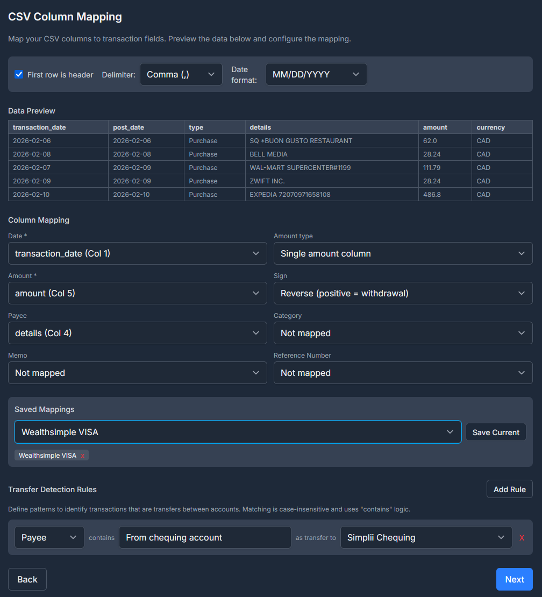
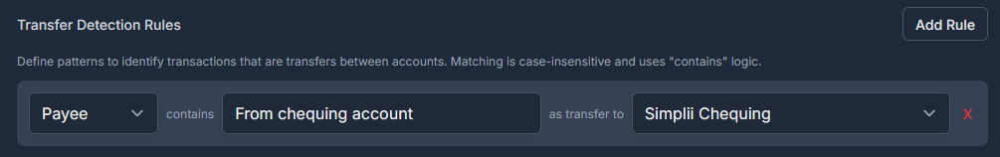

# Importing Transactions

This guide covers importing transactions from bank-exported CSV files, OFX/QFX files, and Quicken QIF files. For complete migration guides, see [Importing from Quicken](importing-from-quicken.md) and [Importing from Microsoft Money](importing-from-microsoft-money.md).

---

## Overview

Monize can import transactions from files downloaded from your bank or financial institution. This is useful for:

- Regularly importing new transactions from your bank
- Importing historical transactions from a bank statement download
- Consolidating accounts from multiple institutions

The import process uses a step-by-step wizard that guides you through file upload, column mapping (for CSV), account selection, category mapping, and review before committing the import.

---

## Supported Formats

| Format | Extension | Description |
|--------|-----------|-------------|
| **CSV** | `.csv` | Comma-separated values. Flexible format -- requires column mapping. |
| **OFX** | `.ofx` | Open Financial Exchange. Standardized format used by most banks. |
| **QFX** | `.qfx` | Quicken Financial Exchange. Identical to OFX with a Quicken-specific wrapper. |
| **QIF** | `.qif` | Quicken Interchange Format. Supports both Microsoft Money and Quicken exports. See [Importing Quicken QIF Files](#importing-quicken-qif-files) and [Importing from Microsoft Money](importing-from-microsoft-money.md). |

---

## Getting Started

Navigate to **Tools > Import Transactions** to open the import wizard.

You can also start an import from a specific account page -- click the account's menu and select **Import Transactions**. This pre-selects the account as the import destination.

---

## Importing CSV Files

CSV is the most flexible import format. Because CSV files have no standard column layout, you must tell Monize which columns contain the date, amount, payee, and other fields.

### Step 1: Upload CSV Files

1. Click the upload area or drag your CSV file(s) onto it
2. Monize reads the file and extracts the column headers and sample rows
3. You can select multiple CSV files for bulk import

> **File Format:** Monize auto-detects the delimiter (comma, semicolon, or tab) and whether the first row is a header. You can override both settings in the next step.

### Step 2: CSV Column Mapping

This step is unique to CSV imports. You configure how Monize interprets your CSV columns.

<!-- Screenshot: The CSV column mapping step showing the options bar, data preview table, column mapping dropdowns, and saved mappings section -->

#### Options Bar

At the top of the mapping step, an options bar lets you configure:

| Option | Description |
|--------|-------------|
| **First row is header** | Checkbox. When checked, the first row is treated as column headers and excluded from import. |
| **Delimiter** | Dropdown: Comma (,), Semicolon (;), or Tab. Changing the delimiter re-parses the file. |
| **Date format** | Dropdown with common formats plus a Custom option. Auto-detected from sample data. |

#### Date Format Options

| Format | Example | Notes |
|--------|---------|-------|
| MM/DD/YYYY | 03/15/2026 | US format (default if ambiguous) |
| DD/MM/YYYY | 15/03/2026 | International format |
| YYYY-MM-DD | 2026-03-15 | ISO format |
| YYYY-DD-MM | 2026-15-03 | Alternate ISO |
| Custom | DD.MM.YYYY | Enter any pattern using YYYY/YY, MM, DD tokens with any separator (-, /, .) |

Monize auto-detects the date format from sample data. If dates appear wrong, select the correct format from the dropdown or enter a custom pattern.

#### Data Preview

A table shows the first 5 rows of your CSV file with column headers. Use this to verify the delimiter and header settings are correct, and to identify which columns contain which data.

#### Auto-Column Matching

Monize automatically detects and suggests column mappings based on your CSV headers. The system matches common header names like "Date", "Amount", "Description", "Payee", "Category", "Memo", and "Reference" to the appropriate fields. You can review and adjust the suggested mappings before proceeding.

#### Column Mapping

Map your CSV columns to transaction fields using dropdowns. Each dropdown lists the columns found in your file.

| Field | Required | Description |
|-------|----------|-------------|
| **Date** | Yes | The transaction date column |
| **Amount** | Yes (if single) | A single column containing the transaction amount |
| **Debit** | Yes (if split) | The withdrawal/debit column |
| **Credit** | Yes (if split) | The deposit/credit column |
| **Payee** | No | The payee or description column |
| **Category** | No | A category column (if your bank provides one) |
| **Subcategory** | No | A subcategory column for two-level category hierarchy |
| **Memo** | No | Additional notes or description |
| **Reference Number** | No | Cheque number or reference ID |

#### Amount Type: Single vs Split

Select the amount type based on how your CSV represents transaction amounts:

**Single amount column** -- One column with positive values for deposits and negative values for withdrawals (or vice versa). This is the most common format.
- **Sign** option: Choose "As-is (positive = deposit)" or "Reverse (positive = withdrawal)". Use Reverse for credit card statements where charges appear as positive numbers.

**Separate debit/credit** -- Two columns: one for withdrawals (debit) and one for deposits (credit). Common in some bank exports.

**Transaction type column** -- Use a dedicated column in the CSV to determine transaction direction instead of relying on amount sign. When selected:
- Choose which column contains the type indicator
- Define keywords for each type:
  - **Income keywords:** e.g., "Income", "Deposit", "Credit" (treated as positive amounts)
  - **Expense keywords:** e.g., "Expense", "Debit", "Payment" (treated as negative amounts)
  - **Transfer-out keywords:** e.g., "Transfer-Out" (money leaving account)
  - **Transfer-in keywords:** e.g., "Transfer-In" (money entering account)
- Optionally specify a **Transfer account column** to identify which account transfers go to/from
- Keyword matching is case-insensitive

> **Amount Parsing:** Monize handles currency symbols ($, EUR, etc.), thousands separators (commas), and parenthesized negatives -- e.g., `($50.00)` is treated as `-$50.00`.

#### Transfer Detection Rules

See [Transfer Detection](#transfer-detection) below for details on configuring rules that automatically identify transfer transactions in your CSV data.

#### Saved Mappings

See [Saved Column Mappings](#saved-column-mappings) below for details on saving and reusing your column mapping configuration.

### Step 3: Select Destination Account

Choose which Monize account the transactions should be imported into.

- Select from the **"Import into account"** dropdown
- Or click **"+ Create new account"** to create a new account inline

> **Auto-Matching:** If you navigated to the import page from a specific account, that account is pre-selected.

### Step 4: Map Categories

If your CSV file has a category column, Monize extracts the unique category values and asks you to map them to existing Monize categories or create new ones.

Categories are displayed in groups:
1. **Needs Attention** (amber) -- Categories that could not be auto-matched
2. **Auto-Matched** (green, collapsed) -- Categories that matched existing Monize categories

For each category, you can:
- **Map to existing** -- Select an existing Monize category
- **Create new** -- Enter a new category name, optionally under a parent category
- **Skip** -- Leave unmapped; transactions import without a category

> **No Category Column?** If you did not map a category column, this step is skipped. Payee default categories are still applied automatically during import (see [Payee Matching During Import](#payee-matching-during-import)).

### Step 5: Map Transfer Accounts

If transfer detection rules matched any transactions (see [Transfer Detection](#transfer-detection)), you need to map the target account names to existing Monize accounts or create new ones.

### Step 6: Review and Import

The review step shows a summary of the import:
- File name and transaction count
- Target account
- Categories, accounts, and payees to be created

Click **"Import Transactions"** to execute the import. The operation runs inside a database transaction -- if an error occurs, all changes are rolled back.

### Step 7: Import Complete

After a successful import, you see:

| Metric | Description |
|--------|-------------|
| **Imported** | Transactions successfully imported |
| **Skipped** | Duplicate transactions skipped |
| **Errors** | Transactions that failed (with error details) |
| **Categories created** | New categories added |
| **Accounts created** | New accounts added |
| **Payees created** | New payees added |

Click **"View Transactions"** to see your imported data, or **"Import More Files"** to continue importing.

---

## Importing OFX/QFX Files

### What is OFX/QFX?

OFX (Open Financial Exchange) and QFX (Quicken Financial Exchange) are standardized file formats that banks use to provide transaction downloads. Unlike CSV, these formats have a defined structure -- no column mapping is needed.

Most banks offer OFX or QFX downloads from their online banking portals, typically under a "Download transactions" or "Export" option.

### How OFX/QFX Import Differs from CSV

| Aspect | CSV | OFX/QFX |
|--------|-----|---------|
| Column mapping | Required | Not needed (fixed format) |
| Date format | User-selected or auto-detected | Automatic (embedded in file) |
| Payee | From mapped column | From NAME field in file |
| Memo | From mapped column | From MEMO field (if different from NAME) |
| Category | From mapped column (optional) | Not provided -- mapped during import or via payee defaults |
| Cleared status | Not provided | All transactions marked as cleared (posted) |
| Transfer detection | Via user-defined rules | Automatic for XFER transaction types |
| Amount handling | User configures sign and column | Automatic (signed amounts in file) |
| Reference number | From mapped column (optional) | From CHECKNUM field |

### OFX Import Steps

The OFX/QFX import follows the same wizard but skips the column mapping step:

1. **Upload** -- Select your `.ofx` or `.qfx` file(s)
2. **Select Account** -- Choose the destination account
3. **Map Categories** -- Map any categories found (OFX files rarely include categories)
4. **Map Transfer Accounts** -- Map accounts for transfer transactions
5. **Review and Import** -- Confirm and execute
6. **Complete** -- View results

#### Supported OFX Statement Types

| Statement Type | Description |
|----------------|-------------|
| BANKMSGSRSV1 | Chequing and savings accounts |
| CREDITCARDMSGSRSV1 | Credit card accounts |

> **Note:** Investment statements (INVSTMTMSGSRSV1) are not supported in OFX format. Use QIF for investment account imports.

#### OFX Transaction Types

Monize recognizes the following OFX transaction types:

| OFX Type | Handling |
|----------|----------|
| DEBIT | Standard withdrawal |
| CREDIT | Standard deposit |
| CHECK | Cheque transaction |
| DEP | Deposit |
| ATM | ATM withdrawal/deposit |
| POS | Point-of-sale transaction |
| XFER | Transfer (see [OFX Transfer Detection](#ofx-transfer-detection)) |
| INT | Interest |
| DIV | Dividend |
| FEE | Fee |
| SRVCHG | Service charge |
| PAYMENT | Payment |
| OTHER | Other transaction |

---

## Importing Quicken QIF Files

Monize supports QIF files exported from Quicken, including both individual account exports and Quicken's full-file export (which contains all accounts, categories, and tags in a single QIF file). Both formats are auto-detected.

> **Important: Future-Dated Transactions**
>
> Monize does not currently support importing future-dated transactions. If your Quicken QIF file contains scheduled or future transactions, you must remove them from the QIF file before importing. See the full guide for details.

Key Quicken QIF features supported:
- **Colon-separated category hierarchy** (e.g., `Food:Groceries`) -- parent/child categories created automatically
- **Full-file export** -- all accounts, category definitions (`!Type:Cat`), and tag definitions (`!Type:Tag`) in a single file
- **Single-account export** -- one file per account, with bulk import support
- **Date padding** -- Quicken's space-padded dates (e.g., `2/ 4/19`) handled automatically
- **Tags** -- extracted from the `/` separator in category fields

For the complete step-by-step guide including exporting from Quicken, import order, and troubleshooting, see **[Importing from Quicken](importing-from-quicken.md)**.

---

## CSV vs OFX/QFX Comparison

| Feature | CSV | OFX/QFX |
|---------|-----|---------|
| **Ease of setup** | Requires column mapping | No mapping needed |
| **Flexibility** | Works with any CSV layout | Fixed format |
| **Date format** | Must be specified | Automatic |
| **Amount sign** | Configurable (normal or reverse) | Automatic |
| **Categories** | Can map from file column | Not in file -- use payee defaults |
| **Transfer detection** | Rule-based (user configures) | Automatic for XFER type |
| **Saved presets** | Yes (saved column mappings) | Not needed |
| **Cleared status** | Not set | Always cleared |
| **Best for** | Banks with non-standard exports, custom data | Standard bank downloads |

---

## Transfer Detection

### CSV Transfer Rules

Since CSV files have no standard way to indicate transfers, Monize lets you define rules that identify transfer transactions based on patterns in the payee or category fields.

<!-- Screenshot: The CSV transfer rules section showing a rule with type, contains, pattern, and target account -->

Each rule has three parts:

| Part | Description |
|------|-------------|
| **Field** | Which column to match: Payee or Category |
| **Pattern** | Text to search for (case-insensitive, "contains" matching) |
| **Target Account** | The Monize account the transfer goes to |

#### Example Rules

| Field | Pattern | Target Account | Matches |
|-------|---------|----------------|---------|
| Payee | Transfer to Savings | Savings | "Transfer to Savings - Jan" |
| Payee | INTERAC e-Transfer | Chequing | "INTERAC e-Transfer JOHN DOE" |
| Category | Transfer | Savings | Any transaction where category contains "Transfer" |

When a rule matches, the transaction is:
1. Marked as a transfer
2. Linked to the target account
3. Category is cleared (transfers do not have categories)

Rules are evaluated in order. The first matching rule wins.

> **Tip:** Transfer rules are saved along with your column mapping preset, so you only need to configure them once per bank format.

### OFX Transfer Detection

OFX files include a transaction type field. Transactions with type `XFER` are automatically treated as transfers. The payee name (NAME field) is used as the transfer account name, which you map during the import wizard.

---

## Saved Column Mappings

If you regularly import CSV files from the same bank, you can save your column mapping configuration as a named preset to avoid re-mapping each time.

#### Saving a Mapping

1. Configure your column mapping, date format, delimiter, and transfer rules
2. Click **"Save Current"** in the Saved Mappings section
3. Enter a descriptive name (e.g., "TD Chequing CSV", "Visa Statement")
4. Click **Save**

If a mapping with the same name already exists, it is overwritten (an "Will overwrite" warning appears).

#### Loading a Mapping

1. Select a saved mapping from the **"Load a saved mapping..."** dropdown
2. All settings are restored: column assignments, delimiter, date format, header toggle, and transfer rules

#### Deleting a Mapping

Click the **x** button next to any saved mapping name to delete it.

> **Saved mappings include transfer rules.** When you save a column mapping preset, the transfer detection rules are saved with it.

---

## Payee Matching During Import

During import, Monize automatically resolves payee names using the following process:

1. **Exact match** -- If a payee with the same name already exists, the transaction is assigned to it
2. **Alias match** -- If a payee alias pattern matches the imported name (see [Payee Aliases](categories-and-payees.md#payee-aliases)), the transaction is assigned to the canonical payee
3. **Create new** -- If no match is found, a new payee is created

When a payee is matched (by name or alias), its **default category** is applied to the transaction -- unless the transaction already has a category from the import file.

> **Payee name cleanup:** All-caps payee names from bank files are automatically converted to Proper Case (e.g., "STARBUCKS" becomes "Starbucks").

This matching process is identical for CSV, OFX/QFX, and QIF imports. To make the most of it, set up payee aliases before your first import (see [Payee Aliases](categories-and-payees.md#payee-aliases)).

---

## Tips and Best Practices

### Before Your First Import

1. **Create your accounts** in Monize first, so they are available as import destinations
2. **Set up payee aliases** for common payees that appear with varying names in bank files (e.g., "STARBUCKS #1234" vs "STARBUCKS #5678")
3. **Set default categories** on payees to automate categorization during import

### For Regular CSV Imports

1. **Save a column mapping** the first time you import from a bank -- it saves time on future imports
2. **Set up transfer rules** if your bank includes inter-account transfers in the CSV
3. **Use the "Reverse sign" option** for credit card statements where charges are positive numbers

### General Tips

- Import all files for the same period at once for better transfer matching
- After import, review uncategorized transactions (**Reports > Uncategorized Transactions**)
- Use the **Recalculate** button on the Net Worth report after large imports to update balance snapshots

---

## Troubleshooting

### Dates Appear Wrong

**Cause:** The date format was auto-detected incorrectly.

**Solution:** Change the date format in the options bar (for CSV) or the date format dropdown (for OFX). Monize defaults to MM/DD/YYYY when dates are ambiguous (e.g., both parts are 12 or less).

### Amounts Have Wrong Sign

**Cause:** Your bank exports withdrawals as positive numbers (common for credit card statements).

**Solution:** In the CSV column mapping step, change the Sign option to "Reverse (positive = withdrawal)".

### Columns Not Parsed Correctly

**Cause:** The delimiter was auto-detected incorrectly (e.g., a semicolon-delimited file detected as comma).

**Solution:** Change the delimiter in the options bar and the file will be re-parsed.

### Duplicate Transactions After Import

**Cause:** Importing the same file twice, or overlapping date ranges between imports.

**Solution:** Monize does not automatically detect duplicates in CSV/OFX imports (unlike QIF transfers). Use the **Duplicate Transaction Finder** report to identify and remove duplicates.

### Transfer Not Created

**Cause (CSV):** No transfer rule matched the transaction, or the rule pattern did not match.

**Solution:** Check your transfer rules. Matching is case-insensitive "contains" -- the pattern must appear somewhere in the payee or category text.

**Cause (OFX):** The transaction type was not XFER.

**Solution:** Manually edit the transaction and convert it to a transfer.

### OFX File Not Recognized

**Cause:** The file may use an unsupported OFX statement type (e.g., investment statements).

**Solution:** Try exporting as CSV from your bank instead, or use QIF format for investment accounts.

### Import Times Out

**Cause:** Very large files or files with thousands of transactions.

**Solution:** The import has a 5-minute timeout. If the file is too large, try splitting it into smaller date ranges.
