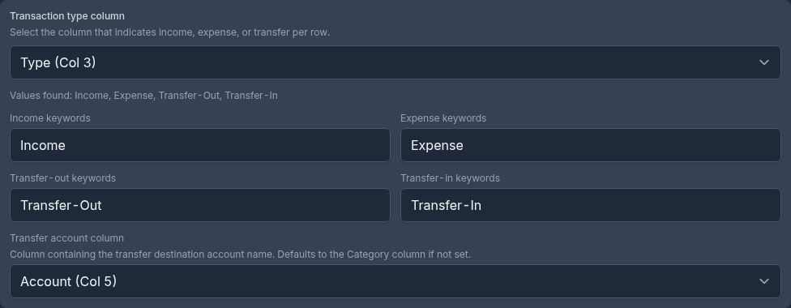
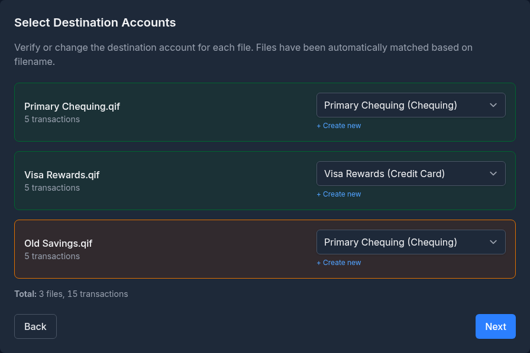
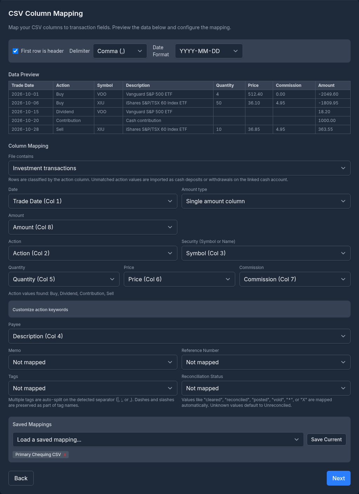
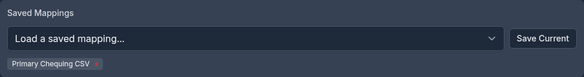

# Importing Transactions

This guide covers importing transactions from bank-exported CSV files, OFX/QFX files, and Quicken QIF files. For complete migration guides, see [Importing from Quicken](importing-from-quicken.md) and [Importing from Microsoft Money](importing-from-microsoft-money.md).

---

## Overview

Monize can import transactions from files downloaded from your bank or financial institution, or exported from other personal finance software. This is useful for:

- Regularly importing new transactions from your bank
- Importing historical transactions from a bank statement download
- Consolidating accounts from multiple institutions
- Moving your history across from Quicken or Microsoft Money

The import process uses a step-by-step wizard that guides you through file upload, column mapping (for CSV), account selection, category, security and transfer-account mapping, and a review before anything is written. A row of numbered circles at the top shows where you are; only the steps your file needs are shown.

> [!TIP]
> Want your bank's transactions to arrive on their own? **Settings > Bank Sync** connects a bank account through Open Banking and imports its booked transactions daily or on demand, with the same payee matching and rules described here.

---

## Supported Formats

| Format | Extension | Description |
|--------|-----------|-------------|
| **CSV** | `.csv` | Comma-separated values. Flexible format -- requires column mapping. Banking or investment (brokerage) transactions. |
| **OFX** | `.ofx` | Open Financial Exchange. Standardized format used by most banks. |
| **QFX** | `.qfx` | Quicken Financial Exchange. Identical to OFX with a Quicken-specific wrapper. |
| **QIF** | `.qif` | Quicken Interchange Format. Supports both Microsoft Money and Quicken exports. See [Importing Quicken QIF Files](#importing-quicken-qif-files) and [Importing from Microsoft Money](importing-from-microsoft-money.md). |
| **QMTF** | `.qmtf` | Quicken for Mac's transfer file. It is QIF under another extension and imports the same way. |
| **Microsoft Money** | `.mny` | A whole Microsoft Money file, imported directly. It has its own wizard -- see [Importing from Microsoft Money](importing-from-microsoft-money.md). |

You can select several files of the same type at once for a bulk import. Files of different types cannot be mixed in one import, and a `.mny` file is always imported on its own.

---

## Getting Started

Navigate to **Tools > Import Transactions** to open the import wizard. A **Before you import** notice at the top links to the Quicken and Microsoft Money guides.

Click the upload area to pick your files, or drag them from your computer and drop them onto it. A file the wizard cannot read is refused with its name, before anything is uploaded.

You can also start an import from a specific account: on the **Accounts** page, open the account for editing and click **Import** at the bottom of the form. The import page then shows "Importing to: *account name*" and uses that account as the destination. For a single QIF, OFX or CSV file the account selection step is skipped entirely.

### Sharing Files from Another App

When Monize is installed as an app (see [Installing as a Progressive Web App](getting-started.md#installing-as-a-progressive-web-app)), you can share a bank download to it from your phone's or computer's share sheet. Choose **Import as a statement** on the **Shared with Monize** screen and the wizard opens with the files already loaded, exactly as if you had picked them here. Nothing is imported until you click the import button on the review step.

---

## Importing CSV Files

CSV is the most flexible import format. Because CSV files have no standard column layout, you must tell Monize which columns contain the date, amount, payee, and other fields.

### Step 1: Upload CSV Files

1. Click the upload area or drag your CSV file(s) onto it
2. Monize reads the file and extracts the column headers and sample rows
3. You can select multiple CSV files for bulk import; they are all read with the mapping you set up for the first one

> **File Format:** Monize auto-detects the delimiter (comma, semicolon, or tab) and the date format. You can override both in the next step.

### Step 2: CSV Column Mapping

This step is unique to CSV imports. You configure how Monize interprets your CSV columns.

#### Options Bar

At the top of the mapping step, an options bar lets you configure:

| Option | Description |
|--------|-------------|
| **First row is header** | Checkbox. When checked, the first row is treated as column headers and excluded from import. |
| **Delimiter** | Dropdown: Comma (,), Semicolon (;), or Tab. Changing the delimiter re-parses the file. |
| **Date Format** | Dropdown with common formats plus a **Custom...** option. Auto-detected from sample data. |

#### Date Format Options

| Format | Example | Notes |
|--------|---------|-------|
| MM/DD/YYYY | 03/15/2026 | US format (default if ambiguous) |
| DD/MM/YYYY | 15/03/2026 | International format |
| YYYY-MM-DD | 2026-03-15 | ISO format |
| YYYY-DD-MM | 2026-15-03 | Alternate ISO |
| Custom... | DD.MM.YYYY | Enter any pattern using YYYY/YY, MM, DD tokens with any separator (-, /, .) |

Monize auto-detects the date format from sample data. If dates appear wrong, select the correct format from the dropdown or enter a custom pattern.

#### Data Preview

A table shows the first 5 rows of your CSV file with column headers. Use this to verify the delimiter and header settings are correct, and to identify which columns contain which data.

#### Auto-Column Matching

Monize automatically suggests column mappings based on your CSV headers. It recognizes common header names such as "Date", "Transaction Date" or "Posting Date"; "Amount"; "Debit"/"Withdrawal" and "Credit"/"Deposit"; "Payee", "Description" or "Merchant"; "Category" and "Subcategory"; "Memo" or "Notes"; "Reference", "Check Number" or "Transaction ID"; "Tags" or "Labels"; and "Status" or "Cleared". You can review and adjust the suggested mappings before proceeding.

#### Column Mapping

Map your CSV columns to transaction fields using dropdowns. Each dropdown lists the columns found in your file, or **Not mapped**.

| Field | Required | Description |
|-------|----------|-------------|
| **File contains** | -- | **Banking transactions** or **Investment transactions** (see [Importing Investment CSV Files](#importing-investment-csv-files)) |
| **Date** | Yes | The transaction date column |
| **Amount type** | Yes | **Single amount column** or **Separate debit/credit** |
| **Amount** | Yes (if single) | A single column containing the transaction amount |
| **Sign** | -- | How the amount's sign is read (see below) |
| **Debit** | Yes (if separate) | The withdrawal/debit column |
| **Credit** | Yes (if separate) | The deposit/credit column |
| **Payee** | No | The payee or description column |
| **Category** | No | A category column (if your bank provides one) |
| **Subcategory** | No | A subcategory column for two-level category hierarchy |
| **Memo** | No | Additional notes or description |
| **Reference Number** | No | Cheque number or reference ID |
| **Tags** | No | One or more tags per row. Several tags in one cell are split on the separator the file uses (`|`, `;` or `,`); dashes and slashes stay part of the tag name |
| **Reconciliation Status** | No | Values like "cleared", "reconciled", "posted", "void", `*` or `X` are mapped automatically. Unknown values import as unreconciled |

#### Amount Type: Single vs Split

Select the amount type based on how your CSV represents transaction amounts:

**Single amount column** -- One column with positive values for deposits and negative values for withdrawals (or vice versa). This is the most common format. The **Sign** option offers:
- **As-is (positive = deposit)** -- the default
- **Reverse (positive = withdrawal)** -- use this for credit card statements where charges appear as positive numbers
- **Use transaction type column** -- see below

**Separate debit/credit** -- Two columns: one for withdrawals (debit) and one for deposits (credit). Common in some bank exports.

**Use transaction type column** -- Use a dedicated column in the CSV to determine transaction direction instead of relying on amount sign. When selected:
- Choose which column contains the type indicator; the values found in it are listed underneath
- Enter comma-separated keywords for each type:
  - **Income keywords:** e.g., "Income", "Deposit" (treated as positive amounts)
  - **Expense keywords:** e.g., "Expense", "Debit" (treated as negative amounts)
  - **Transfer-out keywords:** e.g., "Transfer-Out" (money leaving account)
  - **Transfer-in keywords:** e.g., "Transfer-In" (money entering account)
- Optionally choose a **Transfer account column** naming the account each transfer goes to or comes from. It defaults to the Category column.
- Keyword matching is case-insensitive

> **Amount Parsing:** Monize handles currency symbols ($, £, €, ¥, ₹), thousands separators, European decimal commas (`18,36` is 18.36 and `1.234,56` is 1234.56), and parenthesized negatives -- e.g., `($50.00)` is treated as `-$50.00`. A single separator followed by exactly three digits, such as `1,234`, is read as a thousands separator.

#### Transfer Detection Rules

See [Transfer Detection](#transfer-detection) below for details on configuring rules that automatically identify transfer transactions in your CSV data.

#### Saved Mappings

See [Saved Column Mappings](#saved-column-mappings) below for details on saving and reusing your column mapping configuration.

### Step 3: Select Destination Account

Choose which Monize account the transactions should be imported into.

- Select from the **Import into account** dropdown. Monize pre-selects the account whose name best matches the file name, or else an account of the type the file suggests
- Or click **+ Create new account** to create a new account inline: enter the **Account name**, **Account type** and **Currency**, then click **Create**. The new account is selected as the destination straight away

> **Auto-Matching:** If you navigated to the import page from a specific account, that account is pre-selected and, for a single file, this step is skipped.

When you import several files at once, the step lists every file with its transaction count and a destination dropdown (with **+ Create new** under it). Files matched to an account by name are shown in green; files Monize could only guess for are shown in amber, so you know which ones to check.

### Step 4: Map Categories

If your CSV file has a category column, Monize extracts the unique category values and asks you to map them to existing Monize categories or create new ones.

A summary line counts the categories that need attention, those matched to categories, and those matched to loans. Categories are then displayed in groups:
1. **Needs attention** (amber border) -- Categories that could not be auto-matched
2. **Auto-matched to loan accounts** (shown expanded) -- Categories whose name matches a loan or mortgage account; their transactions are imported as payments to that account
3. **Auto-matched to categories** (collapsed) -- Categories that matched existing Monize categories. Click **Show *n* auto-matched to categories** to check or change them

For each category, you can:
- **Map to existing** -- Select an existing Monize category
- **Or create new** -- Enter a new category name. A **Parent category** dropdown then appears: leave it at **No parent (top-level)**, pick an existing category, or choose **+ Create new parent...** and name it
- **Skip** -- Leave the dropdown at **Skip (no category)**; transactions import without a category
- **This is a loan payment** -- Tick it to send the category's transactions to a loan as payments. Pick the loan under **Select existing loan**, or create one with **Or create new loan**, its **Loan type** (Loan or Mortgage), **Institution** and **Initial loan amount** (the original principal)

> **No Category Column?** If you did not map a category column, this step is skipped. Payee default categories are still applied automatically during import (see [Payee Matching During Import](#payee-matching-during-import)).

### Step 5: Map Transfer Accounts

If transfer detection rules matched any transactions (see [Transfer Detection](#transfer-detection)), you map the account names they produced to Monize accounts. Each name already matching an account is filled in (green); for any other, pick one under **Map to existing**, or type a name under **Or create new** and choose its **Account type** and **Currency**.

### Step 6: Review and Import

The review step shows a summary of the import:
- File name, transaction count and target account (for a bulk import, each file with its count and target, and the total)
- Categories: total, mapped, new to create, and those mapped to loan accounts or new loans
- Transfer accounts and securities: total, mapped, and new to create

Click **Import Transactions** to execute the import. Each file is imported inside a database transaction -- if the import fails, none of its changes are kept. A single row that cannot be imported is counted as an error and the rest of the file still imports.

### Step 7: Import Complete

After a successful import, you see:

| Metric | Description |
|--------|-------------|
| **Imported** | Transactions successfully imported |
| **Skipped** | Rows not imported because they are already there: an OFX row imported before ("already imported"), or the other side of a transfer that is already recorded ("transfer already recorded"). The skipped rows are listed with their date, amount and payee |
| **Errors** | Transactions that failed (with error details) |
| **Categories created** | New categories added |
| **Accounts created** | New accounts added |
| **Payees created** | New payees added |
| **Securities created** | New securities added |

For a bulk import, an **Overall Summary** is followed by **Per-File Results**: each file in green, or in red with its first three error messages.

If the import created a loan or mortgage account without scheduled payments, a **Set Up Recurring Payments** box lists it with a **Set Up Payments** button, so the loan's progress can be tracked from then on.

Click **View Transactions** (or **View Investments** after an investment import) to see the accounts you just imported into, or **Import More Files** to start again.

---

## Importing Investment CSV Files

A brokerage's activity export can be imported as investment transactions. When the file's headers include an action, a security and a quantity column, the mapping step switches **File contains** to **Investment transactions** by itself; you can change it either way.

In investment mode the column mapping asks for:

| Field | Required | Description |
|-------|----------|-------------|
| **Action** | Yes | What each row is: buy, sell, dividend and so on |
| **Security (Symbol or Name)** | Yes | The ticker or the security's name |
| **Quantity** | No | Number of shares |
| **Price** | No | Price per share |
| **Commission** | No | Commission and fees |
| **Amount** | No | The total of the row |

Rows are classified by an exact (case-insensitive) match of the action column against keyword lists for **Buy**, **Sell**, **Dividend**, **Interest**, **Capital gain**, **Reinvest**, **Stock split**, **Shares transferred in**, **Shares transferred out**, **Add shares**, **Remove shares**, **Cash deposit** and **Cash withdrawal**. The step lists the action values found in the file and any it does not recognize; click **Customize action keywords** to add your broker's wording to a list. A value that matches nothing is imported as a cash deposit or withdrawal on the account's linked cash account, by the sign of its amount.

Choose the investment account as the destination; the wizard then continues with [Map Securities](importing-from-quicken.md#step-4-map-securities). The review step adds an **Investment Transactions** box counting each action and warning about rows that will import as cash, purchases without a price, and rows that cannot be imported at all (for example a sell with no price or proceeds), so you can go back and adjust the mapping. Transfer detection rules do not apply in investment mode.

---

## Importing OFX/QFX Files

### What is OFX/QFX?

OFX (Open Financial Exchange) and QFX (Quicken Financial Exchange) are standardized file formats that banks use to provide transaction downloads. Unlike CSV, these formats have a defined structure -- no column mapping is needed.

Most banks offer OFX or QFX downloads from their online banking portals, typically under a "Download transactions" or "Export" option.

### How OFX/QFX Import Differs from CSV

| Aspect | CSV | OFX/QFX |
|--------|-----|---------|
| Column mapping | Required | Not needed (fixed format) |
| Date format | User-selected or auto-detected | Automatic (embedded in file) |
| Payee | From mapped column | From NAME field in file |
| Memo | From mapped column | From MEMO field (if different from NAME) |
| Category | From mapped column (optional) | Not provided -- mapped during import or via payee defaults |
| Cleared status | From mapped column (optional) | All transactions marked as cleared (posted) |
| Transfer detection | Via user-defined rules | Automatic for XFER transaction types |
| Amount handling | User configures sign and column | Automatic (signed amounts in file) |
| Reference number | From mapped column (optional) | From CHECKNUM field |
| Re-importing the same rows | Imported again | Skipped (see below) |

### OFX Import Steps

The OFX/QFX import follows the same wizard but skips the column mapping step:

1. **Upload** -- Select your `.ofx` or `.qfx` file(s)
2. **Select Account** -- Choose the destination account
3. **Map Categories** -- Map any categories found (OFX files rarely include categories)
4. **Map Transfer Accounts** -- Map accounts for transfer transactions
5. **Review and Import** -- Confirm and execute
6. **Complete** -- View results

### Re-Importing Overlapping Downloads

Every OFX row carries the bank's own transaction ID. Monize remembers it, so when you import a download that overlaps one you imported before, the rows already in the account are skipped and listed under **Skipped rows** as "already imported". You can therefore download a generous date range each time without creating duplicates. A row you have since edited to a different date or amount is no longer recognized and imports again.

#### Supported OFX Statement Types

| Statement Type | Description |
|----------------|-------------|
| BANKMSGSRSV1 | Chequing and savings accounts |
| CREDITCARDMSGSRSV1 | Credit card accounts |

> **Note:** Investment statements (INVSTMTMSGSRSV1) are not supported in OFX format. Use QIF or a brokerage CSV export for investment account imports.

#### OFX Transaction Types

Monize recognizes the following OFX transaction types:

| OFX Type | Handling |
|----------|----------|
| DEBIT | Standard withdrawal |
| CREDIT | Standard deposit |
| CHECK | Cheque transaction |
| DEP | Deposit |
| ATM | ATM withdrawal/deposit |
| POS | Point-of-sale transaction |
| XFER | Transfer (see [OFX Transfer Detection](#ofx-transfer-detection)) |
| INT | Interest |
| DIV | Dividend |
| FEE | Fee |
| SRVCHG | Service charge |
| PAYMENT | Payment |
| OTHER | Other transaction |

---

## Importing Quicken QIF Files

Monize supports QIF files exported from Quicken, including both individual account exports and Quicken's full-file export (which contains all accounts, categories, and tags in a single QIF file), as well as Quicken for Mac's `.qmtf` files. Both layouts are auto-detected.

> [!IMPORTANT]
> **Future-Dated Transactions**
>
> Monize does not currently support importing future-dated transactions. If your Quicken QIF file contains scheduled or future transactions, you must remove them from the QIF file before importing. See the full guide for details.

Key Quicken QIF features supported:
- **Colon-separated category hierarchy** (e.g., `Food:Groceries`) -- parent/child categories created automatically
- **Full-file export** -- all accounts, category definitions (`!Type:Cat`), and tag definitions (`!Type:Tag`) in a single file
- **Single-account export** -- one file per account, with bulk import support
- **Date padding** -- Quicken's space-padded dates (e.g., `2/ 4/19`) handled automatically
- **Tags** -- extracted from the `/` separator in category fields
- **Cleared status** -- Quicken's `*`/`c` (cleared) and `X`/`R` (reconciled) flags

For the complete step-by-step guide including exporting from Quicken, import order, and troubleshooting, see **[Importing from Quicken](importing-from-quicken.md)**.

---

## CSV vs OFX/QFX Comparison

| Feature | CSV | OFX/QFX |
|---------|-----|---------|
| **Ease of setup** | Requires column mapping | No mapping needed |
| **Flexibility** | Works with any CSV layout | Fixed format |
| **Date format** | Must be specified | Automatic |
| **Amount sign** | Configurable (normal, reverse, or type column) | Automatic |
| **Categories** | Can map from file column | Not in file -- use payee defaults or rules |
| **Transfer detection** | Rule-based (user configures) | Automatic for XFER type |
| **Investment transactions** | Yes, with an action column | No |
| **Saved presets** | Yes (saved column mappings) | Not needed |
| **Cleared status** | Optional status column | Always cleared |
| **Overlapping downloads** | Imported again | Rows already imported are skipped |
| **Best for** | Banks with non-standard exports, brokerages, custom data | Standard bank downloads |

---

## Transfer Detection

### CSV Transfer Rules

Since CSV files have no standard way to indicate transfers, Monize lets you define rules that identify transfer transactions based on patterns in the payee or category fields. Click **Add Rule** under **Transfer Detection Rules** on the column mapping step to add one.

Each rule reads "*Field* contains *Pattern* as transfer from/to *Account*":

| Part | Description |
|------|-------------|
| **Field** | Which column to match: Payee or Category |
| **Pattern** | Text to search for (case-insensitive, "contains" matching) |
| **Account** | The Monize account the transfer goes to or comes from |

Click **Remove** to delete a rule.

#### Example Rules

| Field | Pattern | Target Account | Matches |
|-------|---------|----------------|---------|
| Payee | Transfer to Savings | Savings | "Transfer to Savings - Jan" |
| Payee | INTERAC e-Transfer | Chequing | "INTERAC e-Transfer JOHN DOE" |
| Category | Transfer | Savings | Any transaction where category contains "Transfer" |

When a rule matches, the transaction is:
1. Marked as a transfer
2. Linked to the target account
3. Category is cleared (transfers do not have categories)

Rules are evaluated in order. The first matching rule wins.

> **Tip:** Transfer rules are saved along with your column mapping preset, so you only need to configure them once per bank format.

### OFX Transfer Detection

OFX files include a transaction type field. Transactions with type `XFER` are automatically treated as transfers. The payee name (NAME field) is used as the transfer account name, which you map during the import wizard.

---

## Saved Column Mappings

If you regularly import CSV files from the same bank, you can save your column mapping configuration as a named preset to avoid re-mapping each time.

#### Saving a Mapping

1. Configure your column mapping, date format, delimiter, and transfer rules
2. Click **Save Current** in the Saved Mappings section
3. Enter a descriptive name (e.g., "TD Chequing CSV", "Visa Statement")
4. Click **Save** (or press Enter)

If a mapping with the same name already exists, it is overwritten (a "Will overwrite" warning appears).

#### Loading a Mapping

1. Select a saved mapping from the **Load a saved mapping...** dropdown
2. All settings are restored: column assignments, delimiter, date format, header toggle, and transfer rules

#### Deleting a Mapping

Click the **x** button next to any saved mapping name to delete it.

> **Saved mappings include transfer rules.** When you save a column mapping preset, the transfer detection rules are saved with it.

---

## Payee Matching During Import

During import, Monize automatically resolves payee names using the following process:

1. **Exact match** -- If a payee with the same name already exists, the transaction is assigned to it
2. **Alias match** -- If a payee alias pattern matches the imported name (see [Payee Aliases](categories-and-payees.md#payee-aliases)), the transaction is assigned to the canonical payee
3. **Create new** -- If no match is found, a new payee is created

When a payee is matched (by name or alias), its **default category** is applied to the transaction -- unless the transaction already has a category from the import file.

> **Payee name cleanup:** In a CSV import, all-caps payee names are converted to Proper Case (e.g., "STARBUCKS" becomes "Starbucks"). OFX and QIF payees are kept as the file spells them.

This matching process is identical for CSV, OFX/QFX, and QIF imports. To make the most of it, set up payee aliases before your first import (see [Payee Aliases](categories-and-payees.md#payee-aliases)).

### Rules

After a transaction is imported, your rules set to run on import (**Tools > Rules**) are applied to it: they can set its category, payee or description, add or remove tags, or send it to the AI review queue. A rule never changes an amount. The rule sees the payee text as it was in the file, before alias matching. Transfers created by the import are not passed through rules. See [Rules](rules.md) for writing and testing them.

---

## Tips and Best Practices

### Before Your First Import

1. **Create your accounts** in Monize first, so they are available as import destinations (or create them inline during the import)
2. **Set up payee aliases** for common payees that appear with varying names in bank files (e.g., "STARBUCKS #1234" vs "STARBUCKS #5678")
3. **Set default categories** on payees, or write rules, to automate categorization during import

### For Regular CSV Imports

1. **Save a column mapping** the first time you import from a bank -- it saves time on future imports
2. **Set up transfer rules** if your bank includes inter-account transfers in the CSV
3. **Use the "Reverse (positive = withdrawal)" sign** for credit card statements where charges are positive numbers
4. **Prefer OFX/QFX if your bank offers it** -- overlapping downloads are then de-duplicated for you

### General Tips

- Import all files for the same period at once for better transfer matching
- After import, review uncategorized transactions (**Reports > Uncategorized Transactions**)
- Use the **Recalculate** button on the Net Worth report after large imports to update balance snapshots

---

## Troubleshooting

### Dates Appear Wrong

**Cause:** The date format was auto-detected incorrectly.

**Solution:** For CSV, change the **Date Format** in the options bar, or enter a custom pattern. Monize defaults to MM/DD/YYYY when dates are ambiguous (e.g., both parts are 12 or less). OFX dates are unambiguous. For a QIF full-file export, change the **Date Format** on the review step; a single-account QIF file's date format is detected from the file itself.

### Amounts Have Wrong Sign

**Cause:** Your bank exports withdrawals as positive numbers (common for credit card statements).

**Solution:** In the CSV column mapping step, change the Sign option to "Reverse (positive = withdrawal)".

### Columns Not Parsed Correctly

**Cause:** The delimiter was auto-detected incorrectly (e.g., a semicolon-delimited file detected as comma).

**Solution:** Change the delimiter in the options bar and the file will be re-parsed.

### Duplicate Transactions After Import

**Cause:** Importing the same file twice, or overlapping date ranges between imports.

**Solution:** OFX/QFX imports skip rows they already imported. CSV and QIF imports do not detect duplicates (apart from the second side of a transfer that is already recorded), so import each period once. Use the **Duplicate Transaction Finder** report to identify and remove duplicates.

### Transfer Not Created

**Cause (CSV):** No transfer rule matched the transaction, or the rule pattern did not match.

**Solution:** Check your transfer rules. Matching is case-insensitive "contains" -- the pattern must appear somewhere in the payee or category text.

**Cause (OFX):** The transaction type was not XFER.

**Solution:** Manually edit the transaction and convert it to a transfer.

### OFX File Not Recognized

**Cause:** The file may use an unsupported OFX statement type (e.g., investment statements).

**Solution:** Try exporting as CSV from your bank instead, or use QIF format for investment accounts.

### "All files must be the same type"

**Cause:** A bulk import mixed QIF, OFX and CSV files.

**Solution:** Import each type separately.

### Import Times Out

**Cause:** Very large files (near the 10 MB limit) or files with thousands of transactions.

**Solution:** The import has a 5-minute timeout. If the file is too large, try splitting it into smaller date ranges.
