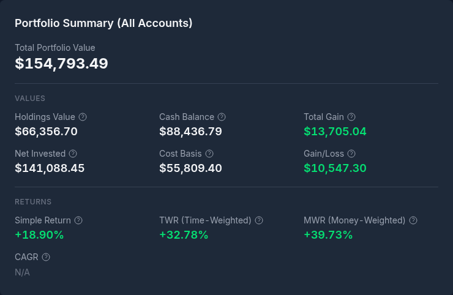
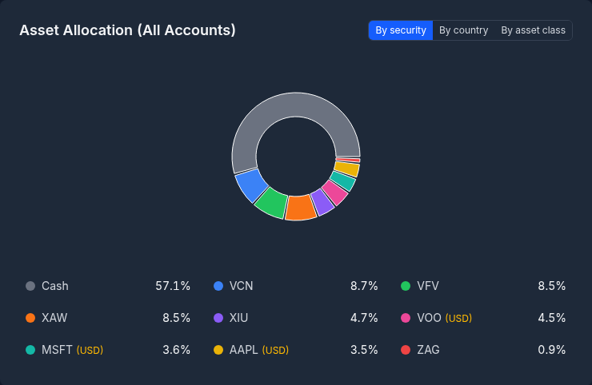
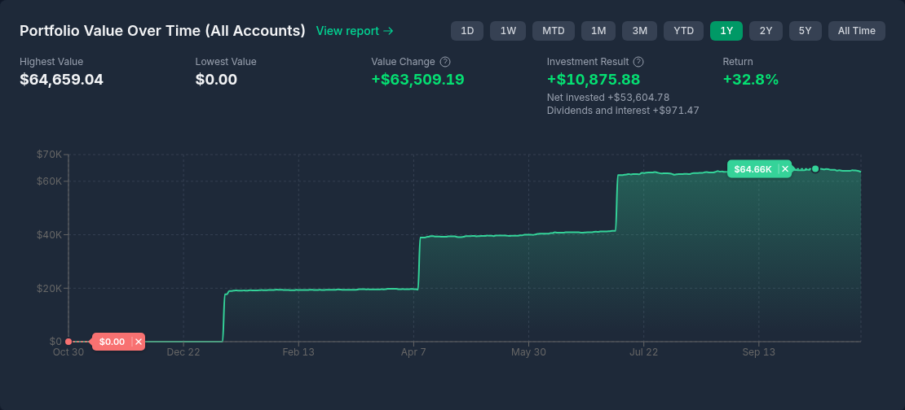
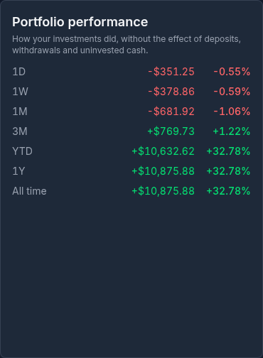
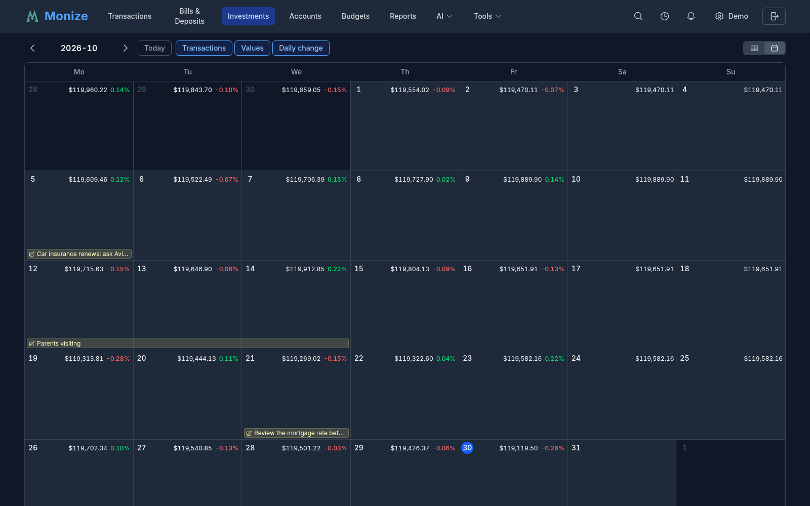
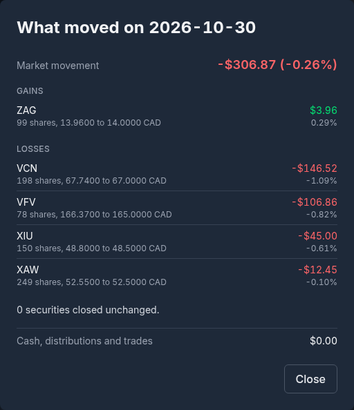
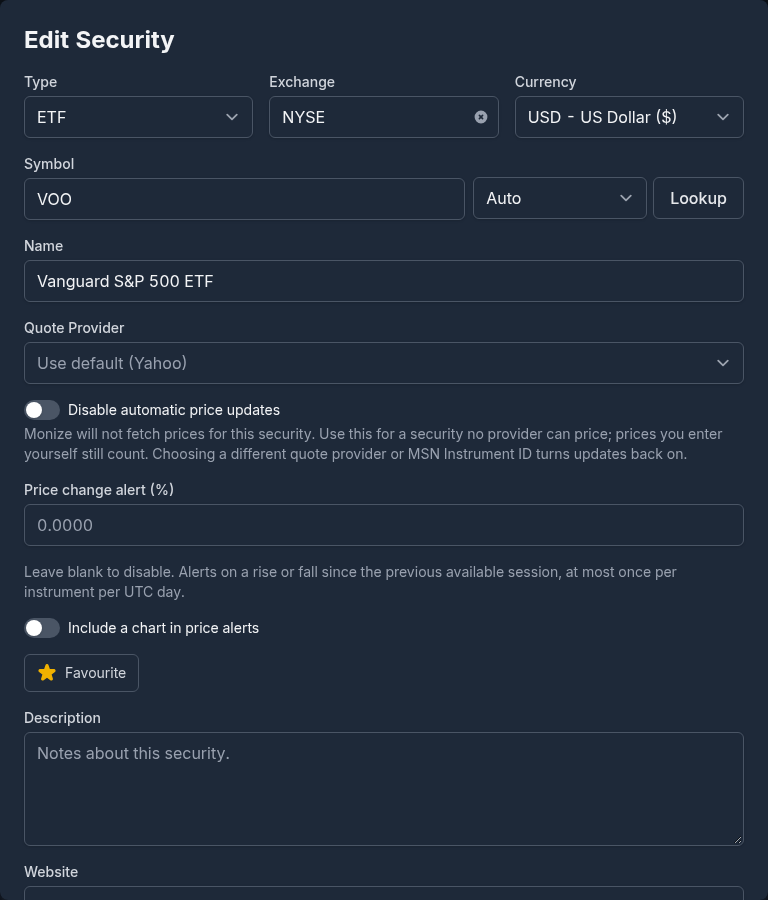
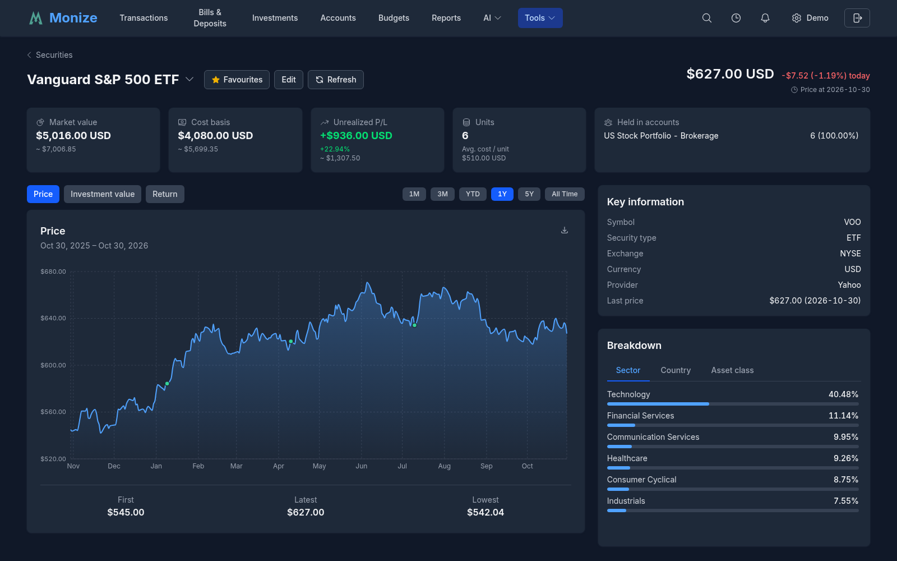
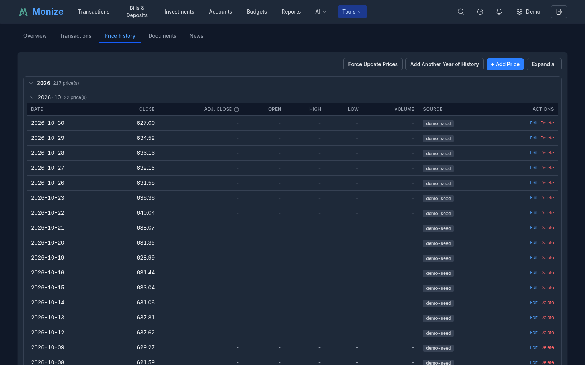

# Investments

Monize provides comprehensive investment portfolio tracking with automatic price updates, cost basis calculation, return measurement, and performance reporting.

---

## Overview

Navigate to **Investments** from the top navigation bar. The Investments page gives you a complete picture of your portfolio: current market values, gains and losses, returns, allocation, value over time, and every investment transaction.


At the top of the page:

- **All Investment Accounts** -- a multi-select list of your investment accounts. Tick one or more accounts to show only those; every card on the page then names the selection in its title
- **Refresh** -- fetches the latest prices for your securities (see [Price Updates](#price-updates)). Hover over it to see when prices were last updated
- **+ New Transaction** -- choose **Investment Transaction** (a buy, sell, dividend and so on) or **Cash Transaction** (a deposit, withdrawal or fee in the account's cash)

> **Tip:** You can open the Investments page already filtered to one account by clicking a brokerage account on the [Accounts](accounts.md) page or a brokerage favourite on the [Dashboard](dashboard.md).

---

## Investment Account Structure

Investment accounts in Monize are composed of two linked accounts:

| Component | Purpose |
|-----------|---------|
| **Brokerage Account** | Holds your securities (stocks, ETFs, mutual funds, bonds) |
| **Cash Account** | Tracks the cash balance within the brokerage |

When you create an investment account, both components are created automatically. The cash account is hidden from the main Accounts list but is managed through the Investments page.

### How It Works

- **Buying securities** decreases the cash balance and adds to holdings
- **Selling securities** increases the cash balance and reduces holdings
- **Dividends** increase the cash balance
- **Transfers** move cash in or out of the investment account

> **Microsoft Money users:** In Microsoft Money, the cash and securities are combined in a single investment account. Monize separates these for cleaner transaction tracking, but the import process handles this mapping automatically.

---

## Portfolio View

### Portfolio Summary

The **Portfolio Summary** card shows the **Total Portfolio Value** (holdings plus cash), then two groups of figures. Hover over any figure for an explanation of how it is worked out.



| Group | Figure | Description |
|-------|--------|-------------|
| **Values** | **Holdings Value** | The current market value of all the securities you hold |
| | **Cash Balance** | Uninvested cash sitting in your investment accounts |
| | **Total Gain** | Portfolio value minus net invested: realized and unrealized gains, dividends, and interest |
| | **Net Invested** | Your own money deposited, less withdrawals |
| | **Cost Basis** | What your current holdings cost, including purchase commissions |
| | **Gain/Loss** | Unrealized gain or loss: market value minus cost basis |
| **Returns** | **Simple Return** | (Market value - cost basis) / cost basis |
| | **TWR (Time-Weighted)** | The return of your investments, unaffected by when you deposited or withdrew money |
| | **MWR (Money-Weighted)** | The annual rate your own money earned, weighting each purchase, sale and dividend by when it happened |
| | **CAGR** | Your annualized growth rate based on net invested against the current value |

When a holding has no current price, or an exchange rate is missing, the card says the figures are incomplete, names what is missing, and shows **Portfolio Value (partial)** instead of a total.

### Asset Allocation

The **Asset Allocation** donut chart has a grouping toggle:

| Grouping | When available |
|----------|----------------|
| **By security** | Always |
| **By tag** | Only when your holdings are tagged |
| **By key** | Only when your holdings carry [`key:value` tags](tags.md#keyvalue-tags) |
| **By country** | Only when country allocation data exists |
| **By asset class** | Only when asset-class data exists (equities, fixed income, cash, and so on) |



Each view shows the top 10 slices plus an **Other** band that groups the remaining smaller holdings. Allocation percentages always reconcile against the drawn slices, so the legend and the chart agree exactly.

- **By key** charts your portfolio's value-weighted split across the values of a chosen [tag key](tags.md#portfolio-allocation-by-key) (for example, splitting by a `country` or `strategy` key).
- **By country** performs a **geographic look-through**: rather than grouping by an ETF's listing exchange, it looks *through* your funds to their underlying holdings and reports true country-level exposure -- the top 10 countries individually, with the rest collapsed into an **Other Countries** band.
- **By asset class** splits funds into their stock, bond and cash components, with the rest collapsed into an **Other Asset Classes** band. A security's country and asset-class split come from its price provider where available, or from the **Geographical Allocation** and **Asset Allocation** sections of the security's form.

### Portfolio Value Over Time

The **Portfolio Value Over Time** chart plots the value of your investments with a range selector: **1D**, **1W**, **MTD**, **1M**, **3M**, **YTD**, **1Y**, **2Y**, **5Y**, and **All Time**. The 1D and 1W ranges use intraday prices where the price provider supplies them. Hover over the chart to read the value on any day.

Under the range buttons, the chart reports for the selected window:

- **Highest Value** and **Lowest Value**
- **Value Change** -- the value at the end of the window less the value at the start
- **Investment Result** and **Return** -- what your investments earned over the window, leaving out deposits, withdrawals and uninvested cash, so buying and selling do not move it

A **View report** link opens the full [Portfolio Value Over Time report](reports.md#investment-reports) for a richer breakdown.



### Portfolio Performance

Beside the chart, the **Portfolio performance** card lists how your investments did over standard periods -- **1D**, **1W**, **1M**, **3M**, **YTD**, **1Y**, **2Y**, **5Y**, **10Y**, and **All time** -- each with the amount gained or lost and a time-weighted return. Deposits, withdrawals and uninvested cash are left out, so the figures measure your investments rather than your saving. Periods longer than your history are not shown.



### Holdings by Account

The **Holdings by Account** card lists your positions grouped by account. Each account's row shows its total market value and gain; click it to expand the positions.


Each holding displays:

| Column | Description |
|--------|-------------|
| **Symbol** | The security's symbol and name. Click it to open the [security's detail page](#security-detail-page) |
| **Shares** | Number of shares or units held |
| **Avg Cost** | Your average cost per share |
| **Price** | Latest market price |
| **Cost Basis** | What you paid for the holding |
| **Mkt Value** | Current total value (shares x price) |
| **Gain/Loss** | Difference from cost basis, in money and as a percentage |
| **% Port** | The holding's share of the portfolio |

Each account also has a **Cash** row with its **Available Balance** (click it to see the cash account's transactions) and an **Account Total**. Gains are shown in green and losses in red. Click a column heading to sort by it, and use **Columns** to choose which columns to show. Holdings in a foreign currency show their value in that currency and, converted, in your home currency.

### Transfers Recorded as Two Rows

If Monize finds a share transfer that was entered twice -- once as a Transfer Out in one account and once as a Transfer In in another -- a **Transfers recorded as two separate rows** card lists each pair with a **Link** button. Until the two rows are linked, the receiving account cannot inherit the cost basis, so its gain reads as unknown.

---

## Recent Transactions

The **Recent Transactions** section at the bottom of the page is the investment register. Two toggles control it:

- **Brokerage** / **Cash** -- the security transactions, or the transactions in the investment accounts' cash
- **Table** / **Calendar** -- a list, or a month calendar (see below)

In the table, the **Filter** button filters by **Symbol**, **Action**, and date range (**From** / **To**); the Cash register filters by **Payees**, **Categories**, and dates. Each row shows its date, account, action, symbol, shares, price, total, and reconciliation status, with **Edit** and **Delete** buttons. **+ New Brokerage Transaction** (or **+ New Cash Transaction**) adds a transaction.

### Investments Calendar

Switch to **Calendar** to see the month as a calendar. The **Layers** buttons choose what each day shows:

- **Transactions** -- the investment transactions on that day
- **Values** -- the portfolio's value at the end of the day
- **Daily change** -- how much the portfolio moved that day, as a percentage

Use the arrows and **Today** to move between months, or click the month to jump to another one. Notes you have added to days (from any calendar in Monize) appear as banners across their days. Click a day to add a note to it, or to start a new investment transaction on that date.



Click a day's percentage to open **What moved on** that date: the **Market movement** for the day, then the securities that rose (**Gains**) and fell (**Losses**), each with its shares and its price before and after. Cash, distributions and trades are reported separately, so a deposit is not mistaken for a gain.



For the biggest daily moves across your holdings at a glance, add the [Top Movers](dashboard.md#top-movers) widget to your dashboard.

---

## Investment Transaction Types

| Action | Description | Cash Impact |
|--------|-------------|-------------|
| **Buy** | Purchase securities | Cash decreases |
| **Sell** | Sell securities | Cash increases |
| **Dividend** | Cash dividend received | Cash increases |
| **Interest** | Interest income received | Cash increases |
| **Capital Gain** | A capital gain distribution | Cash increases |
| **Short-Term Capital Gain** / **Long-Term Capital Gain** | A capital gain distribution, by holding period | Cash increases |
| **Return of Capital** | A distribution that returns part of your investment; it lowers your cost basis | Cash increases |
| **Reinvest Dividend** | Dividend reinvested as additional shares | No cash change |
| **Reinvest Interest** | Interest reinvested as additional shares | No cash change |
| **Reinvest Short-Term Cap Gain** / **Reinvest Long-Term Cap Gain** | A capital gain distribution reinvested as additional shares | No cash change |
| **Stock Split** | Changes the number of shares (for example 2 new shares for every 1 old) | No cash change |
| **Add Shares** / **Remove Shares** | Add or remove shares without a purchase or sale (for example a gift or a correction) | No cash change |
| **Redeem CD/Bond** | A bond or certificate of deposit paying back its principal, with any accrued interest | Cash increases |
| **Transfer** | Move shares to another investment account, keeping their cost basis. The register shows the two sides as **Transfer Out** and **Transfer In** | No cash change |

---

## Creating Investment Transactions

1. Navigate to **Investments**
2. Click **+ New Transaction** and choose **Investment Transaction** (or use **+ New Brokerage Transaction** in the register)
3. Pick the **Brokerage Account** and the **Transaction Type**
4. Fill in the details and click **Create Transaction**


### Transaction Fields

| Field | Description |
|-------|-------------|
| **Brokerage Account** | The investment account (for a transfer, **From Account** and **To Account**) |
| **Date** | Transaction date |
| **Transaction Type** | Buy, Sell, Dividend, and so on (see above) |
| **Funds From (optional)** / **Funds To (optional)** | For a buy or sell, the account the money comes from or goes to. The linked cash account is the default |
| **Security** | The security involved. **+ Add new security** creates one without leaving the form |
| **Quantity (Shares)** | Number of shares or units |
| **Price per Share** | Price per share or unit |
| **Commission / Fees** | Any trading commission or fee |
| **Description (optional)** | Optional notes |
| **Status** | Unreconciled, Cleared, Reconciled, or Void. A void transaction stays in the register but moves no shares and no cash |
| **Total Amount** | The total, calculated from quantity, price and commission; you can also type the total and Monize works out the price |

Some types ask for different fields: a dividend, interest or distribution asks for an **Amount**; a stock split asks for **New shares** and **Old shares**; a transfer asks for the **Cost per Share**; a bond redemption asks for **Accrued Interest**. When the security trades in a different currency from the account, the form adds an **Exchange rate** and a **Converted Total**.

Use the arrow beside **Create Transaction** to choose **Create Transaction & New**, which saves and clears the form for the next entry. To change a transaction, click **Edit** on its row (the form then has **Update Transaction**).

---

## Securities Management

Securities represent the stocks, ETFs, mutual funds, bonds, and other instruments you hold.

### Accessing Securities

Navigate to **Tools > Securities** to manage your list of securities.


The page shows the **Total Securities**, **Types**, **Exchanges**, and **Currencies** you hold, a search box, and an **All** / **Active** / **Inactive** filter. Each row shows the security's **Symbol**, **Name**, **Type**, **Shares** held and their **Value**, **Exchange**, **Currency**, price **Provider**, the **Source** of the latest price, and its **Status**. Click the star to make a security a favourite, or click a row to open the [security's detail page](#security-detail-page).

### Security Fields

Click **+ New Security**, or **Edit** on a security's row, to open the security form. Type a symbol or name and click **Lookup** to fill in the details from the price provider.



| Field | Description |
|-------|-------------|
| **Symbol** | Ticker symbol (e.g., AAPL, VGRO.TO) |
| **Name** | Full name (e.g., Apple Inc.) |
| **Type** | Stock, ETF, Mutual Fund, Bond, Option, Cryptocurrency, or Other |
| **Exchange** | Stock exchange (NYSE, NASDAQ, TSX, etc.), filled in from the ticker |
| **Currency** | The currency the security trades in |
| **Quote Provider** | Where prices come from: Auto, Yahoo, MSN, LSE, Deutsche Börse, or the bond engine. Leave it on the default to use the instance's default provider |
| **Disable automatic price updates** | Stop fetching prices for a security no provider can price; you then enter its prices yourself |
| **Description** | Free-text notes, filled in from the provider's profile during lookup |
| **Website** / **Investor relations website** | Links shown on the detail page |
| **Tags** | Tags that drive the by-tag and by-key allocation views |
| **Geographical Allocation** / **Asset Allocation** | The fund's country and asset-class split, as percentages, where the provider does not supply it |
| **Price change alert (%)** | Notify you when the price rises or falls by at least this percentage from one session to the next (leave blank to turn off). **Include a chart in price alerts** adds a price chart to the alert |
| **Favourite** | Show the security first in lists |

Bonds also have a **Bond kind** and **Country**, which link the security to a supported government bond programme so Monize can work out its value.

### Adding Securities

Securities can be added:
- Manually from the Securities page
- From the investment transaction form (**+ Add new security**)
- During import (mapped or auto-created from your Microsoft Money or QIF data)

### Deactivating and Deleting Securities

A security you no longer hold can be **Deactivated** from its row: it disappears from the Active list but keeps its history. A security that is not used by any holding or investment transaction can be **Deleted**, which also deletes its price history. A security that is still referenced cannot be deleted until those transactions are removed.

### Exchange Priority

When looking up securities, Monize searches its price providers and ranks results by exchange. If you primarily invest on non-US exchanges, you can set **Preferred Exchanges** in **Settings** to prioritize results from your exchanges. See [Settings > Preferred Exchanges](settings-and-security.md#preferred-exchanges) for details.

---

## Security Detail Page

Click a security on the Securities page, or its symbol in the holdings list, to open its detail page. The header shows the latest price with the day's change ("today", or "last move" when the market has not traded today), whether the market is open, and the buttons **Favourites**, **Edit**, and **Refresh**. The arrow beside the name switches to another security.



Below the header:

- **Position cards** -- **Market value**, **Cost basis**, **Unrealized P/L**, **Units** with the **Avg. cost / unit**, and the accounts the security is **Held in**
- **Price chart** -- switch between **Price**, **Investment value** (what your position was worth), and **Return**, over 1M to All Time
- **Key information** -- symbol, type, exchange, currency, provider, and last price
- **Breakdown** -- the fund's weighting by **Sector**, **Country**, and **Asset class**

The tabs below hold the rest:

| Tab | What it shows |
|-----|---------------|
| **Overview** | **About** (the description, sector, industry, country, website, and tags), **Security performance** over standard periods, **Position info** (first and last transaction, total invested and sold, dividends, fees, realized P/L, total return), and the **Accounts** holding it |
| **Transactions** | Every transaction in this security, with **+ Add transaction** and **Adjust shares** |
| **Price history** | Every stored price, by year and month, with the tools to manage them (see below) |
| **Documents** | Links to the security's paperwork: factsheet, KIID, prospectus, annual reports, tax documents, research |
| **News** | Recent news about the security from the price provider |

---

## Price Updates

Security prices are updated automatically and can also be refreshed manually.

### Automatic Updates

- **Schedule:** Weekdays (Monday-Friday) at 5:00 PM New York time
- **Source:** Each security's quote provider -- Yahoo Finance by default, or MSN, the London Stock Exchange, Deutsche Börse, or the bond engine
- **Data:** Daily prices (close, plus open, high, low and volume where the provider supplies them)

### Manual Refresh

Click **Refresh** on the Investments page, the Securities page, a security's detail page, or the Dashboard to fetch the latest prices immediately.

### Manual Price Management

You can add, edit, and delete individual price entries for any security. This is useful for:
- Securities no provider can price (e.g., private funds, GICs)
- Correcting incorrect price data
- Adding NAV prices for mutual funds

To manage prices:
1. Open the security's detail page and its **Price history** tab
2. Click **+ Add Price** and enter the **Date** and **Close Price** (and optionally the open, high, low, and volume)
3. Use **Edit** or **Delete** on any row to correct or remove a price



Each price shows its **Source** -- the provider, a manual entry, or a transaction. Manual prices take priority over provider prices for the same date. If you delete a manual price and investment transactions exist on that date, Monize backfills the price from the transaction's buy or sell price.

The Price history tab also has **Force Update Prices**, which re-fetches the whole period you have held the security, and **Add Another Year of History**, which fetches one more year of older prices.

### Price Backfill from Transactions

Monize can populate security prices from your investment transaction history. When you buy or sell a security at a specific price, that price can be used to fill gaps in the price history. This is especially useful for securities with automatic price updates disabled, or securities no provider can price.

Transaction-based prices are created automatically during import. For existing data, an administrator can trigger a backfill from the browser console (see [Issues](#issues) below).

### Historical Prices

When you add a new security, Monize fetches its last year of prices so that historical valuations and charts are accurate. Use **Add Another Year of History** on the security's Price history tab to go further back.

---

## Holdings and Cost Basis

Monize tracks your cost basis using the **average cost method**.

### How Average Cost Works

1. When you **buy** shares, the total cost (including commission) is added to your cost basis
2. The average cost per share is: `total cost basis / total shares held`
3. When you **sell** shares, the cost basis for the sold shares is calculated using the average cost
4. **Reinvested dividends** add to both quantity and cost basis
5. A **return of capital** lowers the cost basis

### Example

| Transaction | Shares | Price | Total Cost | Total Shares | Avg Cost |
|------------|--------|-------|------------|--------------|----------|
| Buy 100 | 100 | $10 | $1,000 | 100 | $10.00 |
| Buy 50 | 50 | $12 | $1,600 | 150 | $10.67 |
| Sell 75 | -75 | $15 | $800 | 75 | $10.67 |

### Zero Holdings

When all shares of a security are sold, the holding is removed from your portfolio; its detail page shows the position as closed with its realized P/L. If you buy the same security again, a new cost basis starts from that purchase.

---

## Investment Reports

Monize includes 13 dedicated investment reports. Navigate to **Reports** and choose the **Investment** category to see them.

| Report | Description |
|--------|-------------|
| **Investment Performance** | Portfolio returns, gains/losses, and asset allocation |
| **Gains, Dividends & Interest** | Realized and unrealized capital gains plus dividend and interest income, with monthly breakdowns |
| **Sector Weightings** | Portfolio sector exposure from stocks and ETFs |
| **Realized Gains & Losses** | Tax planning with proceeds and cost basis analysis |
| **Portfolio Value Over Time** | Historical portfolio value trends and period returns |
| **Investment Transaction History** | Complete transaction log with action-type filtering |
| **Security Type Allocation** | Allocation by asset type (stocks, ETFs, bonds, etc.) |
| **Geographic/Exchange Allocation** | Geographic exposure by exchange and region |
| **Dividend Yield & Growth** | Yield tracking, per-security yields, and growth analysis |
| **Security Performance** | A single security's price chart and trades, or several securities and market indexes compared on one chart |
| **Currency Exposure** | Currency risk analysis across your portfolio |
| **Monte Carlo Simulation** | Project future portfolio outcomes with thousands of randomized return paths and a saved-scenario library |
| **GEM Strategy** | Track the Global Equities Momentum signal and whether your portfolio follows it |

You can also build your own holdings reports with the **Investment Report** builder. For full details, see [Reports](reports.md#investment-reports).

---

## Importing Investment Data

Importing investment data from Microsoft Money requires special handling. See the [Importing from Microsoft Money](importing-from-microsoft-money.md) guide for complete details.

### Key Points

- The recommended method is to import the `.mny` file directly. Investment accounts, securities, buys, sells, dividends, reinvestments, share transfers, stock splits and price history all come across in one pass, and share counts are reconciled against Money's own open tax lots afterwards
- If you use the older QIF method instead, Microsoft Money exports investment accounts as two separate QIF files: "Investment" type for securities transactions and "Regular" type for cash transactions
- Import the investment brokerage file first, then the cash file
- With QIF, securities must be mapped to existing records or created during import
- Monize automatically creates the linked cash transactions when importing investment QIF files

For the recommended QIF import order, see [Recommended Import Order](importing-from-microsoft-money.md#part-5-recommended-import-order).

## Issues
### Backfilling historical security price info does not complete
You may encounter an issue where backfilling historical security price info doesn't work, possibly because of price provider rate limits. For a single security, open its **Price history** tab and click **Force Update Prices**. To re-load every security at once, press F12 to open the browser developer tools while logged in as a Monize administrator. Go to the console and run:
```
fetch('/api/v1/securities/prices/backfill', {
  method: 'POST',
  headers: { 'x-csrf-token': decodeURIComponent(document.cookie.match(/csrf_token=([^;]+)/)?.[1]) }
}).then(r => r.json()).then(console.log)
```
### Backfilling historical price info from transaction info
Similarly, since version 1.5.8 Monize can use security transaction history to populate the security prices. This doesn't run on existing data automatically, but an administrator can trigger it from the browser console:
```
fetch('/api/v1/securities/prices/backfill-transactions', {
  method: 'POST',
  headers: { 'x-csrf-token': decodeURIComponent(document.cookie.match(/csrf_token=([^;]+)/)?.[1]) }
}).then(r => r.json()).then(console.log)
```
