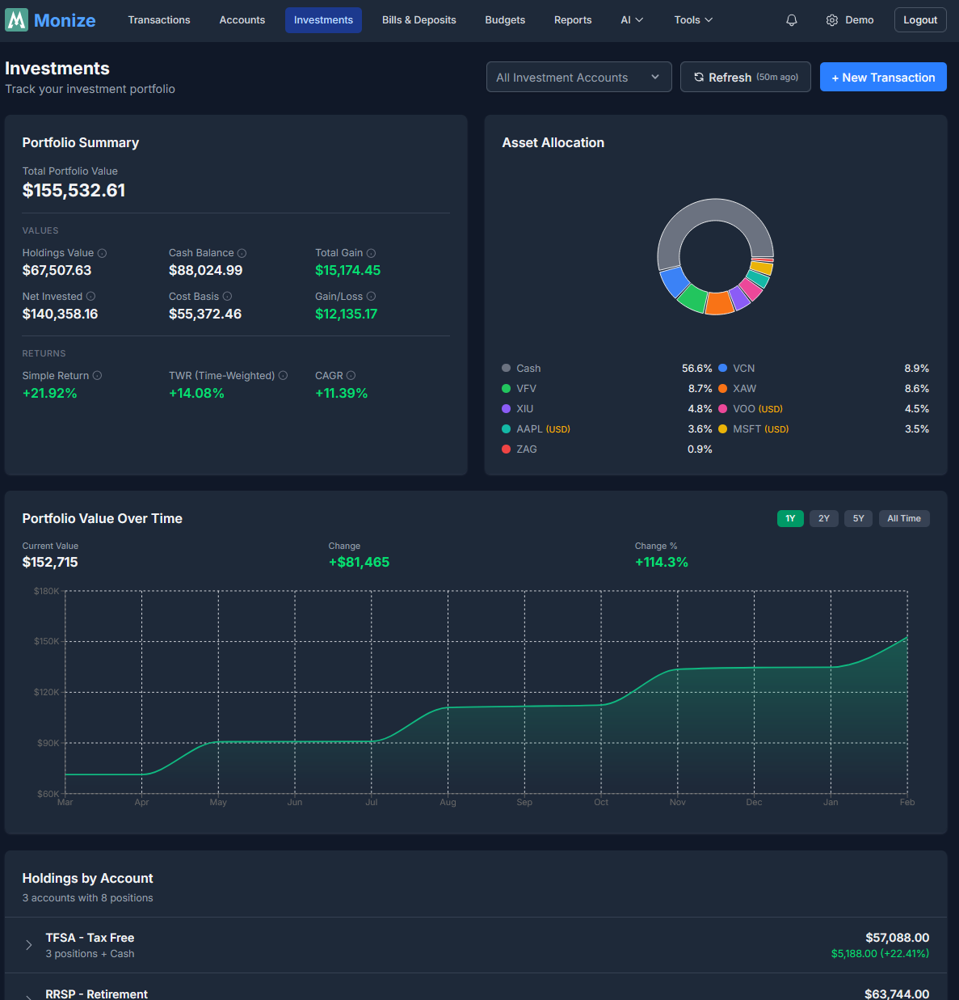
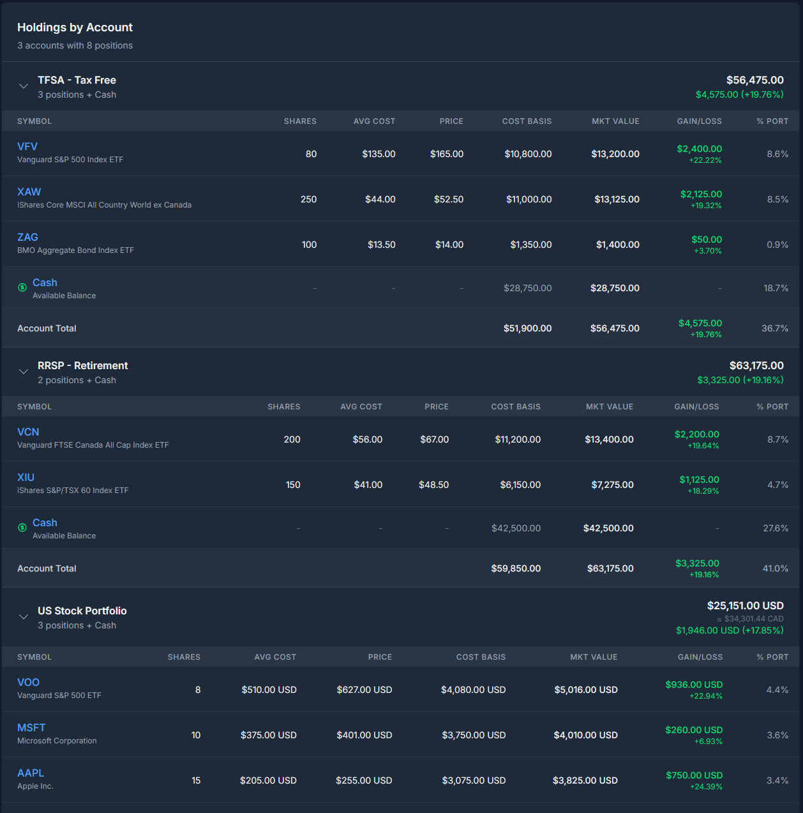
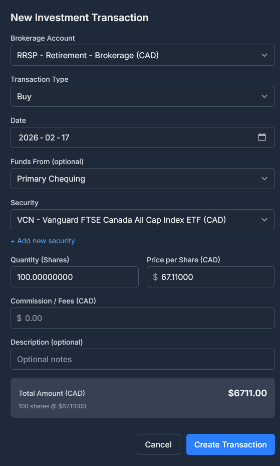
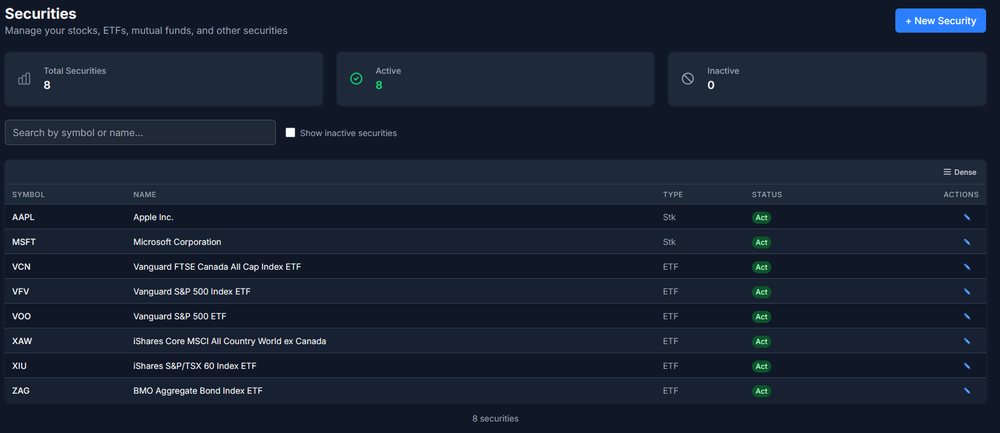

# Investments

Monize provides comprehensive investment portfolio tracking with automatic price updates, cost basis calculation, and performance reporting.

---

## Overview

The Investments page gives you a complete picture of your investment portfolio, including current market values, unrealized gains/losses, and daily price movements.


<!-- Screenshot: The investments page showing portfolio summary, holdings list, and account selection -->

---

## Investment Account Structure

Investment accounts in Monize are composed of two linked accounts:

| Component | Purpose |
|-----------|---------|
| **Brokerage Account** | Holds your securities (stocks, ETFs, mutual funds, bonds) |
| **Cash Account** | Tracks the cash balance within the brokerage |

When you create an investment account, both components are created automatically. The cash account is hidden from the main Accounts list but is managed through the Investments interface.

### How It Works

- **Buying securities** decreases the cash balance and adds to holdings
- **Selling securities** increases the cash balance and reduces holdings
- **Dividends** increase the cash balance
- **Transfers** move cash in or out of the investment account

> **Microsoft Money users:** In Microsoft Money, the cash and securities are combined in a single investment account. Monize separates these for cleaner transaction tracking, but the import process handles this mapping automatically.

---

## Portfolio View

The portfolio view shows all your investment holdings grouped by account. You can filter the view to a specific account using the account selector at the top of the page.

> **Tip:** You can navigate directly to the Investments page filtered by a specific account by clicking on a brokerage account from the [Accounts](accounts.md) page or from a brokerage favourite on the [Dashboard](dashboard.md).


<!-- Screenshot: The portfolio view showing holdings grouped by account with market values, gains, and percentages -->

### Portfolio Summary

At the top, a summary card shows:

- **Total Market Value** -- Current value of all investment holdings
- **Total Cost Basis** -- What you paid for all holdings
- **Total Unrealized Gain/Loss** -- The difference (both dollar and percentage)
- **Cash Balances** -- Total cash across all investment accounts

### Holdings List

Each holding displays:

| Column | Description |
|--------|-------------|
| **Security** | Name and symbol of the security |
| **Quantity** | Number of shares/units held |
| **Average Cost** | Your average cost per share |
| **Current Price** | Latest market price |
| **Market Value** | Current total value (quantity x current price) |
| **Unrealized Gain/Loss** | Difference from cost basis (both $ and %) |

Holdings are colour-coded: green for gains, red for losses.

### Asset Allocation

The Investments page includes an **Asset Allocation** donut chart with a grouping toggle:

| Grouping | When available |
|----------|----------------|
| **By security** | Always |
| **By tag** | Only when your holdings are tagged |
| **By key** | Only when your holdings carry [`key:value` tags](tags.md#keyvalue-tags) |
| **By country** | Only when country allocation data exists |

Each view shows the top 10 slices plus an **Other** band that groups the remaining smaller holdings. Allocation percentages always reconcile against the drawn slices, so the legend and the chart agree exactly.

- **By key** charts your portfolio's value-weighted split across the values of a chosen [tag key](tags.md#portfolio-allocation-by-key) (for example, splitting by a `country` or `strategy` key).
- **By country** performs a **geographic look-through**: rather than grouping by an ETF's listing exchange, it looks *through* your funds to their underlying holdings and reports true country-level exposure -- the top 10 countries individually, with the rest collapsed into an **Other Countries** band.

### Portfolio Value Over Time

The page also shows a **Portfolio Value Over Time** chart with a range selector (1D, 1W, 1M, and longer ranges up to All). A **View report** link opens the full [Portfolio Value report](reports.md#investment-reports) for a richer breakdown.

---

## Investment Transaction Types

Monize supports 9 investment transaction types:

| Action | Description | Cash Impact |
|--------|-------------|-------------|
| **Buy** | Purchase securities | Cash decreases |
| **Sell** | Sell securities | Cash increases |
| **Dividend** | Cash dividend received | Cash increases |
| **Interest** | Interest income received | Cash increases |
| **Capital Gain** | Realized or unrealized capital gains | Cash increases |
| **Reinvest** | Dividend reinvested as additional shares | No cash change |
| **Split** | Stock split adjustment | No cash change |
| **Transfer In** | Securities moved in from another account | No cash change |
| **Transfer Out** | Securities moved out to another account | No cash change |

---

## Creating Investment Transactions

1. Navigate to **Investments**
2. Select the brokerage account
3. Click **Add Transaction**
4. Select the transaction type (Buy, Sell, Dividend, etc.)
5. Fill in the details:


<!-- Screenshot: The investment transaction form showing security selection, action type, quantity, price, and commission fields -->

### Transaction Fields

| Field | Description |
|-------|-------------|
| **Date** | Transaction date |
| **Action** | Transaction type (Buy, Sell, etc.) |
| **Security** | The security involved |
| **Quantity** | Number of shares/units |
| **Price** | Price per share/unit |
| **Commission** | Any trading commission or fee |
| **Total** | Calculated total (quantity x price + commission) |
| **Description** | Optional notes |

---

## Securities Management

Securities represent the stocks, ETFs, mutual funds, bonds, and other instruments you trade.

### Accessing Securities

Navigate to **Tools > Securities** to manage your security master list.


<!-- Screenshot: The securities management page showing a list of securities with symbols, names, types, and exchanges -->

### Security Fields

| Field | Description |
|-------|-------------|
| **Symbol** | Ticker symbol (e.g., AAPL, VGRO.TO) |
| **Name** | Full name (e.g., Apple Inc.) |
| **Type** | STOCK, ETF, MUTUAL_FUND, BOND, GIC, CASH, or OTHER |
| **Exchange** | Stock exchange (NYSE, NASDAQ, TSX, etc.) |
| **Currency** | The currency the security trades in |
| **Description** | Free-text notes, auto-populated from the Yahoo provider profile during symbol lookup |
| **Tags** | User-assignable tags that drive the by-tag allocation view |

### Adding Securities

Securities can be added:
- Manually from the Securities page
- During import (mapped or auto-created from QIF data)
- Automatically when creating investment transactions

### Deleting Securities

Securities that are not used in any investment account can be deleted from the Securities page. Click the delete button next to a security to remove it. If the security is referenced by any holdings or investment transactions, it cannot be deleted until those references are removed.

### Exchange Priority

When looking up securities, Monize searches Yahoo Finance and ranks results by exchange. If you primarily invest on non-US exchanges, you can set **Preferred Exchanges** in **Settings** to prioritize results from your exchanges. See [Settings > Preferred Exchanges](settings-and-security.md#preferred-exchanges) for details.

---

## Price Updates

Security prices are updated automatically and can also be refreshed manually.

### Automatic Updates

- **Schedule:** Weekdays (Monday-Friday) at 5:00 PM EST
- **Source:** Yahoo Finance
- **Data:** Daily OHLCV (Open, High, Low, Close, Volume)

### Manual Refresh

Click the **Refresh Prices** button on the Investments page or Dashboard to trigger an immediate price update.

### Manual Price Management

You can add, edit, and delete individual price entries for any security. This is useful for:
- Securities not tracked by Yahoo Finance (e.g., private funds, GICs)
- Correcting incorrect price data
- Adding NAV prices for mutual funds

To manage prices:
1. Navigate to **Tools > Securities**
2. Click on a security to view its price history
3. Use the **Add Price**, **Edit**, or **Delete** buttons on individual entries

Manual prices (source: "manual") take priority over Yahoo Finance prices for the same date. If you delete a manual price and investment transactions exist on that date, the system automatically backfills the price from the transaction's buy/sell price.

### Price Backfill from Transactions

Monize can populate security prices from your investment transaction history. When you buy or sell a security at a specific price, that price can be used to fill gaps in the price history. This is especially useful for securities with `skipPriceUpdates` enabled or securities not available on Yahoo Finance.

Transaction-based prices are automatically created during import. For existing data, you can trigger a manual backfill from the browser console (see [Issues](#issues) below).

### Historical Prices

When you import investment data or add a new security, Monize automatically backfills historical prices (up to 10 years). This ensures accurate portfolio valuation for historical reporting.

---

## Holdings and Cost Basis

Monize tracks your cost basis using the **average cost method**.

### How Average Cost Works

1. When you **buy** shares, the total cost is added to your cost basis
2. The average cost per share is: `total cost basis / total shares held`
3. When you **sell** shares, the cost basis for the sold shares is calculated using the average cost
4. **Reinvested dividends** add to both quantity and cost basis

### Example

| Transaction | Shares | Price | Total Cost | Total Shares | Avg Cost |
|------------|--------|-------|------------|--------------|----------|
| Buy 100 | 100 | $10 | $1,000 | 100 | $10.00 |
| Buy 50 | 50 | $12 | $1,600 | 150 | $10.67 |
| Sell 75 | -75 | $15 | $800 | 75 | $10.67 |

### Zero Holdings

When all shares of a security are sold, the holding is removed from your portfolio. If you buy the same security again, a new cost basis starts from that purchase.

---

## Investment Reports

Monize includes 12 dedicated investment reports for comprehensive portfolio analysis. Navigate to **Reports** and filter by the **Investment** category to access them.

| Report | Description |
|--------|-------------|
| **Investment Performance** | Portfolio returns, gains/losses, and asset allocation |
| **Dividend & Interest Income** | Passive income tracking with monthly breakdowns |
| **Sector Weightings** | Portfolio sector exposure from stocks and ETFs |
| **Realized Gains & Losses** | Tax planning with proceeds and cost basis analysis |
| **Portfolio Value Over Time** | Historical portfolio value trends and period returns |
| **Investment Transaction History** | Complete transaction log with action-type filtering |
| **Security Type Allocation** | Allocation by asset type (stocks, ETFs, bonds, etc.) |
| **Geographic/Exchange Allocation** | Geographic exposure by exchange and region |
| **Dividend Yield & Growth** | Yield tracking, per-security yields, and growth analysis |
| **Individual Security Performance** | Deep dive into a single security with price chart and trade markers |
| **Currency Exposure** | Currency risk analysis across your portfolio |
| **Monte Carlo Simulation** | Project future portfolio outcomes with thousands of randomized return paths and a saved-scenario library |

For full details, see [Reports](reports.md#investment-reports).

---

## Importing Investment Data

Importing investment data from Microsoft Money requires special handling. See the [Importing from Microsoft Money](importing-from-microsoft-money.md) guide for complete details.

### Key Points

- The recommended method is to import the `.mny` file directly. Investment accounts, securities, buys, sells, dividends, reinvestments, share transfers, stock splits and price history all come across in one pass, and share counts are reconciled against Money's own open tax lots afterwards
- If you use the older QIF method instead, Microsoft Money exports investment accounts as two separate QIF files: "Investment" type for securities transactions and "Regular" type for cash transactions
- Import the investment brokerage file first, then the cash file
- With QIF, securities must be mapped to existing records or created during import
- Monize automatically creates the linked cash transactions when importing investment QIF files

For the recommended QIF import order, see [Recommended Import Order](importing-from-microsoft-money.md#part-5-recommended-import-order).

## Issues
### Backfilling historical security price info does not complete
You may encounter an issue where backfilling historical security price info doesn't work, possibly because of Yahoo Finance rate limits. To trigger a manual re-load, press F12 to open up Browser Developer Tools while logged in as a Monize administrator. Go to the console and run:
```
fetch('/api/v1/securities/prices/backfill', {
  method: 'POST',
  headers: { 'x-csrf-token': decodeURIComponent(document.cookie.match(/csrf_token=([^;]+)/)?.[1]) }
}).then(r => r.json()).then(console.log)
```
### Backfilling historical price info from transaction info
Similarly, a new feature in 1.5.8 uses security transaction history to populate the security prices. This doesn't trigger on existing datasources, but can be manually triggered from the browser console:
```
fetch('/api/v1/securities/prices/backfill-transactions', {
  method: 'POST',
  headers: { 'x-csrf-token': decodeURIComponent(document.cookie.match(/csrf_token=([^;]+)/)?.[1]) }
}).then(r => r.json()).then(console.log) 
```