# Reports

Monize includes 48 built-in reports across 10 categories, plus custom report builders for your transactions and your investment holdings.

---

## Overview

Navigate to **Reports** from the top navigation bar. The Reports page lists every built-in report and every custom report you have saved, each as a card with its category, name, and a one-line description. Click a card to open the report.

- **Search reports by name or description...** -- narrows the list as you type
- **Category** -- buttons for **All Reports** and each category, each with the number of reports in it. Monize remembers the category you picked
- **Density** -- the button showing **Normal**, **Compact**, or **Dense** cycles between three layouts; Dense shows the reports as a table. On a phone the reports are a two-column grid of tiles
- **New Report** -- create a custom report (see [Custom Report Builder](#custom-report-builder))

---

## Report Categories

| Category | Description |
|----------|-------------|
| **Spending** | Expense breakdowns by category, payee, and time |
| **Income** | Income analysis and cash flow |
| **Net Worth** | Net worth trends and account balances |
| **Tax** | Tax-relevant summaries and payroll deductions |
| **Debt & Loans** | Debt payoff projections, amortization schedules, and credit use |
| **Investment** | Portfolio performance, allocation, transaction history, and planning |
| **Insights** | Behavioural patterns, anomalies, money flows, and fees |
| **Maintenance** | Data quality and cleanup tools |
| **Bills** | Scheduled transaction calendars and payment history |
| **Budget** | Budget tracking, health scores, and trend analysis |
| **Custom** | The custom transaction reports you have saved |

Every report is always listed. A report that needs data you do not have yet -- an investment account, a budget, a loan -- opens with a message saying so.

---

## Using a Report

Every report page has a **Back to Reports** link and, beside its title, an arrow (**Switch to another report**) that opens a searchable list of every report -- your favourites first, then each category -- so you can move between reports without going back to the list.

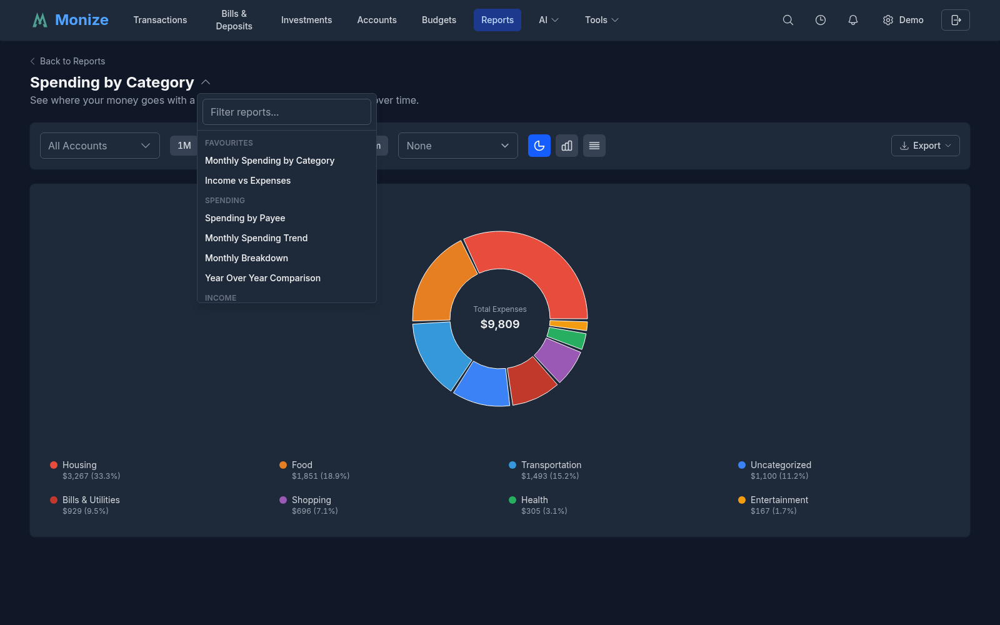

### Date Range Selection

Most reports have a row of range buttons above the chart. Each report offers the ranges that suit it, from **1D**, **1W**, **MTD**, and **1M** through **3M**, **6M**, **YTD**, **1Y**, **2Y**, **5Y**, and **10Y** to **All Time**. Many also have **Custom**, which shows **Start Date** and **End Date** fields for any range you like.

### Account Selection

Reports that can be limited to some of your accounts have an accounts selector. Monize remembers your selection for each report between visits.

### Filtering from Reports to Transactions

You can click most data points -- a bar, a pie segment, a Sankey flow, or a table row -- to open the Transactions page with filters pre-applied, so you can drill down from a summary to the transactions behind it. A payee opens exactly that payee's transactions.

On the **Income vs Expenses** report, clicking an income or expense bar filters by the corresponding **category type** (income categories or expense categories), so you see exactly the transactions that contributed to that bar.

### Partial Figures

When a figure cannot be worked out completely -- for example an amount in a currency with no exchange rate -- the report says which figures are partial and what is missing (such as the currency to add a rate for on the [Currencies](currency-management.md) page) instead of showing a wrong total.

---

## Built-In Reports

### Spending Reports

| Report | Description |
|--------|-------------|
| **Spending by Category** | See where your money goes with a breakdown of expenses by category over time |
| **Spending by Payee** | Track how much you spend with each merchant or vendor over time |
| **Monthly Spending Trend** | View your spending patterns month over month to identify trends |
| **Monthly Breakdown** | Expense and income by category, month by month, with subtotals, a total, and an average per month. Switches turn on **Include current month**, **Show percentages**, and **Highlight deviations** (months well above or below the category's average). Transfers are listed separately, and a cell opens its transactions |
| **Year Over Year Comparison** | Compare this year's income, expenses, and savings with up to four previous years |

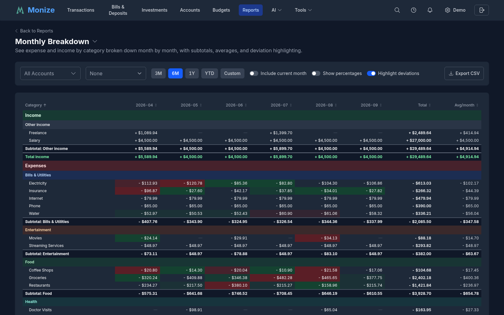

### Income Reports

| Report | Description |
|--------|-------------|
| **Income vs Expenses** | Compare your income to expenses and track your savings rate over time |
| **Income by Source** | Break down your income streams to understand where your money comes from |
| **Cash Flow Statement** | Detailed view of money coming in and going out across all accounts |

#### Tag Breakdowns

**Income vs Expenses** and **Cash Flow Statement** can split their figures by a [tag key](tags.md#keyvalue-tags). Choose a key in **Break down by tag key** (for example `project`) and the report adds a breakdown with a tab for each of the key's values (and one for untagged rows), showing that value's income, expenses, tagged inflows and outflows, **Balance**, and **Balance %**. Tick **Include tagged transfers** to count transfers that carry the tag as well.

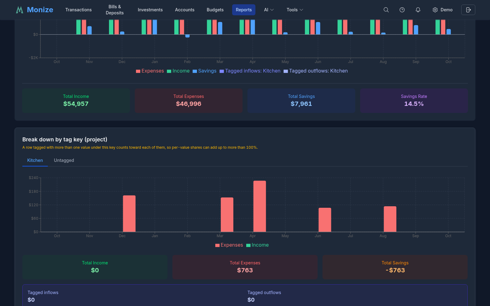

**Spending by Category**, **Income by Source**, **Budget vs Actual**, and **Monthly Breakdown** can instead focus on a single **Tag value**: they then show the **Available funds** for that value (its income plus the transfers tagged with it) next to what was spent.

### Net Worth Reports

| Report | Description |
|--------|-------------|
| **Net Worth Over Time** | Track your total net worth including all accounts, assets, and liabilities. The **Bar style** switch shows each month as one **Net worth** bar or stacked **By account type** |
| **Account Balances** | See what every account was worth on any date you pick (**Balance as of**), grouped by assets and liabilities, account type, institution, open or closed, or favourite, and sorted by name or balance. Filters narrow it to some institutions, account types, or statuses |

### Tax Reports

Payroll deductions with yearly maximums are tracked on the [Taxes](taxes.md) page.

| Report | Description |
|--------|-------------|
| **Tax Summary** | Annual summary of tax-deductible expenses and taxable income, for reference |
| **Payroll Deductions** | For each payroll deduction category, the year's total against its maximum, paycheque by paycheque, and every year on record. Pick the **Year** to show. Until you have set up a payroll deduction rule, it offers **Open Payroll Deductions** |

### Debt & Loans Reports

| Report | Description |
|--------|-------------|
| **Debt Payoff Timeline** | Visualize your debt reduction progress with projections for payoff dates. Shows balance over time with historical payments and projected payoff, payment breakdowns (principal vs interest), and summary metrics including estimated payoff date. Supports multiple payment frequencies and Canadian mortgage calculations. |
| **Loan Amortization Schedule** | Detailed payment schedules for mortgages and loans with principal vs interest breakdown for each payment period |
| **Credit Utilization** | See how much of your available credit you are using across credit cards and lines of credit. |
| **Loan Overpayment Simulator** | Pick a loan and model extra payments to see how much sooner it would be paid off and how much interest you would save. Includes an account selector across all your debt accounts and mirrors the loan detail page's simulator (rendering the revolving view for a line of credit). |

> **Note:** The debt and loan reports work with Loan, Mortgage, and Line of Credit accounts; Credit Utilization also covers credit cards.

#### Loan Detail Page Tools

Beyond the reports above, each loan, mortgage, and line of credit has a dedicated **account detail page** with interactive planning tools. (The Loan Overpayment Simulator report embeds these same tools with an account selector.)

| Tool | What it does |
|------|--------------|
| **Overpayment Simulator** | Model extra payments and see how much sooner the loan would be paid off and how much interest you would save. Supports a recurring extra payment (with optional start and end dates, at a chosen frequency) plus up to 50 one-off lump sums, and surfaces a detected-extra-principal hint from your payment history that you can apply with one click. A payoff timeline chart compares the baseline projection against your overpayment scenario. Simulations never change your scheduled payments. |
| **Goal-Seek** | Work backwards from a target instead of guessing an amount. Choose **"save $X of interest"** or **"be paid off by this month"**, and the simulator solves for the recurring extra payment that hits it -- the solved amount drops straight into the simulator so the schedule, chart, and savings cards all recompute at once. Targets already met report zero needed; unreachable targets say so. |
| **Saved Scenarios** | Save and name overpayment scenarios per loan so you can revisit and compare different payoff plans over time. Scenarios can be loaded (click a row), renamed, and deleted. Once you have saved more than one, a **scenario comparison chart** draws each as an arc from today to its payoff date, its height being the interest it saves versus paying the minimum (narrower and taller is better) -- with an interactive legend and a tooltip reporting each scenario's real interest saved and payoff date. The panel exports **CSV** and a **PDF** report (headline cards, the chart, and the comparison table). |
| **Impact of Overpayments Made** | A past-impact section showing how the payments you have already made compare to the original contractual schedule -- extra principal already paid, time already saved, and interest already saved. |
| **Rate History** | Track interest-rate changes over the life of the loan. Add, edit, and delete rate changes with an effective date; when a rate changes you can keep the current payment (shifting the payoff timeline), set a new payment amount, or recalculate the payment to stay on schedule. A **Detect** button infers past rate changes from your payment history -- including loans where the bank books interest separately from principal -- and entries are badged as **Manual**, **Inferred**, or **Initial**. Detection is **non-destructive**: your account's own rate and payment are set only in the edit form and are never silently overwritten, and when a rate change would affect a linked scheduled payment, Monize shows a before/after preview and asks permission first. |

> **Exports:** The Loan Schedule, Rate History, and scenario comparison **export to CSV** from the loan detail page, and the payoff comparison chart exports to **PNG**.

### Investment Reports

Monize includes 13 investment reports for comprehensive portfolio analysis.

| Report | Description |
|--------|-------------|
| **Investment Performance** | Track portfolio returns, gains/losses, and asset allocation over time. Shows current portfolio value, cost basis, total gain/loss, and return percentage with holdings and allocation views. |
| **Gains, Dividends & Interest** | Track capital gains and losses (realized and unrealized) alongside dividend and interest income, by month, by day, or by security |
| **Sector Weightings** | Analyze portfolio sector exposure from individual stocks and ETFs, with drill-down showing direct stock vs ETF exposure per sector |
| **Realized Gains & Losses** | Track realized gains and losses from sold securities for tax planning and performance review, with proceeds, cost basis, and transaction counts |
| **Portfolio Value Over Time** | Visualize total investment portfolio value with historical trends, period returns, and portfolio breakdown. Offers a Total view and a **By-security** stacked-area view (each holding plus a cash band and a rolled-up "other securities" band), a per-security **table view**, **CSV export**, and works across **intraday 1D/1W/1M** ranges as well as longer periods. Like the Investments page chart, it separates the **Value Change** from the **Investment Result**, which leaves out your deposits and withdrawals. |
| **Investment Transaction History** | Complete history of all investment transactions with filtering by action type (buy, sell, dividend, etc.), account, and date |
| **Security Type Allocation** | View portfolio allocation by asset type (stocks, ETFs, mutual funds, bonds) with drill-down into individual holdings |
| **Geographic/Exchange Allocation** | Analyze portfolio geographic exposure by region, by exchange, or by country (looking through funds to their holdings), with bar chart and pie chart views |
| **Dividend Yield & Growth** | Track portfolio dividend yield, per-security yields, year-over-year growth, and payment frequency analysis |
| **Security Performance** | Deep dive into a single security with price history chart (including buy/sell markers), transaction history, and dividend history. You can also select **multiple securities and market indexes** (such as the S&P 500 or the S&P/TSX Composite) **to compare**, or switch to an **All securities** view that draws every active security's cumulative percent return on one chart -- each rebased to 0% at its first available price, so holdings at different price levels and currencies share a single axis. The comparison chart **exports to PDF**, and the report supports account-type and text filters. |
| **Currency Exposure** | Understand currency risk with portfolio allocation by currency, showing native and converted values with exchange rate details |
| **Monte Carlo Simulation** | Project future portfolio outcomes with thousands of randomized return paths and a saved-scenario library (see below) |
| **GEM Strategy** | Track the Global Equities Momentum signal, why it changed, and whether your portfolio matches it (see below) |

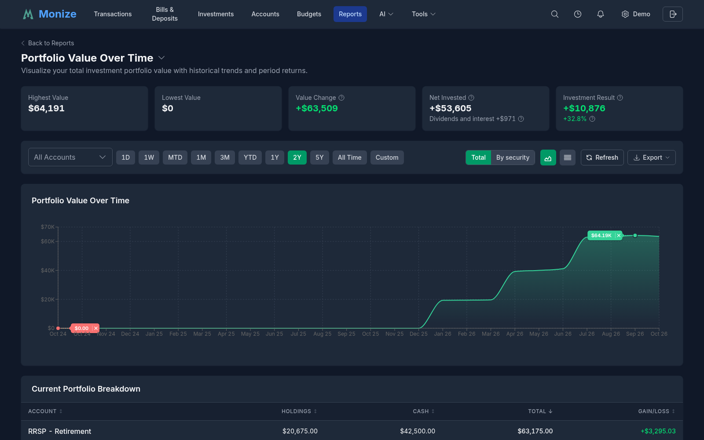

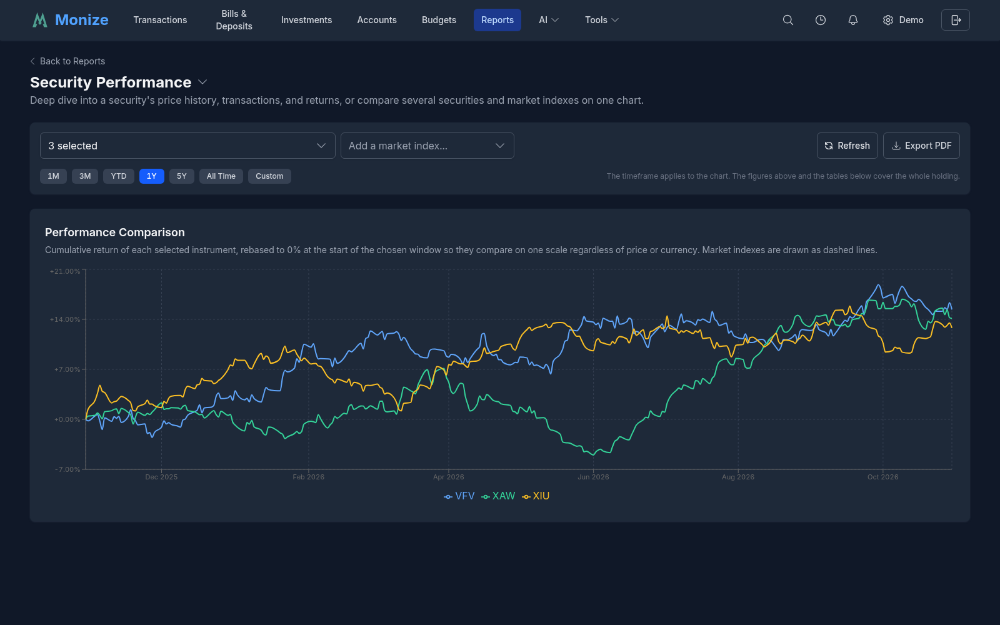

Investment reports have a **Refresh** button beside the export button to fetch the latest security prices first.

#### Monte Carlo Simulation

The Monte Carlo report projects how a portfolio could grow (and be drawn down) by running thousands of randomized market paths.

1. Pick a saved scenario from the **Scenarios** list, or click **New**
2. Fill in the scenario inputs:
   - **Scenario name** and the **Investment accounts** to model
   - **Starting value**, or tick **Use current balance on each run** to start from the accounts' value
   - **Contribution phase** -- **Years**, **Annual contribution**, and **Contribution growth**
   - **Withdrawal phase** -- **Years**, **Annual withdrawal** (in today's money, grown with inflation), and an optional **Target (today's value)**
   - **Additional cash flows** -- **+ Add cash flow** for one-time or recurring inflows and outflows, such as a pension or a home purchase, optionally adjusted for inflation
   - **Return assumptions** -- **Specify expected return** (with **Expected return** and **Volatility**), or **Use historical returns from selected accounts**; plus **Inflation** and the number of **Simulations**
3. Click **Run simulation**

The results show the **Median final** value, the **10th–90th percentile** range, the **Probability of Depletion**, and, with a target, the **Probability Above Target**, over a fan chart of the projected portfolio value (switch to **Table** for the figures by year) and a **Performance Summary**. Tick **Show in today's value** to adjust for inflation.

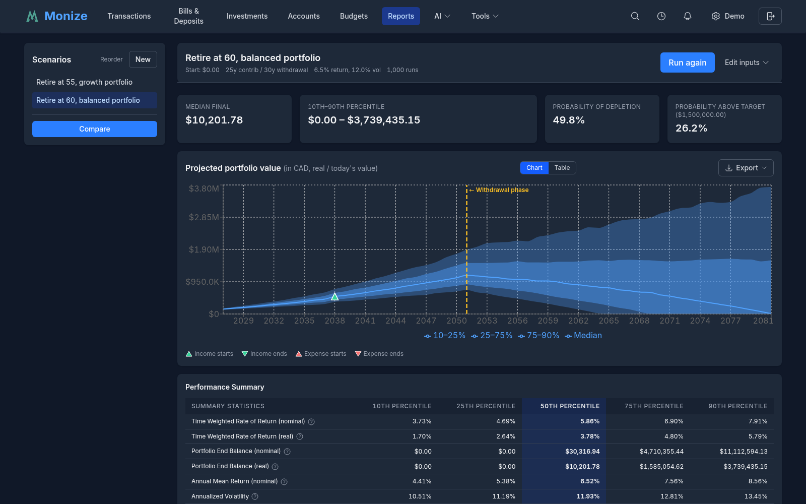

Click **Save scenario** to keep the inputs, or **Save as...** to keep them under a new name. After a run, **Edit inputs** reopens the inputs and **Run again** reruns the scenario. To compare scenarios, click **Compare** under the Scenarios list, tick two to four scenarios, and click **Compare selected**: the comparison page runs them side by side and offers **Download CSV**.

#### GEM Strategy

The **GEM Strategy** report follows the Global Equities Momentum strategy: at each evaluation it compares the 12-month returns of US equities (the S&P 500), developed markets outside the US, emerging markets, and a safe asset, and names the one asset to hold. Assign an instrument to each role and one or more of your investment accounts in **Settings**; the tabs then show the **Overview** (the current signal, your portfolio against it, and what to transfer), the **Signals** history, **My portfolio**, and a **Backtest**. You can keep several scenarios and switch between them. A change of signal can also send you a notification.

### Insights Reports

| Report | Description |
|--------|-------------|
| **Recurring Expenses Tracker** | Identify and monitor subscriptions, memberships, and recurring charges |
| **Spending Anomalies** | Detect unusually large transactions and spending spikes that need attention |
| **Weekend vs Weekday Spending** | Analyze your spending patterns based on day of week to understand habits |
| **Monthly Comparison** | Compare any month to the previous month across income, expenses, net worth, and investments |
| **Cash Flow Sankey** | See where your money came from and where it went: income flowing into spending, savings, investments and debt payments, with what was left over or drawn from your balances. The **Detail** switch shows categories or subcategories; click a flow to open its transactions |
| **Foreign Currency Transaction Fees** | Track the foreign-transaction fees charged by accounts that apply a conversion fee. See [Currency Management](currency-management.md#foreign-transaction-fees) |

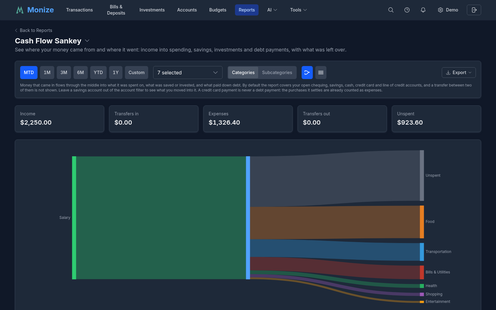

### Maintenance Reports

| Report | Description |
|--------|-------------|
| **Uncategorized Transactions** | Find and categorize transactions that are missing categories |
| **Duplicate Transaction Finder** | Identify potential duplicate entries that may need review or deletion |

### Bills Reports

| Report | Description |
|--------|-------------|
| **Upcoming Bills Calendar** | Visual calendar of scheduled transactions and upcoming bill due dates |
| **Bill Payment History** | Track payment patterns and history for recurring bills and scheduled transactions |

### Budget Reports

| Report | Description |
|--------|-------------|
| **Budget vs Actual** | Compare your budgeted amounts to actual spending over time across all categories |
| **Budget Health Score** | Get a 0--100 health score for your budget with detailed per-category impact analysis |
| **Seasonal Spending Patterns** | Discover seasonal trends and high-spending months across your budget categories |
| **Budget Trend** | Line chart showing total budgeted vs total actual spending over 6--12 months to track improvement |
| **Category Performance** | Table showing each category's budget performance over multiple months with trend indicators |
| **Savings Rate** | Track your savings rate (income minus expenses divided by income) over time vs your target |
| **Health Score History** | Line chart of monthly budget health scores showing your financial trajectory over time |
| **Flex Group Analysis** | Stacked bar chart for each flex group showing component categories with group limit reference |
| **Seasonal Spending Map** | Heatmap grid showing 12 months across all categories to identify seasonal spending patterns |

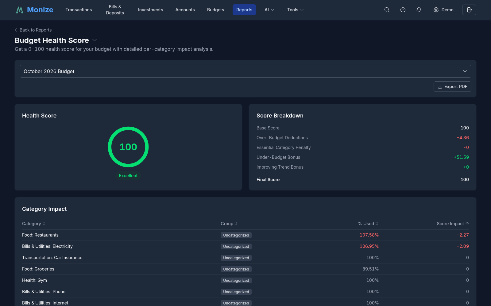

> **Note:** Budget reports need at least one budget. For more details, see [Budgets](budgets.md#budget-reports).

---

## Custom Report Builder

Create your own reports with flexible filtering, grouping, and visualization options. Click **New Report** on the Reports page and choose:

- **Standard Report** -- a report over your transactions (described here)
- **Investment Report** -- a table of your holdings (see [Custom Investment Reports](#custom-investment-reports))

### Report Configuration

| Section | Setting | Options |
|---------|---------|---------|
| **Basic Information** | **Report Name** | A descriptive name for your report |
| | **Description (optional)**, **Icon**, **Background Color** | How the report's card looks on the Reports page |
| **Visualization** | **View Type** | Table, Line Chart, Bar Chart, or Pie Chart |
| | **Group By** | No Grouping, Category, Payee, Year, Month, Week, Day, or Tag |
| **Table Configuration** (Table only) | **Columns to Display** | Which columns the table shows |
| | **Sort By** / **Sort Direction** | Default or any column, Ascending or Descending |
| **Time Period** | **Timeframe** | Last 7 Days, Last 30 Days, Last Month, Last 3 Months, Last 6 Months, Last 12 Months, Last Year, Year to Date, or Custom Range (with **Start Date** and **End Date**) |
| **Aggregation Options** | **Metric** | No Aggregation, Total Amount, Transaction Count, Average Amount, or Budget Variance |
| | **Direction** | Income Only, Expenses Only, or Both |
| | **Include transfers** | Count transfers between your accounts |
| | **Add to favourites** | Star the report as soon as it is created |

Click **Create Report** to save it. It then appears on the Reports page under **Custom**.

### Report Filters

The **Filters (optional)** section narrows the report to the transactions you care about. With no filters, every transaction is included.

1. Click **Add filter group**
2. In the group, pick a field -- **Account**, **Category** (which also offers *Uncategorized* and *Transfers*), **Payee**, **Tag**, or **Text** (a free-text search on the transaction's details) -- and a value
3. Click **Add OR condition** to add another condition to the same group: a transaction matches the group if it matches any of its conditions
4. Click **Add AND group** to add another group: a transaction must match every group

For example, one group with *Category = Restaurants* OR *Category = Coffee Shops*, AND a second group with *Account = Visa Rewards*, reports dining out paid with that card.

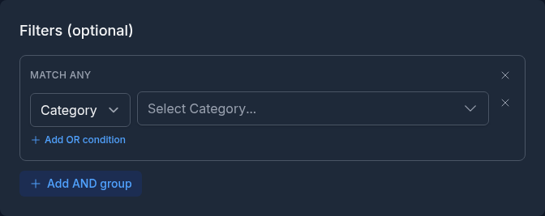

### Custom Investment Reports

An **Investment Report** is a table of your holdings with the columns you choose, valued on a date you choose.

| Section | Setting |
|---------|---------|
| **Basic Information** | **Report Name**, **Description (optional)**, **Icon**, **Background Color** |
| **Columns** | Choose from about 40 columns (quantity, average cost, cost basis, last price, market value, gain, % gain, type, currency, and more). Remove a column with its remove button, add one from **Available columns**, and drag to reorder. Symbol is always included |
| **Accounts** | **Investment accounts to include** -- leave empty for all |
| **Grouping & Sorting** | **Group By** (No Grouping, Account, Symbol, or Currency), **Sort By**, and **Sort Direction**. Tick **Combine the same security held in multiple accounts** to show one row per security |
| **Report Date** | **As of date** -- leave empty to always value the report on the latest market day |

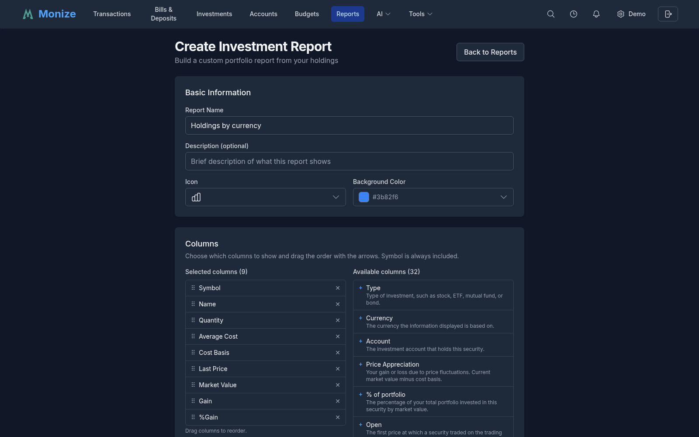

Saved investment reports appear under the **Investment** category. When viewing one, you can change the accounts and the **As of date**, switch the **Currency** between each holding's own currency and your home currency, refresh prices, and export to CSV.

---

## Chart Types

Custom transaction reports support four visualization types, chosen with **View Type**:

### Table

A tabular view showing rows of data with columns for the grouped dimension and the selected metric. With **No Grouping** and **No Aggregation**, it lists the individual transactions.

### Line Chart

A trend line connecting data points over time. Best for showing changes over months, weeks, or days.

### Bar Chart

Bars comparing values across groups. Best for category or payee comparisons.

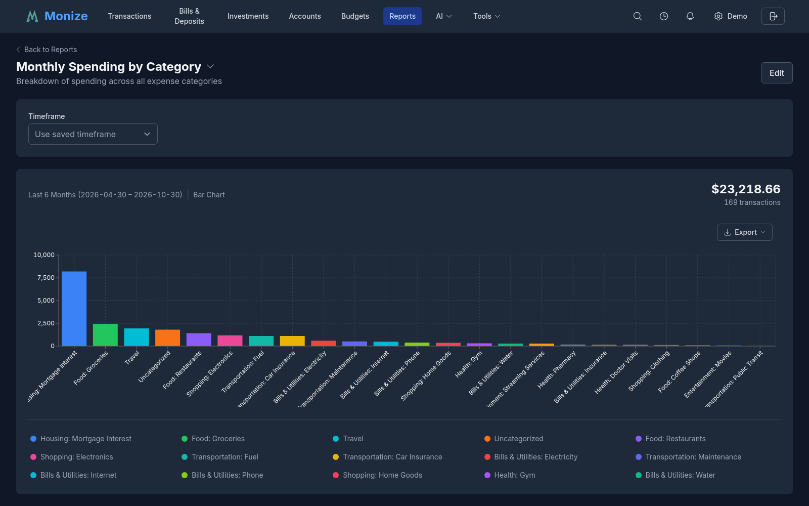

### Pie Chart

A circular chart showing proportional breakdown. Best for understanding the composition of spending or income.

### Viewing a Custom Report

A saved custom report opens with its saved timeframe. Change the **Timeframe** on the report to look at another period without editing it, and choose **Use saved timeframe** to go back. A report that reaches the row limit says so and asks you to narrow the timeframe or filters.

---

## Exporting Reports

Reports can be exported for sharing, printing, or archiving. Depending on what the report offers, the button reads **Export PDF**, **Export CSV**, or **Export** with a choice of **CSV** and **PDF**.

A PDF includes:

- Summary cards with key metrics
- Charts and visualizations
- Data tables with the full report contents

The export preserves the report's current filters and date range. PDFs embed a Roboto font subset so non-Western text -- Polish, Cyrillic, Greek, and currency symbols -- renders correctly, and chart images are compressed so files stay small.

---

## Saving and Favouriting Reports

### Saving Custom Reports

A custom report is saved when you click **Create Report** in the builder. It then appears in the Reports list alongside the built-in reports.

### Favouriting Reports

Mark frequently used reports as favourites for quick access:

1. On the Reports page, click the star (**Add to favourites**) on a report
2. Favourite reports appear first in the list, and at the top of the report switcher

Favourites are saved to your account, so they follow you to every device, and the Dashboard's Favourite Reports widget lists them.

### Editing Custom Reports

Open a custom report and click **Edit** at the top right. The builder opens with the report's settings; click **Update Report** to save. Built-in reports cannot be edited, but you can create a custom report with similar parameters if you need a variation.

### Deleting Custom Reports

Open the custom report, click **Edit**, then **Delete Report**, and confirm. Built-in reports cannot be deleted.
