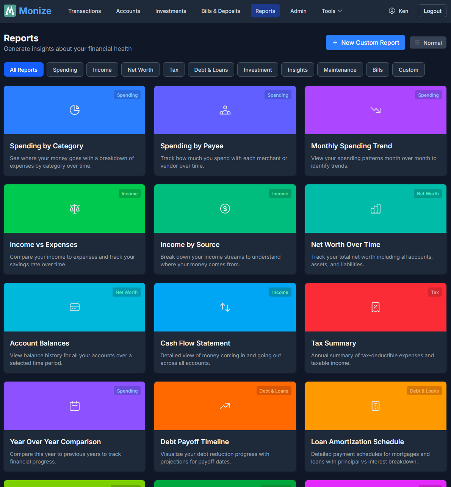
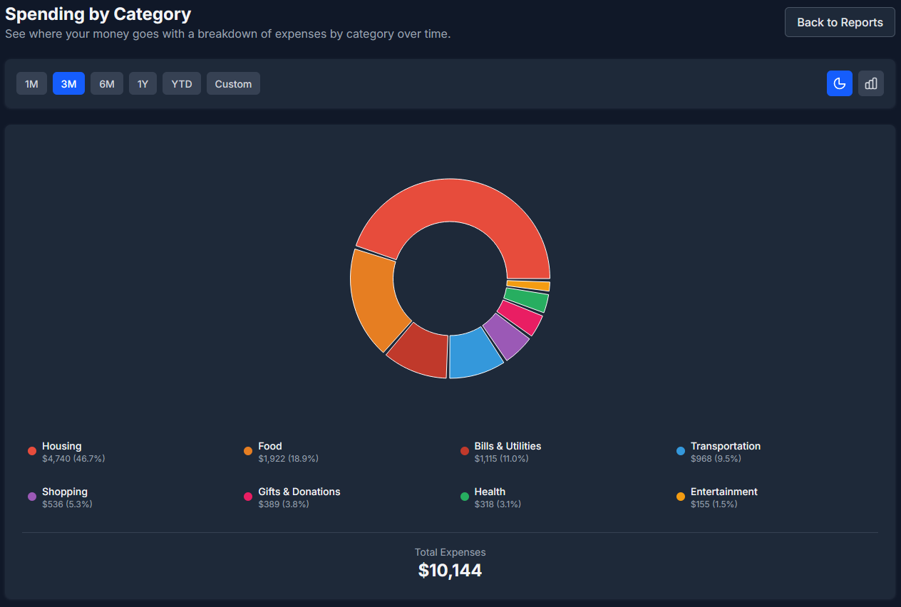
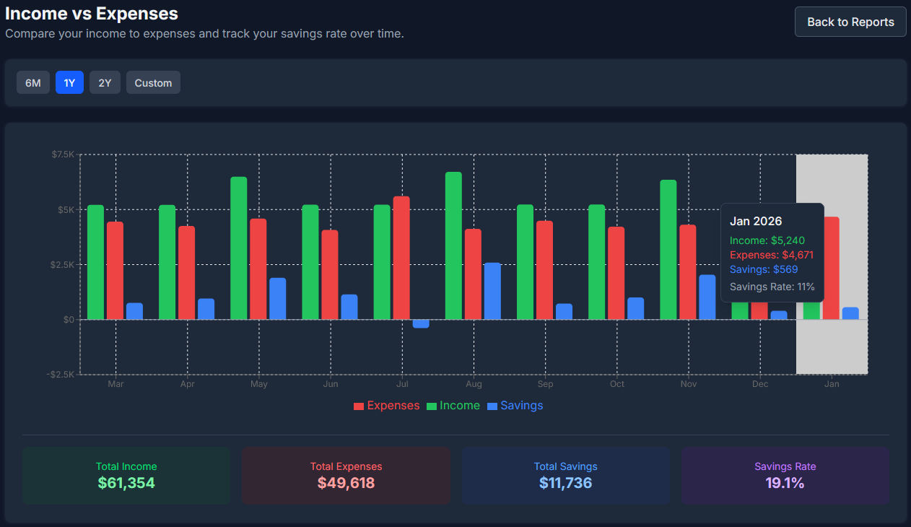
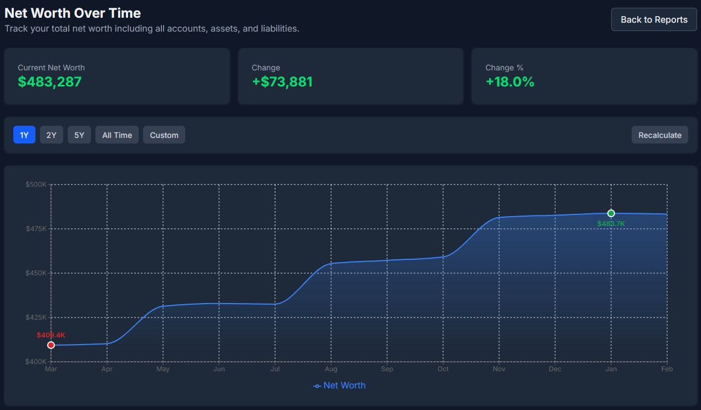
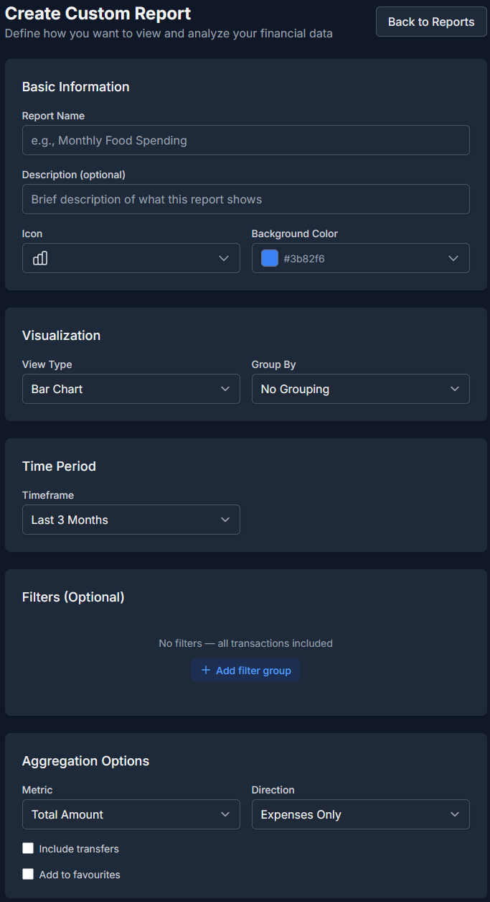
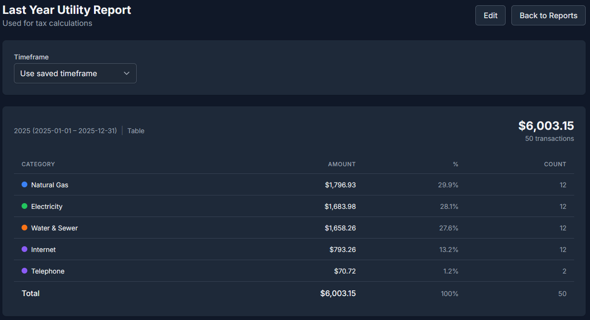

# Reports

Monize includes 40+ built-in reports across 10 categories, plus a custom report builder for analyzing your financial data in depth.

---

## Overview

Navigate to **Reports** from the top navigation bar to access the reporting system. The Reports page lists all built-in reports and any custom reports you have created.

<!-- Screenshot: The reports page showing the list of available built-in and custom reports -->

---

## Report Categories

Reports are organized into categories. Use the category filter bar at the top of the Reports page to show all reports or filter by a specific category:

| Category | Description |
|----------|-------------|
| **Spending** | Expense breakdowns by category, payee, and time |
| **Income** | Income analysis and cash flow |
| **Net Worth** | Net worth trends and account balance history |
| **Tax** | Tax-relevant transaction summaries |
| **Debt & Loans** | Debt payoff projections and amortization schedules |
| **Investment** | Portfolio performance, allocation, and transaction history |
| **Insights** | Behavioural patterns, anomalies, and comparisons |
| **Maintenance** | Data quality and cleanup tools |
| **Budget** | Budget tracking, health scores, and trend analysis |
| **Bills** | Scheduled transaction calendars and payment history |

The Reports page also supports three display density modes (Normal, Compact, Dense) for viewing the report list.

---

## Built-In Reports

### Spending Reports

| Report | Description |
|--------|-------------|
| **Spending by Category** | Breaks down your expenses by category for a selected time period |
| **Spending by Payee** | Shows your top spending recipients |
| **Monthly Spending Trend** | Tracks how your spending changes month over month |
| **Year over Year Comparison** | Compares spending and income across different years |

<!-- Screenshot: The spending by category report showing a pie chart and table breakdown of expenses -->

### Income Reports

| Report | Description |
|--------|-------------|
| **Income vs Expenses** | Compare your income to expenses and track your savings rate over time |
| **Income by Source** | Break down your income streams to understand where your money comes from |
| **Cash Flow Statement** | Detailed view of money coming in and going out across all accounts |

<!-- Screenshot: The income vs expenses report showing monthly bars with totals -->

### Net Worth Reports

| Report | Description |
|--------|-------------|
| **Net Worth Over Time** | Track your total net worth including all accounts, assets, and liabilities |
| **Account Balances** | View balance history for all your accounts over a selected time period |

<!-- Screenshot: The net worth report showing a line chart with assets, liabilities, and net worth over time -->

### Tax Reports

| Report | Description |
|--------|-------------|
| **Tax Summary** | Annual summary of tax-deductible expenses and taxable income |

### Debt & Loans Reports

| Report | Description |
|--------|-------------|
| **Debt Payoff Timeline** | Visualize your debt reduction progress with projections for payoff dates. Shows balance over time with historical payments and projected payoff, payment breakdowns (principal vs interest), and summary metrics including estimated payoff date. Supports multiple payment frequencies and Canadian mortgage calculations. |
| **Loan Amortization Schedule** | Detailed payment schedules for mortgages and loans with principal vs interest breakdown for each payment period |
| **Credit Utilization** | See how much of your available credit you are using across credit cards and lines of credit. |
| **Loan Overpayment Simulator** | Pick a loan and model extra payments to see how much sooner it would be paid off and how much interest you would save. Includes an account selector across all your debt accounts and mirrors the loan detail page's simulator (rendering the revolving view for a line of credit). |

> **Note:** These reports are available for Loan, Mortgage, and Line of Credit account types.

#### Loan Detail Page Tools

Beyond the reports above, each loan, mortgage, and line of credit has a dedicated **account detail page** with interactive planning tools. (The Loan Overpayment Simulator report embeds these same tools with an account selector.)

| Tool | What it does |
|------|--------------|
| **Overpayment Simulator** | Model extra payments and see how much sooner the loan would be paid off and how much interest you would save. Supports a recurring extra payment (with optional start and end dates, at a chosen frequency) plus up to 50 one-off lump sums, and surfaces a detected-extra-principal hint from your payment history that you can apply with one click. A payoff timeline chart compares the baseline projection against your overpayment scenario. Simulations never change your scheduled payments. |
| **Goal-Seek** | Work backwards from a target instead of guessing an amount. Choose **"save $X of interest"** or **"be paid off by this month"**, and the simulator solves for the recurring extra payment that hits it -- the solved amount drops straight into the simulator so the schedule, chart, and savings cards all recompute at once. Targets already met report zero needed; unreachable targets say so. |
| **Saved Scenarios** | Save and name overpayment scenarios per loan so you can revisit and compare different payoff plans over time. Scenarios can be loaded (click a row), renamed, and deleted. Once you have saved more than one, a **scenario comparison chart** draws each as an arc from today to its payoff date, its height being the interest it saves versus paying the minimum (narrower and taller is better) -- with an interactive legend and a tooltip reporting each scenario's real interest saved and payoff date. The panel exports **CSV** and a **PDF** report (headline cards, the chart, and the comparison table). |
| **Impact of Overpayments Made** | A past-impact section showing how the payments you have already made compare to the original contractual schedule -- extra principal already paid, time already saved, and interest already saved. |
| **Rate History** | Track interest-rate changes over the life of the loan. Add, edit, and delete rate changes with an effective date; when a rate changes you can keep the current payment (shifting the payoff timeline), set a new payment amount, or recalculate the payment to stay on schedule. A **Detect** button infers past rate changes from your payment history -- including loans where the bank books interest separately from principal -- and entries are badged as **Manual**, **Inferred**, or **Initial**. Detection is **non-destructive**: your account's own rate and payment are set only in the edit form and are never silently overwritten, and when a rate change would affect a linked scheduled payment, Monize shows a before/after preview and asks permission first. |

> **Exports:** The Loan Schedule, Rate History, and scenario comparison **export to CSV** from the loan detail page, and the payoff comparison chart exports to **PNG**.

### Investment Reports

Monize includes 12 investment reports for comprehensive portfolio analysis. These reports are available when you have at least one investment account.

| Report | Description |
|--------|-------------|
| **Investment Performance** | Track portfolio returns, gains/losses, and asset allocation over time. Shows current portfolio value, cost basis, total gain/loss, and return percentage with holdings and allocation views. |
| **Dividend & Interest Income** | Track passive income from dividends, interest, and other investment returns with monthly breakdowns by security |
| **Sector Weightings** | Analyze portfolio sector exposure from individual stocks and ETFs, with drill-down showing direct stock vs ETF exposure per sector |
| **Realized Gains & Losses** | Track realized gains and losses from sold securities for tax planning and performance review, with proceeds, cost basis, and transaction counts |
| **Portfolio Value Over Time** | Visualize total investment portfolio value with historical trends, period returns, and portfolio breakdown. Offers a Total view and a **By-security** stacked-area view (each holding plus a cash band and a rolled-up "other securities" band), a per-security **table view**, **CSV export**, and works across **intraday 1D/1W/1M** ranges as well as longer periods. |
| **Investment Transaction History** | Complete history of all investment transactions with filtering by action type (buy, sell, dividend, etc.), account, and date |
| **Security Type Allocation** | View portfolio allocation by asset type (stocks, ETFs, mutual funds, bonds) with drill-down into individual holdings |
| **Geographic/Exchange Allocation** | Analyze portfolio geographic exposure by exchange and region for diversification insights, with bar chart and pie chart views |
| **Dividend Yield & Growth** | Track portfolio dividend yield, per-security yields, year-over-year growth, and payment frequency analysis |
| **Individual Security Performance** | Deep dive into a single security with price history chart (including buy/sell markers), transaction history, and dividend history. You can also select **multiple securities to compare**, or switch to an **All securities** view that draws every active security's cumulative percent return on one chart -- each rebased to 0% at its first available price, so holdings at different price levels and currencies share a single axis. The comparison chart **exports to PDF**, and the report supports account-type and text filters. |
| **Currency Exposure** | Understand currency risk with portfolio allocation by currency, showing native and converted values with exchange rate details |
| **Monte Carlo Simulation** | Project future portfolio outcomes with thousands of randomized return paths and a saved-scenario library |

### Insights Reports

| Report | Description |
|--------|-------------|
| **Recurring Expenses Tracker** | Identify and monitor subscriptions, memberships, and recurring charges |
| **Spending Anomalies** | Detect unusually large transactions and spending spikes that need attention |
| **Weekend vs Weekday Spending** | Analyze your spending patterns based on day of week to understand habits |
| **Monthly Comparison** | Compare any month to the previous month across income, expenses, net worth, and investments |

### Maintenance Reports

| Report | Description |
|--------|-------------|
| **Uncategorized Transactions** | Find and categorize transactions that are missing categories |
| **Duplicate Transaction Finder** | Identify potential duplicate entries that may need review or deletion |

### Budget Reports

| Report | Description |
|--------|-------------|
| **Budget vs Actual** | Compare your budgeted amounts to actual spending over time across all categories |
| **Budget Health Score** | Get a 0--100 health score for your budget with detailed per-category impact analysis |
| **Seasonal Spending Patterns** | Discover seasonal trends and high-spending months across your budget categories |
| **Budget Trend** | Line chart showing total budgeted vs total actual spending over 6--12 months to track improvement |
| **Category Performance** | Table showing each category's budget performance over multiple months with trend indicators |
| **Savings Rate** | Track your savings rate (income minus expenses divided by income) over time vs your target |
| **Health Score History** | Line chart of monthly budget health scores showing your financial trajectory over time |
| **Flex Group Analysis** | Stacked bar chart for each flex group showing component categories with group limit reference |
| **Seasonal Spending Map** | Heatmap grid showing 12 months across all categories to identify seasonal spending patterns |

> **Note:** Budget reports only appear if you have an active budget. For more details, see [Budgets](budgets.md#budget-reports).

### Bills Reports

| Report | Description |
|--------|-------------|
| **Upcoming Bills Calendar** | Visual calendar of scheduled transactions and upcoming bill due dates |
| **Bill Payment History** | Track payment patterns and history for recurring bills and scheduled transactions |

---

## Custom Report Builder

Create your own reports with flexible filtering, grouping, and visualization options.

1. Navigate to **Reports**
2. Click **Create Custom Report**
3. Configure the report parameters

<!-- Screenshot: The custom report builder showing all configuration options -->

### Report Configuration

| Setting | Options |
|---------|---------|
| **Name** | A descriptive name for your report |
| **Timeframe** | Date range for the report data |
| **Group By** | Category, Payee, Month, Week, or Day |
| **Direction** | Income only, Expenses only, or Both |
| **Metric** | Total amount, Transaction count, Average amount, or Budget Variance |
| **Chart Type** | Table, Line, Bar, Pie, or Area chart |
| **Sorting** | Sort by name, amount, count, or date |

### Report Filters

| Filter | Description |
|--------|-------------|
| **Accounts** | Include only specific accounts |
| **Categories** | Filter to specific categories |
| **Payees** | Filter to specific payees |
| **Search Text** | Free-text filter on transaction details |

---

## Chart Types

Custom reports support five visualization types:

### Table

A tabular view showing rows of data with columns for the grouped dimension and selected metrics.

<!-- Screenshot: A report displayed as a data table -->

### Line Chart

A trend line connecting data points over time. Best for showing changes over months, weeks, or days.

### Bar Chart

Vertical bars comparing values across groups. Best for category or payee comparisons.

### Pie Chart

A circular chart showing proportional breakdown. Best for understanding the composition of spending or income.

### Area Chart

Similar to a line chart but with the area below filled in. Effective for showing cumulative trends.

---

## Report Filters

### Filtering from Reports to Transactions

When viewing a report, you can click on any data point (a bar, pie segment, or table row) to navigate directly to the Transactions page with filters pre-applied. This allows you to drill down from a high-level summary to the individual transactions that make up that figure.

On the **Income vs Expenses** report, clicking an income or expense bar filters by the corresponding **category type** (income categories or expense categories), so you see exactly the transactions that contributed to that bar.

### Date Range Selection

Reports support flexible date ranges:

- **This Month** / **Last Month**
- **This Quarter** / **Last Quarter**
- **This Year** / **Last Year**
- **Last 30 Days** / **Last 90 Days** / **Last 12 Months**
- **Custom Range** -- Select specific start and end dates

---

## PDF Export

Reports can be exported to PDF for sharing, printing, or archiving. Click the **Export PDF** button when viewing any report to generate a PDF that includes:

- Summary cards with key metrics
- Charts and visualizations
- Data tables with the full report contents

The exported PDF preserves the report's current filters and date range. Exports embed a Roboto font subset so non-Western text -- Polish, Cyrillic, Greek, and currency symbols -- renders correctly, and chart images are compressed so files stay small.

---

## Saving and Favouriting Reports

### Saving Custom Reports

Custom reports are saved automatically when you create them. They appear in the Reports list alongside the built-in reports.

### Favouriting Reports

Mark frequently used reports as favourites for quick access:

1. On the Reports page, click the star icon next to a report
2. Favourite reports appear at the top of the list

### Editing Custom Reports

Click the edit button on any custom report to modify its configuration. Built-in reports cannot be edited, but you can create a custom report with similar parameters if you need a variation.

### Deleting Custom Reports

Custom reports can be deleted from the Reports page. Built-in reports cannot be deleted.
