# Rules

Rules fill in your transactions for you. A rule watches the transactions you create and the ones you import, and when one matches its conditions it sets the category, the payee or the description, adds or removes tags, asks for an AI review, or reshapes the transaction into a transfer or a split. You can test a rule on your existing transactions before you save it, and run a saved rule over the transactions you already have, with an undo.

---

## Overview

Every rule has three parts, the same three sections you see in the rule editor:

| Part | What it decides |
|------|-----------------|
| **When** | Which transactions the rule looks at: the ones you create, the ones you import, or both, optionally only those dated inside a window |
| **If** | The conditions a transaction must meet: its payee, amount, account, category, description, tags, date and more |
| **Then** | What the rule changes on a transaction that matches, in order |

Some examples:

| Rule | If | Then |
|------|----|------|
| Coffee runs | Payee is any of Tim Hortons, Starbucks | Set the category to Coffee Shops (only if empty), add the `Coffee run` tag |
| Costco receipts | Payee text as received matches the pattern `*costco*` | Set the payee to Costco, set the category to Groceries |
| Dinners out over $100 | Category is Restaurants and Amount (ignoring sign) is at least 100 | Add the `Date night` tag |

A rule fills in; by default it does not overwrite. **Set the category** and **Set the payee** start with **Only if empty** switched on, so a category you typed yourself, or one that came from the payee's default category, is kept.

---

## The Rules Page

Open **Tools > Rules**. The list shows your rules in the order they run, one row each, with its **Order**, an **Enabled** switch, the rule's name and a **Summary** of when it runs and how many conditions and actions it has. A switched-off rule is shown dimmed and does nothing until you switch it on again. Click a row, or **Edit**, to open the rule. **Create rule** starts a new one; with no rules yet the page offers **Create your first rule** instead.

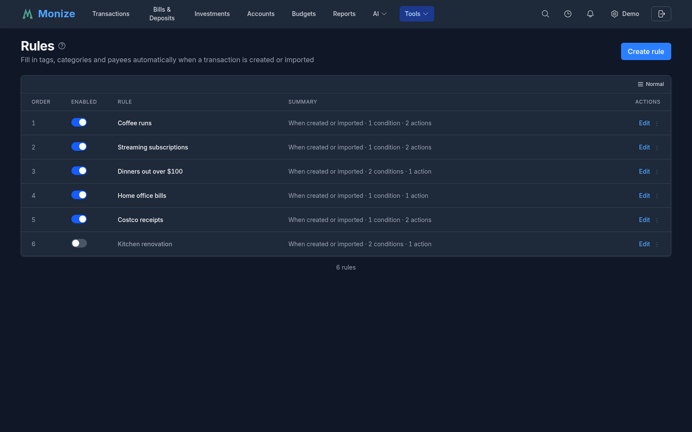

The menu at the end of each row (on a phone, press and hold the row) holds the other actions:

| Action | What it does |
|--------|--------------|
| **Duplicate** | Makes a copy named "*name* (copy)". The copy is switched off until you enable it, so the two do not both run |
| **Run on existing transactions** | Applies the saved rule to transactions you already have; see [Running a Rule on Existing Transactions](#running-a-rule-on-existing-transactions) |
| **Move up**, **Move down** | Changes where the rule runs in the list |
| **Delete** | Deletes the rule after you confirm. Transactions it already changed stay as they are |

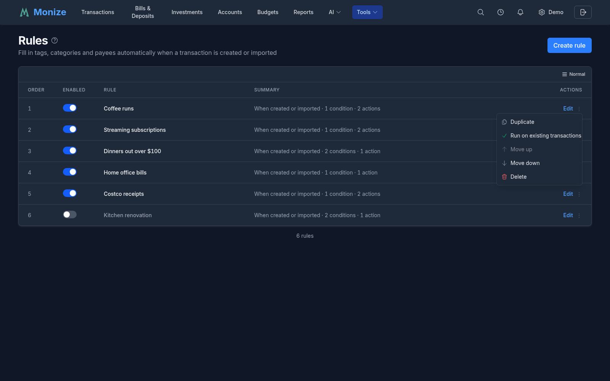

### Invalid Rules

A rule that can no longer run is marked **Invalid**, and hovering the mark says why: a tag, payee, category or account it uses no longer exists, it has no actions, or its definition is otherwise not valid. An invalid rule is skipped until you open it, repair it and save it; it cannot be run on existing transactions meanwhile.

---

## When Rules Run

A rule runs once on each new transaction, at the moment it is written:

| Trigger | Covers |
|---------|--------|
| **A transaction is created** | Transactions and transfers you enter, transactions posted from a scheduled bill or deposit (by hand or automatically), and those the AI assistant or an MCP client create for you |
| **A transaction is imported** | CSV, OFX/QFX and QIF imports, a Microsoft Money import, and transactions arriving through Bank Sync |

Editing a transaction later does not run the rules again, and neither does anything a rule changes: each transaction gets one pass. Restoring a backup, undoing or redoing a change, and the cash side of an investment transaction do not run them either. To apply a rule to transactions that already exist, run it on them (see [Running a Rule on Existing Transactions](#running-a-rule-on-existing-transactions)).

### Order and Stop Processing

Rules run in the order of the list, top to bottom. A later rule sees what the earlier ones changed: if the first rule sets the category, a later rule's **Category** condition reads that category. Use **Move up** and **Move down** to put the rule that should decide first at the top.

When a rule has **Stop processing other rules** switched on and it matches a transaction, the rules after it in the list are skipped for that transaction.

### Rules and the Payee's Default Category

On a new transaction, the values you typed come first, then the payee's default category, then the rules in order. With **Only if empty** on, a rule fills a category or payee only when the transaction has none at that point; with it off, the rule replaces whatever is there. See [Categories and Payees](categories-and-payees.md) for default categories.

---

## Creating and Editing a Rule

Click **Create rule**, or open an existing rule. The editor shows the rule's **Name** and a **Rule enabled** switch, then the **When**, **If** and **Then** sections, the **Test** panel and, for a saved rule, its **History**. Nothing is stored until you click **Save rule**; **Cancel** leaves without saving.

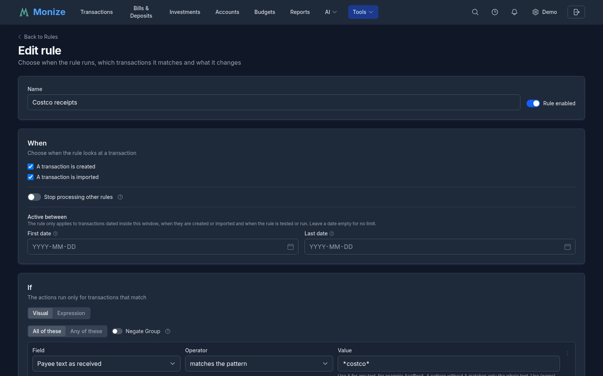

### When

| Option | Description |
|--------|-------------|
| **A transaction is created** | Run on transactions you create. At least one of the two stays selected |
| **A transaction is imported** | Run on imported and bank-synced transactions |
| **Stop processing other rules** | When this rule matches, the rules after it are skipped for that transaction |
| **Active between** | A **First date** and a **Last date**. The rule only applies to transactions dated inside this window: when they are created or imported, and when the rule is tested or run. Leave a date empty for no limit |

The window is useful for a rule that should not reach back into older, already reconciled history: give it a **First date** and a later run on existing transactions leaves everything before it alone.

### If: Conditions

The conditions are a group of cards. Each condition picks a **Field**, an **Operator** and a **Value**; **+ Add condition** adds one. At the top of the group, **All of these** means every condition must hold and **Any of these** means one is enough. **+ Add group** puts a group inside the group, with its own **All of these** or **Any of these**, so you can write "this and that, and either of these two". **Negate Group** turns a group around: it matches when its conditions do not.

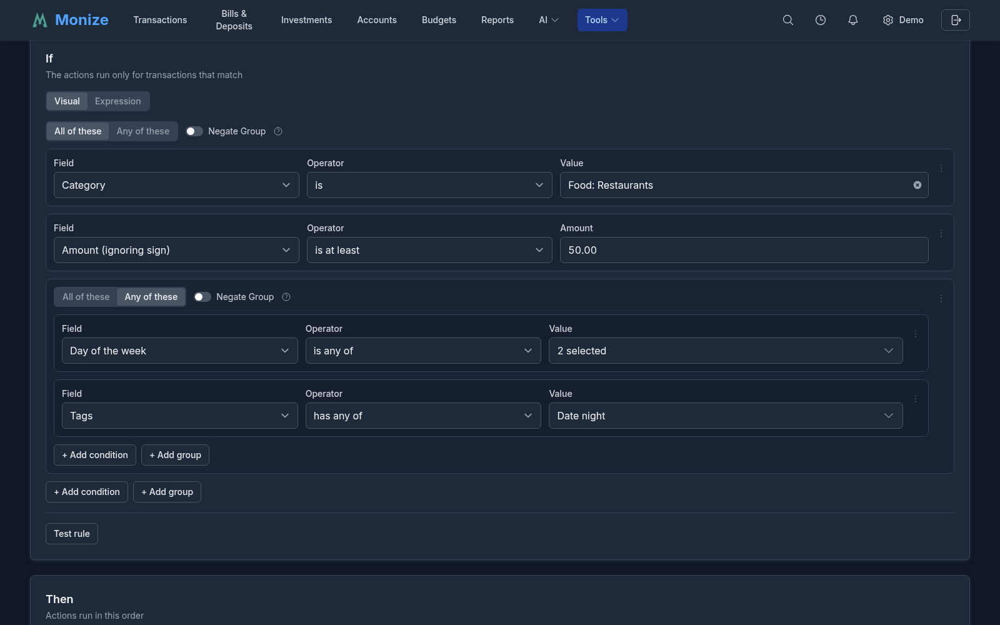

A rule with no conditions applies to every transaction, and the editor warns you about it.

| Field | Operators | Notes |
|-------|-----------|-------|
| **Account** | is, is not, is any of, is none of | The account the transaction is in |
| **From account (transfers)**, **To account (transfers)** | is, is not, is any of, is none of, is empty | Set only on a transfer; empty on anything else |
| **Type** | is, is not, is any of | **Expense**, **Income** or **Transfer**, from what the transaction is rather than from the account |
| **Payee** | is, is not, is any of, is none of, is empty | The payee after alias matching |
| **Payee text as received** | is, contains, starts with, matches the pattern, is empty | The payee text exactly as the file or the bank sent it, or as you typed it, before alias matching |
| **Category** | is, is not, is any of, is none of, is empty, is in, or under | "is in, or under" includes the subcategories |
| **Description** | is, contains, starts with, matches the pattern, is empty | |
| **Amount (with sign)** | is, is less than, is at most, is greater than, is at least, is between | Negative for money going out |
| **Amount (ignoring sign)** | is less than, is at most, is greater than, is at least, is between | So "at least 100" does not depend on the direction |
| **Currency** | is, is any of | The account's currency |
| **Tags** | has any of, has all of, has none of | The tags the transaction has when the rule runs, including those added by an earlier rule |
| **Has splits** | is | Yes or No |
| **Reference number** | is, contains, starts with, matches the pattern, is empty | The cheque or reference number |
| **Day of the month** | is, is less than, is at most, is greater than, is at least, is between, is any of | 1 to 31 |
| **Day of the week** | is, is any of | Monday to Sunday |
| **Status** | is, is not, is any of | Unreconciled, cleared, reconciled or void |
| **Has an attachment** | is | Yes or No |
| **Date** | is, is less than, is at most, is greater than, is at least, is between | The transaction's date |

Text comparisons ignore case and the spaces at either end. A field that does not apply to a transaction (the from-account of something that is not a transfer) only ever matches **is empty**.

A group can be nested up to four levels deep, and a rule can hold up to 50 conditions.

#### Patterns and Captures

**matches the pattern** compares the whole text against a pattern in which `*` stands for any text: `*coffee*` matches any text containing "coffee", while `coffee` without a star matches only the text "coffee" itself. Regular expressions are not supported, and the editor refuses a pattern that looks like one; to match one of several texts, use a group of **Any of these** with one condition for each.

A pattern can also keep part of the text for the actions: put a name in braces where the text should be kept, for example `*PRINCIPAL: {principal} INTEREST: {interest}*`. A name is lowercase letters and digits, starting with a letter, and a pattern can keep up to five. The text actions can then use `{principal}` as a placeholder, and a split can use it as the amount of a part.

#### Expression View

**Visual** and **Expression** at the top of the If section switch between the cards and the same conditions written as text, for example `transaction.absAmount >= 50 && (transaction.weekday in ["FRI", "SAT"] || transaction.tagIds.hasAny([tag("Date night")]))`. Both views edit the same conditions. In the expression, `&&` means all of these, `||` any of these and `!( ... )` not; items are written by name, such as `payee("Tim Hortons")` or `category("Food: Restaurants")`. A list of **Suggestions** under the box offers the fields, operators and names that fit where you are typing. While the text has a mistake, the editor names the line and column, and you cannot save or switch back to Visual until it is fixed.

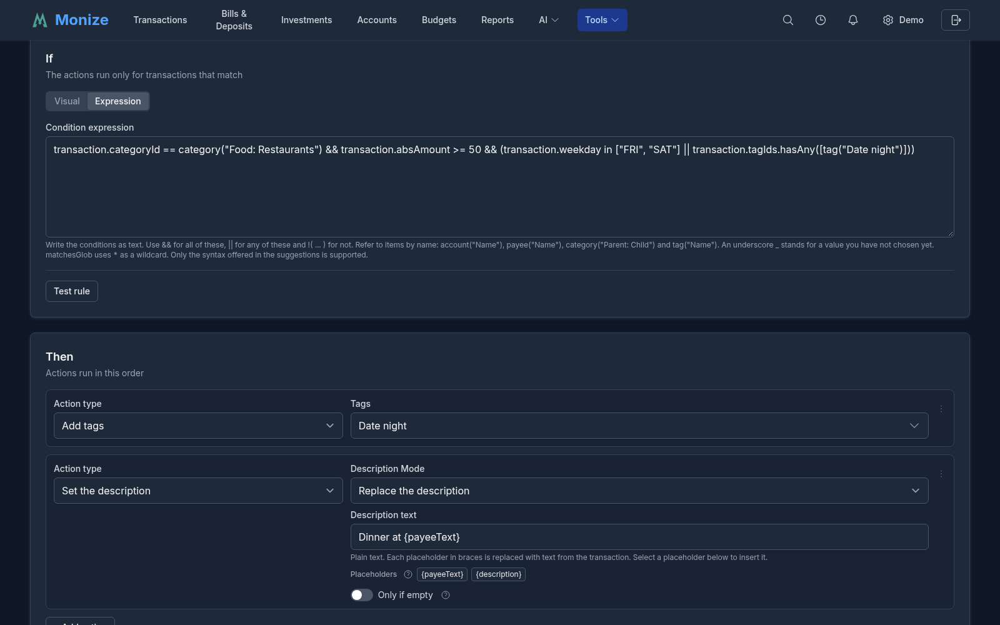

### Then: Actions

**+ Add action** adds an action card; pick its **Action type** and fill in what it needs. The actions run in the order shown, and each card's menu can duplicate it, move it up or down, or delete it. A rule needs at least one action and can have up to ten.

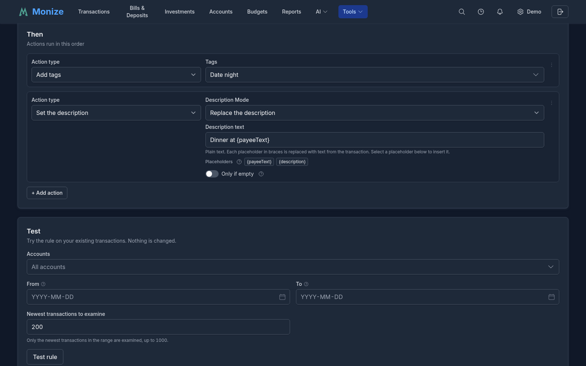

| Action | What it does |
|--------|--------------|
| **Add tags** | Adds the chosen tags; the transaction's other tags are kept |
| **Remove tags** | Removes the chosen tags if the transaction has them |
| **Set the category** | Sets the category. Not applied to a transfer, which has no category, or to a split transaction, whose categories belong to its lines |
| **Set the payee** | Sets the payee to one of your payees |
| **Set the payee from text** | Builds a payee name from placeholders and sets the payee with that name. With **Create the payee if it does not exist**, a new payee is created when no payee matches the name (by name, alias or a close match) |
| **Set the description** | Writes a description built from placeholders. **Description Mode** is **Replace the description**, **Add after the description** or **Add before the description** |
| **Convert to transfer** | Turns a matched expense into a transfer to another account, or a matched income into a transfer from one (**Direction**). The other account must use the same currency. **Clear the category** removes the category the transaction had |
| **Split transaction** | Turns the transaction into a split; see [Splits from the Bank's Text](#splits-from-the-banks-text) |
| **Settle a loan installment** | Books a bank debit as the installment of a mortgage or loan; see [Settling a Loan Installment](#settling-a-loan-installment) |
| **Ask for an AI review** | Puts the transaction in the **AI > AI Review Inbox** with your **Review Instructions**, for example "split this purchase by the receipt". The rule changes nothing itself; a person approves any change the AI proposes |

**Set the category**, **Set the payee**, **Set the payee from text** and **Set the description** have the **Only if empty** switch: on, the rule fills the field only when the transaction has none; off, it replaces it.

The text in **Set the payee from text** and **Set the description** is plain text with placeholders in braces, which you can insert from the **Placeholders** list under the box: `{payeeText}` is the payee text as received, `{description}` is the description as it stands when the action runs, and the other placeholders are the captures named in the rule's patterns. With **Add after the description** and **Add before the description**, the text is joined exactly as written, so include any space or separator you want.

A rule can hold one **Ask for an AI review**, and one of **Convert to transfer**, **Split transaction** and **Settle a loan installment**, which cannot be combined with **Set the category**.

#### Splits from the Bank's Text

**Split transaction** is for a bank line that names its own parts, such as a loan payment the bank describes as `PRINCIPAL: 1200,50 INTEREST: 300,25`. In If, add a condition on the payee text or the description with **matches the pattern**, capturing each amount (`*PRINCIPAL: {principal} INTEREST: {interest}*`). In the action, each part takes its **Amount** from a capture, or **The rest**, and goes either to a **Category** or, as a **Transfer**, to an **Account**, with an optional **Memo**; **Payee of the transaction (optional)** sets the payee of the whole transaction. A split has 2 to 10 parts, and they must add up to the transaction's amount; otherwise the rule leaves the transaction alone. The card's **How to use this** guide walks through this example.

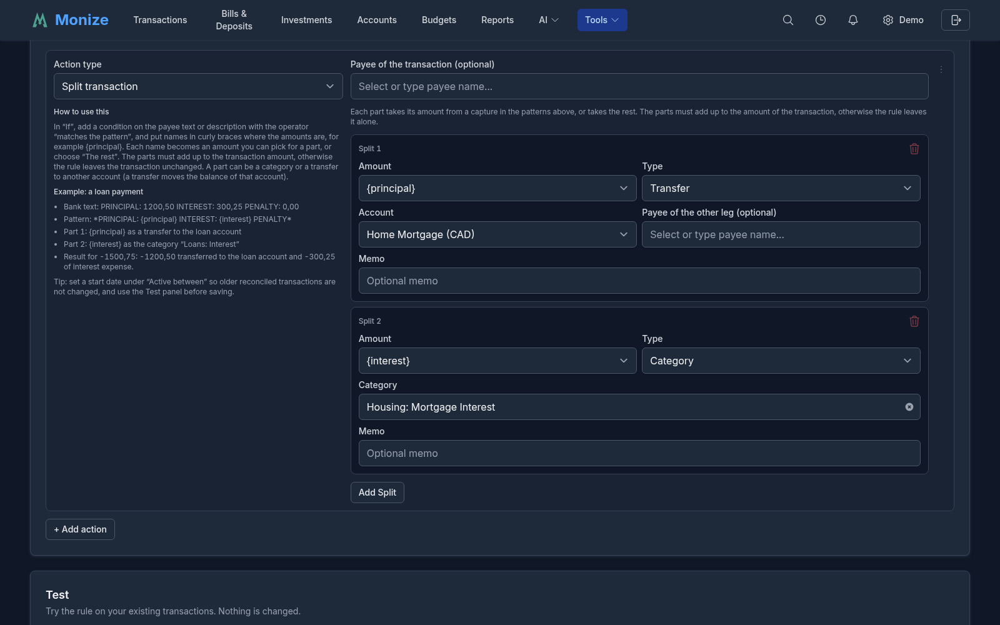

#### Settling a Loan Installment

**Settle a loan installment** is for a bank debit that pays a mortgage or loan installment as one amount. Choose the **Loan account** and how many **Days before the due date** and **Days after the due date** the bank may take the payment. A matched debit pays the installment due in that window: it becomes a split, with the principal transferred to the loan account and the interest booked to the loan's interest category (or the **Interest category** you choose), both priced by Monize for that installment. **Debit Above the Installment** and **Debit Below the Installment** decide what happens when the amounts differ by more than a few cents: pay the difference as extra principal, pay the interest first, or leave the transaction alone. Turn off automatic posting on the loan's scheduled payment so the installment is not paid twice; the editor warns you when it is on. The **Payment matching** option on a mortgage or loan creates a rule like this for you; see [Payment Matching](accounts.md#payment-matching).

---

## Testing a Rule

The editor can show what a rule would do before you save it. Neither test changes anything.

### Test Rule: Which Transactions Match

**Test rule** at the bottom of the If section lists your existing transactions that the conditions match, inside the rule's **Active between** window, ten to a page, in the same list as the Transactions page. It looks only at the conditions, so it works before you have added an action.

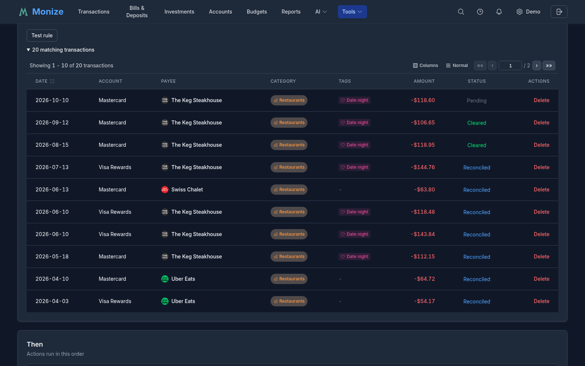

### The Test Panel: What Would Change

The **Test** panel below the actions tries the whole rule, saved or not, on your existing transactions. Choose the **Accounts** (all by default), a **From** and **To** date, and how many of the **Newest transactions to examine** (200 by default, up to 1,000), then click **Test rule**. The result says how many transactions would change out of how many were examined, lists each one with its **Planned change**, and lists the transactions the rule would leave alone with the reason (for example, it is a transfer, which has no category). When the dates hold more transactions than the number examined, the result says so: only the newest are included, so raise the number or narrow the dates to reach older ones.

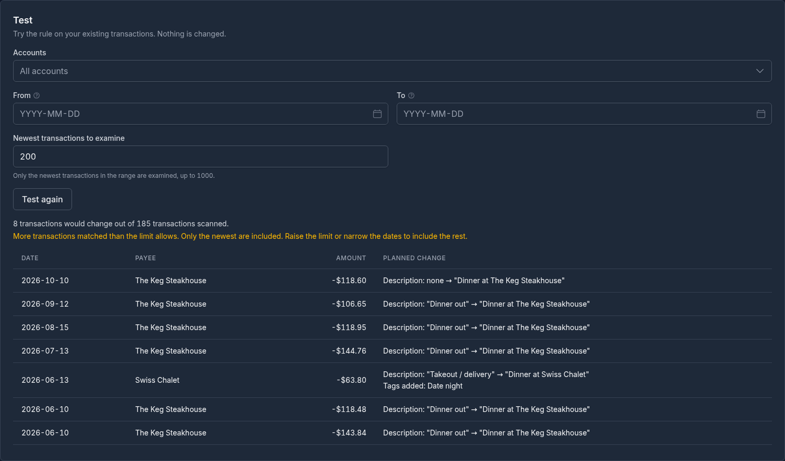

When you change the rule or the filters after a test, the result stays on screen but is marked out of date until you test again. If the last test found that the rule matches none of the transactions examined, the editor says so beside **Save rule**; a common cause is a pattern without `*`, which matches only the whole text.

---

## Running a Rule on Existing Transactions

A saved rule can be applied to the transactions you already have: choose **Run on existing transactions** in its row's menu on the Rules page, or click **Run on existing transactions** in the editor (save your changes first).

1. Choose the **Accounts**, the **From** and **To** dates and how many of the **Newest transactions to examine**.
2. Click **Preview**. The dialog lists every transaction the rule would change and how, and the ones it would leave alone with the reason. Nothing has changed yet.
3. Click **Confirm and run** to apply exactly what the preview showed.

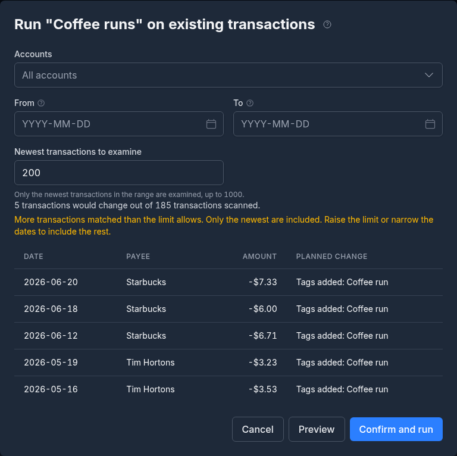

If your transactions or the rule changed between the preview and the confirmation, nothing is written and the dialog shows a new preview to confirm instead. A run can be undone as one step from the action history; see [Undo and Redo](transactions.md#undo-and-redo). A run that only queued AI reviews has nothing to undo.

A run leaves some transactions alone and says why: a transfer has no category to set, a split's categories belong to its lines, and with **Lock reconciled transactions** on (see [Settings](settings-and-security.md#transactions)) a reconciled transaction is not changed. The rule's **Active between** window applies to a run too.

---

## A Rule's History

The **History** section of a saved rule lists the latest transactions it changed, newest first: each one's **Date**, **Payee** and **Amount**, the **Source** of the change (**Created**, **Imported** or **Manual run**), the **Change** it made and when it was **Applied**. **View** opens the transaction on the Transactions page. The history keeps the latest 50 changes and holds them for a year.

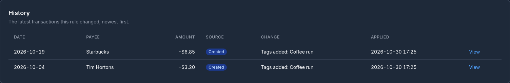

---

## Rules Elsewhere in Monize

- **Imports.** Rules set to run on import apply to every imported transaction; they see the payee text as it was in the file. See [Importing Transactions](importing-transactions.md#rules).
- **Bank Sync preview.** Expanding a row in the preview of a bank account's first sync shows which of your import rules match it and what they would change. See [Previewing and Syncing](settings-and-security.md#previewing-and-syncing).
- **Tags.** See [Tags and Rules](tags.md#tags-and-rules) for rules that add, remove and test tags.
- **The AI assistant.** The assistant and MCP clients can list, create, change, test and run rules for you, always with a confirmation. See [Making Changes](ai.md#making-changes).

> [!TIP]
> Start a new rule with **Only if empty** on and test it on your existing transactions first. When the Test panel shows what you expect, save it, then run it on your history if you want the older transactions to match.
