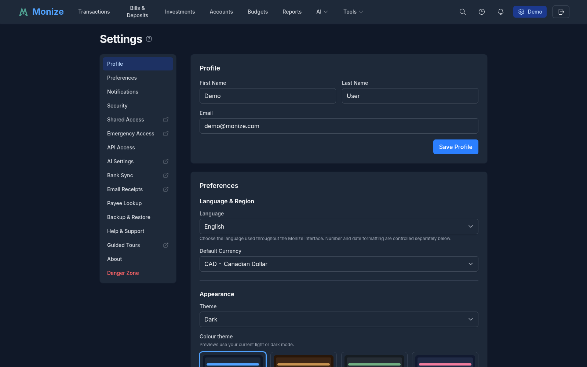
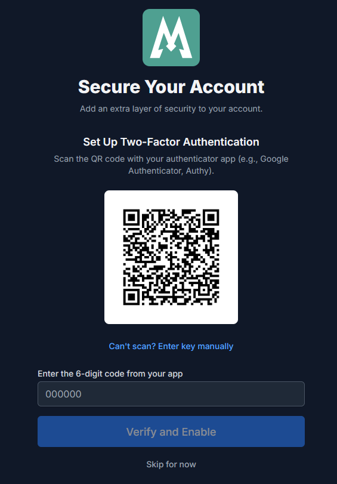
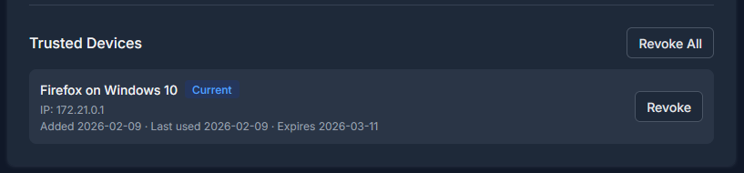
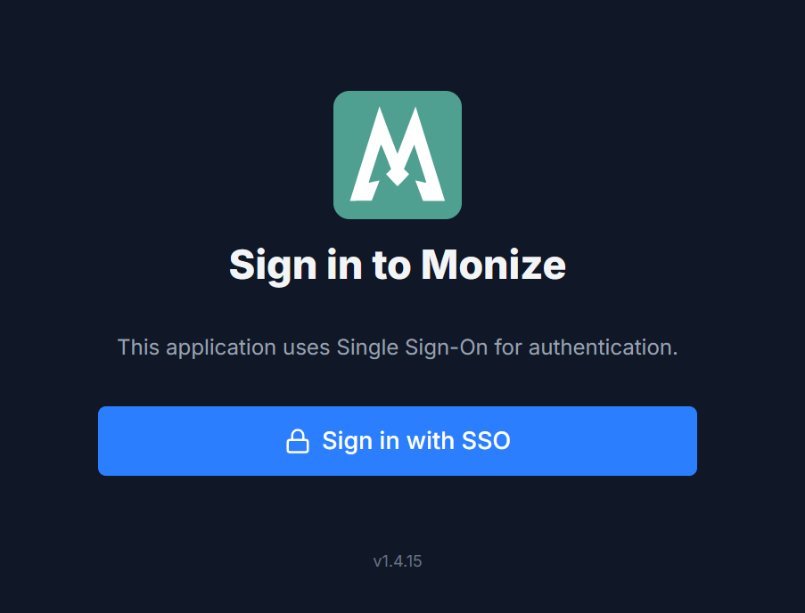
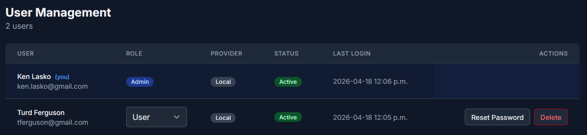
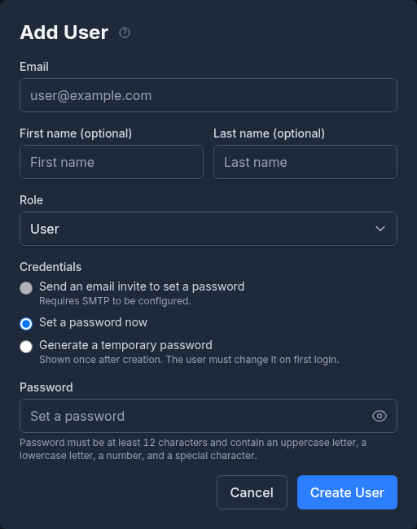

# Settings and Security

Monize provides comprehensive security features and configurable user preferences.

---

## User Settings

Navigate to **Settings** (gear icon in the top-right corner) to configure your preferences. The Settings page uses a sidebar navigation on desktop (or tabs on mobile) to organize sections, making it easy to jump directly to the area you need.


<!-- Screenshot: The settings page showing sidebar navigation, display preferences, home currency, and security options -->

### Settings Sections

| Section | What it covers |
|---------|----------------|
| **Profile** | Your name and email address |
| **Preferences** | Language, appearance, dates and numbers, investments, transactions, application behaviour (see below) |
| **Notifications** | Email, browser push, per-notification delivery and cooldown (see [Notifications](#notifications)) |
| **Security** | Password, two-factor authentication, backup codes, trusted devices |
| **Shared Access** | Delegated users (see [Shared Access](shared-access.md)) |
| **Emergency Access** | Dead-man's switch for trusted contacts (see [Emergency Access](emergency-access.md)) |
| **API Access** | Personal access tokens and the MCP server URL (see [Personal Access Tokens](#personal-access-tokens-pats)) |
| **AI Settings** | AI providers, budgets and usage (see [AI](ai.md)) |
| **Payee Lookup** | Where a payee's contact details come from (see [Payee Lookup](#payee-lookup)) |
| **Email Receipts** | A mailbox for order confirmations and the profiles that read them (see [Email Receipts](email-receipts.md)) |
| **Backup & Restore** | Your own manual export and restore (see [Backup and Restore](backup-and-restore.md)). Scheduled backups are configured by an administrator on [Admin > Backups](#automatic-backups-admin) |
| **Help & Support** | Documentation links and the support backup (see [Help and Support](#help-and-support)) |
| **Guided Tours** | Every walkthrough Monize offers (see [Guided Tours](#guided-tours)) |
| **About** | Version, update status, release notes, licence (see [About](#about)) |
| **Danger Zone** | Delete data or delete your account |

> **Delegates:** While you are acting as a delegate for someone else, the Settings page shows only the **Security** section, which manages *your own* password and 2FA. Every other section would reflect or alter the account owner's settings, so it is hidden. See [Shared Access](shared-access.md).

### Preferences

Preferences are grouped into six blocks. **They save as you change them** -- there is no Save button; each change is written immediately and confirmed with a toast.

#### Language & Region

| Setting | Description |
|---------|-------------|
| **Language** | The display language for the Monize interface (see [Language](#language)) |
| **Default Currency** | Primary currency for reporting and dashboard totals |

#### Appearance

| Setting | Description |
|---------|-------------|
| **Theme** | System (follow device setting), Light, or Dark |
| **Colour theme** | The palette used within your light/dark mode (see [Theme and Colour Theme](#theme-and-colour-theme)) |

#### Dates & Numbers

| Setting | Description |
|---------|-------------|
| **Date Format** | How dates are displayed throughout the application |
| **Number Format** | Decimal and thousands separator preferences, or auto-detect from the browser locale |
| **Timezone** | Preferred timezone, used for backups and for dating downloaded files |
| **Week starts on** | First day of the week for calendars and weekly views |
| **Show Create Date in transaction forms** | Displays the date and time a transaction was originally created. This is separate from the transaction date and helps you tell when an entry was actually added to Monize. |
| **Time Format** | 24-hour (14:30) or 12-hour (2:30 PM) |

#### Investments

| Setting | Description |
|---------|-------------|
| **Default Stock Quote Provider** | Yahoo Finance or MSN Money, used when a security has no provider override. If the chosen provider fails, Monize automatically tries the other. MSN does not provide intraday data, so the 1D / 1W / 1M ranges on the Portfolio Value Over Time chart are unavailable for MSN-tracked holdings, and MSN requires `MSN_API_KEY` to be configured on the server. |
| **Preferred Exchanges** | Up to 3 stock exchanges in priority order for security lookups (see [below](#preferred-exchanges)) |

#### Transactions

| Setting | Description |
|---------|-------------|
| **Recent transactions in quick-fill** | Number of entries shown in the history button popover next to the Payee field on transaction forms (3, 5, 10, 15, or 20; default 5). See [Quick Fill from Recent Transactions](transactions.md#quick-fill-from-recent-transactions). |
| **Lock reconciled transactions** | While off, Monize warns you before an edit that would change a reconciled transaction's date or amount, then lets it through. While on, reconciled transactions cannot be edited, deleted or unreconciled at all -- turn it off again to make a correction. |

#### Application

| Setting | Description |
|---------|-------------|
| **Map provider for addresses** | Which map service opens when you click an address in a desktop browser: Automatic (OpenStreetMap), Apple Maps, Bing Maps, Google Maps, OpenStreetMap, or Waze. Phones and tablets always open their own map app whatever you choose here. |
| **Show What's New after an upgrade** | Shows a summary of the release notes the first time you sign in after Monize updates to a new version. You can always reopen it from the version number at the bottom of the Settings page or on the login screen. |

> **Email notifications moved.** The email on/off switch, the weekly budget digest and the per-notification delivery matrix now live in their own [Notifications](#notifications) section rather than under Preferences.

### Language

Monize is built for multiple languages. Choose your preferred display language from the **Language** picker under **Language & Region**, and the interface -- menus, labels, buttons, messages, and email notifications -- is shown in that language.

#### How It Works

- **Pick once, applied everywhere** -- Your language is saved to your account preferences, so it follows you across devices and browser sessions when you sign in.
- **Automatic detection** -- Before you set a preference, Monize detects a suitable language from your browser's settings. If your browser's language is not available, it falls back to the default language.
- **Locale-aware formatting** -- Your language drives how dates, numbers, currency amounts, and percentages are formatted throughout the app, so they read naturally for your region. (Date and number formats can also be overridden independently -- see **Date Format** and **Number Format** above.)
- **Right-to-left support** -- The layout adapts automatically for right-to-left languages.
- **Email notifications** -- All transactional emails -- password reset, email verification, delegation invites, admin notifications, and bill reminders -- are sent in the recipient's stored language.

#### Notes

- AI assistant responses, insights, and forecasts are written in your chosen language; data values (account/category/payee names, currencies, numbers) are left as-is.
- The set of available languages grows over time. Whichever languages are installed appear in the **Language** picker; if a particular language is not yet listed, the interface falls back to the default language.

### Theme and Colour Theme

Appearance is two independent settings.

**Theme** decides light or dark: **System** follows your device setting and switches with it, or you can pin **Light** or **Dark**.

**Colour theme** decides the palette used *within* that light or dark mode. The picker shows a swatch preview of each palette rendered in your current mode rather than only naming it.

| Palette | |
|---------|---|
| **Default** | Monize's standard palette |
| **Latte**, **Burgundy**, **Forest**, **Nord**, **Midnight** | Warm and cool alternatives |
| **MS Money**, **Newspaper** | Familiar looks for people arriving from Microsoft Money, and a high-legibility print-like palette |
| **Solarized**, **Gruvbox**, **Dracula**, **Tokyo Night**, **Rose Pine** | Well-known developer palettes |
| **High contrast** | Maximum separation between foreground and background for low-vision use |
| **Colour-blind safe** | Tinted so that the red/green pairs Monize uses for gains and losses remain distinguishable |

### Preferred Exchanges

When you look up a security by name or symbol, Yahoo Finance may return results from multiple exchanges around the world. The **Preferred Exchanges** setting lets you specify up to 3 exchanges in priority order so that results from your preferred exchanges are ranked first.

For example, if you primarily invest on the London Stock Exchange and the Toronto Stock Exchange, setting your preferred exchanges to **LSE** and **TSX** ensures that when you search for a security, matches from those exchanges appear before results from NYSE or other exchanges.

#### How It Works

- Select up to 3 exchanges using the **Priority 1**, **Priority 2**, and **Priority 3** dropdowns
- Priority 1 has the highest preference, followed by Priority 2 and Priority 3
- Results from preferred exchanges are boosted above all other results
- An exact symbol match on a preferred exchange always wins
- If no preferred exchanges are set, Monize uses its default exchange ranking (major US exchanges first)

#### Where It Applies

Preferred exchanges are used whenever Monize looks up a security from Yahoo Finance:

- **Securities page** -- When adding or editing a security and using the Lookup button
- **Import wizard** -- When mapping securities during a QIF, OFX, or CSV import (both individual lookups and the "Lookup All" bulk operation)
- **Security creation** -- When creating a new security from the import mapping screen

#### Example

Without preferred exchanges, searching for "Barclays" might return `BCS` (NYSE) as the top result. With **LSE** set as Priority 1, the search returns `BARC.L` (London Stock Exchange) instead.

---

## Notifications

The **Notifications** section decides what Monize tells you about and how it reaches you. It has five parts: email, browser push devices, the per-notification delivery matrix, the investment movement alert, and a diagnostics report for when push is not working.

### Email Notifications

| Setting | Description |
|---------|-------------|
| **Email Notifications** | The master switch for email. With it off, nothing is sent by email regardless of the matrix below. |
| **Weekly Budget Digest** | A weekly summary of budget alerts and status |
| **Digest day** | Monday or Friday |
| **Send Test Email** | Sends a test message to your account's email address so you can confirm delivery works |

Critical budget alerts (over budget, income shortfall) are sent immediately regardless of the digest settings.

> Email is only available when an administrator has configured SMTP on the server. Without it the section reads *"Email notifications are not available. SMTP has not been configured by the administrator."*

### Browser Push

Monize can deliver notifications to a phone or desktop even when the app is closed, using Web Push. No Firebase, Google Play or Apple Developer account is involved -- the instance generates and holds its own key pair.

#### Registering a Device

1. Navigate to **Settings > Notifications > Browser push**
2. Click **Enable on this device**. Your browser asks for permission to show notifications; nothing is sent until you allow it.
3. Click **Send test notification** to confirm delivery

Each registered device is listed with the transport that delivers it (Web push or UnifiedPush), the address it registered from, when it was registered, when it was last active, its browser, and its last delivery. **Remove** revokes a device immediately.

#### Platform Notes

| Platform | What to know |
|----------|--------------|
| **iPhone / iPad** | Push works only once Monize is installed to the Home Screen. Use **Share > Add to Home Screen** and open Monize from there. If no permission prompt appears, allow notifications in iOS **Settings > Notifications > Monize**. |
| **Android** | A granted browser permission is not always enough -- the system can still hide notifications. Press and hold the Monize icon on your home screen, tap **App info**, then **Notifications**, and make sure they are turned on. |
| **Brave** | Brave blocks the push service by default. Open Brave **Settings > Privacy and security**, turn on *"Use Google services for push messaging"*, restart the browser and try again. |
| **Blocked in the browser** | If notifications are blocked for Monize, allow them in the browser's site settings and reload the page. |

#### Retired Devices

A device can stop being reachable on its own. Monize says which of the three happened, and the repair is the same in each case -- turn push on again in that browser:

| Reason | Meaning |
|--------|---------|
| **No longer reachable** | The browser's push service dropped the subscription |
| **Retired when this instance rotated its push key pair** | An administrator rotated the instance key pair (see [Instance Notification Settings](#instance-notification-settings)) |
| **Retired after repeated delivery failures** | Deliveries kept failing, so the registration was retired |

> Browser push has to be switched on for the whole instance by an administrator before any of this is available, and the server needs `ENCRYPTION_KEY` set so it can store its push key pair.

### UnifiedPush

The same encrypted push can be delivered to a self-hosted UnifiedPush distributor -- **ntfy**, **NextPush** and similar -- instead of Google's or Apple's infrastructure. It shares the instance's push key pair and its on/off switch.

To use it, register an endpoint in your UnifiedPush distributor app, then turn on the **UnifiedPush** column for the notification categories you want in the matrix below. Devices delivered this way are labelled **UnifiedPush** in the device list.

### Notification Diagnostics

Under **Notification diagnostics** Monize shows what your browser and device report about notification support -- permission state, service worker registration, transport, and platform quirks. **Refresh** re-reads it after you change a setting, and **Copy report** puts the whole thing on the clipboard to paste into a bug report.

### How to Notify Me

The preference matrix chooses which channel carries each kind of notification, and how often it may interrupt you.

**Categories (rows)**

| Category | What it covers |
|----------|----------------|
| **Bills and scheduled** | Upcoming and overdue bills, scheduled transactions |
| **Budgets** | Budget alerts and digests |
| **System alerts** | Infrastructure problems (backup failures, provider outages, SMTP). **Push channels only** -- its email side is a severity-driven administrator fan-out, not a personal setting. |
| **Account balances** | Balance thresholds and watched accounts |
| **Investment value** | Portfolio movement (see below) |
| **Strategy signals** | Signals from investment strategies |

**Channels (columns)**

| Channel | Behaviour |
|---------|-----------|
| **Email (report)** | The batched/digest email. Live and never suppressed by the cooldown. |
| **Email (alert)** | An immediate email, one per event |
| **Push** | Browser push to your registered devices |
| **UnifiedPush** | Push to your own UnifiedPush distributor |

A cell whose channel does not apply to that category renders as *not applicable* rather than as a dead toggle. A channel that cannot deliver says why: *"Turn on email notifications above to send these by email"*, or *"No device is registered for push, so this channel cannot deliver."*

**Cooldown**

Each category carries its own cooldown: **Off**, 5 minutes, 15 minutes, 30 minutes, 1 hour, 6 hours, or 24 hours. Within the window, a second alert or push from the same group is skipped. It gates the two interrupting channels (alert email and push) and never the report email.

Every cell and cooldown saves as you change it.

### Investment Value Movement

**Investment value movement** sends one notification a day when your investment accounts move beyond a threshold you set. The movement is measured from market changes and dividends only -- deposits and withdrawals are excluded, so moving money in does not read as a gain. Set the threshold under **Notify when the daily move is at least**; it saves as you change it.

---

## Payee Lookup

Monize can fill in a payee's **website, address, email and phone number** for you. The **Payee Lookup** section decides where those details come from and whether the lookup runs by itself.

Two sources can answer:

| Source | What it gives you |
|--------|-------------------|
| **Google Places** | Directory facts, cheaper per lookup. Google holds no email address. |
| **Existing AI Provider** | Can find an email address, and costs a model call for every lookup. Uses a provider you configured under [AI Settings](ai.md). |

Each source has its own on/off switch on its title line, so you can leave a provider configured for the assistant while switching it off for payee lookups. When both sources can answer, use the arrows (or drag) to choose **which source answers first**; if the first source cannot answer -- its monthly limit is spent, or it found nothing -- the next one is tried. With more than one active AI provider you can also pin **which** provider answers a lookup, or leave it on *"Any provider, in priority order."*

### Automatic Payee Contact Lookup

Below the sources, **Enable automatic payee contact lookup** looks a new payee up as you create it, instead of waiting for you to ask. The payee's name is sent, along with any notes, website, address, email and phone it already has, so the lookup can tell the right business and the right location apart -- "Starbucks 483 Bay St Toronto" resolves a branch where "Starbucks" alone resolves whichever one ranks first.

With every source switched off the toggle is shown off and disabled: nothing could answer, so it does not claim a behaviour that cannot happen.

### Setting up Google Places

Google Places answers a payee lookup from Google's business directory. You supply an API key from your own Google Cloud project; Monize sends the payee's name (and the address you already have) and stores nothing with Google.

#### 1. Create the key in Google Cloud

1. Sign in to the [Google Cloud console](https://console.cloud.google.com/) and create or select a project. Google requires a **billing account** on the project even to use the free monthly allowance.
2. Enable **Places API (New)** for the project. This is *not* the legacy "Places API" -- Monize calls the new `places:searchText` endpoint, and a project with only the legacy API enabled returns no results.
3. Go to **APIs & Services > Credentials > Create credentials > API key** and copy the key.

#### 2. Restrict the key -- by IP, not by referrer

This is the step that is easiest to get wrong. **Monize calls Google from the server, not from your browser.**

- **Application restriction: IP addresses.** List your deployment's outbound (egress) IP addresses. This is the restriction that actually constrains a server-side key.
- **API restriction:** limit the key to **Places API (New)**.

An **HTTP referrer restriction is the wrong choice here.** A referrer restriction only protects a key that is *public* -- shipped inside browser JavaScript, where the browser sets the `Referer` header and page script cannot forge it. This key lives encrypted in Monize's database and never reaches a browser, so anything holding it can send any referrer it likes; the restriction filters nobody.

If your deployment has **no stable egress IP** (a home server on a dynamic address, a cluster with variable egress), a referrer restriction is still workable as a weak filter: Monize sends the origin of `PUBLIC_APP_URL` as the `Referer` header, so add exactly that origin to the allowed referrers. Note that a pattern like `*.example.com/*` does **not** match a bare `example.com`.

> Google reports a referrer mismatch as `Requests from referer <empty> are blocked`. If the Test button returns that, the allowed referrer does not match the origin Monize sends.

#### 3. Enter the key in Monize

1. Navigate to **Settings > Payee Lookup**
2. On the **Google Places** row, click **Set up**
3. Paste the key into **API key**
4. Click **Test**. Monize runs a real search (for "coffee shop") against Google with that key and reports *"Google accepted the key"* or the error Google returned. A refused test costs nothing against your monthly limit.
5. Click **Save**, then turn on **Use Google Places for payee lookups**

Once saved, the key is never shown again -- the field displays a mask, and leaving it blank when you edit keeps the stored key. **Remove key** deletes it.

#### 4. Set the monthly limit

**Limit requests each month** is on by default with a limit of **1,000**.

That number is deliberate. A payee lookup asks Google for `websiteUri` and `internationalPhoneNumber`, which puts every call in Google's **Text Search Enterprise SKU**, whose free allowance is **1,000 requests per calendar month**. The widely quoted 10,000 belongs to the Essentials SKU, which returns neither a website nor a phone number and so cannot answer this lookup at all.

- The count resets on Google's calendar month -- the first of the month, midnight **US Pacific** time -- so Monize's counter and Google's allowance roll over together
- Your usage is shown on the Google Places row as *"Used this month: N of 1000"*
- Once the limit is spent, lookups **fall back to your AI provider** if you have one switched on; with no fallback, lookups are unavailable until the month rolls over
- You can raise the limit (1 to 1,000,000) or switch it off entirely, but past the free allowance Google bills you

#### Troubleshooting

| Message | What it means |
|---------|---------------|
| *"The stored API key cannot be read by this server."* | The key is stored but cannot be decrypted -- typically after a backup is restored onto a different instance, or after `ENCRYPTION_KEY` changed. Enter the key again to fix it. |
| *"This server has no encryption key configured, so an API key cannot be stored securely."* | The deployment has no `ENCRYPTION_KEY`. Ask your administrator to set one; a key cannot be saved until then. |
| Test fails with a referrer or IP error | See [step 2](#2-restrict-the-key----by-ip-not-by-referrer) -- the key's application restriction does not match how Monize calls Google. |
| Test succeeds but no results | The project likely has the legacy **Places API** enabled instead of **Places API (New)**. |

### Server-Wide Google Places Key

An administrator can supply one key for the whole deployment instead, through environment variables:

```bash
GOOGLE_PLACES_API_KEY=your-google-places-key
GOOGLE_PLACES_MONTHLY_CAP=1000   # optional, default 1000
```

When this is set, Google Places is available to every user on the instance and the operator's limit is the only one that applies. Users then see only *"Configured by this server's administrator"* and an on/off switch -- they cannot enter or see a key, and cannot change the limit. Every user's lookups spend the operator's allowance.

Leave `GOOGLE_PLACES_API_KEY` unset and each user configures their own key and their own limit, as described above.

---

## Remember Me

The login page includes a "Remember Me" checkbox that extends your session duration from the default 1 day to a configurable period (default 30 days).

### How It Works

| Setting | Without Remember Me | With Remember Me |
|---------|--------------------|--------------------|
| **Access token** | 15 minutes | 15 minutes |
| **Refresh token** | 1 day | 30 days (configurable) |

- When "Remember Me" is checked, the refresh token cookie is set with a longer expiry
- The access token still expires every 15 minutes and is silently refreshed using the refresh token
- Both tokens rotate on refresh (old tokens are revoked)
- Tokens are stored as httpOnly cookies and are never accessible to JavaScript

### Configuration

The duration can be configured via the `REMEMBER_ME_DAYS` environment variable:

```bash
REMEMBER_ME_DAYS=14  # 14-day sessions instead of the default 30
```

If not set or set to an invalid value, the default is 30 days.

### 2FA Integration

When two-factor authentication is enabled, the "Remember Me" preference is preserved through the 2FA verification step. After entering your TOTP code, the extended session duration is applied as expected.

---

## Two-Factor Authentication (2FA)

Monize supports Time-based One-Time Password (TOTP) authentication for an additional layer of security. It lives in **Settings > Security**.

> **SSO accounts:** Two-factor authentication is not available for accounts that sign in through an identity provider -- authentication security is managed by that provider. See [Single Sign-On](#single-sign-on-oidc).

### Setting Up 2FA

1. Navigate to **Settings > Security**
2. Click **Enable 2FA**
3. Scan the QR code with your authenticator app (Google Authenticator, Authy, 1Password, etc.)
4. Enter the 6-digit verification code to confirm setup
5. **Save your backup codes** in a secure location (see [Backup Codes](#backup-codes) below)


<!-- Screenshot: The 2FA setup page showing the QR code and verification input -->

### Logging in with 2FA

After enabling 2FA:

1. Enter your email and password as normal
2. You will be prompted for a 6-digit TOTP code
3. Enter the code from your authenticator app
4. Optionally check "Trust this device" to skip 2FA on this device for future logins

### Backup Codes

When you enable 2FA, Monize generates **12 single-use backup codes**. These are your fallback if you lose access to your authenticator app.

- Each code is an 8-character hexadecimal string (e.g., `a1b2c3d4`)
- Codes are displayed **only once** at generation time -- save them in a secure location
- Each code can only be used once; after use, it is permanently removed
- During 2FA verification, you can enter a backup code instead of a TOTP code
- To regenerate backup codes, navigate to **Settings > Security > Backup Codes** and click **Regenerate codes**. You must enter a current 6-digit code to confirm, and regenerating invalidates every existing code.

> **Security Note:** Backup codes are hashed with bcrypt before being stored in the database. The plain-text codes are never stored on the server.

### Disabling 2FA

1. Navigate to **Settings > Security**
2. Click **Disable 2FA**
3. Enter your current 6-digit code to confirm

### Required 2FA

An administrator can make two-factor authentication mandatory for the whole deployment:

```bash
FORCE_2FA=true
```

With this set, the Security section shows **Required by administrator** and 2FA cannot be disabled. For OIDC logins the requirement is pushed up to the identity provider: a sign-in is rejected unless the provider actually asserts that multi-factor authentication happened (via the `amr`/`acr` claims), because app-level 2FA does not apply to an SSO account.

---

## Trusted Devices

When logging in with 2FA, you can mark a device as "trusted" to skip the TOTP prompt on future logins from that device.

A device is trusted by checking **"Don't ask again on this browser"** during a 2FA login.

### Managing Trusted Devices

1. Navigate to **Settings > Security**
2. Scroll to the **Trusted Devices** section
3. View all currently trusted devices -- the one you are using is marked **Current**
4. Click **Revoke** to remove trust for a single device, or **Revoke All** to clear every one

Revoking all devices means you will be asked for your 2FA code on your next login from any device.



> **Security Note:** Trusted device tokens are stored as SHA-256 hashes in the database. The actual token is stored only in the browser cookie.

---

## Password Management

### Changing Your Password

1. Navigate to **Settings** or **Change Password**
2. Enter your current password
3. Enter and confirm your new password
4. Click **Save**

Password changes immediately revoke all existing refresh tokens, logging you out of all other sessions.

### Password Breach Checking

Monize checks new passwords against the [Have I Been Pwned](https://haveibeenpwned.com/) database to prevent you from using passwords that have appeared in known data breaches.

- Checked during **registration** and **password reset**
- Uses the HIBP k-anonymity API -- only the first 5 characters of the password hash are sent, so your full password is never transmitted
- If the password has been found in a breach, you will see: *"This password has been found in a data breach. Please choose a different password."*
- If the HIBP service is unavailable, the password is allowed (availability over security)

### Forgot Password

1. On the login page, click **Forgot Password**
2. Enter your email address
3. Check your email for a reset link
4. Click the link and set a new password

> **Security Note:** Password reset tokens are hashed with SHA-256 before being stored in the database. The token expires after a set time period.

---

## Account Lockout

Monize protects against brute-force login attacks with automatic account lockout.

| Setting | Value |
|---------|-------|
| **Max failed attempts** | 5 consecutive failures |
| **Base lockout duration** | 30 minutes |
| **Escalation** | Exponential backoff (30 min, 60 min, 120 min, etc.) |

### How It Works

1. After **5 consecutive failed login attempts**, the account is locked
2. The lockout duration doubles with each subsequent lockout cycle:
   - 1st lockout (5 failures): 30 minutes
   - 2nd lockout (10 failures): 60 minutes
   - 3rd lockout (15 failures): 120 minutes
3. If email is configured, a lockout notification is sent to the account owner
4. A successful login resets the failure counter and clears any lockout

> **Note:** Login attempts for non-existent accounts return a generic "Invalid credentials" message and do not reveal whether the account exists.

---

## Single Sign-On (OIDC)

Monize supports OpenID Connect (OIDC) for single sign-on integration with identity providers.

### Supported Providers

- Authentik
- Authelia
- Pocket-ID
- Any OpenID Connect-compatible provider

### Configuration

OIDC is configured via environment variables:

```bash
OIDC_ISSUER=https://your-identity-provider.com
OIDC_CLIENT_ID=monize
OIDC_CLIENT_SECRET=your-client-secret
OIDC_REDIRECT_URI=http://localhost:3001/auth/callback
```

When OIDC is configured, a "Sign in with SSO" button appears on the login page.


<!-- Screenshot: The login page showing the "Sign in with SSO" button below the standard login form -->

---

## Personal Access Tokens (PATs)

Personal Access Tokens provide API access for external integrations such as MCP clients. Tokens are managed in **Settings > AI** under the **MCP / Personal Access Tokens** section.

### Token Scopes

Each token is created with one or more scopes that control what operations it can perform:

| Scope | Description |
|-------|-------------|
| **read** | View accounts, transactions, categories, payees and financial reports |
| **write** | Create transactions, payees and categories, and update or delete resources |

Scopes are enforced server-side via a scope guard. Endpoints decorated with required scopes will reject tokens that lack the necessary permissions. The same vocabulary is used for OAuth/MCP scopes, so a token cannot be granted a scope the server does not define.

### Creating a Token

1. Navigate to **Settings > API Access**
2. Click **Create Token**
3. Give it a name (for example, *Claude Desktop*), choose at least one scope, and pick an expiration: **30 days**, **90 days**, **1 year**, or **No expiration**
4. Copy the token from the confirmation dialog -- it is not shown again

The section also displays the **MCP Server URL** for this instance, with a copy button, for configuring MCP clients such as Claude Code or Claude Desktop. Each token in the list shows when it was created, when it expires, and when it was last used.

### Token Lifecycle

- Tokens are prefixed with `pat_` for easy identification
- The full token is displayed **only once** at creation time
- Tokens are stored as SHA-256 hashes in the database
- Tokens can have an optional expiration date
- Revoke a token at any time from the settings page
- Tokens are rejected if the owning user account is locked or disabled

For MCP integration details, see [AI > MCP Server](ai.md#mcp-server).

---

## Guided Tours

Monize ships short in-app walkthroughs of its features. **Settings > Guided Tours** lists every tour in one place: how many steps it has, which release added it, and whether you have taken it, left it early, or not seen it yet.

- **Start** runs a tour; **Retake** runs one you have already finished
- Press **Escape** to leave a tour at any point, and pick it up again from this page
- A tour that needs data you do not have yet says so instead of failing -- for example, *"Add an account first -- this tour walks through recording a transaction."*
- **Reset tour progress** clears every recorded tour so they are offered again from the dashboard and after an update

Tours are also offered from the dashboard, from the Getting Started flow, and from the What's New notes after an upgrade.

---

## Help and Support

**Settings > Help & Support** collects the places to get help:

| Link | What it is |
|------|------------|
| **GitHub** | The source code |
| **Open an Issue** | Report a bug or request a feature |
| **Discussions** | Ask questions and share ideas with the community |
| **Wiki** | These guides |
| **Create a support backup** | A de-identified, encrypted copy of your data for a maintainer (see below) |

### Support Backup

A **support backup** lets you hand a maintainer a file that reproduces your bug without handing over your finances. It is a normal backup with the identifying content removed:

- **Names are masked** -- the first and last two characters are kept
- **Notes, descriptions and account numbers are removed**
- **Every private amount is multiplied by a single hidden factor**, while public values (exchange rates, security prices, interest rates) are left intact so the data still behaves correctly
- **Dates, frequencies and structure are preserved**, which is what makes bugs still reproduce
- The file is **always encrypted** with the password shown in the dialog, and restores like any other backup

Options before generating:

| Option | Description |
|--------|-------------|
| **What to include** | Investments, scheduled transactions, budgets, reports and projections, import column mappings, auto-backup settings |
| **Include security price history** | Off by default -- a full price series matches public market data and can identify a masked ticker. Turn it on only when the bug concerns prices or valuations. |
| **Limit to specific accounts** | Leave everything unchecked to include every account. Picking a subset also pulls in the accounts and payees they reference. |
| **Date range** | Optional. Opening balances are adjusted so the trimmed file still reconciles. |
| **Amount multiplier** | Any non-integer greater than 1. **Regenerate** picks a new one. |
| **Encryption password** | At least 8 characters. Monize asks you to confirm you saved it before generating -- it is stored nowhere and cannot be recovered. |

**Preview** shows a before/after sample of the masking so you can see exactly what a maintainer would receive.

> **Do not share the multiplier.** It is the key that reverses the hidden amounts. Send the encryption password through a separate channel from the file itself.
>
> This protects against casual exposure, not against someone who already knows you -- dates, frequencies and structure are preserved.

---

## About

**Settings > About** reports what this instance is running:

| Item | Description |
|------|-------------|
| **Version** and **API version** | The web app's and the backend's versions. If they differ, Monize warns you -- it usually means an upgrade only partly rolled out and the lagging service needs a restart or redeploy. |
| **Updates** | Whether a newer release exists, with a link to it. Controlled by `UPDATE_CHECK_ENABLED` on the server. |
| **What's new** | This version's release notes, read without leaving the app |
| **All releases** | Every release and its notes on GitHub |
| **Licence** | Monize is free software under the GNU AGPL v3 |
| **Security policy** | How to report a vulnerability privately |
| **Copy diagnostics** | Copies version, browser and locale details to paste into a bug report |

---

## Backend Connectivity

If the Monize backend becomes unavailable (e.g., during a server restart or network issue), the frontend automatically detects the outage and displays a notification banner.

### How It Works

1. When any API call receives a **502 status** or **no response** (network error), the frontend enters "backend down" mode
2. A red banner appears at the top of the page: *"Connection Lost -- Unable to reach the server. Retrying automatically..."*
3. The frontend polls the backend health endpoint (`/health/live`) every **5 seconds**
4. When the backend responds successfully, the page reloads automatically to restore normal operation

This prevents false logouts during temporary backend outages -- instead of being redirected to the login page, you see a clear status message and automatic recovery.

---

## Security Architecture

Monize implements comprehensive security measures:

### Authentication

| Feature | Implementation |
|---------|---------------|
| **Password Hashing** | bcrypt with salt rounds |
| **Password Breach Check** | HaveIBeenPwned k-anonymity API on registration and password reset |
| **Account Lockout** | 5 failed attempts triggers lockout with exponential backoff |
| **Access Tokens** | JWT with 15-minute expiry |
| **Refresh Tokens** | Rotating tokens with family-based replay detection. 1 day by default, or `REMEMBER_ME_DAYS` (default 30) with Remember Me. |
| **TOTP Encryption** | Per-user unique salt (not shared secret) |
| **2FA Backup Codes** | 12 single-use codes, bcrypt-hashed, generated on 2FA setup |
| **Personal Access Tokens** | Scoped (read/write/reports), SHA-256 hashed, revocable |
| **Rate Limiting** | 100 req/min global, 3-5 per 15 min on auth endpoints |
| **Forced 2FA** | `FORCE_2FA=true` makes 2FA mandatory; OIDC logins must assert MFA at the provider |
| **Step-Up Re-Authentication** | High-sensitivity surfaces re-prompt for your strongest factor (password, TOTP, or a fresh OIDC sign-in) and issue a short-lived token scoped to that surface alone |
| **Secrets at Rest** | `ENCRYPTION_KEY` encrypts AI provider keys, Google Places keys, emergency-access credentials, the push key pair, and the password automatic backups are encrypted with |

### Data Protection

| Feature | Implementation |
|---------|---------------|
| **User Isolation** | All database queries filter by userId |
| **Input Validation** | DTO validation with whitelist mode (rejects unknown fields) |
| **SQL Injection** | Parameterized queries via TypeORM |
| **Row-Level Security** | Optional database-enforced per-user isolation beneath the app-level filtering (`RLS_MODE=off\|shadow\|enforce`) |
| **XSS Protection** | No dangerouslySetInnerHTML, HTML escaping in emails |
| **CSRF** | Token validation with httpOnly cookies |

### HTTP Security Headers

| Header | Value |
|--------|-------|
| **Content-Security-Policy** | Restrictive CSP with style-src and script-src whitelist |
| **Strict-Transport-Security** | max-age=31536000; includeSubDomains |
| **X-Content-Type-Options** | nosniff |
| **X-Frame-Options** | DENY |
| **Referrer-Policy** | strict-origin-when-cross-origin |
| **Cross-Origin-Opener-Policy** | same-origin |
| **Cross-Origin-Resource-Policy** | same-origin |
| **Permissions-Policy** | Restrictive policy |

#### Plain HTTP Deployments

If you are running Monize over plain HTTP without a reverse proxy such as Traefik, set the `DISABLE_HTTPS_HEADERS` environment variable to `true`:

```bash
DISABLE_HTTPS_HEADERS=true
```

This disables two headers that require HTTPS to function correctly:
- **Strict-Transport-Security (HSTS)** -- Forces browsers to use HTTPS; invalid over HTTP
- **Cross-Origin-Opener-Policy (COOP)** -- Can cause issues with HTTP-only deployments

It also disables the `Secure` flag on authentication cookies so they work over plain HTTP.

> **Do not use in production with HTTPS.** Only set this when HTTPS is not available at the application level.

### Encryption Key

Everything Monize stores encrypted at rest -- AI provider API keys, Google Places API keys, emergency-access credentials, the instance push key pair, and the copy of your password that automatic backups are encrypted with -- is protected by a single deployment secret:

```bash
ENCRYPTION_KEY=  # minimum 32 characters; generate with: openssl rand -hex 32
```

This is **strongly recommended and will be required in a future release**. Today the backend starts without it and warns on every boot; while it is unset, automatic backups are written **unencrypted**, AI and Google Places keys cannot be stored, emergency access cannot be enabled, and browser push cannot be configured.

> **Keep this value safe, and keep it the same.** Changing or losing it does not re-encrypt anything -- every secret already stored becomes unreadable, and automatic backups stop until each user signs in again. Back it up wherever you keep your other deployment secrets.

`ENCRYPTION_KEY` was formerly called `AI_ENCRYPTION_KEY`. The old name is still read (and still wins if both are set), so an existing deployment upgrades without re-keying anything; set `ENCRYPTION_KEY` to the *same* value to move over.

---

## Shared Access (Delegated Users)

Monize lets you grant another person scoped access to your accounts without sharing your password. Delegates have their own login and see only the accounts, sections, and shared data you have explicitly granted. While viewing your data, a delegate sees an always-visible "Viewing: [Your Name]" banner with a context switcher.

Navigate to **Settings > Shared Access** to invite a delegate, configure per-account and section permissions, reset a delegate's password, or remove access.

For complete documentation -- including the invitation flow, permission tabs, the delegate's view, and how Shared Access interacts with two-factor authentication -- see the dedicated [Shared Access](shared-access.md) page.

---

## Emergency Access

Emergency Access is a "dead-man's switch" that automatically grants designated trusted contacts the ability to take over your account if you do not sign in for an extended period (default: 14 days). It is intended for incapacitation or worst-case scenarios where a partner, family member, or executor needs access to your financial records on your behalf. You receive daily reminder emails before access is granted, and contacts receive single-use magic links by email when the grant fires.

Navigate to **Settings > Emergency Access** to enable the feature, add contacts, set the inactivity thresholds, and write an optional encrypted message that contacts will see when they claim access.

For complete documentation -- including how grants work, the claim flow for contacts, the encrypted message and step-up authentication, and how to clear an accidental grant -- see the dedicated [Emergency Access](emergency-access.md) page.

---

## Backup and Restore

**Settings > Backup & Restore** covers your own manual export and restore, with optional password-based encryption (AES-256-GCM). Scheduled automatic backups and their three-tier retention policy are an administrator setting on [Admin > Backups](#automatic-backups-admin). For complete documentation, see the dedicated [Backup and Restore](backup-and-restore.md) page.

---

## Danger Zone

The Danger Zone section at the bottom of **Settings** provides options to delete your financial data or your entire user account. These actions are irreversible.

### Delete Data

**Delete Data** removes your financial data while keeping your user account intact. This is particularly useful when migrating from [Quicken](importing-from-quicken.md) or [Microsoft Money](importing-from-microsoft-money.md) -- if an import did not go as expected, you can wipe the data and start over without recreating your user account or reconfiguring your settings.

Navigate to **Settings**, scroll to **Danger Zone**, and click **"Delete Data..."**.

#### What Is Always Deleted

The following data is always removed when you delete data:

- All transactions and transaction splits
- All scheduled/recurring transactions
- All securities, security prices, holdings, and investment transactions
- All budgets, budget periods, budget categories, and budget alerts
- Monthly account balance summaries (net worth snapshots)
- Custom reports
- Tags
- Import column mapping presets
- AI insights and usage logs

#### Optional Deletions

You can optionally choose to also delete:

| Option | What It Does |
|--------|-------------|
| **Accounts** | Deletes all financial accounts. If unchecked, accounts are kept but their balances are reset to the opening balance. |
| **Categories** | Deletes all categories. References to categories on payees and accounts are cleared first. |
| **Payees** | Deletes all payees and payee aliases. |
| **Currency preferences** | Deletes saved exchange rate preferences. |

> **Migration Tip:** If you are re-doing an import from Quicken or Microsoft Money, check all four optional boxes to get a completely clean slate. If you only want to re-import transactions but keep your account structure, leave "Accounts" unchecked -- account balances will be reset to their opening balance automatically.

#### Confirmation

- **Password users:** You must enter your password to confirm the deletion
- **SSO (OIDC) users:** You must re-authenticate with your identity provider

The operation runs inside a database transaction -- if an error occurs, no data is deleted.

### Delete Account

**Delete Account** permanently deletes your entire user account and all associated data. After deletion, you are logged out and redirected to the login page.

Navigate to **Settings**, scroll to **Danger Zone**, and click **"Delete Account"**.

To confirm:
1. Type **DELETE** in the confirmation field
2. Enter your password (or re-authenticate via SSO)
3. Click **"Confirm Delete"**

> **Note:** You cannot delete your account if you are the last admin user. Assign the admin role to another user first.

> **If you are a delegate of another account:** deleting removes your own data, but your login and the shared access others granted you are kept so the delegation keeps working -- you become a delegate-only user. To end that access, ask the owner to remove you from their [Shared Access](shared-access.md) list first.

---

## Admin Features

Users with the **admin** role have access to additional features.

### User Management

Navigate to **Admin > User Management** to manage application users.


<!-- Screenshot: The admin user management page showing a list of users with roles and actions -->

Admin capabilities:

- View all registered users
- Add new user accounts
- Change user roles (user/admin)
- Disable or enable user accounts
- Reset user passwords

### Adding Users

Admins can create new user accounts directly from the User Management page. Click the **"Add User"** button to open the creation form.


<!-- Screenshot: The Add User modal showing email, name, role, and credential method fields -->

#### Required Fields

| Field | Description |
|-------|-------------|
| **Email** | The new user's email address (must be unique) |

#### Optional Fields

| Field | Description |
|-------|-------------|
| **First name** | The user's first name |
| **Last name** | The user's last name |
| **Role** | **User** (default) or **Admin** |

#### Credential Methods

Choose one of three methods for setting the new user's initial credentials:

| Method | Description |
|--------|-------------|
| **Send an email invite** | Sends the user an invite link to set their own password. The link expires after 24 hours and can only be used once. Requires SMTP to be configured. |
| **Set a password now** | You provide a password at creation time. The password must be at least 12 characters and include an uppercase letter, a lowercase letter, a number, and a special character. |
| **Generate a temporary password** | A temporary password is generated and displayed to you once after creation. Share it with the user out-of-band (e.g., in person or via a secure message). The user will be required to change it on first login. |

> **Note:** The email invite option is only available when SMTP is configured on the server. If SMTP is not configured, it will be greyed out and the default will be "Set a password now".

#### Upgrading Delegate-Only Users

If a user already exists as a [delegate](shared-access.md) (someone who was granted shared access but never created a full account), creating an account with the same email address will upgrade them to a full user while preserving all existing delegations.

### Instance Notification Settings

Navigate to **Admin > Notifications** to configure the delivery channels this Monize instance offers and the push identity behind them. Devices, test notifications and per-notification preferences belong to each account and are managed in Settings -- an administrator configures the instance and never sends to, or sees, another person's notifications.

#### Delivery Channels

| Channel | Notes |
|---------|-------|
| **Browser push** | Notifications delivered to a phone or desktop even when Monize is closed. Needs no Firebase, Google Play or Apple Developer account. Toggle it on or off for the whole instance here. |
| **Email** | Bill reminders, budget digests and system alerts. Unavailable until the SMTP environment variables are set. |
| **ntfy and UnifiedPush** | The same encrypted push, delivered to a self-hosted UnifiedPush distributor instead of a browser vendor's service. It shares the instance's push key pair and switch, so it is unavailable while browser push is off. |

#### Web Push Identity

The page shows the instance's push key fingerprint, when it was generated, and how many devices are registered (active and retired).

**Rotate key pair** replaces the instance's key pair. Every registered device stops being reachable and has to turn push on again, so rotate only if the key may have been exposed -- or to recover from a key pair the server can no longer decrypt.

| Message | What to do |
|---------|-----------|
| *"This instance has no push key pair. Set `ENCRYPTION_KEY` and restart."* | Monize generates the pair itself on the next start once the key is present |
| *"This instance cannot decrypt its stored push key pair."* | Usually `ENCRYPTION_KEY` changed under a live database, or a backup was restored onto a different instance. Rotate the key pair to recover; every device registers again. |
| *"This instance has no `ENCRYPTION_KEY`, so it cannot open the push key pair it stored."* | Rotating will not help. Set `ENCRYPTION_KEY` in the deployment and restart, and push works again with the existing devices. |

<a id="automatic-backups-admin"></a>

### Automatic Backups

Navigate to **Admin > Backups** to configure scheduled backups for this Monize instance: the destination folder on the server, the frequency and time of day, and the three-tier retention policy. The page also offers **Validate** for the folder, **Run Backup Now**, and the status of the last run. Full documentation of every field is on the [Backup and Restore](backup-and-restore.md) page.

What the scheduler writes is a compressed per-user server backup, one file per account. It is **not** a full PostgreSQL dump, and it is not byte-identical to the `.mzbe` file a person downloads from **Settings > Backup & Restore**.

| Point | Detail |
|-------|--------|
| **Who it covers** | Every account on the deployment is backed up |
| **Whose schedule applies** | The schedule, folder and retention you set here are stored against your own administrator account; every other user is reconciled to the deployment defaults |
| **Encryption** | Each user's file is encrypted with the stored copy of their own password, so `ENCRYPTION_KEY` must be set (see [Encryption Key](#encryption-key)) |
| **Demo mode** | Save, Validate, Run and Browse are disabled, with a note saying why |

> **Note:** The admin section only appears in the navigation if your user account has the admin role.
