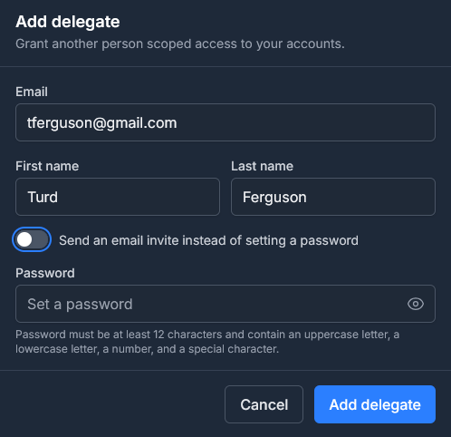
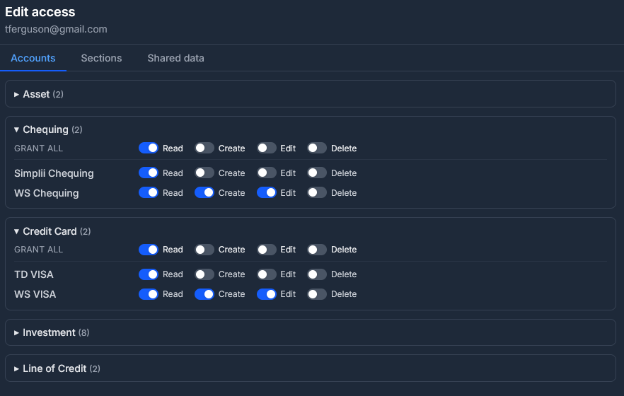

# Shared Access (Delegated Users)

Shared Access lets you grant another person scoped access to your Monize accounts -- ideal for spouses, family members, accountants, or bookkeepers who need to view (and optionally update) parts of your financial data without sharing your password.

There are two ways an account can be shared, and they are chosen per account, per person:

| Way to share | How it feels to the other person | Best for |
|--------------|----------------------------------|----------|
| **Delegation** (the original behaviour) | They switch context and look at *your* ledger, then switch back | Accountants, bookkeepers, someone helping you occasionally |
| **Joint account** (added in v1.14.0) | Your account simply appears in *their* own account list, register and net worth -- no context switching | A couple sharing a chequing account |

Both are configured from the same **Edit access** screen, and both are governed by the same per-account read / create / edit / delete grants. Joint is an extra toggle on top of a read grant, not a separate feature.

Each delegate has their own login.

---

## Concepts

| Term | Meaning |
|------|---------|
| **Owner** | The user who owns the accounts and grants access |
| **Delegate** | A separate user who has been granted access to one or more of the owner's accounts |
| **Grantee** | A delegate viewed from the perspective of a specific joint account -- the person the account is shared *with* |
| **Delegate-only user** | A user account that was created by an owner via Shared Access and has never registered or claimed their own data |
| **Full account** | A delegate who has their own Monize login and data, rather than an owner-managed credential identity. Only full accounts can be given joint access. |
| **Acting as** | The session state when a delegate is currently viewing an owner's data |
| **Joint account** | An account the owner has flagged as joint for a particular delegate, making it appear natively in that delegate's own data |

Delegates always have their own credentials. The owner's password is never shared, and the delegate sees only the data the owner has explicitly granted -- nothing else.

---

## Adding a Delegate

1. Navigate to **Settings > Shared Access**
2. Click **Add delegate**
3. Enter the delegate's **email address**


<!-- Screenshot: The "Add delegate" form showing the email lookup, name fields, and password/invite options -->

Monize automatically looks up the email after a short delay. From there, one of three paths applies:

| Scenario | What you do | Result |
|----------|-------------|--------|
| **Email already has a Monize account** | Click **Add delegate** | The existing user gains access using their current login. No password or invite step. |
| **New email, you set the password** | Enter first/last name and a temporary password | A new user is created with that password. Share it with the delegate out-of-band; they can change it after logging in. |
| **New email, send an email invite** | Enter first/last name and check **Send an email invite** | A new user is created with no password. An invite email is sent containing a one-time link valid for 24 hours; the delegate sets their own password. |

> **Note:** The password must meet Monize's standard complexity requirements (the same rules used for registration). Passwords are also checked against the [Have I Been Pwned](https://haveibeenpwned.com/) breach database.

> **Joint access and account type:** A delegate you create here with a password or invite is an *owner-managed* identity. Joint sharing is offered only for delegates who are full Monize accounts of their own, so if you intend to share an account jointly with your spouse, have them register (or add them by their existing email) rather than creating a credential for them.

After the delegate is created, they appear in the **Shared Access** list with zero accounts granted. The next step is to configure permissions.

---

## Configuring Delegate Permissions

From the delegate's row in the Shared Access list, click **Edit access** to open the permissions modal. The row summarizes what is granted -- sections, accounts, shared data, and how many of those accounts are **joint**.


<!-- Screenshot: The "Edit access" modal showing the Accounts / Sections / Shared data tabs -->

The modal has three tabs.

### Accounts Tab

Choose which accounts the delegate can see, and what they can do with each.

Each account row has five toggles:

| Toggle | Meaning |
|--------|---------|
| **Read** | See the account, its balance, and its transactions |
| **Create** | Add new transactions to the account |
| **Edit** | Modify existing transactions in the account |
| **Delete** | Delete transactions from the account |
| **Joint** | The account appears natively in the delegate's own account list, register and net worth -- no context switching. See [Joint Accounts](#joint-accounts). |

**Read is required for Create, Edit, Delete, and Joint.** Unchecking Read automatically clears the other four. If you grant no Read access at all, the delegate sees nothing for that account.

**Joint is disabled for delegates who are not full Monize accounts.** Hovering the toggle explains why: *"Joint accounts can only be shared with users who have their own Monize account."*

Accounts are grouped by type (Chequing, Savings, Credit Card, etc.) so you can scope access broadly -- for example, share all chequing accounts with your spouse while keeping investment accounts private.

> **You can only share what you own.** Accounts that somebody else shared with you do not appear in this screen at all, so a joint account can never be re-shared onward -- only its owner can share it.

### Sections Tab

Section toggles control whether the delegate can see entire feature areas of the application:

| Section | What it controls |
|---------|------------------|
| **Bills & Deposits** | The scheduled / recurring transactions screen |
| **Investments** | Portfolio, securities, and investment transactions |
| **Budgets** | Budgets and budget tracking |
| **Reports** | All built-in and custom reports |
| **AI Assistant** | Natural-language queries via your configured AI provider |
| **Warranties** | Read-only: your warranties, their documents and their claims, the Warranties link in Tools and the dashboard widget. A warranty's linked purchase appears only when its account is one the delegate can read. See [Warranties](warranties.md#sharing-with-a-delegate). |

Sections apply to the delegate **while acting as you**. They have no bearing on joint accounts, which live in the delegate's own context.

A section is only useful if the delegate also has Read access to the accounts that feed it. For example, granting **Reports** without granting Read on any account produces empty reports.

> **AI Assistant note:** The delegate uses *your* configured AI provider and consumes against *your* AI usage. Answers are scoped to the accounts the delegate can read.

### Shared Data Tab

Categories, payees, and tags are shared reference data across all of your accounts. This tab controls whether the delegate can modify them:

| Resource | Toggles |
|----------|---------|
| **Payees** | Create, Edit, Delete |
| **Categories** | Create, Edit, Delete |
| **Tags** | Create, Edit, Delete |

Read access to all three is always implied -- delegates need to see payees, categories, and tags to make sense of any transaction.

> **Tip:** A common setup is to enable **Create** for all three but leave **Edit** and **Delete** off. This lets the delegate enter transactions naturally (creating new payees as needed) without being able to rename or remove existing entries that affect your historical data.

The **Payees > Create** permission also governs whether a grantee may type a new payee name while entering a transaction on a joint account.

---

## Joint Accounts

*Added in v1.14.0.*

Plain delegation means *acting as* the other person: you switch context, see their ledger, and switch back. That is right for a bookkeeper and wrong for a couple sharing a chequing account.

Ticking **Joint** on an account row (on top of **Read**) makes that account appear in the other person's own data as though it were theirs. Nothing to remember, nothing to switch.

### What the Grantee Gets

Once an account is joint, the grantee sees it in their own context:

- **Account list** -- listed alongside their own accounts, with a **Joint** badge and *"Shared by [your name]"*. A **Shared with me** filter slider on the accounts page narrows the list to shared accounts only.
- **Register** -- the account's transactions, and (where permitted) the ability to add, edit and delete rows in it
- **Net worth** -- included by default; see [Net Worth](#net-worth)
- **Account detail page** -- the balance chart, cash flow, top categories, top payees and balance forecast, computed exactly as the owner sees them

What the grantee can *do* is still your existing per-account grants: **Read**, **Create**, **Edit**, **Delete**. Those grants are enforced by the server, not merely by hiding buttons.

The grantee never gets ownership of the account object. Renaming, closing, reconciling, changing settings on and deleting a joint account are the owner's alone -- those actions are not offered on a joint row and are rejected server-side.

### Which Account Types Can Be Written To

In v1, only everyday banking accounts accept grantee writes. The rest are shared read-only no matter which grant flags are ticked:

| Account type | Shareable as joint | Grantee writes |
|--------------|--------------------|----------------|
| Chequing, Savings, Cash, Credit Card, Line of Credit | Yes | Create / Edit / Delete, as granted |
| Investment, Loan, Mortgage, Asset, Other | Yes | **None** -- read-only regardless of the grant flags |

The effective permission the grantee's screen shows is the grant flags combined with this policy, so the interface and the server can never disagree.

### Categories, Payees, and Tags on Joint Accounts

Every transaction in a joint account belongs to the **owner's** ledger, even the rows the grantee writes:

- The grantee picks categories and payees from **your** lists, not theirs. Their own reference data can never land on your rows.
- Typing a brand-new payee name auto-creates it on your ledger, but only if the delegation has **Payees > Create**. Otherwise the transaction is rejected.
- Categories cannot be created from the grantee's native context in v1.
- **Tags are personal on both sides.** The grantee cannot set tags on a joint row; your existing tags on those rows display read-only to them, and tag-based breakdowns stay owner-only.

Rows the grantee creates keep their creator attribution, but they are your transactions, on your account, in your reports.

### Net Worth

The grantee decides whether a joint account counts toward **their** net worth, from the account row's menu. That preference is theirs alone: it is invisible to you, and it is never confused with your own "exclude from net worth" setting.

| Case | In the grantee's net worth? |
|------|-----------------------------|
| Joint account, no exclusion set by the grantee | Yes (the default) |
| Joint account the grantee excluded | No |
| Joint account you excluded from *your* net worth | Yes -- your flag governs your view only |
| Plain (non-joint) granted account | No -- never aggregated into the delegate's own numbers |

Your own net worth is unchanged in every case.

### What the Owner Sees

On your side, a shared account is labelled with how many people it is shared with:

- The **account list** row shows a **Joint** badge and *"Shared with N people"*
- The **account detail page** header shows the same
- The **edit account** form shows the count with a **Manage sharing** link straight to Shared Access

### What Joint Accounts Do Not Include Yet

These are deliberate v1 scope cuts, not bugs:

- **Reports** (built-in and custom) exclude joint rows
- **AI Assistant and the MCP server** exclude joint rows -- both AI surfaces change together, and in v1 neither reads them
- **Investment breakdowns** exclude joint investment accounts (the plain net-worth total still includes them)
- Attachments, scheduled transactions and investment holdings on a joint account are not natively visible to the grantee
- Grantees cannot add splits, tags or attachments to joint rows
- Grantee CSV / QIF export of joint rows is deferred

Anything in this list is still reachable the old way, if you also grant plain delegated access: the grantee switches into your context and sees it there.

---

## Transfers Between Two People's Accounts

You can transfer money **between an account you own and an account shared with you**, in either direction and from either side. The transfer form's account picker now offers the accounts you are allowed to move money into; previously the destination simply was not there.

- Authorization is the ordinary write grant (**Create** / **Edit** / **Delete**) on the shared side.
- Each leg belongs to its own account's owner, so both ledgers stay self-contained -- balances, net worth, reports and exports keep aggregating only your own rows.
- Moving a transfer leg between owners is rejected; so are cross-owner split transfers and cross-owner scheduled transfers.
- The AI Assistant and MCP server cannot create or edit cross-owner transfers in v1; they report a clear error rather than half-doing it.

---

## Unsharing and Re-sharing

Everything about joint access is computed from the grants that exist **right now**. Nothing is copied, so nothing needs repairing.

Untick **Joint** (or **Read**, or remove the delegate entirely) and on the grantee's next page load:

- The account disappears from their list, register, detail pages and net worth -- no leftovers, no tombstones
- Existing transfers between their account and yours are **frozen, not severed**. Each side keeps its own leg, the counterpart shows as **Hidden account** instead of leaking the other person's account details, and neither side can change the amount, date or account through it. Descriptive fields on your own leg stay editable.
- Deleting your own leg of a frozen transfer removes only your leg and detaches the counterpart, which survives as a one-sided transfer.
- Rows the grantee created in the account stay in your ledger, untouched -- they were always your rows.

Re-tick **Joint** later and all of the above reverses on its own: the account reappears, the masking lifts, and frozen transfers reconnect with no repair step. Note that re-granting plain **Read** does *not* silently restore the joint flag -- you re-tick it deliberately.

The **Hidden account** masking applies everywhere a transfer can be read: lists, transaction detail, exports, and what the AI Assistant and MCP server can see.

---

## What the Delegate Sees

When the delegate logs in, their navigation is filtered to only the sections they have access to:

- The **Accounts** and **Transactions** tabs appear only if at least one account has Read enabled
- **Bills & Deposits**, **Investments**, **Budgets**, **Reports**, and **AI** appear only if the corresponding Section toggle is on
- Transactions involving an account the delegate cannot read display the inaccessible side as **Hidden account** in transfers
- The delegate can mark accounts as favourites independently of your own favourites -- their dashboard ordering does not affect yours

If a delegate has no personal Monize data (i.e., they were created via Shared Access and have not registered their own accounts), they go straight into your context after logging in.

---

## Switching Context (Viewing Banner)

While a delegate is viewing your data, an amber banner appears at the top of every page:

```
Viewing: [Owner Name]                                 [ context switcher ]
```

The dropdown on the right lets the delegate switch between:

- **Their own account** (if they have one, labelled "(you)")
- **Each owner** who has shared access with them

Selecting a different context reloads the page so all data refreshes under the new identity.

> **Purely joint delegations are not listed.** If everything you shared with someone is joint -- every readable account already appears natively, with no sections and no shared-data permissions -- there is nothing extra to see by switching, so you are not offered as a context. A delegation with nothing readable *yet* stays listed, so the delegate can still get in once you grant something, and the context somebody is currently acting as is never pulled out from under them.

> **Privacy:** The banner is intentionally visible at all times. It guards against the delegate forgetting which dataset they are looking at and entering information into the wrong account.

---

## Resetting a Delegate's Password

If a delegate forgets their password, the owner can issue a new temporary password from the Shared Access list -- but only when the delegate is a **delegate-only user**.

1. Open **Settings > Shared Access**
2. Click **Reset password** on the delegate's row
3. Copy the generated temporary password and share it with the delegate out-of-band
4. The delegate logs in with the temporary password and can change it from their own Settings page

The **Reset password** button is hidden for delegates who:

- Have registered their own Monize account (they own their credentials -- you cannot overwrite them)
- Own financial accounts of their own
- Are also delegates for a different owner
- Have the admin role

In any of these cases, the delegate must use the standard **Forgot Password** flow on the login page.

> Because joint sharing requires a full Monize account, a delegate you share jointly with always manages their own password.

---

## Removing a Delegate

1. Open **Settings > Shared Access**
2. Click **Remove** on the delegate's row
3. Confirm the action

Removing a delegate immediately revokes all of their access:

- All per-account grants are deleted, including joint flags
- Every joint account disappears from their own account list, register and net worth
- Cross-owner transfers between you freeze as described in [Unsharing and Re-sharing](#unsharing-and-re-sharing)
- Their per-account net-worth exclusions for your accounts are discarded along with the grants
- The delegate's favourite-account list (for your accounts) is removed
- If the delegate is currently signed in and viewing your data, their next request fails with "Delegated access is no longer valid" and they are logged out

If the delegate is a **delegate-only user** who has never created their own accounts and has no other delegations, their user record is also deleted. Otherwise the user remains (they keep their own login and any other delegations) -- only the relationship to *your* accounts is removed.

> **Note:** Removing a delegate does not delete any transactions they created. Records keep their original creator attribution, and rows they entered in a joint account stay on your ledger.

---

## Two-Factor Authentication and Delegation

If you (the owner) have 2FA enabled, **the delegate must also enable 2FA on their own account** before they can act as you.

When a delegate tries to switch into an owner's context and the owner has 2FA but the delegate does not, the switch is blocked with:

> *"That account requires two-factor authentication. Set up 2FA in Settings before switching."*

This is a non-negotiable requirement. TOTP secrets are per-user and are never shared between the owner and the delegate -- so the delegate must independently prove possession of a second factor for their own login before they can access a 2FA-protected dataset.

See [Settings and Security > Two-Factor Authentication](settings-and-security.md#two-factor-authentication-2fa) for setup details.

---

## Security Notes

- Delegates never see your password, your 2FA secret, your backup codes, or your trusted-device list.
- Changing your password does **not** automatically revoke active delegate sessions -- if you need to cut off a delegate, use **Remove** on the Shared Access page.
- Delegate API requests are scoped server-side. Even if a delegate crafted a direct API call to an account they were not granted, the request would be rejected with a permission error.
- Joint access is enforced the same way. Which accounts are natively visible, which of them accept writes, whether a transfer connects and what the net worth includes are all recomputed from the live grants on every request -- the interface never gets to decide.
- An account shared with someone cannot be re-shared by them. Delegated accounts are absent from the Edit Access screen entirely, so sharing never chains.
- A request for a joint account you were not granted returns "not found" rather than "forbidden", so probing cannot confirm that an account exists.
- Invite tokens are stored as hashes and expire after 24 hours. A used token cannot be replayed.
- Reset tokens generated via **Reset password** are single-use and expire after the standard reset window.
- Personal Access Tokens (see [Settings and Security > Personal Access Tokens](settings-and-security.md#personal-access-tokens-pats)) belong to the user that created them. A delegate's PAT does not grant access to the owner's data -- a delegate would need to switch context interactively and create the PAT while acting as the owner.
