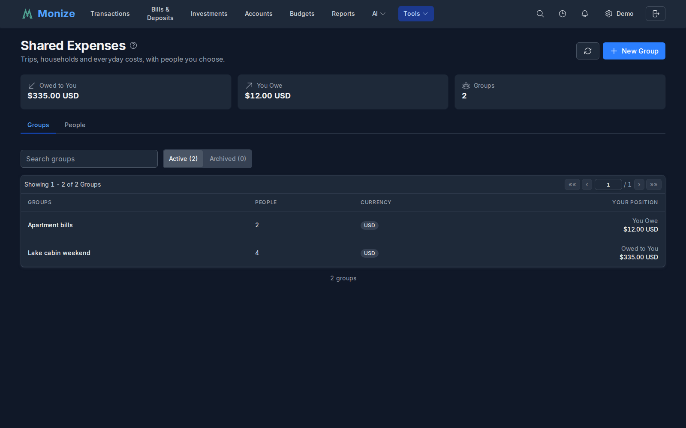
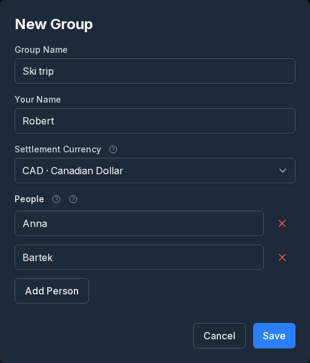
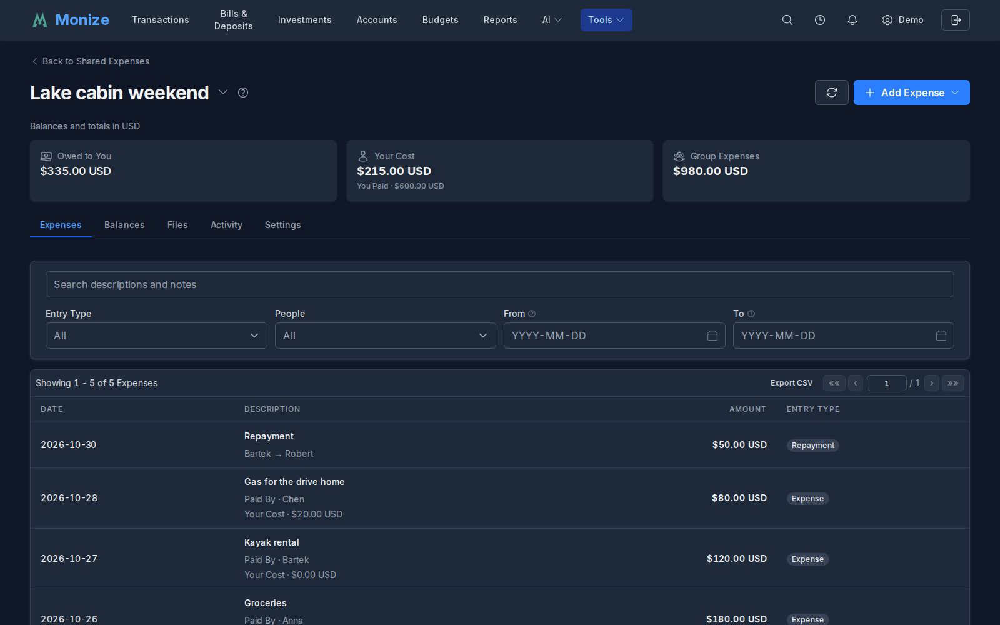
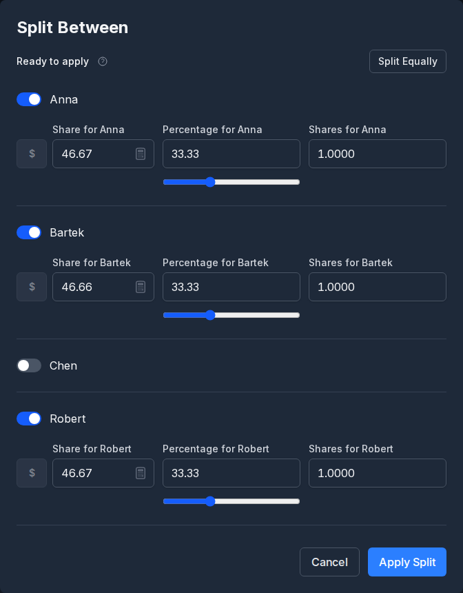
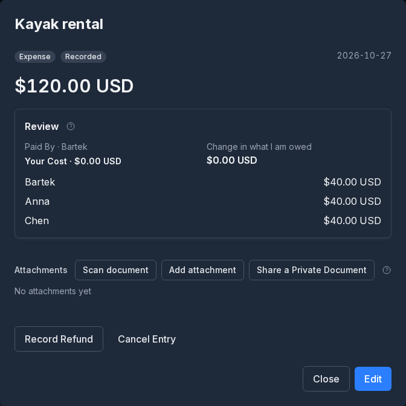
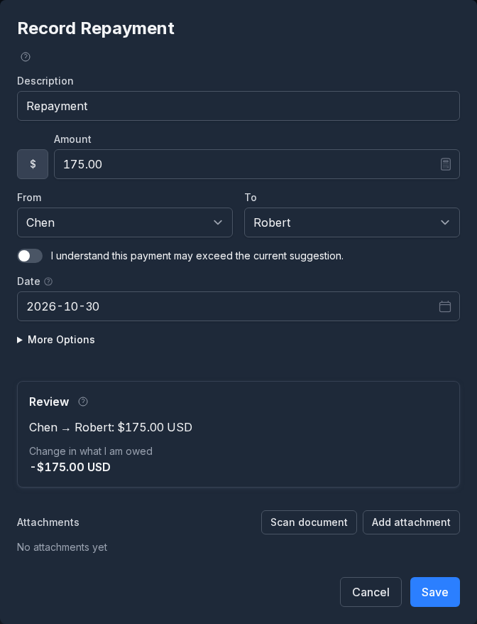
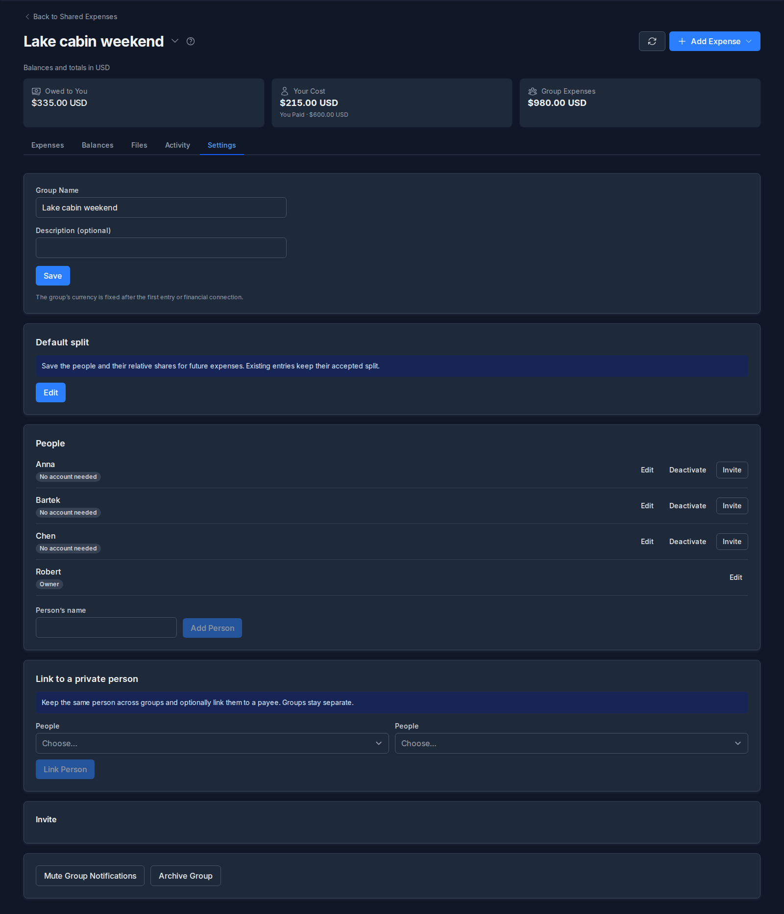
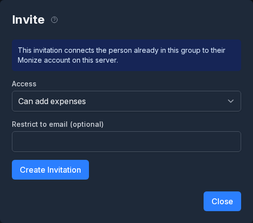

# Shared Expenses

Monize keeps track of **money you spend together with other people**: a trip, a shared apartment, a club. You record who paid for each purchase and who it was for, and Monize works out each person's position and the fewest repayments that settle the group.

Shared entries stay **separate from your personal accounts**. Adding an expense or recording a repayment here does not move money between bank accounts, and nothing in a group appears in your balances, budgets or reports.

---

## Where It Lives

**Shared Expenses** is in the **Tools** menu on a computer, and in the navigation menu on a phone. It belongs to your own profile: a delegate viewing your data does not see it, and you switch back to your own profile to open your groups.

The page has two tabs:

- **Groups** lists your groups with your position in each. Above the list, **Owed to You** and **You Owe** add up your positions across every group, per currency. Switch between **Active** and **Archived** groups, or use **Search groups**.
- **People** holds your private list of people (see [Keeping the Same Person Across Groups](#keeping-the-same-person-across-groups)).

Click a group to open it.

---

## Creating a Group

Choose **New Group**.

- **Group Name**, for example "Ski trip" or "Apartment bills".
- **Your Name** is how you appear to the others in this group.
- **Settlement Currency** is the currency balances and repayments are worked out in. Purchases can still be in other currencies (see [Foreign Currencies](#foreign-currencies)). The currency is fixed once the group has its first entry.
- **People**: one row for each person taking part; **Add Person** adds another row. Nobody needs a Monize account. You can record expenses for everyone and [invite them](#inviting-people) later, or never.

Choose **Create Group**. Keep one group for the whole trip: each purchase can involve a different selection of its people.

---

## The Group Page

Across the top, **Group Expenses** is what the group spent, **Your Cost** is your share of it and **You Paid** is what you paid, all in the settlement currency. Your position, what you are owed or owe once repayments are counted, is on the [Balances](#balances-and-repayments) tab and in the group list. The switcher beside the group's name jumps to another group.

The tabs below are:

| Tab | What it holds |
|-----|---------------|
| **Expenses** | Every entry, with search and filters |
| **Balances** | Each person's position and the suggested repayments |
| **Files** | Receipts, tickets and photos for the group |
| **Activity** | Who changed what, and when |
| **Settings** | People, access, invitations and the group itself |

On **Expenses**, **Search descriptions and notes** finds an entry by its text, and the filters below it narrow the list by **Entry Type** (expenses, refunds, income or repayments), by one of the **People**, or by a **From** and **To** date. Each active filter shows as a chip you can remove. **Export CSV** downloads the whole group: the entries, every person's share and payment, and the positions.

---

## Recording an Expense

Choose **Add Expense**, then **Expense**.

1. **Description**, **Amount** and its currency, and **Date**.
2. **Paid By**: who paid. Choose **More than one person paid** to enter how much each payer contributed; the amounts must add up to the total.
3. **Split Between** shows who the purchase was for. It starts as an equal split between everyone; choose **Change Split** to change it.
4. **More Options** holds a **Note**, a **Group Label** (a free-text tag such as "Food" that the group sees), and the **Agreed Exchange Rate** when the purchase is in another currency.
5. Add a receipt or photo under attachments if you have one. It is shared with the group when you save.
6. Check the amounts in the preview and choose **Save**.

A person can pay without having a share: a friend who paid for your concert ticket is owed the whole amount.

Choose **Add Expense**, then **Income**, for money the group received rather than spent, such as a deposit returned to the group or winnings shared between you. It works the same way: **Received By** replaces **Paid By**, and the split says who it belongs to.

### Changing the Split

Each person has a switch. Turn someone off when they did not take part; they are left out of this expense only. For the people left in:

- Leave every amount blank to split **equally**.
- Enter a **fixed amount** or a **percentage** for a person; whatever is left is split equally between the people whose fields are blank. **Zero** keeps a person in the split without charging them.
- Use **Shares** for relative portions: shares of 2, 1 and 1 give the first person half and the others a quarter each.

The line at the top says whether the split is complete, or how much is still to allocate or over-allocated. **Split Equally** starts again. Choose **Apply Split** to go back to the expense. Percentages shown while you type may be rounded; the saved amounts are worked out by the server and add up exactly to the total.

### Default Split

When a group always shares costs the same way, such as a 60/40 split of the rent, the owner saves it under **Default split** in the group's **Settings**. New expenses start from it. Existing entries keep the split they were saved with, and someone added to the group later is not in the default until you edit it. **Use Equal Split For Everyone** removes it.

### Planned Expenses

An expense dated in the future is **Planned**: it is listed, but does not affect balances until its date. Open it on that day to record it.

---

## Editing, Refunds and Cancelling

Click an entry to open it.

- **Edit** changes any part of it. Balances follow the change, and the entry's earlier version stays in its history.
- **Record Refund** records money returned for an expense, such as a cancelled booking. The refund follows the original split, takes earlier refunds into account, and uses the original expense's exchange rate.
- **Cancel Entry** removes an entry recorded by mistake. Give a reason; its effect is removed from the balances, and it stays in the list and the activity as **Cancelled**.

Entries are never deleted, so everyone in the group can see what changed.

---

## Balances and Repayments

The **Balances** tab shows where everyone stands.

**Each Person's Position** is what each person is owed (positive) or owes (negative). **Review** under a name breaks it down into what they paid, their share, their income share, and the repayments they sent and received.

**Suggested Repayments** are the fewest transfers that would settle everyone. They use each person's net position across all purchases, so you may be asked to repay someone who did not pay for your particular expense; that is still correct. Settling once at the end of a trip is usually simpler than repaying after every purchase.

### Recording a Repayment

Monize does not send money. After the money has changed hands, choose **Record Repayment** beside the suggestion, or **Record Other Repayment** for any other payment between two people.

**From**, **To** and **Amount** are filled in from the suggestion; change the amount for a partial repayment. A repayment larger than the current suggestion is refused unless you turn on **I understand this payment may exceed the current suggestion**, which protects you from recording the same payment twice.

### Reminders

When someone who has joined the group with their own Monize account owes money, **Remind** under their suggestion, then **Send Reminder**, sends them a notification that opens the group's balances. You can remind the same person once every 24 hours, and the reminder respects their notification settings and whether they have muted the group.

---

## Foreign Currencies

A purchase can be in any currency. Its amount is converted to the settlement currency with:

- the **Agreed Exchange Rate** you entered under **More Options** (the rate stays with the expense), or
- the **historical market rate** for the purchase date, when you did not enter one.

When Monize has no rate for that currency pair and date, the expense is marked and the group shows a notice: the positions and suggestions wait until the rate is known, and **Known position** shows your position without that expense. Open the marked expense from the notice to enter the rate you agreed, or retry the lookup. See [Currency Management](currency-management.md) for where market rates come from.

---

## Files and Activity

**Files** collects every document in the group: files uploaded straight to the group (tickets, bookings, a photo of the bill before anyone has entered it) and the attachments of individual expenses. **Upload Files** adds documents; each can be renamed and given a document type.

- **Create Expense From This File** opens a new expense with the file already attached, for a receipt uploaded first.
- **Open Related Entry** opens the expense a file belongs to.
- **Share a Private Document** copies a document from one of your own transactions into the group. The copy is separate: the original stays private.

**Activity** lists every change to the group: entries added, changed or cancelled, people added, invitations, access changes and documents, each with who made it and when.

---

## Inviting People

Anyone in a group can stay a name only. To let a person see the group and add expenses themselves, invite them from **Settings**. They need a Monize account on the same server.

Choose **Invite** beside the person.

1. Optionally enter **Restrict to email (optional)** so that only that account can use the link.
2. Choose **Create Invitation**, then **Copy Link** and send it to them however you like. Monize does not email it.
3. They open the link, sign in, and choose **Join Group**. They join as the person already in the group, with that person's history.

A link is valid for 7 days, and creating another one for the same person replaces it. **Remove Access** under **Invite** at the bottom of Settings revokes a link nobody has used yet.

Joining shows the other person the group's expenses, people and documents. **Your personal finances stay private**: nobody in the group sees your accounts, categories, payees or bank records.

### Access Levels

| Access | Can |
|--------|-----|
| **Owner** | Everything: edit people, invite, change access, archive or delete the group |
| **Can add expenses** | Add, edit, refund and cancel entries, record repayments, upload files |
| **Can view** | Read the group, its balances and files |

Change a joined person's access with the list beside their name. **Remove Access** ends their access but leaves them and their history in the group.

### Transferring Ownership

To hand the group over, pick **Ask To Take Ownership** in the list beside a joined person. They see **Accept Ownership** in their Settings; once they accept, you choose **Complete Handover**. The new owner manages access and the group's settings, and you stay on as someone who can add expenses.

---

## Managing People

The owner can, from **Settings**:

- **Edit** a person's name.
- **Add Person** to an existing group.
- **Deactivate** a person who has not joined, for example someone who left the household. Their earlier expenses and balances stay; they are left out of new expenses. **Reactivate** brings them back.

### Keeping the Same Person Across Groups

The **People** tab on the main page is your own list of the people you share costs with; nobody else sees it. Save a person there, optionally linked to one of your payees, then use **Link to a private person** in a group's Settings to connect their appearance in that group. **New Group** then offers **Add someone from your people**, so you do not retype names. Groups stay separate: linking does not merge balances.

---

## Archiving, Leaving and Deleting

- **Archive Group** (owner) closes a finished trip. An archived group stays readable and its balances still count on the main page; **Reopen Group** before adding or editing entries.
- **Leave Group** (anyone but the owner) ends your access. Your recorded history stays in the group.
- **Delete Empty Group** (owner) is only offered while a group has no entries. A group with entries, documents or bookings is archived instead.
- **Mute Group Notifications** stops notifications from one group; **Enable Group Notifications** turns them back on.

---

## Notifications

When someone else changes a group you are in, or changes your access, Monize sends you a notification that opens the group. Choose how they reach you under **Settings > Notifications**, in the **Shared expenses** row (see [Settings and Security](settings-and-security.md#notifications)).

---

## Take the Guided Tour

Open **Settings > Guided tours** and choose **Start** beside **Shared expenses**. The walkthrough points out navigation, group creation, expenses and balances. It does not create sample records for you.

When asked to open a group, select one from the list. If you have none yet, choose **Skip this step**; the tour finishes without opening a group. You can create your group afterwards and use **Retake** in Guided tours to see the remaining steps. Use **End tour** or Escape to leave at any time.

---

## Related

- [Currency Management](currency-management.md) -- exchange rates and where they come from
- [Settings and Security](settings-and-security.md#notifications) -- the notification delivery matrix
- [Shared Access](shared-access.md) -- sharing your own accounts with a delegate, which is a different feature
