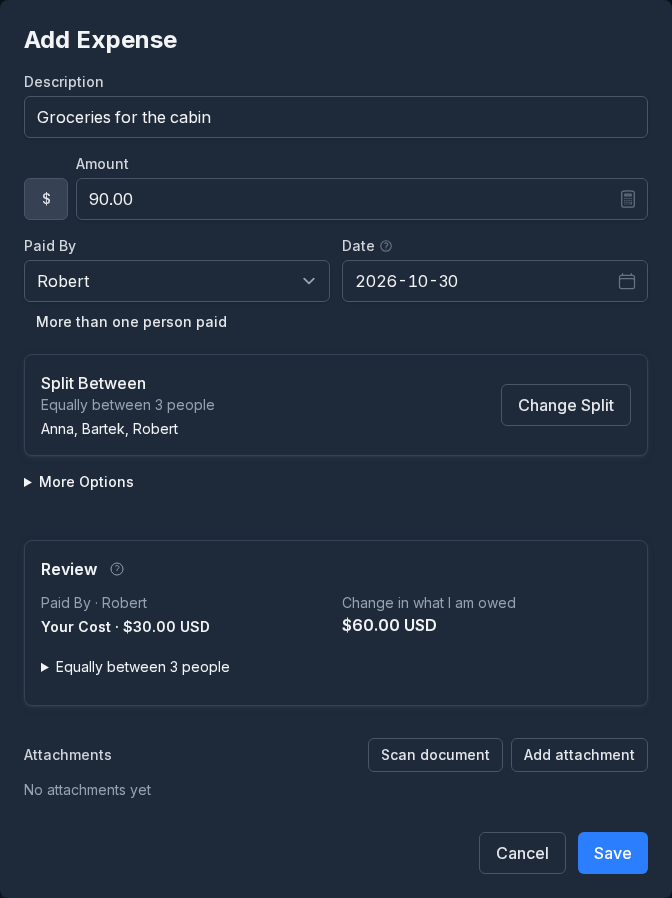
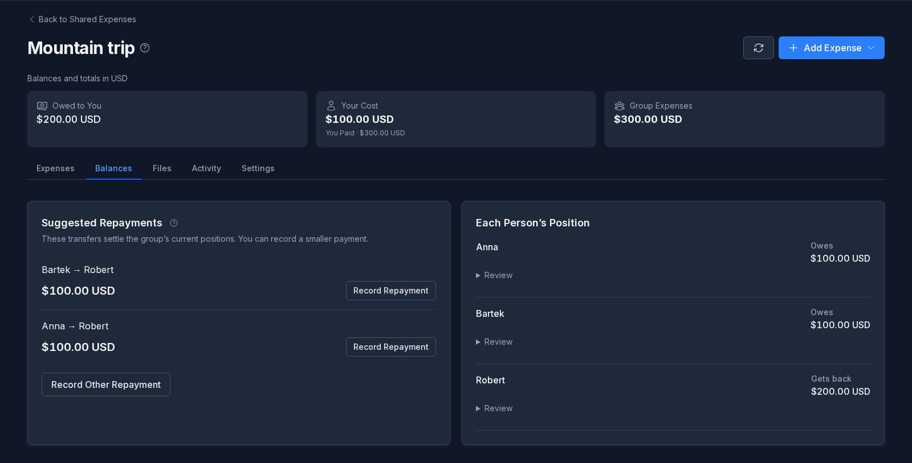
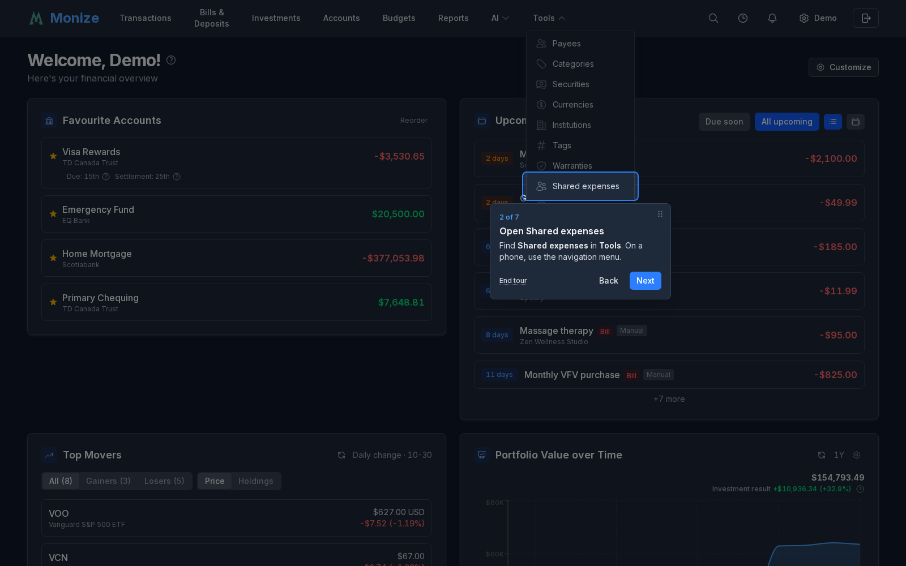

# Shared Expenses

Track purchases for a trip or another group, see who owes whom, and record repayments. Open **Tools > Shared expenses** on a computer, or **Shared expenses** in the navigation menu on a phone.

Shared entries stay separate from your personal account transactions. Adding an expense or recording a repayment here does not move money between bank accounts.

## Create a group

Choose **New Group**, enter a name and settlement currency, and add the people taking part. A participant does not need a Monize account. Keep the group for the whole trip; each purchase can involve a different selection of people.

## Record a purchase

Open the group and choose **Add Expense**. Enter what was bought, the date, amount and currency. Select who paid and who benefited.

Under **Split Between**, choose equal shares, exact amounts or percentages. Exclude someone who did not take part, or give them a zero share. For example, a coffee bought for one friend belongs to that friend; groceries for the cabin can be shared by everyone. Review the split before saving. You can attach a receipt to keep it with the expense.

## Check balances and repayments

The **Balances** tab shows the group's positions and suggested repayments. These help you settle several purchases together instead of transferring money after each one. Record a repayment after the money has changed hands.

Use **Files** to find supporting documents and **Activity** to see the group's history. The controls available to you depend on your group access.

## Take the guided tour

Open **Settings > Guided tours** and choose **Start** beside **Shared expenses**. The walkthrough points out navigation, group creation, expenses and balances. It does not create sample records for you.

When asked to open a group, select one from the list. If you have none yet, choose **Skip this step**; the tour finishes without opening a group. You can create your group afterwards and use **Retake** in Guided tours to see the remaining steps. Use **End tour** or Escape to leave at any time.
