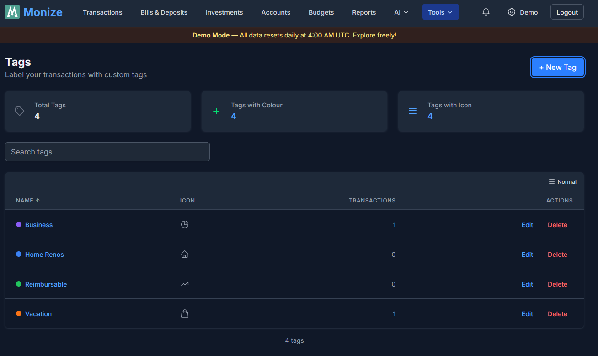

# Tags

Tags provide a flexible, cross-cutting way to label and organize your transactions. Unlike categories (which assign a single classification per transaction), tags let you apply multiple labels to any transaction or split -- making it easy to track concepts that span categories.

---

## Overview

Tags are user-defined labels with an optional colour and icon. They complement categories by allowing you to group transactions across different categories and accounts.

**Example use cases:**

| Tag | Purpose |
|-----|---------|
| `Vacation 2026` | Track all spending on a specific trip across dining, travel, lodging |
| `Tax Deductible` | Flag deductible expenses across multiple categories |
| `Reimbursable` | Mark work expenses to be submitted for reimbursement |
| `Home Renovation` | Group project costs across hardware, labour, permits |
| `Wedding` | Track all wedding-related expenses |

Each tag has:

| Property | Description |
|----------|-------------|
| **Name** | The tag label (unique per user, case-insensitive) |
| **Colour** | Optional hex colour for visual identification in lists and filters |
| **Icon** | Optional icon (from the Heroicons library) |

---

## Managing Tags

Navigate to **Tools > Tags** to access the tag management page.

<!-- Screenshot: The tags management page showing the list of tags with colours, icons, and transaction counts -->

### Creating a Tag

1. Click **Add Tag**
2. Fill in the tag form:

| Field | Required | Description |
|-------|----------|-------------|
| **Name** | Yes | Tag label (1-100 characters, must be unique) |
| **Colour** | No | Pick from the colour palette or leave unset |
| **Icon** | No | Choose an icon for visual identification |

3. Click **Save**

### Editing a Tag

Click the edit button next to any tag to modify its name, colour, or icon. Renaming a tag updates it on all associated transactions.

### Deleting a Tag

Click the delete button on a tag to remove it. The tag is removed from all transactions that reference it. The transactions themselves are not affected -- only the tag association is removed.

The tag list shows a **transaction count** next to each tag so you can see how many transactions use it before deciding to delete.

---

## Tagging Transactions

### Adding Tags to a Transaction

1. Open the transaction form (create new or edit existing)
2. In the **Tags** field, select one or more tags from the dropdown
3. Save the transaction

Tags appear as coloured chips in the transaction form, showing the tag name and its colour.

### Tags on Split Transactions

When a transaction is split across multiple categories, each split row can have its own set of tags. This allows fine-grained tagging -- for example, tagging only the business portion of a mixed-use purchase as "Reimbursable."

1. Open the split editor
2. Each split row has its own **Tags** dropdown
3. Select tags for individual splits as needed

### Inline Tag Creation

If you need a new tag while entering a transaction, you can create one without leaving the form:

1. In the Tags dropdown, click **Create Tag**
2. Enter the tag name, optional colour, and icon
3. Save the tag -- it is immediately available and selected

---

## Tags on Scheduled Transactions

Scheduled transactions (bills and deposits) support tags. When a scheduled transaction is auto-posted or manually posted, the tags are carried over to the created transaction.

1. Open a scheduled transaction form
2. Select tags in the **Tags** field
3. When the transaction is posted, the tags are applied automatically

This is useful for tagging recurring transactions -- for example, tagging a monthly gym membership as "Health" without needing to remember to tag each posted occurrence.

---

## KEY:VALUE Tags

Tags understand a **`key:value`** naming convention. Name a tag `country:poland`, `strategy:dividend`, or `account-owner:sam` and Monize treats the part before the colon as a **key** and the part after as its **value**. There is no migration and no separate data model -- it is simply a convention parsed from the tag name, so any tag you name this way works immediately, and tags without a colon behave exactly as before.

Grouping tags under a shared key lets you slice your data by that key's values -- for example, tag several securities `country:poland`, `country:canada`, and `country:usa`, then chart how your portfolio splits across countries.

### Portfolio Allocation by Key

On the [Investments](investments.md#asset-allocation) page, the **Asset Allocation** chart gains a **By key** grouping mode when your holdings carry `key:value` tags. Pick a key (e.g. `country` or `strategy`) and the chart shows your portfolio's **value-weighted split across that key's values**, with holdings that lack the key rolled into an untagged band.

### Filtering Transactions by Tag Key

The transactions filter panel can match on a tag **key** rather than a specific tag. For a chosen key you can filter to transactions where the key:

| Condition | Matches |
|-----------|---------|
| **Has value** | Any tag with that key, whatever its value |
| **No value** | Transactions with no tag using that key |
| **Contains** | The key's value contains the text you type |
| **Doesn't contain** | The key's value does not contain the text you type |

Key filters cover split rows too, so a split line tagged `project:reno` is found the same way a whole transaction would be.

---

## Filtering by Tags

Tags integrate with the transaction filter panel, letting you find all transactions with specific tags.

### Filtering in the Transaction List

1. Open the **Filters** panel on the Transactions page
2. In the **Tags** filter, select one or more tags
3. The transaction list updates to show only transactions (or splits) matching the selected tags

Tag filters work alongside other filters (accounts, categories, payees, date range, search). Active tag filters appear as coloured chips above the transaction list for easy visibility.

### Quick Tag Filtering

On desktop, tags displayed on transaction rows are clickable. Click a tag directly in the transaction list to instantly filter the list to all transactions with that tag. On mobile, tap a transaction and select the tag from the action sheet to apply the same filter.

### Tags in Reports

Tags can be used as a filter dimension in reports. When running a spending or income report, you can filter by tags to see totals for specific tag groups -- for example, total spending tagged "Vacation 2026" broken down by category.
