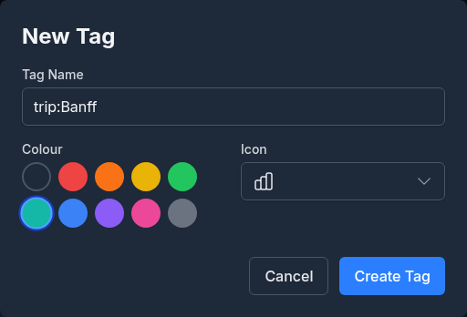
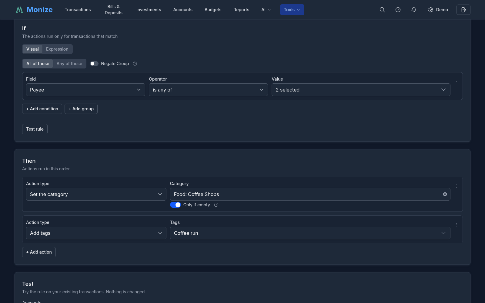
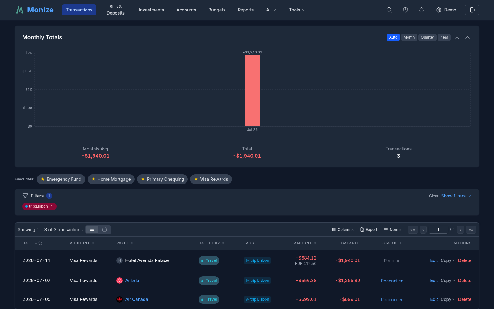

# Tags

Tags provide a flexible, cross-cutting way to label and organize your transactions. Unlike categories (which assign a single classification per transaction), tags let you apply multiple labels to any transaction or split -- making it easy to track concepts that span categories.

---

## Overview

Tags are user-defined labels with an optional colour and icon. They complement categories by allowing you to group transactions across different categories and accounts.

**Example use cases:**

| Tag | Purpose |
|-----|---------|
| `Vacation 2026` | Track all spending on a specific trip across dining, travel, lodging |
| `Tax Deductible` | Flag deductible expenses across multiple categories |
| `Reimbursable` | Mark work expenses to be submitted for reimbursement |
| `Home Renovation` | Group project costs across hardware, labour, permits |
| `trip:Lisbon` | A [key:value tag](#keyvalue-tags): one value of the `trip` key |

Each tag has:

| Property | Description |
|----------|-------------|
| **Name** | The tag label (unique per user, case-insensitive) |
| **Colour** | Optional colour for visual identification in lists and filters |
| **Icon** | Optional icon shown beside the name |

Tags can be put on transactions, on the lines of a split transaction, on scheduled transactions and on securities.

---

## Managing Tags

Navigate to **Tools > Tags** to access the tag management page.

Three cards at the top count your **Total Tags**, the **Tags with Colour** and the **Tags with Icon**. **Search tags...** narrows the list by name. The list shows each tag's **Name** with its colour, its **Icon** and the number of **Transactions** that carry it; click a column header to sort by it. Click a tag's name to see its transactions on the Transactions page; click anywhere else on the row to edit it. **Edit** and **Delete** are at the end of each row (on a phone, press and hold the row, or right-click it).

### Creating a Tag

1. Click **+ New Tag**
2. Fill in the tag form:

| Field | Required | Description |
|-------|----------|-------------|
| **Tag Name** | Yes | Tag label (1-100 characters, must be unique) |
| **Colour** | No | **Red**, **Orange**, **Yellow**, **Green**, **Teal**, **Blue**, **Purple**, **Pink** or **Grey**, or **No colour** |
| **Icon** | No | Choose an icon for visual identification |

3. Click **Create Tag**

### Editing a Tag

Click **Edit** on a tag's row (or the row itself) to modify its name, colour, or icon, then click **Update Tag**. Renaming a tag updates it on all associated transactions.

### Deleting a Tag

Click **Delete** on a tag's row and confirm. When the tag is in use, the confirmation says on how many transactions; the tag is removed from them, and the transactions themselves are not otherwise affected.

---

## Tagging Transactions

### Adding Tags to a Transaction

1. Open the transaction form (create new or edit existing)
2. In the **Tags** field, select one or more tags from the dropdown. The tags you used most recently are listed first.
3. Save the transaction

Tags appear as coloured chips in the transaction form, showing the tag name and its colour, and as chips on the transaction's row in the register.

### Tags on Split Transactions

When a transaction is split across multiple categories, each split row can have its own set of tags. This allows fine-grained tagging -- for example, tagging only the business portion of a mixed-use purchase as "Reimbursable."

1. Open the split editor
2. Each split row has its own **Tags** dropdown
3. Select tags for individual splits as needed

### Inline Tag Creation

If you need a new tag while entering a transaction, you can create one without leaving the form:

1. In the Tags dropdown, click **Create new tag...**
2. Enter the tag name, optional colour, and icon
3. Save the tag -- it is immediately available and selected

The same is possible in the scheduled transaction form and the security form.

### Tagging Many Transactions at Once

Select several transactions on the Transactions page and use the bulk update to give all of them the same tags in one step. The bulk update replaces the tags the transactions had; see [Transactions](transactions.md).

---

## Tags on Scheduled Transactions

Scheduled transactions (bills and deposits) support tags. When a scheduled transaction is auto-posted or manually posted, the tags are carried over to the created transaction.

1. Open a scheduled transaction form
2. Select tags in the **Tags** field
3. When the transaction is posted, the tags are applied automatically

This is useful for tagging recurring transactions -- for example, tagging a monthly gym membership as "Health" without needing to remember to tag each posted occurrence.

---

## Tags and Rules

[Rules](rules.md) (**Tools > Rules**) fill in tags, categories and payees automatically when a transaction is created or imported. A rule has three parts: **When** it runs (a transaction is created, imported, or both), **If** the transaction matches its conditions (payee, amount, account, day of the month, description, tags and more), and **Then** what it changes.

Tags take part on both sides of a rule:

- **Add tags** and **Remove tags** are actions: for example, a rule that adds `Coffee run` to every transaction with Tim Hortons or Starbucks.
- **Tags** is a condition, with **has any of**, **has all of** and **has none of**: for example, a rule that sets a category on every transaction tagged `Reimbursable`.

Other actions set the category, the payee or the description, or ask for an AI review; a rule never changes an amount or moves money. The editor's **Test rule** lists the existing transactions the conditions match before you save, and **Run on existing transactions** applies a saved rule to the transactions you already have, with an undo. Rules run in the order of the list, and **Stop processing other rules** keeps the later ones from touching a transaction this rule matched. A rule that uses a tag you later delete is marked invalid until you repair it.

---

## KEY:VALUE Tags

Tags understand a **`key:value`** naming convention. Name a tag `country:poland`, `strategy:dividend`, or `account-owner:sam` and Monize treats the part before the colon as a **key** and the part after as its **value**. There is no migration and no separate data model -- it is simply a convention parsed from the tag name, so any tag you name this way works immediately, and tags without a colon behave exactly as before.

Grouping tags under a shared key lets you slice your data by that key's values -- for example, tag several securities `country:poland`, `country:canada`, and `country:usa`, then chart how your portfolio splits across countries.

### Portfolio Allocation by Key

On the [Investments](investments.md#asset-allocation) page, the **Asset Allocation** chart gains a **By key** grouping mode when your holdings carry `key:value` tags. Pick a key (e.g. `country` or `strategy`) and the chart shows your portfolio's **value-weighted split across that key's values**, with holdings that lack the key rolled into an untagged band.

### Filtering Transactions by Tag Key

The transactions filter panel can match on a tag **key** rather than a specific tag. Choose the **Tag key** (or **Any (no key filter)**), then a **Condition**:

| Condition | Matches |
|-----------|---------|
| **Has a value** | Any tag with that key, whatever its value |
| **Has no value** | Transactions with no tag using that key |
| **Value contains** | The key's value contains the text you type |
| **Value does not contain** | The key's value does not contain the text you type |

Key filters cover split rows too, so a split line tagged `project:reno` is found the same way a whole transaction would be.

### Breaking Reports Down by Key

**Income vs Expenses** and **Cash Flow** offer **Break down by tag key**: pick a key and the report shows a figure for each of its values, plus **Untagged**. With **Include tagged transfers**, transfers that carry the key (for example money drawn from a savings account for a trip) appear as their own figure, never counted as income or expenses. A row tagged with more than one value under the key counts toward each of them, so per-value shares can add up to more than 100%.

On a category's [detail page](categories-and-payees.md#category-detail-page), the **Tag Breakdown** panel splits the category's spending by the values of a key you choose.

---

## Filtering by Tags

Tags integrate with the transaction filter panel, letting you find all transactions with specific tags.

### Filtering in the Transaction List

1. Open the **Filters** panel on the Transactions page
2. In the **Tags** filter, select one or more tags
3. The transaction list updates to show only transactions (or splits) matching the selected tags

Tag filters work alongside other filters (accounts, categories, payees, date range, search). Active tag filters appear as coloured chips above the transaction list for easy visibility.

The search box understands tags too: `tag:lisbon` finds transactions with a tag whose name contains "lisbon", and `has:tag` finds the transactions that carry any tag.

### Quick Tag Filtering

On desktop, tags displayed on transaction rows are clickable. Click a tag directly in the transaction list to instantly filter the list to all transactions with that tag. On mobile, tap a transaction and select the tag from the action sheet to apply the same filter.

### Tags in Reports

Tags can be used in [custom reports](reports.md#custom-report-builder): filter a report to transactions with chosen tags, group it by **Tag**, or show a **Tag** column -- for example, total spending tagged "Vacation 2026" broken down by category. Several built-in reports, among them Spending by Category, Income by Source and Budget vs Actual, can also count tagged transfers as available funds.
