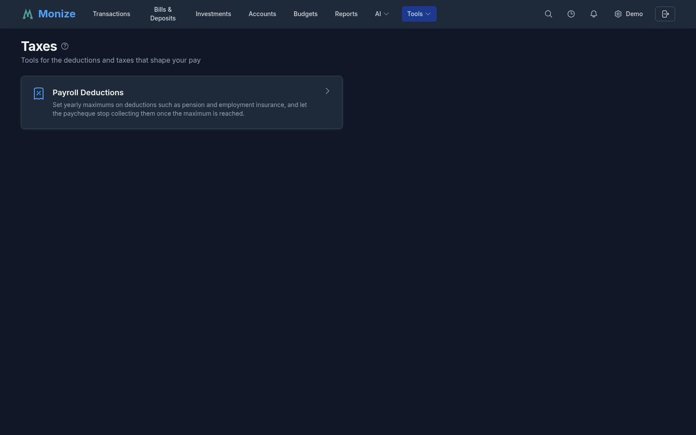
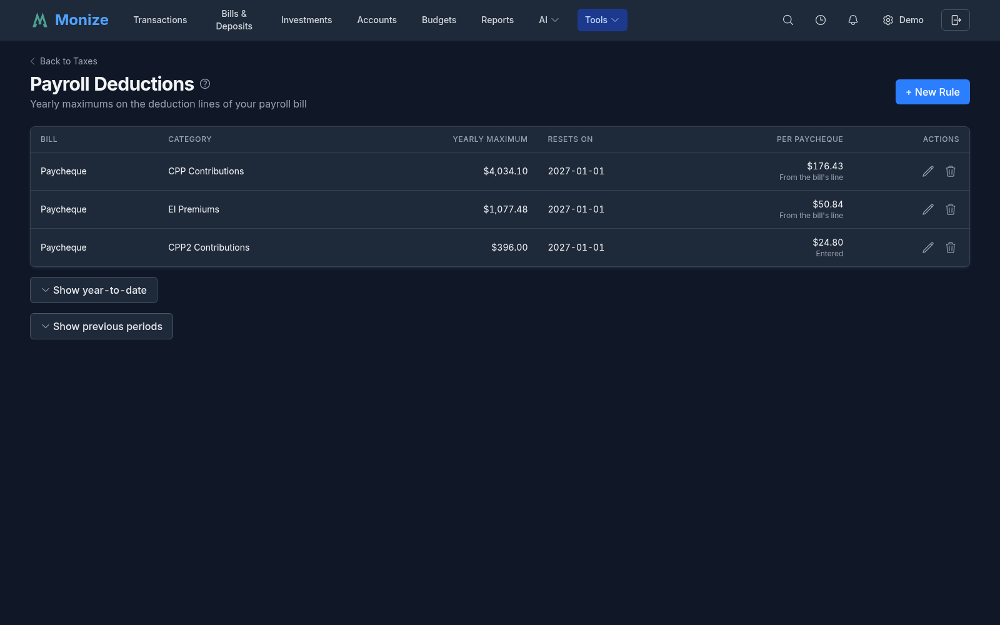
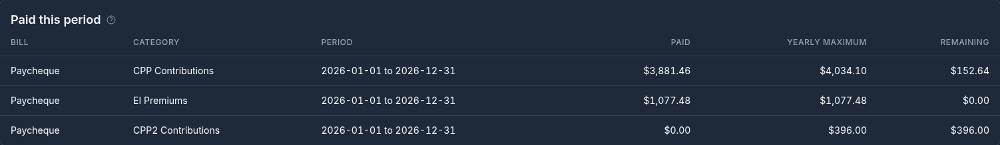
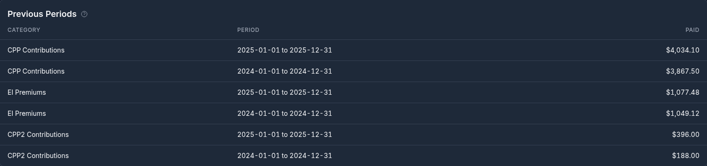

# Taxes

**Tools > Taxes** collects the tools for the deductions and taxes that shape your pay. Its first tool, **Payroll Deductions**, puts a yearly maximum on the deductions your paycheque takes, such as pension contributions and employment insurance premiums, so that your scheduled paycheque stops collecting a deduction once the year's maximum is reached and starts again when the year resets, and your cash flow forecast shows the larger paycheques that follow.

---

## The Taxes Page

Open **Tools > Taxes**. Each tool is a card; click one to open it. Taxes is available to the account owner only: it is not in the Tools menu while you are acting for someone else through [Shared Access](shared-access.md).

| Tool | What it does |
|------|--------------|
| **Payroll Deductions** | Yearly maximums on the deduction lines of your payroll bill, what each deduction has collected this year and in earlier years, and a paycheque that stops collecting a deduction once its maximum is reached |

---

## Payroll Deductions

Many payroll deductions stop for the year once you have paid their maximum: in Canada, for example, CPP contributions and EI premiums, and in the United States the Social Security tax. A scheduled paycheque in Monize would otherwise keep deducting the same amount all year, so the bills you post and the forecast you plan with would be wrong for the last months of every year. A payroll deduction rule fixes that for one deduction on one paycheque.

### Before You Start: a Split Paycheque

The rules work on a scheduled deposit that records your paycheque as a split (see [Split Scheduled Transactions](bills-and-deposits.md#split-scheduled-transactions)):

| Line | Category | Amount |
|------|----------|--------|
| Gross pay | Salary | 3,100.00 |
| Income tax | Payroll Deductions: Income Tax | -512.60 |
| Pension | Payroll Deductions: CPP Contributions | -176.43 |
| Employment insurance | Payroll Deductions: EI Premiums | -50.84 |
| Second pension tier, not deducted yet | Payroll Deductions: CPP2 Contributions | 0.00 |

The bill's amount is the net pay that reaches your account. Each deduction is a negative line with its own category; a line of zero is a deduction the paycheque does not take at the moment but will later (one that starts part-way through the year, or one already stopped for this year).

### The Payroll Deductions Page

Open **Tools > Taxes > Payroll Deductions**. With no rules yet, the page explains what to do and offers **Create Your First Rule**. Once you have rules, each one is a row:

| Column | Description |
|--------|-------------|
| **Bill** | The scheduled paycheque the rule caps |
| **Category** | The deduction line it caps |
| **Yearly maximum** | The most the category collects in one year, in the bill's currency |
| **Resets on** | When the count next starts again from zero |
| **Per paycheque** | What one paycheque deducts: **From the bill's line**, or **Entered** by you when the bill's line is zero. **Expected amount needed** means neither is known, so the forecast cannot project the deduction |
| **Actions** | Edit or delete the rule |

**Back to Taxes** returns to the Taxes page.

### Creating Deduction Rules

Click **+ New Rule**. One form creates the rules for several deductions of one paycheque at once.

| Field | Description |
|-------|-------------|
| **Payroll scheduled bill** | The scheduled deposit that is your paycheque. Only active bills that pay in more than they take out are offered |
| **Resets** | How often the count starts again: **Yearly** |
| **Reset date** | The day each year the count starts again, usually the first day of the year. A new rule starts on the next 1 January |
| **Deduction category** | One of the bill's deduction lines. Only the bill's own deduction lines are offered, and not those that already have a rule |
| **Yearly maximum** | The most this category collects in one year, in the bill's currency |
| **Expected per paycheque** | Shown only when the bill's line for the category is zero: what a paycheque usually deducts once it does. When the bill has a line, the form shows it instead ("The bill's line deducts ... per paycheque") |

**+ Add another category** adds a row for the next deduction of the same bill, and the button beside a row removes it. All the rows are saved together or not at all.

Monize fills in what it can from your history, and says so under the box:

- **Yearly maximum**: estimated from what the category has already collected. A deduction that stopped this year stopped at its maximum, so the year's total is the estimate; otherwise it is last year's total, or this year's when that is already higher.
- **Expected per paycheque**: the amount your transactions in this category most often show over the last year.
- When another paycheque already has a rule on the same category, the new row starts from that rule's maximum, because the two share one maximum (see [Several Paycheques](#several-paycheques)).

A figure you type is never replaced. Check the suggestions against the official maximums for the year: they come from your own history, not from any government source.

To change a rule, click the edit button on its row: the **Edit Deduction Rule** dialog holds that one category. The delete button removes a rule after you confirm; transactions already posted are not changed, and the next paycheque posts its full line.

### What a Rule Does

When the paycheque is **posted**, automatically or from the Post dialog, each deduction line with a rule is reduced to the room left under the year's maximum, down to zero, and the paycheque's amount grows by the difference. For example, with EI capped at 1,077.48 and 1,024.00 paid so far this year:

| Paycheque | Line on the bill | Room left | Line as posted | Net pay |
|-----------|------------------|-----------|----------------|---------|
| 24 April | -64.00 | 53.48 | -53.48 | 10.52 more |
| 8 May | -64.00 | 0.00 | 0.00 | 64.00 more |
| First paycheque after the reset | -64.00 | 1,077.48 | -64.00 | as usual |

What has been paid is read from your transactions at the moment the paycheque posts: every transaction in the category since the last reset date, in any account, in the bill's currency. A refund in the category lowers it. Transactions in another currency are not counted, so in that case the paycheque errs towards deducting.

A rule never changes a transaction that is already posted: it only shapes the next paycheque. Lines that are not deductions (the gross pay) are left alone, and a rule never raises a deduction above the bill's line.

The same reduction shows wherever Monize looks ahead:

- The [Cash Flow Forecast](bills-and-deposits.md#cash-flow-forecast) on the Bills & Deposits page and the dashboard projects each future paycheque with the reduced deduction, the larger net pay that follows, and the full deduction again after the reset date.
- Editing one occurrence of the paycheque (see [Overriding Individual Occurrences](bills-and-deposits.md#overriding-individual-occurrences)) opens it with the lines as the posting will cap them.

### Year to Date and Previous Periods

Two buttons under the list open the figures behind the rules.

**Show year-to-date** opens **Paid this period**: for each category, the bills that cap it, the current **Period**, what it has **Paid** so far, the **Yearly maximum** and what is **Remaining**. Paid counts every transaction in the category, across every account, in the bill's currency; when some were in another currency, the row says how many were left out.

**Show previous periods** opens **Previous Periods**: what each category collected in each of its last five completed years, newest first. It is a quick check of last year's maximum when you confirm this year's.

For a full year-by-year and paycheque-by-paycheque view, use the **Payroll Deductions** report under Reports; see [Tax Reports](reports.md#tax-reports).

### Several Paycheques

When two paycheques deduct to the same category (a mid-month and a month-end paycheque, or two jobs) and each has a rule on it, they share one maximum: the room is spent in date order across both bills, and where their maximums differ the lower one applies. The year-to-date table shows such a category once, naming both bills.

### Reminder Before the Reset

Two months before a rule resets, Monize sends a notification asking you to confirm next year's maximum, since most maximums change every year. Nothing changes if you do not act: the rule keeps its values and resets on its date. Open the notification to go to Payroll Deductions and edit the rule. Where the notification is delivered is set under [Notifications](settings-and-security.md#notifications).

> [!TIP]
> Set the rules up early in the year, before any maximum is reached. Rules created later still work: the paid figure always comes from the transactions already in the category, so the next paycheque is capped correctly from the day you save.
