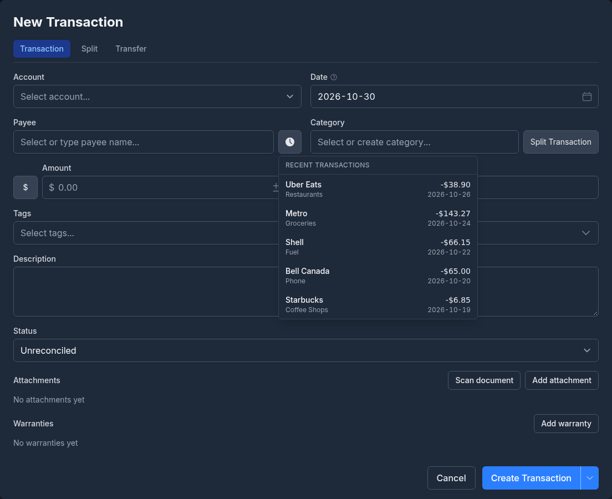
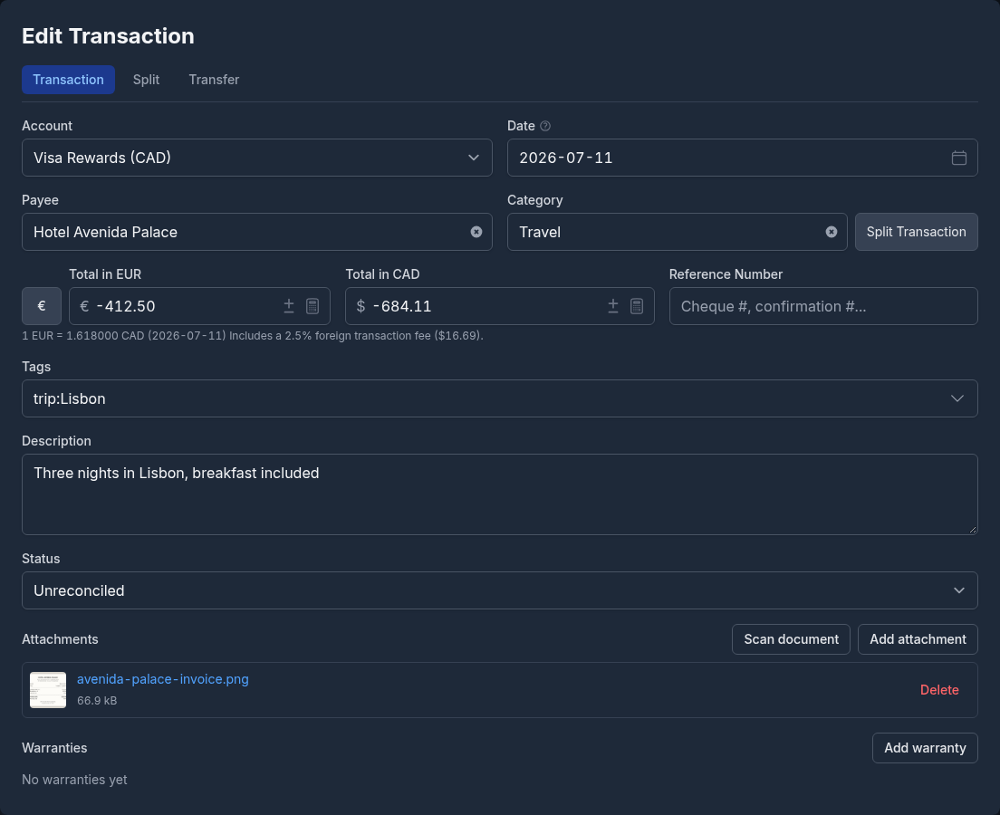
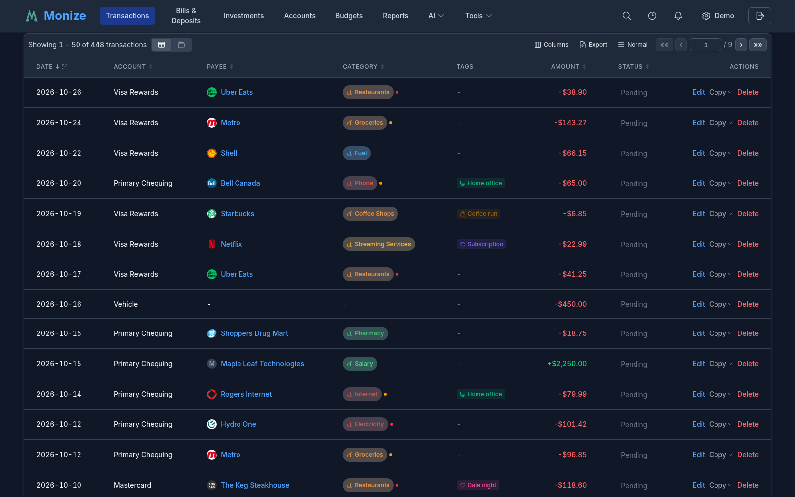
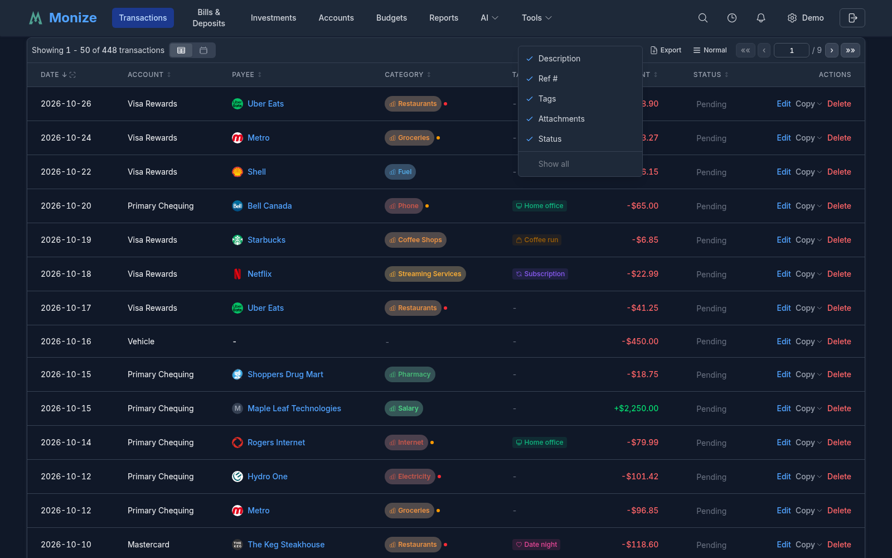
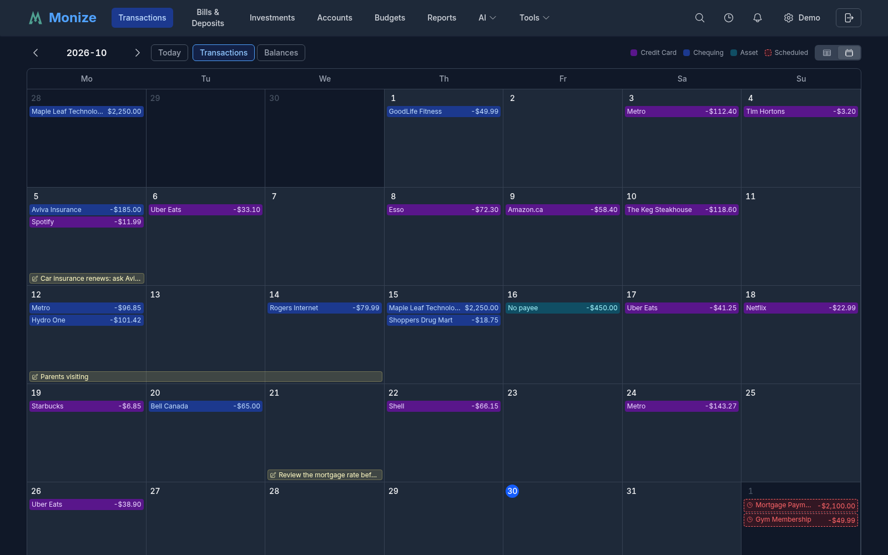
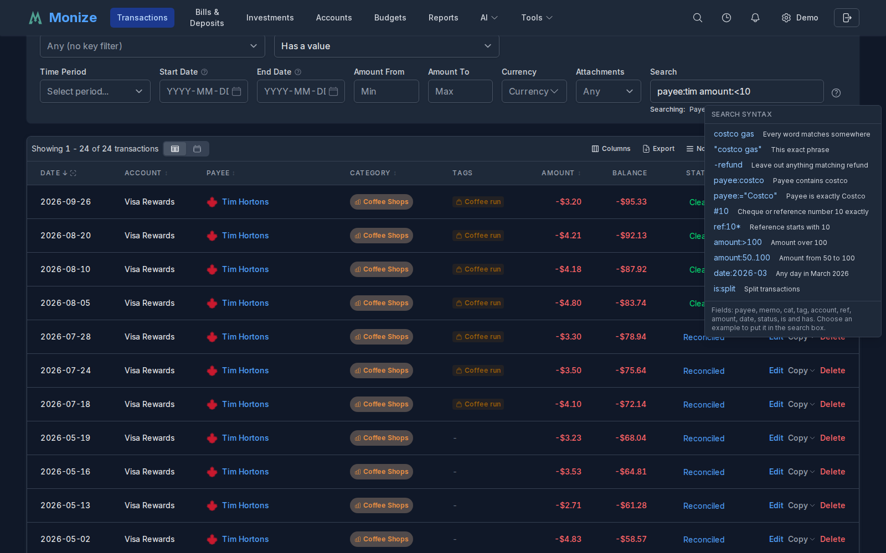
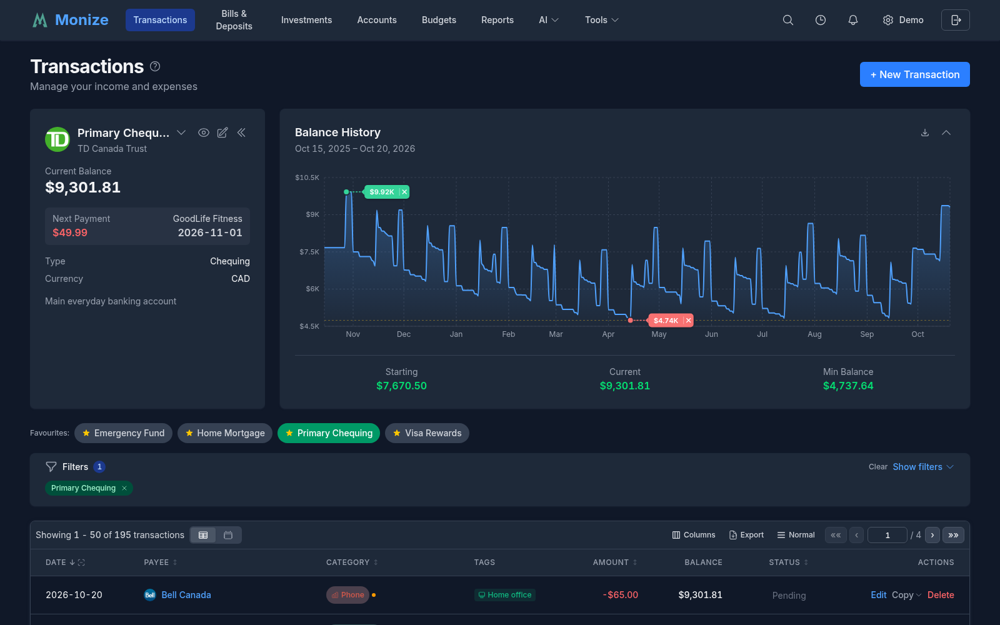
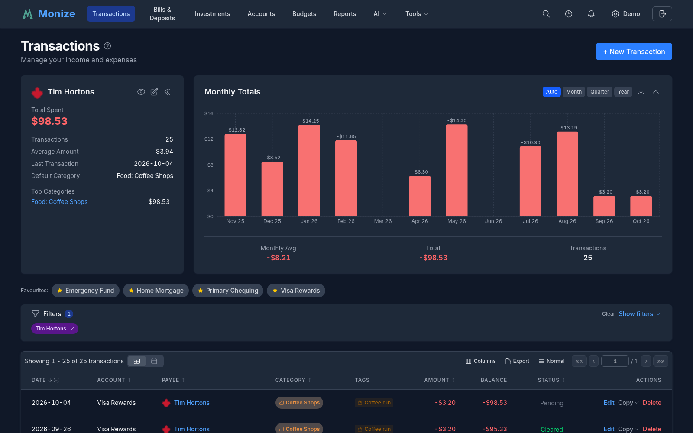
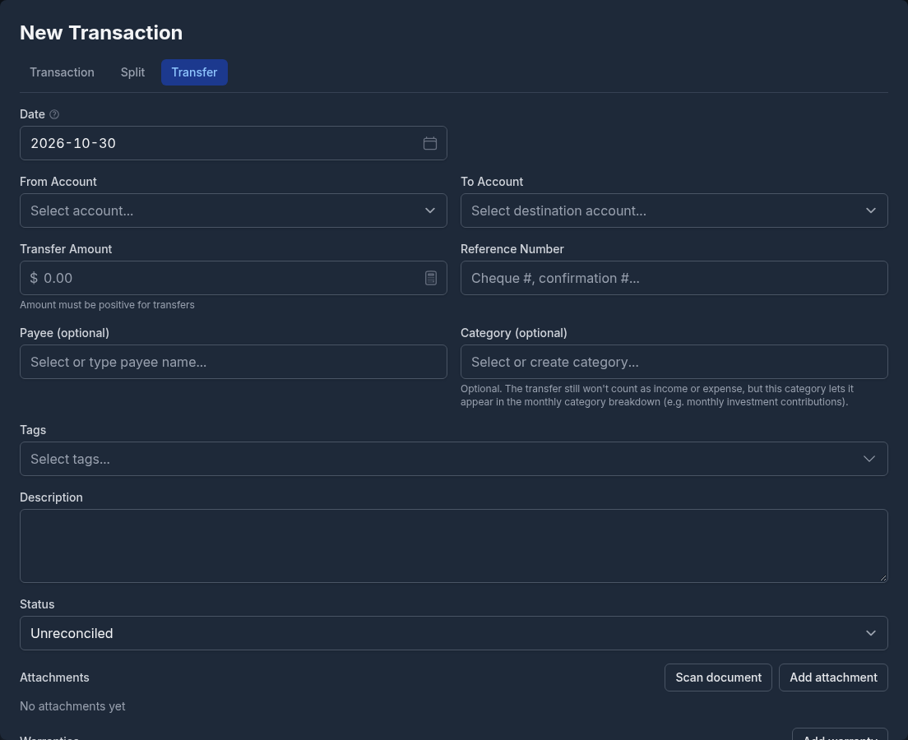
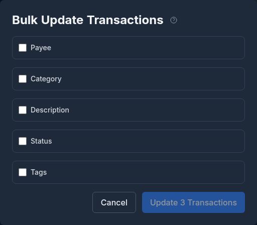

# Transactions

Transactions are the core of your financial data in Monize. This page covers creating, searching, filtering, and managing transactions.

---

## Overview

The Transactions page (the register) shows your transactions across all accounts, or the accounts you filter to. From top to bottom it has a chart summarizing what is in view, a row of your favourite accounts, the filter panel, and the list itself, which you can also read as a month calendar.

---

## Creating a Transaction

1. Navigate to **Transactions**
2. Click **+ New Transaction**
3. Fill in the **New Transaction** form:

The three buttons at the top of the form choose what you are entering: a **Transaction**, a **Split** across several categories (see [Split Transactions](#split-transactions)), or a **Transfer** between accounts (see [Transfers Between Accounts](#transfers-between-accounts)).

4. Click **Create Transaction**. The arrow beside it offers **Create Transaction & New**, which saves and starts another, keeping the account and date.

### Transaction Fields

| Field | Required | Description |
|-------|----------|-------------|
| **Account** | Yes | Which account this transaction belongs to |
| **Date** | Yes | The date of the transaction |
| **Payee** | No | Who the transaction was with |
| **Category** | No | The expense or income category |
| **Amount** | Yes | The transaction amount (negative for expenses, positive for income). The **+/-** button flips the sign, the calculator button works out a figure for you, and the currency button beside it lets you enter the amount [in another currency](#foreign-currency-transactions) |
| **Reference Number** | No | Cheque number, confirmation number, or another reference |
| **Tags** | No | One or more [tags](tags.md) for flexible labelling; the tags you used most recently are listed first |
| **Description** | No | Additional notes; links in it become clickable |
| **Status** | No | Unreconciled, Cleared, Reconciled, or Void |
| **Attachments** | No | Receipts, invoices, and other files (see [Attachments](#attachments)) |

Picking a payee fills in its default category, if you have not chosen one yet. When the Amount is an expense or income, its sign follows the category you choose, unless that category has automatic sign turned off.

### Date Field Keyboard Shortcuts

The date field supports keyboard shortcuts for quick date entry:

| Key | Action |
|-----|--------|
| **T** | Jump to today |
| **Y** | Jump to first day of the year |
| **R** | Jump to last day of the year |
| **M** | Jump to first day of the month |
| **H** | Jump to last day of the month |
| **+** or **=** | Next day |
| **-** | Previous day |
| **Page Up** | Next month |
| **Page Down** | Previous month |

> [!TIP]
> On desktop, hover over the info icon next to the date label to see these shortcuts.

The calendar popover also has a **year picker**, so you can jump to a distant year in one step instead of paging month by month.

### Quick Payee Creation

If the payee does not exist, type its name and choose to create it, directly from the transaction form without leaving the page. A category can be created the same way, including a subcategory written as `Parent: Child`.

### Quick Fill from Recent Transactions

The transaction form includes a **history button** (clock icon) next to the Payee field. Clicking it opens a popover listing recent transactions, and selecting one quick-fills the form with the payee, category, amount, description, and tags from that transaction. You can then adjust any field before saving.

The history button appears on the **new transaction** form only -- it is hidden when editing an existing transaction. It is also available in [split mode](#split-transactions): selecting a recent split entry copies its payee and rebuilds the split rows from the source transaction.

#### Two Modes

The popover behaves differently depending on whether a payee is selected:

| Context | What the popover shows |
|---------|------------------------|
| **No payee selected** | **Recent transactions**: a deduplicated list with one row per unique payee/category combination. Useful when you have not decided what you are entering yet. |
| **Payee selected (or typed)** | **Recent for** that payee: its most recent transactions, in date order with no deduplication. Useful for repeating a familiar purchase exactly. |

For payee-scoped results, free-text payee names are matched exactly. If you have not selected an existing payee from the dropdown but have typed a name that matches a previous free-text entry, the popover scopes to that name.

#### What Is Included

- **Splits are included.** A split parent appears as a single row labelled "Split: Category A, Category B" (truncated with a count if more than two categories). Selecting it rebuilds the full split breakdown in the form.
- **Transfers are excluded.** Transfers between accounts are managed through their own form mode and do not appear in the quick-fill list.

#### Configuring the Limit

The number of entries shown in the popover is configurable from **3** to **20** (default **5**). Adjust it under **Settings -> Preferences -> Transactions -> Recent transactions in quick-fill**. See [Settings and Security](settings-and-security.md#preferences) for details.

> [!TIP]
> When you are creating a transaction for a payee you visit often, type or pick the payee first, then open the history -- you will see only that payee's prior entries in date order, which is faster than scrolling the global list.

### Foreign-Currency Transactions

When you were charged in a currency other than the account's, click the currency button beside the Amount field and pick the **Entry currency**. Type the amount exactly as it appears on your statement: Monize fetches the exchange rate for the transaction's date and shows the converted total in the account's currency, with the rate it used. If the account has a foreign currency conversion fee set, the fee is included and named. Where no rate is found, enter the converted amount yourself.

The register can show such a transaction in the account's currency or the original one.

### Attachments

Every transaction can carry files -- receipts, invoices, statements. In the form's **Attachments** section:

- **Add attachment** picks a file: an image or a PDF, up to 10 MB, and up to 10 files per transaction
- **Scan document** takes a photo with your phone's camera (or picks one on a desktop), finds the page in it, and lets you straighten it, drag its corners, and choose a colour, greyscale, or black-and-white finish before attaching it. The original photo is kept beside the clean copy
- On a new transaction the files are uploaded when you save it

Click an attachment to preview it inside Monize: images at **Fit to screen** or **Actual size**, PDFs page by page, with **Download** at the bottom.

The register has an **Attachments** column with the count, and the **Attachments** filter (**Any**, **Yes**, **No**) finds the transactions still missing a receipt. Below the attachments, **Add warranty** records a [warranty](warranties.md) for the purchase.

---

## Transaction List

The transaction list displays your transactions in a table with the following columns:

| Column | Description |
|--------|-------------|
| **Date** | Transaction date. The **Hide the year** button in its header drops the year so more of the payee fits |
| **Account** | Account name (not shown when you are looking at a single account) |
| **Payee** | Who the transaction was with, with the payee's logo |
| **Category** | Assigned category, the destination of a transfer, or the categories of a split |
| **Description** | Transaction notes |
| **Ref #** | Reference or cheque number |
| **Tags** | The transaction's [tags](tags.md) |
| **Attachments** | How many files are attached |
| **Amount** | Transaction amount (red for expenses, green for income) |
| **Balance** | Running balance, shown while the list is sorted by date and narrowed to one account or by a filter |
| **Status** | Reconciliation status; click to change it |
| **Actions** | **Edit**, **Copy**, and **Delete** |

Click a row to open it in the edit form. Click a payee, category, account, date, or tag in a row to filter the list by it. On a phone, each transaction is a card, and a long press opens its actions.

### Sorting

Click a column header to sort by it, and again to reverse the order. The running balance is only shown while the list is sorted by date. On a phone, sorting is a row of chips.

### Choosing Columns

The **Columns** button above the list shows or hides columns; you can also right-click a column header (or long-press it on a phone) to hide it. Your choice is remembered in this browser. Default columns for every browser are set under **Settings -> Preferences -> Default Views**.

### Display Density

The density button above the list (labelled with the current density) adjusts how much fits on screen:

- **Normal** -- Default spacing with generous padding
- **Compact** -- Reduced padding, fits more transactions on screen
- **Dense** -- Minimal padding for maximum data density, with single-letter statuses

### Pagination

Transactions are paginated at 50 per page. Use the controls above and below the list to go to the first, previous, next, or last page, or type a page number. On a phone, swipe left or right to turn the page.

### Exporting

**Export** saves the transactions that match your filters as a CSV file.

---

## Calendar View

The **Table** and **Calendar** buttons above the list switch the register to a month calendar. Each day shows its transactions, and your filters still apply.

- **Previous month** and **Next month** move through the months; click the month heading to jump to any month by typing it (for example `Mar 1998` or `2026-03`). On a phone, swipe left and right
- The **Layers** buttons show or hide each day's **Transactions** and its end-of-day **Balances**; days after today show the projected balance, marked as such
- Scheduled transactions from [Bills & Deposits](bills-and-deposits.md) appear on their due days, marked **Scheduled** (or **Overdue**)
- Click a day to see everything on it, add a **New transaction on this day**, or **Add a note**: day notes are sticky notes that can cover one day or a span of days

---

## Searching and Filtering

The filter panel provides powerful options for finding specific transactions. **Hide** folds it away.

### Available Filters

| Filter | Description |
|--------|-------------|
| **Show Accounts** | Offer **All**, **Active**, or **Closed** accounts in the account filter |
| **Accounts** | Filter by one or more accounts |
| **Payees** | Filter by one or more payees |
| **Categories** | Filter by one or more categories |
| **Tags** | Filter by one or more [tags](tags.md) |
| **Status** | Filter by one or more reconciliation statuses (Unreconciled, Cleared, Reconciled, Void) |
| **Tag key** and **Condition** | Filter by a [key:value tag](tags.md#filtering-transactions-by-tag-key): has a value, has no value, value contains, or value does not contain |
| **Time Period** | Quick presets that set the date range for you: All Dates, Today, Yesterday, This Week, Last Week, Last 30 Days, Month to Date, Last Month, Last 365 Days, Year to Date, Last Year, or Custom |
| **Start Date** and **End Date** | Set the date range yourself |
| **Amount From** and **Amount To** | Set a minimum and/or maximum amount |
| **Currency** | Transactions entered in a particular foreign currency |
| **Attachments** | **Yes** or **No** to find transactions with or without attachments |
| **Search** | Free text, or the [search syntax](#search-syntax) |

> [!NOTE]
> When the filter panel is collapsed, each active filter appears as a removable chip -- click the **x** on a chip to clear just that filter. If any of your accounts are marked as favourites, a **Favourites** row of quick-select buttons appears above the panel so you can limit the list to a favourite account in one tap.

### Search Syntax

Several words find the transactions that contain all of them, anywhere in the payee, description, reference, category, tags, or transfer account. A word that reads as an amount in your number format also matches that exact amount, and one that reads as a date in your date format (ISO `YYYY-MM-DD` is always accepted) matches that date. A line under the box shows how Monize read your search, and the **?** button lists the syntax; choose an example to put it in the box.

| Type | To find |
|------|---------|
| `costco gas` | Transactions containing both words |
| `"costco gas"` | That exact phrase |
| `-refund` | Leave out anything matching refund |
| `payee:costco` | Payee contains costco |
| `payee:="Costco"` | Payee is exactly Costco |
| `#10` | Cheque or reference number 10 exactly |
| `ref:10*` | Reference starts with 10 |
| `amount:>100` | Amount over 100 |
| `amount:50..100` | Amount from 50 to 100 |
| `date:2026-03` | Any day in March 2026 |
| `is:split` | Split transactions (also `is:transfer`, `is:uncategorized`) |
| `has:attachment` | Has an attachment (also `has:warranty`, `has:ref`, `has:memo`, `has:tag`) |

The fields are `payee`, `memo` (the description), `cat`, `tag`, `account`, `ref`, `amount`, `date`, `status`, `is`, and `has`.

### Payee and Category Info Widget

When you filter the list to a single **account**, **payee**, or **category**, an **info panel** appears beside the chart summarizing it:

- **Account** -- the current balance, type, account number, currency, credit limit or interest rate, and the next scheduled payment; for loans and mortgages, the current payment, estimated payoff, and remaining interest. A caret beside the name switches to another account, and an icon opens the account's [detail page](accounts.md#account-detail-pages)
- **Payee** -- total spent, income, the number of transactions, the average amount, the last transaction, the default category, the next bill, the top categories, and a detected recurring pattern
- **Category** -- the total, this month's budget, the monthly average, subcategories, top payees, and the next scheduled transaction

Each panel can be edited from its pencil icon, and collapsed so the chart uses the full width.

### Filter Persistence

Your filter selections are saved in your browser's local storage, so they persist between sessions. When navigating from a report, the dashboard, or another page, the link's filters are applied via URL parameters and override your saved filters temporarily.

---

## Transaction Charts

Above the list, a chart summarizes the transactions currently in view. Which chart you get depends on your filters, and **Hide chart** folds it to a thin strip (you can start with it folded under **Settings -> Preferences -> Default Views**).

### Account Balances

With more than one account in view and no payee, category, tag, or search filter, a bar chart shows the current balance of each account, with the average and total. The **Auto**, **Linear**, and **Log** buttons set the scale, and clicking a bar filters the list to that account. The chart can be downloaded as a PNG.

### Monthly Totals

When you filter by payee, category, tag, or search, a bar chart of the income and expense totals of the matching transactions. It rolls up to an **adaptive Month / Quarter / Year granularity** (auto-selected by the span in view, with a manual toggle) and **gap-fills empty periods**, so bars are spaced by real elapsed time rather than one equal-width bar per active period. Click a bar to narrow the list to that period. Averages are computed over elapsed periods.

### Balance History

With a single account in view, a running-balance chart for it. When no start-date filter is set, it spans the account's **entire history**; the axis switches between month and year labels as the span grows, and an all-zero (e.g. closed) account shows a banner instead. For **liability accounts** (credit cards, loans, mortgages, lines of credit) a negative balance is normal, so the chart uses a neutral **Min Balance** label instead of flagging the low point as a warning.

When you filter by a [tag key](tags.md#filtering-transactions-by-tag-key), a **Spending by** chart breaks the spending down by the key's values.

---

## Split Transactions

A split transaction distributes a single payment across multiple categories. For example, a supermarket purchase might be split between "Groceries" and "Household Supplies."

### Creating a Split

1. In the transaction form, click **Split**
2. Enter the **Total Amount**
3. In **Split Details**, give each row a type (**Category**, **Transfer** to another account, or **Investment**), its category or account, an amount, an optional memo, and optional [tags](tags.md)
4. Click **Add Split** for more rows; a split needs at least two
5. The split amounts must total the transaction amount. The footer shows what remains; **Distribute Evenly** and **Distribute Proportionally** spread the remainder for you, and a row's button adds the remainder to that row
6. Click **Create Transaction**

Removing the second-to-last row turns the transaction back into a regular one. Split transactions show their categories in the category column of the transaction list. Click on the transaction to see the full breakdown.

---

## Transfers Between Accounts

Transfers move money between your accounts (e.g., from chequing to savings).

### Creating a Transfer

1. In the transaction form, click **Transfer**
2. Choose the **From Account** and the **To Account**
3. Enter the **Transfer Amount** (always positive)
4. Optionally choose a **Payee** and a **Category** (see the note below)
5. Click **Create Transfer**

Monize creates two linked transactions -- one in each account. The source account shows a withdrawal and the destination shows a deposit. Editing or deleting either side changes both.

You can also turn an existing transaction into a transfer, or a transfer back into a transaction, by switching its mode in the edit form and clicking **Convert to Transfer** (or **Convert to Transaction**).

> [!NOTE]
> A transfer is never counted as income or an expense. Assigning it a category is optional and does not change that -- but a categorised transfer does appear in the monthly category breakdown, which is handy for tracking things like recurring investment contributions.

Accounts other people share with you as [joint accounts](shared-access.md#transfers-between-two-peoples-accounts) can be a transfer's destination too.

### Cross-Currency Transfers

If the source and destination accounts are in different currencies, the form asks for the **Amount Received** in the destination's currency as well, filled in from the current exchange rate. Both amounts are recorded, so the effective rate is the one your bank actually used. See [Currency Management](currency-management.md) for details.

---

## Editing and Deleting Transactions

### Editing

Click on any transaction in the list to open it in the **Edit Transaction** form. Modify any field and click **Update Transaction**.

> [!NOTE]
> Monize **warns you before you edit or delete a reconciled transaction**, so a carefully balanced statement does not drift by accident. You can still proceed after confirming, unless **Lock reconciled transactions** is turned on in [Settings -> Preferences](settings-and-security.md#preferences).

### Voiding

Set a transaction's status to **Void** to cancel it while keeping the record. A void transaction keeps its amount but no longer moves the account balance, and it is shown struck through. Voiding one side of a transfer voids both. To bring it back, edit the transaction and choose another status.

### Deleting

Click **Delete** on the row to permanently remove a transaction. The account balance is adjusted accordingly. You can undo a deletion right away (see [Undo and Redo](#undo-and-redo)).

> [!CAUTION]
> If the transaction is part of a linked transfer, deleting it also deletes the linked transaction in the other account.

---

## Bulk Update

Bulk Update allows you to modify multiple transactions at once, such as changing the category, payee, or status for a batch of transactions.

### Entering Bulk Update Mode

1. Open the **Filters** panel on the Transactions page
2. Click the **Bulk Update** button (beside the **Show Accounts** controls on desktop, or at the bottom of the filter panel on a phone)
3. Checkboxes will appear next to each transaction in the list

### Selecting Transactions

- Click the checkbox next to individual transactions to select them
- Use the **select all** checkbox in the table header to select all transactions on the current page
- If all transactions on the page are selected, a banner will offer to **Select all N matching transactions** across all pages (useful when filters are applied)

### Applying Changes

1. After selecting transactions, click **Bulk Update** in the selection banner
2. In the **Bulk Update Transactions** dialog, toggle on the fields you want to change:
   - **Payee** -- Change the payee for all selected transactions
   - **Category** -- Assign a new category; on split transactions the new category is applied to their split lines
   - **Description** -- Replace the description (leave it empty to clear it)
   - **Status** -- Set the status to Pending (unreconciled), Cleared, or Void
   - **Tags** -- Replace the tags (leave it empty to clear them)
3. Only the fields you toggle on are updated; other fields are left unchanged
4. Click **Update N Transactions** to save the changes

Transfers have their linked counterpart updated as well.

### Exiting Bulk Update Mode

- Click **Cancel Bulk** in the filter panel to exit without making changes
- Completing a bulk update automatically exits bulk mode
- Clicking **Clear selection** in the selection banner also exits bulk mode

---

## Bulk Delete

You can delete multiple transactions at once using the same selection mechanism as Bulk Update.

### How to Bulk Delete

1. Enter bulk mode using the **Bulk Update** button in the filter panel
2. Select transactions using checkboxes (individual, page-level, or all matching)
3. Click **Delete** in the selection banner
4. Confirm the deletion in the dialog

### Deletion Modes

| Mode | Description |
|------|-------------|
| **By selection** | Deletes the specific transactions you selected by checkbox |
| **By filter** | Deletes all transactions matching the current filter criteria (when "select all matching" is used) |

### Important Notes

- Deletion is **permanent**
- Linked transfer counterparts are automatically deleted along with the selected transaction
- Account balances are recalculated after deletion
- A confirmation dialog shows the count of transactions to be deleted before proceeding

---

## Transaction Status

Each transaction has a reconciliation status:

| Status | Shown as | Description |
|--------|----------|-------------|
| **Unreconciled** | Pending (○ when dense) | New transaction, not yet verified against a statement |
| **Cleared** | Cleared (C) | Verified to match a bank statement entry |
| **Reconciled** | Reconciled (R) | Confirmed by a completed reconciliation |
| **Void** | VOID (V) | Cancelled; the record is kept but no longer moves the balance |

The status flow is typically: **Unreconciled** -> **Cleared** -> **Reconciled**

Click the status in the list to cycle it, or set it in the transaction form or during the account reconciliation process. A void transaction can only be changed in the form. See [Account Reconciliation](accounts.md#account-reconciliation) for details.

---

## Copying Transactions

The **Copy** dropdown on each transaction row provides two actions:

### Duplicate

Opens a copy of the transaction with the same account, payee, amount, category, tags, and description in the **Duplicate Transaction** form, so you can adjust any fields (such as the date) before saving.

### Schedule as Recurring

Converts a transaction into a recurring scheduled transaction. The scheduled transaction form opens pre-filled with the transaction's details. Set the frequency, next due date, and other scheduling options, then click **Create**.

The original transaction is not modified in either case. For more on scheduled transactions, see [Bills and Deposits](bills-and-deposits.md).

---

## Undo and Redo

Monize tracks your recent actions and lets you undo and redo them using keyboard shortcuts:

| Shortcut | Action |
|----------|--------|
| **Ctrl+Z** (or **Cmd+Z** on Mac) | Undo the last action |
| **Ctrl+Shift+Z** (or **Cmd+Shift+Z** on Mac) | Redo the last undone action |
| **Ctrl+Y** (or **Cmd+Y** on Mac) | Redo (alternative shortcut) |

Undo and redo work across all data pages -- transactions, accounts, categories, payees, tags, securities, budgets, scheduled transactions, and custom reports. A toast notification confirms each undo or redo operation. The **Action History** button (the clock icon in the header) lists your recent actions, with **Undo** and **Redo** buttons.

> [!NOTE]
> These shortcuts are disabled when focus is inside a text input field, so they do not interfere with normal text editing.
