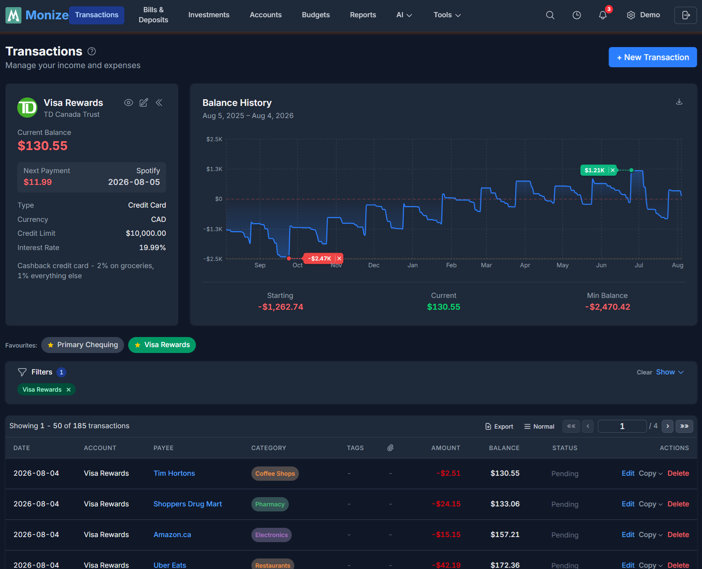
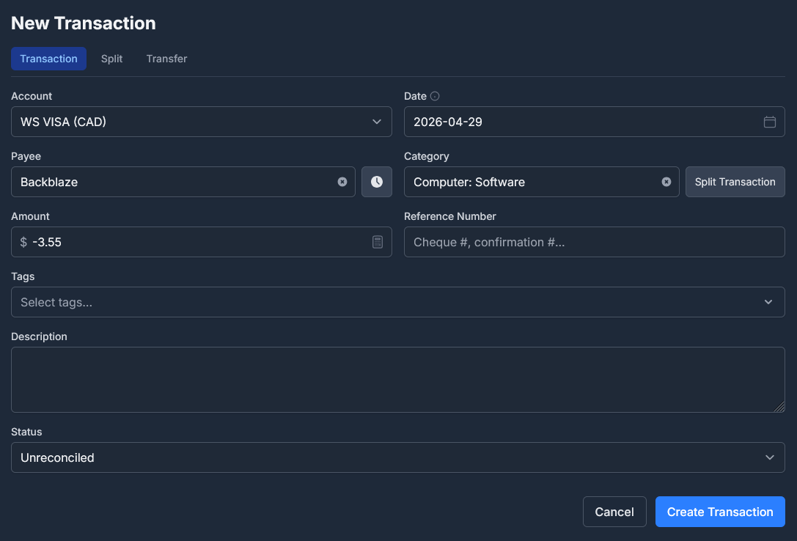
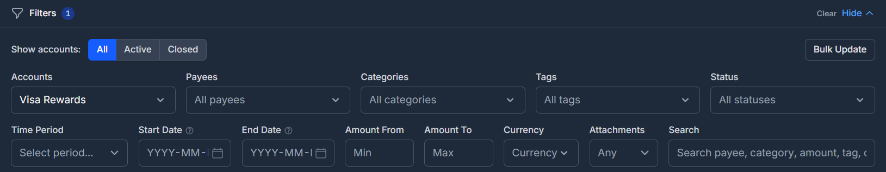
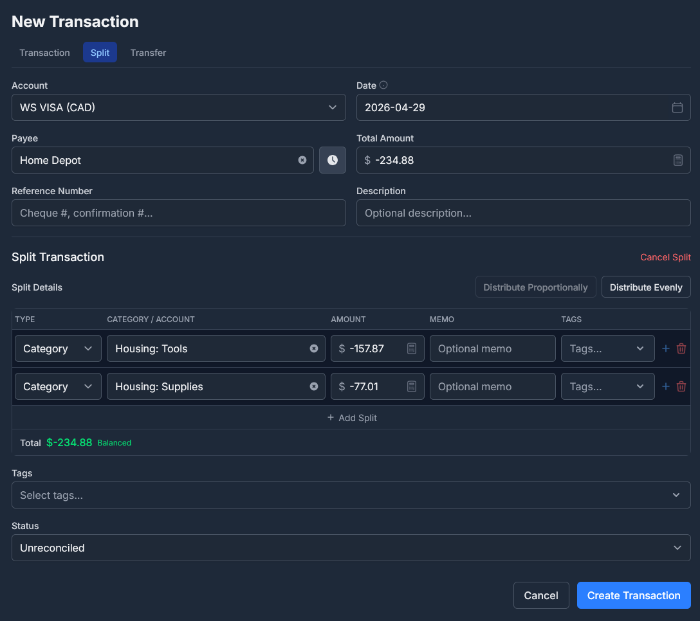

# Transactions

Transactions are the core of your financial data in Monize. This page covers creating, searching, filtering, and managing transactions.

---

## Overview

The Transactions page provides a comprehensive view of all your financial transactions across all accounts. It supports advanced filtering, search, and density controls for efficient data management.

<!-- Screenshot: The transactions page showing the list, filter panel, and summary card -->

---

## Creating a Transaction

1. Navigate to **Transactions**
2. Click **Add Transaction** (or use the quick-add button)
3. Fill in the transaction form:

<!-- Screenshot: The transaction creation form showing all fields -->

### Transaction Fields

| Field | Required | Description |
|-------|----------|-------------|
| **Date** | Yes | The date of the transaction |
| **Account** | Yes | Which account this transaction belongs to |
| **Payee** | No | Who the transaction was with |
| **Amount** | Yes | The transaction amount (negative for expenses, positive for income) |
| **Category** | No | The expense or income category |
| **Memo** | No | Additional notes or description |
| **Tags** | No | One or more [tags](tags.md) for flexible labelling |
| **Reference** | No | Cheque number or reference code |
| **Status** | No | Unreconciled, Cleared, or Reconciled |

### Date Field Keyboard Shortcuts

The date field supports keyboard shortcuts for quick date entry:

| Key | Action |
|-----|--------|
| **T** | Jump to today |
| **Y** | Jump to first day of the year |
| **R** | Jump to last day of the year |
| **M** | Jump to first day of the month |
| **H** | Jump to last day of the month |
| **+** or **=** | Next day |
| **-** | Previous day |
| **Page Up** | Next month |
| **Page Down** | Previous month |

> **Tip:** On desktop, hover over the info icon next to the date label to see these shortcuts.

The calendar popover also has a **year picker**, so you can jump to a distant year in one step instead of paging month by month.

### Quick Payee Creation

If the payee does not exist, you can create a new one directly from the transaction form without leaving the page.

### Quick Fill from Recent Transactions

The transaction form includes a **history button** (clock icon) next to the Payee field. Clicking it opens a popover listing recent transactions, and selecting one quick-fills the form with the payee, category, amount, memo, and tags from that transaction. You can then adjust any field before saving.

The history button appears on the **new transaction** form only -- it is hidden when editing an existing transaction. It is also available in [split mode](#split-transactions): selecting a recent split entry copies its payee and rebuilds the split rows from the source transaction.

#### Two Modes

The popover behaves differently depending on whether a payee is selected:

| Context | What the popover shows |
|---------|------------------------|
| **No payee selected** | A globally deduped list of your recent transactions, with one row per unique payee/category combination. Useful when you have not decided what you are entering yet. |
| **Payee selected (or typed)** | The most recent transactions for that specific payee, in raw chronological order with no dedup. Useful for repeating a familiar purchase exactly. |

For payee-scoped results, free-text payee names are matched exactly. If you have not selected an existing payee from the dropdown but have typed a name that matches a previous free-text entry, the popover scopes to that name.

#### What Is Included

- **Splits are included.** A split parent appears as a single row labelled "Split: Category A, Category B" (truncated with a count if more than two categories). Selecting it rebuilds the full split breakdown in the form.
- **Transfers are excluded.** Transfers between accounts are managed through their own form mode and do not appear in the quick-fill list.

#### Configuring the Limit

The number of entries shown in the popover is configurable from **3** to **20** (default **5**). Adjust it under **Settings -> Preferences -> Transactions -> Recent transactions in quick-fill**. See [Settings and Security](settings-and-security.md#preferences) for details.

> **Tip:** When you are creating a transaction for a payee you visit often, type or pick the payee first, then open the history -- you will see only that payee's prior entries in date order, which is faster than scrolling the global list.

---

## Transaction List

The transaction list displays your transactions in a table with the following columns:

| Column | Description |
|--------|-------------|
| **Date** | Transaction date |
| **Account** | Account name |
| **Payee** | Who the transaction was with |
| **Category** | Assigned category (or "Split" if multiple categories) |
| **Memo** | Transaction notes |
| **Amount** | Transaction amount (red for expenses, green for income) |
| **Balance** | Running balance for the account |
| **Status** | Reconciliation status indicator |

### Display Density

You can adjust the display density to fit more or fewer transactions on screen:

- **Normal** -- Default spacing with generous padding
- **Compact** -- Reduced padding, fits more transactions on screen
- **Dense** -- Minimal padding for maximum data density

### Pagination

Transactions are paginated at 50 per page. Use the pagination controls at the bottom of the list to navigate between pages.

---

## Searching and Filtering

The filter panel provides powerful options for finding specific transactions.

<!-- Screenshot: The filter panel showing account, category, payee, date range, and search filters -->

### Available Filters

| Filter | Description |
|--------|-------------|
| **Accounts** | Filter by one or more accounts |
| **Account Status** | Show active or archived accounts |
| **Categories** | Filter by one or more categories |
| **Payees** | Filter by one or more payees |
| **Tags** | Filter by one or more [tags](tags.md) |
| **Date Range** | Set start and end dates |
| **Amount Range** | Set a minimum and/or maximum amount (min/max) |
| **Status** | Filter by one or more reconciliation statuses (Unreconciled, Cleared, Reconciled, Void) |
| **Time Period** | Quick presets that set the date range for you: Today, Yesterday, This Week, Last Week, Month to Date, Last Month, Year to Date, Last Year, Last 30 Days, Last 365 Days, All Dates, or Custom |
| **Search** | Free-text search across payee, memo, reference, and category and tag names. If what you type parses as an amount in your number format (respecting your decimal and grouping separators) it also matches transactions with that exact amount, and if it parses as a date in your date format (ISO `YYYY-MM-DD` is always accepted) it matches transactions on that exact date |

> **Note:** When the filter panel is collapsed, each active filter appears as a removable chip -- click the **x** on a chip to clear just that filter. If any of your accounts are marked as favourites, a **Favourites** row of quick-select buttons appears above the panel so you can limit the list to a favourite account in one tap.

### Payee and Category Info Widget

When you filter the list to a single **payee** or a single **category**, an **info widget** appears alongside the transactions summarizing that payee or category -- the same way the account widget summarizes a single-account view. It gives you an at-a-glance total and context for what you are looking at without leaving the page.

### Filter Persistence

Your filter selections are saved in your browser's local storage, so they persist between sessions. When navigating from a report, the report's filters are applied via URL parameters and override your saved filters temporarily.

---

## Transaction Charts

Above the list, two charts summarize the transactions currently in view. Both follow your active filters and timeframe.

### Monthly Totals

A time-aware bar chart of income and expense totals. It rolls up to an **adaptive Month / Quarter / Year granularity** (auto-selected by the span in view, with a manual toggle) and **gap-fills empty periods**, so bars are spaced by real elapsed time rather than one equal-width bar per active period. The axis and tooltip are labelled by period, you can **drill down into a bucket**, and averages are computed over elapsed periods.

### Balance History

A running-balance chart for the account(s) in view. When no start-date filter is set, it can span your account's **entire history** (an all-time mode), kept fast by server-side downsampling to at most 400 points while always keeping the latest; the axis switches between month and year labels as the span grows, and an all-zero (e.g. closed) account shows a banner. For **liability accounts** (credit cards, loans, mortgages, lines of credit) a negative balance is normal, so the chart uses a neutral **Min Balance** label instead of flagging the low point as a warning.

---

## Split Transactions

A split transaction distributes a single payment across multiple categories. For example, a supermarket purchase might be split between "Groceries" and "Household Supplies."

### Creating a Split

1. In the transaction form, click **Split**
2. Add multiple category/amount rows
3. Each row has its own category, amount, optional memo, and optional [tags](tags.md)
4. The split amounts must total the transaction amount
5. Click **Save**

<!-- Screenshot: The split transaction interface showing multiple category/amount rows -->

Split transactions display "Split" in the category column of the transaction list. Click on the transaction to see the full breakdown.

---

## Transfers Between Accounts

Transfers move money between your accounts (e.g., from chequing to savings).

### Creating a Transfer

1. In the transaction form, select the **source account**
2. Choose the **Transfer to account** (the destination)
3. Enter the amount
4. Optionally choose a **category** (see the note below)
5. Click **Save**

Monize creates two linked transactions -- one in each account. The source account shows a withdrawal and the destination shows a deposit.

> **Note:** A transfer is never counted as income or an expense. Assigning it a category is optional and does not change that -- but a categorised transfer does appear in the monthly category breakdown, which is handy for tracking things like recurring investment contributions.

### Cross-Currency Transfers

If the source and destination accounts are in different currencies, you may need to adjust the exchange rate or amounts after import. See [Currency Management](currency-management.md) for details.

---

## Editing and Deleting Transactions

### Editing

Click on any transaction in the list to open it in the edit form. Modify any field and click **Save**.

> **Note:** Monize **warns you before you edit or delete a reconciled transaction**, so a carefully balanced statement does not drift by accident. You can still proceed after confirming.

### Voiding

Voiding a transaction reverses its effect on the account balance but preserves the record for audit purposes. The transaction amount is set to zero and the status changes to **Void**.

### Deleting

Deleting permanently removes a transaction. This action cannot be undone. The account balance is adjusted accordingly.

> **Caution:** If the transaction is part of a linked transfer, deleting it will also affect the linked transaction in the other account.

---

## Bulk Update

Bulk Update allows you to modify multiple transactions at once, such as changing the category, payee, or status for a batch of transactions.

### Entering Bulk Update Mode

1. Open the **Filters** panel on the Transactions page
2. Click the **Bulk Update** button (located next to the "Show accounts" controls on desktop, or at the bottom of the filter panel on mobile)
3. Checkboxes will appear next to each transaction in the list

### Selecting Transactions

- Click the checkbox next to individual transactions to select them
- Use the **select all** checkbox in the table header to select all transactions on the current page
- If all transactions on the page are selected, a banner will offer to **select all matching transactions** across all pages (useful when filters are applied)

### Applying Changes

1. After selecting transactions, click **Bulk Update** in the selection banner
2. In the Bulk Update dialog, choose which fields to update:
   - **Category** -- Assign a new category to all selected transactions
   - **Payee** -- Change the payee for all selected transactions
   - **Status** -- Update the reconciliation status (Unreconciled, Cleared, Reconciled, or Void)
3. Only fields you modify will be updated; other fields are left unchanged
4. Click **Apply** to save the changes

### Exiting Bulk Update Mode

- Click **Cancel Bulk** in the filter panel to exit without making changes
- Completing a bulk update automatically exits bulk mode
- Clicking **Clear selection** in the selection banner also exits bulk mode

---

## Bulk Delete

You can delete multiple transactions at once using the same selection mechanism as Bulk Update.

### How to Bulk Delete

1. Enter bulk mode using the **Bulk Update** button in the filter panel
2. Select transactions using checkboxes (individual, page-level, or all matching)
3. Click **Delete** in the selection banner
4. Confirm the deletion in the dialog

### Deletion Modes

| Mode | Description |
|------|-------------|
| **By selection** | Deletes the specific transactions you selected by checkbox |
| **By filter** | Deletes all transactions matching the current filter criteria (when "select all matching" is used) |

### Important Notes

- Deletion is **permanent** and cannot be undone
- Linked transfer counterparts are automatically deleted along with the selected transaction
- Account balances are recalculated after deletion
- A confirmation dialog shows the count of transactions to be deleted before proceeding

---

## Transaction Status

Each transaction has a reconciliation status:

| Status | Icon | Description |
|--------|------|-------------|
| **Unreconciled** | (blank) | New transaction, not yet verified against a statement |
| **Cleared** | C | Verified to match a bank statement entry |
| **Reconciled** | R | Locked as part of a completed reconciliation |
| **Void** | V | Cancelled, zero-amount record preserved |

The status flow is typically: **Unreconciled** -> **Cleared** -> **Reconciled**

You can change the status from the transaction list by clicking the status indicator, or during the account reconciliation process. See [Account Reconciliation](accounts.md#account-reconciliation) for details.

---

## Copying Transactions

The **Copy** dropdown on each transaction row provides two actions:

### Duplicate

Creates a copy of the transaction with the same account, payee, amount, category, tags, and memo. The duplicate opens in the transaction form so you can adjust any fields (such as the date) before saving.

### Schedule as Recurring

Converts a transaction into a recurring scheduled transaction. The scheduled transaction form opens pre-filled with the transaction's details. Set the frequency, start date, and other scheduling options, then click **Save**.

The original transaction is not modified in either case. For more on scheduled transactions, see [Bills and Deposits](bills-and-deposits.md).

---

## Undo and Redo

Monize tracks your recent actions and lets you undo and redo them using keyboard shortcuts:

| Shortcut | Action |
|----------|--------|
| **Ctrl+Z** (or **Cmd+Z** on Mac) | Undo the last action |
| **Ctrl+Shift+Z** (or **Cmd+Shift+Z** on Mac) | Redo the last undone action |
| **Ctrl+Y** (or **Cmd+Y** on Mac) | Redo (alternative shortcut) |

Undo and redo work across all data pages -- transactions, accounts, categories, payees, tags, securities, budgets, scheduled transactions, and custom reports. A toast notification confirms each undo or redo operation.

> **Note:** These shortcuts are disabled when focus is inside a text input field, so they do not interfere with normal text editing.
