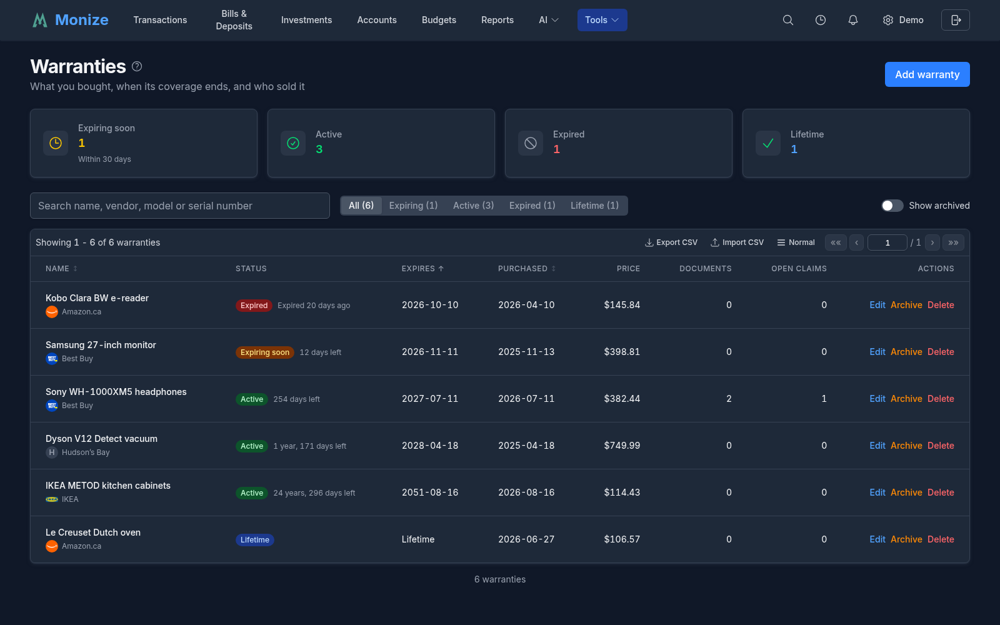
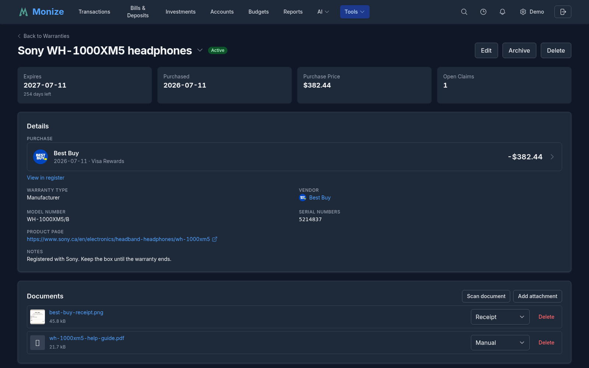
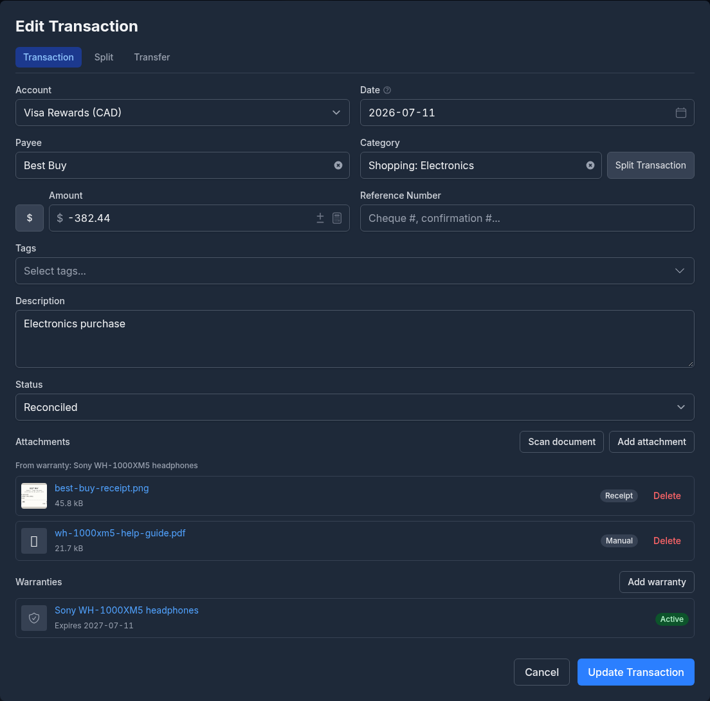
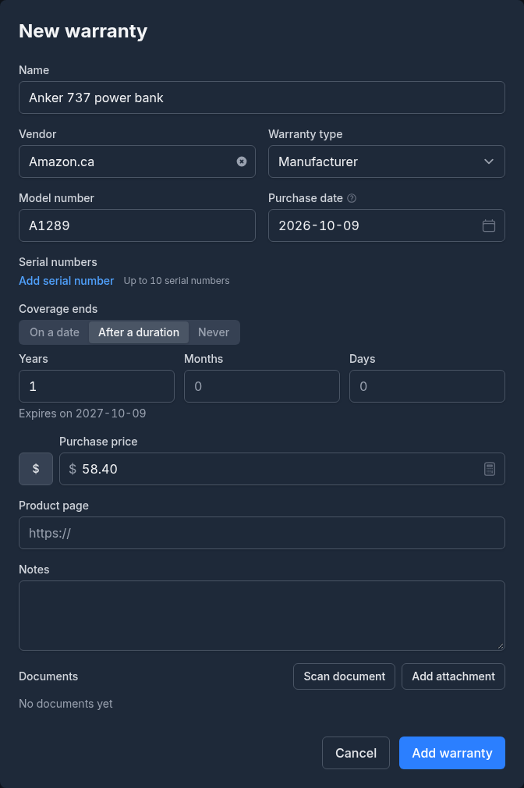
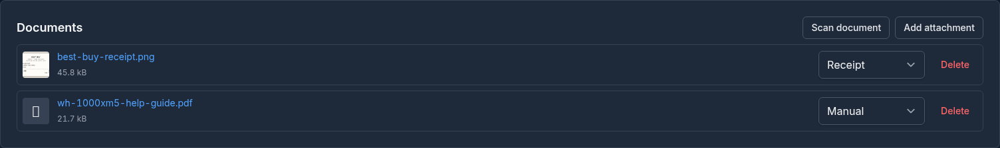
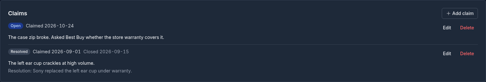
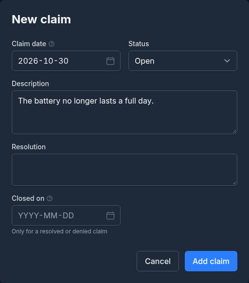
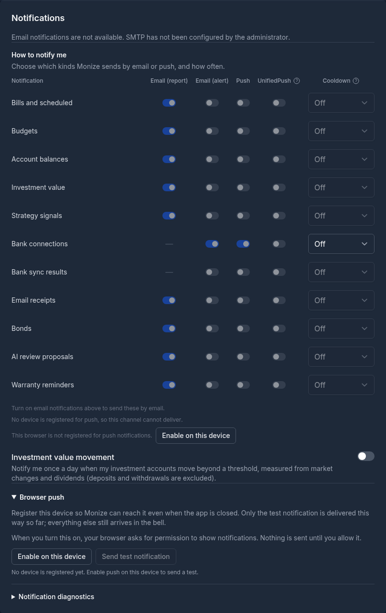
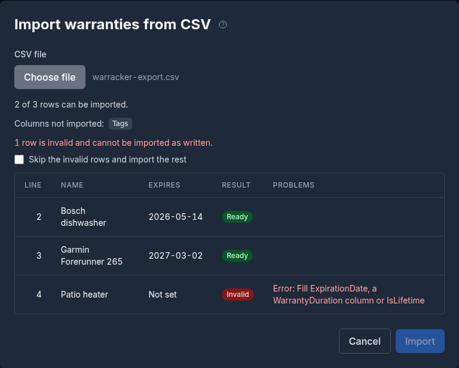

# Warranties

Monize keeps track of **what you bought and when its warranty ends**: the purchase, the receipt, manual and photos that prove it, its serial and model numbers, any claims you made, and a reminder before the coverage runs out. Most warranties start from a transaction that is already in your register, so the purchase and its proof stay together.

A warranty **never moves money**. Its purchase price is there for reference only and is never added to a balance, a report or a total.

---

## Where It Lives

**Warranties** is in the **Tools** menu.

Above the list, four cards count your **Expiring soon** (within 30 days), **Active**, **Expired** and **Lifetime** warranties; click a card to show only those. Below them:

- **Filter by status**: **All**, **Expiring**, **Active**, **Expired** or **Lifetime**, each with its count.
- **Search warranties** matches the name, the vendor, the model number and the serial numbers.
- **Show archived** lists the archived warranties instead of the current ones.
- **Export CSV** and **Import CSV** (see [Importing From Warracker](#importing-from-warracker-csv) and [Exporting](#exporting)).

The list shows each warranty's **Name** (with the vendor under it), **Status** and days left, the date it **Expires**, the date it was **Purchased**, the **Price**, the number of **Documents** and of **Open claims**. Click the **Name**, **Expires** or **Purchased** header to sort by it (on a phone, the sort is a row of chips). Each row has **Edit**, **Archive** and **Delete**; click anywhere else on the row to open the warranty.

### The Detail Page

The detail page shows the warranty's end date and days left, its purchase date, its **Purchase Price** and its **Open Claims**, then:

- **Details**: the **Purchase** it was bought with, the **Warranty type**, the **Vendor** (with the payee's logo when Monize has one), the **Model number**, the **Serial numbers**, the **Product page** and the **Notes**.
- **Documents** and **Claims** (see below).

Click the **Purchase** to edit that transaction right there, in the same window the register uses. **View in register** opens the Transactions page with the purchase highlighted. **Switch warranty** in the header jumps to another warranty without going back to the list.

**Archive** a warranty you no longer care about: it disappears from the list, the widget, the reminders and the AI assistant, but nothing is deleted and **Unarchive** brings it back. **Delete** removes the warranty together with its claims and documents.

---

## Adding a Warranty

Click **Add warranty** and fill in:

| Field | Notes |
|-------|-------|
| **Name** | What you bought. Required, up to 200 characters. |
| **Vendor** | Pick a payee or type a name. |
| **Warranty type** | **Manufacturer** (the default), **Extended**, **Store** or **Other**. |
| **Model number**, **Serial numbers** | Click **Add serial number** for each one, up to 10. |
| **Purchase date** | Required. |
| **Coverage ends** | **On a date**, **After a duration** (years, months and days from the purchase date; Monize shows the date it works out), or **Never** for a lifetime warranty. A new warranty starts at **After a duration** of 1 year. A lifetime warranty has no end date and no reminder. |
| **Purchase price** | Optional, with its currency. |
| **Product page**, **Notes** | Optional. |
| **Documents** | Optional. **Add attachment** or **Scan document** for the receipt, manual or certificate while creating the warranty; they upload when you save it. |

A duration that lands on a day the month does not have ends on the month's last day: 1 month from January 31 is February 28. When you edit a warranty later, **Coverage ends** shows the end date it was saved with.

---

## Adding One From a Transaction

Most warranties start from a purchase in your register. Open the transaction's edit window on the **Transactions** page: its **Warranties** section lists the warranties already linked to it, each with its status and end date, and offers **Add warranty**.

**Add warranty** takes you to the Warranties page with the form pre-filled from the transaction: the name (the payee, or the description), the vendor, the purchase date, the price and the currency. A form with unsaved changes asks first; a new transaction is saved before you leave it. A split transaction fills in its whole amount, so edit the price before saving if the warranty covers only one item. One transaction can carry several warranties (three items on one receipt are three warranties).

After you save, the Warranties page shows only that transaction's warranties (**Warranties for one transaction**); **Show all warranties** clears it.

In the register, a row with a warranty shows a **shield** with the number of warranties beside its paperclip, and the search box accepts `has:warranty`. Click a warranty in the edit window's **Warranties** section to open it.

Deleting the transaction keeps the warranty and its own documents; the detail page then says **No linked transaction**.

---

## Status and Days Left

| Status | Meaning |
|--------|---------|
| **Active** | More than 30 days left |
| **Expiring soon** | 30 days or fewer, including the day it expires (**Expires today**) |
| **Expired** | The end date has passed |
| **Lifetime** | Never ends |

Days are counted in your own timezone, and the status is worked out by the server, so every screen agrees.

---

## Documents and Scanning

The **Documents** section works like a transaction's attachments: upload a file, or scan a paper receipt with your phone's camera, and preview images and PDFs in the app. Each document has a **Document type**: **Receipt**, **Manual**, **Photo**, **Warranty** or **Other**. A new document starts as **Other**; choose its type from the **Document type** picker on its row, and change it there whenever you like. A warranty holds up to 10 documents of up to 10 MB each. A document belongs to the warranty, and when the warranty is linked to a transaction it is one of that transaction's attachments too: it appears in the transaction's attachments (labelled with the warranty's name), in the register's paperclip count and in the `has:attachment` search, even after the warranty is archived. Deleting the warranty removes its documents everywhere.

---

## Claims

The **Claims** section logs what you claimed and how it ended, newest first.

Click **Add claim** and enter the **Claim date**, a **Status** (**Open**, **Approved**, **Denied** or **Resolved**), a **Description** of what went wrong, and, once it is settled, the **Resolution** and the date it **Closed on** (only for a resolved or denied claim; it cannot be before the claim date). Each claim has **Edit** and **Delete**.

Open claims are counted on the list and on the detail page. A claim never changes the warranty's status.

---

## Reminders

Monize reminds you **30 days** and **7 days** before a warranty ends, and **on the day** it expires. Each reminder is sent once; nothing is sent after the day of expiry, or for an archived or lifetime warranty. If you change the end date, the reminders start again for the new date. A reminder opens the warranty's detail page, and like any notification it can be snoozed or repeated from the notification centre.

How a reminder reaches you is set on the **Warranty reminders** row of **How to notify me** in [Settings > Notifications](settings-and-security.md#notifications): it is always in the bell, it is in the email report by default, and alert email, push and UnifiedPush are off until you turn them on.

---

## Dashboard Widget

**Warranties expiring soon** is an optional widget. Add it from the dashboard's **Customize** dialog (see [Dashboard](dashboard.md#customizing-your-dashboard)). It shows up to five warranties expiring within 30 days, soonest first, and its title opens the Warranties page.

---

## Sharing With a Delegate

In [Shared Access](shared-access.md), the **Warranties** toggle on the delegate's **Sections** tab lets them see your warranties, their documents and their claims, and gives them the **Warranties** link in their Tools menu and the dashboard widget. A delegate can read and export, but cannot add, edit, archive, delete, import, upload or record a claim.

The linked purchase is shown only when its account is one the delegate may read. Otherwise the detail page says **The purchase is in an account you cannot read.**

---

## Importing From Warracker (CSV)

**Import CSV** on the Warranties page reads a file in the column set of [Warracker](https://github.com/sassanix/Warracker), so a Warracker export, or a file exported from this page, imports directly:

`ProductName`, `PurchaseDate`, `WarrantyDurationYears`, `WarrantyDurationMonths`, `WarrantyDurationDays`, `ExpirationDate`, `IsLifetime`, `PurchasePrice`, `SerialNumber`, `ProductURL`, `Vendor`, `Tags`, `Notes`, `Currency`, `ModelNumber`, `WarrantyType`

- `ProductName` and `PurchaseDate` (as `YYYY-MM-DD`) are required. Headers match regardless of case.
- Each row needs one way to end: `ExpirationDate`, a `WarrantyDuration` column, or `IsLifetime` (`true`, `false`, `yes`, `no`, `1` or `0`). When a row gives both a date and a duration, the date is used and the row says so.
- `SerialNumber` takes several serial numbers separated by commas, or a JSON array when a serial number itself contains a comma.
- `WarrantyType` is `manufacturer`, `extended`, `store` or `other`; anything else imports as `other`, with a note.
- A price with a blank or unknown `Currency` uses your default currency.
- `Tags` is read and reported as not imported (a warranty has no tags).

Choose the file and Monize checks it first: a table shows every row as **Ready** or **Invalid**, with the problem and any note, and the columns it did not import. Nothing is saved until you click **Import**. A file with invalid rows imports nothing unless you tick **Skip the invalid rows and import the rest**.

---

## Exporting

**Export CSV** downloads every warranty the page's current status filter, search, **Show archived** setting and transaction filter match, in the same Warracker columns. The end date goes in `ExpirationDate` and the duration columns stay empty.

---

## AI Assistant and MCP

The [AI](ai.md) assistant and MCP clients can list your warranties with the read-only `list_warranties` tool ("Which of my warranties expire this year?"): status, days left, end date, vendor, open claims and documents, filtered by status or a search, up to 50 at a time. Neither can create or change a warranty.

---

## Limits

| Limit | Value |
|-------|-------|
| Documents per warranty | 10 (up to 10 MB each) |
| Serial numbers per warranty | 10, of up to 100 characters each |
| Import file | 1 MiB and 1000 rows |
| Expiring window and reminders | 30 days; reminders at 30, 7 and 0 days (fixed) |

---

## Related

- [Transactions](transactions.md) -- the register, the Copy dropdown and attachments
- [Dashboard](dashboard.md) -- adding optional widgets
- [Shared Access](shared-access.md) -- delegates and sections
- [Settings and Security](settings-and-security.md#notifications) -- the notification delivery matrix
